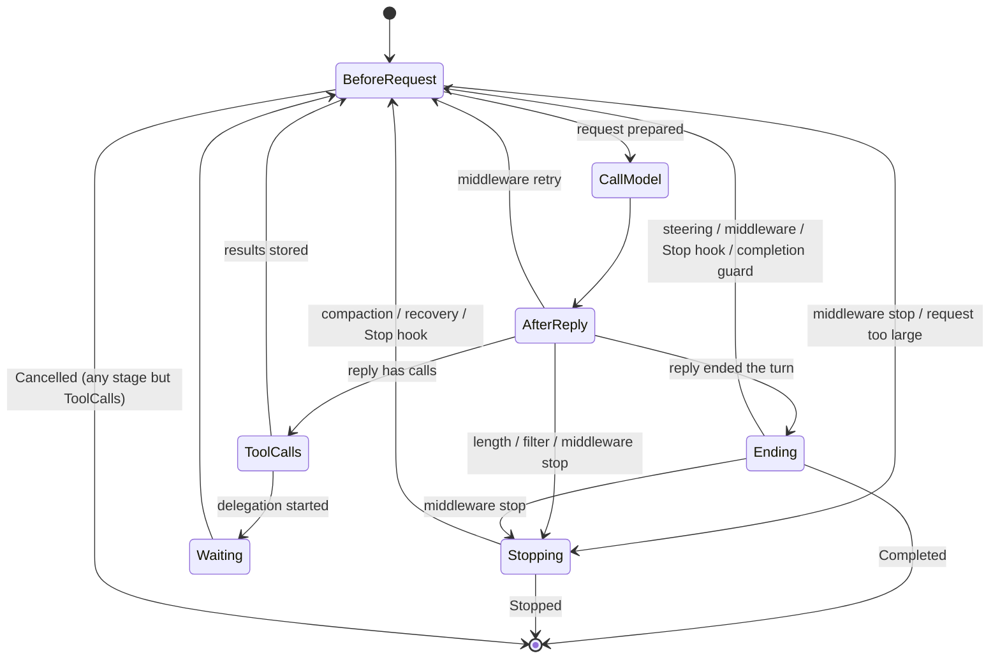

# Agent execution loop

A prompt turn is driven by `run_turn` in `crates/agent-runtime/src/agent/execution/stage.rs`,
started by the session actor (`SessionActor::start_run`) in a task of its own so the actor
stays responsive to cancel and mode changes while a turn runs.

## Stages and steps

The run's model (its provider and the facts about it) is resolved once before `run_turn` is
called (`execution::resolve_model`, `provider_init` retry, see "Run state"); `run_turn` runs the
first middleware hook, then moves a `Stage` until a step returns the run's `CycleOutcome`. A `Stage` is a loop
position that owns the data its step consumes (`stage.rs`): `BeforeRequest`,
`CallModel(request)`, `AfterReply(reply)`, `ToolCalls { calls, results }`, `Waiting(wait)`,
`Ending` and `Stopping(stop)`. `Stage::advance` takes the stage by value and returns a
`Step`, which is `ControlFlow<CycleOutcome, Stage>`: the next stage, or the end of the run
(`Completed`, `Cancelled` or `Stopped`). Cancelled is an outcome and not a stage, so there is
no placeholder value, and cancellation is checked at the top of each iteration except in
`ToolCalls`, which must store one result per pending call first.

`Ending` holds what a finished reply leads to (drain steering, end-of-run middleware, the Stop
hook, the task-completion guard, pruning); `Stopping` holds what a stop leads to (automatic
compaction, stop recovery, the token-limit Stop hook, publication). The step functions are in
`transitions.rs` (`transition_before_llm_call`, `transition_call_llm`, `transition_after_llm`,
`transition_processing_tool_calls`) and `wait.rs`. Every one returns `Result<Step, TurnError>`
(`error.rs`): `TurnError::Provider` carries the provider's error, `Middleware` names the
middleware that failed and keeps its source, `History` carries a failed read or write of the
stored conversation with the store's error as its source, and `Other` wraps anything else. The session
actor classifies a failed run by matching on it (`provider_failure_from_execution_error`).

The labels that events and hooks carry are enums deriving `strum::IntoStaticStr`:
`SteeringBoundary`, `ContextTrigger`, `StopHookKind` and `ExecutionOrigin`.

Source: `crates/agent-runtime/src/agent/execution/stage.rs`, `crates/agent-runtime/src/agent/execution/error.rs`,
`crates/agent-runtime/src/agent/execution/transitions.rs`.

## Run slot

`SessionActor` holds `run: RunSlot` (`Idle` or `Running(ActiveRun)`) and a generation counter that
advances with each run, so a stale `PromptFinished` is ignored. The run's cancellation token is
`ActiveRun::cancellation`; an idle session has nothing to cancel. `SessionActor::start_run` is the
only place that fills the slot, for interactive, queued and scheduled prompts alike: it emits
`RunStarted` with the origin's label, spawns the execution task and one forwarder for the run's
phase. The run's `ExecutionOrigin` (`Interactive` or `Scheduled { .. }`) gives the `RunStarted`
label and decides what the run emits when it ends (an interactive run replies once its last event
is delivered, a scheduled run emits `ScheduledExecutionCompleted` or `ScheduledExecutionFailed`);
its `Completion` carries the reply and the queued input id. The execution runs under
`execute_prompt_guarded`, which turns a panic of the run into its failure (`run panicked: ...`):
everything that ends a run (reply, scheduled terminal events, `PromptFinished`) comes after
the execution returns, so a panic that escaped would leave the slot, the lease and the queued
prompts waiting for a run that is gone. This relies on `panic = "unwind"`. The run reports through a `watch` channel carrying a `RunSignal`
(phase and a revision), so a burst of changes reaches the actor as the latest phase.

Source: `crates/agent-runtime/src/agent/session_actor.rs`, `crates/agent-runtime/src/agent/turn_control.rs`.

## Run state: one owner per lifetime

The state of a run is split by mutability in `crates/agent-runtime/src/agent/execution/turn.rs`:

- `TurnEnv` is everything fixed for the run: session id, run id, the turn-pinned
  `SessionHandle`, the resolved model (`ResolvedModel`: the provider and its profile of
  capabilities, output caps and configured effort), tool configuration, cancellation token,
  steering inbox, cycle accounting and the run's `ToolSet`. It is built once the model is
  resolved, with one struct literal in `execute_prompt_inner` (`session_actor.rs`), so a
  missing field is a compile error and a `TurnEnv` always has a model; step functions take
  it as `&TurnEnv`, including the concurrent tool wave. For a prompt the model is resolved
  after the prompt is stored (a provider failure leaves the prompt in the history, takes no
  pre-turn snapshot and runs no middleware hook), so the steps before that (the
  `UserPromptSubmit` hook, which runs before the model is resolved, repository-knowledge
  orientation, storing the prompt) use the session's handle and locals, not a `TurnEnv`.
  Native `/compact` resolves the model once, without a retry, but a provider that cannot be
  built does not end it yet: the env then holds `ResolvedModel::unavailable`, and
  `compact_history_with` runs the `pre_compaction` hook first. A summary from the hook is
  stored without any provider, and so is a compaction policy that names another working
  provider; only a summary that has to come from the session's own provider fails with the
  provider-initialization error, before `CompactionStart`. What the run offers the model is not part of the
  model: the tools are collected for every request from the live MCP snapshot, so an MCP
  server's `tools/list_changed` takes effect between two requests of one run.
- `Turn` is everything that changes while the run executes: the `RuntimeContext`
  (active task, intent), the run objective, the `History`, the statistics, the queued
  notices, the request overrides, delegations suspended by
  steering, the repository-knowledge delivery budget, budget warnings, the pre-turn
  snapshot (`PreTurnSnapshot`: `None`, `Pending(task)`, `Ready(snapshot)`) and
  `TurnBudgets`, the counters that bound the run (Stop-hook continuations per reason,
  completion-guard and stop-recovery counts, model requests, the last compaction and
  progress-review positions). It has one owner, the loop, and is borrowed `&mut` by the
  steps that change it. It holds no lock, atomic or cell, so a new run starts from
  `Turn::new` and nothing run-scoped is reachable from another session or a later run.
- The model is not run state: it never changes. It is `TurnEnv::model`, resolved by
  `execution::resolve_model` (`stage.rs`) under the `provider_init` retry, cancellable while
  it waits; `Run` holds only the middleware stack and the event receiver. Capabilities are
  read from `env.model.profile` at every place in the run loop, never from the provider.
- `SessionRuntime` keeps only session-scoped caches and grants (session grants, MCP tool
  state, accounting, cache prefix) behind short synchronous locks.

A tool wave shares `&TurnEnv` and `&Turn`: `execute_prepared_tool_call` only reads the
run's `RuntimeContext` store and active task, and writes (progress entries, artifacts,
delegations) go to the session store, not to `Turn`. Anything a wave produces for the run
(`snapshot_part`, `hook_contexts`) comes back in its `ToolResult` and is folded in after
the wave. `Turn` must stay `Sync` for that; `DelegationRecovery` wraps its future in a
`SyncWrapper` for this reason.

Source: `crates/agent-runtime/src/agent/execution/turn.rs`, `crates/agent-runtime/src/agent/session_actor.rs`.

## History: one writer, one projection

The run holds the messages the session store holds (`History` over `Vec<AgentMessage>`,
`turn.rs`). `History::load` reads them once, where the run is set up
(`execute_prompt_inner`); the loop, the native `/compact` and compaction read the run's
history and never the store. `History::commit` is the only way to grow it, the prompt of
the run included: it writes each message to the store and appends it only after the write
succeeded, so a request never carries a message the store does not hold and a failed write
fails the run. Undo/redo snapshot records are the one other write (`store_snapshot_record`):
they are not conversation and a load drops them. Everything the run reads from the history
(the tool baseline in effect, the latest mode reminder, the number of user turns) is looked
up in the messages when asked; nothing is cached in a field beside them. After a compaction
boundary was committed, `History::keep_effective` drops what it closed, as a load would.

`querymt_agent_core::projection::project_request` is the one place a stored history becomes
the messages of a request: a notice is user text, a tool baseline is the request's tool list
and never a message, a tool change after the baseline in effect is a message only for a
provider that takes them, native provider output is replayed only to the target it came
from, and prompt content is cut at the size limit. `projection::tool_baseline` is the one
lookup of the baseline in effect (the projection, `tool_history::offered` and the origin
check all use it). A model request, a compaction request and every token estimate
(`pruning::estimate_history_tokens`, with the provider's `tool_updates`) read the history
through the projection, so what a reload would send is what the run sends. Cache hints are
put on the messages as they are sent (`cache_hints.rs`), after any context hook.

The identity native replay is checked against is `SessionHandle::output_target(&env.model, …)`.
The session store records no protocol or endpoint, so it comes from the provider:
`ChatProvider::output_provenance` is what the provider stamps on its output for the
configuration it was built with (OpenAI in Responses mode, xAI on its Responses path and
Codex state it), read once into `ResolvedModel::provenance`. A reply stamped at another
endpoint is therefore sent in portable form. A provider that states nothing (Extism plugins,
remote and mesh providers, OpenAI in Chat Completions mode) falls back to completing the
identity from the latest stored output of the same provider and model, which is a gate and
not proof of the endpoint configured now; the provider re-checks every output's provenance
against its own configuration where it can.

Skipped results of a batch that steering interrupted are committed before the steering that
skipped them (`commit_steering` with the results as `preceding`), so the stored order is the
sent order. The run does not reload its history when it completes: it already holds what a
load would give it. `TurnStack::stopped` drops what the middleware queued while consulted
when none of them recovers, so the loop and the test rigs share that rule.

Source: `crates/agent-runtime/src/agent/execution/turn.rs`, `crates/agent-core/src/projection.rs`,
`crates/agent-runtime/src/agent/execution/cache_hints.rs`.

## Tool-call lifecycle

Each call is prepared, then executed (`crates/agent-runtime/src/agent/execution/tool_calls.rs`).

1. Preparation rejects invalid outer JSON before any hook or permission check; it never
   degrades to empty arguments.
2. Arguments are normalized to *effective* arguments, pre-tool hooks run, a hook may
   replace the input or block the call, then the arguments are validated against the
   tool schema.
3. Execution emits the start event, optionally snapshots the workspace, checks the
   permission against the session tool configuration, runs the tool, runs post-tool
   hooks on the complete output, and only then truncates the model-visible output.
4. Hook context contributions travel with the `ToolResult` and are stored after all
   result blocks, so call/result adjacency in the provider protocol is preserved.

A result that a hook blocked, suppressed or redacted must never regain information
through later enrichment.

## Parallel waves

All calls of one model response are planned by `plan_waves`
(`crates/agent-runtime/src/agent/execution/wave_plan.rs`), a pure function. Calls in one wave never conflict
on file access and may run concurrently; waves run one after another. A call that is not
`ParallelSafe` is a barrier and runs alone; no call moves across a barrier. Of two
conflicting calls the earlier one in model order lands in the earlier wave.

## Retry

Two retry paths, non-streaming `call_with_retry` and stream recreation, share one
attempt budget, one backoff calculation and one set of events. Both live in
`crates/agent-runtime/src/agent/execution/llm_retry.rs`. Which errors are transient is decided by
`LLMError::is_retryable()` in the `querymt` crate; read it there rather than from this
note.

- **Non-streaming calls** go through `call_with_retry`. The configured `max_retries`
  (read through `max_attempts()`, at least 1) counts the first request, so the default of
  3 means three requests in total.
- **Streaming calls** rebuild the stream on failure (`handle_stream_failure`, a
  `StreamRetryBudget`). A recreation spends both `max_stream_retries` (default 2) and one
  of the shared `max_attempts`. If output was already emitted the retry still happens and
  may repeat visible text (`TODO(stream-retry-safety)`).
- **Delay** (`retry_delay_secs`): the provider's retry hint when present, capped at
  `max_wait_secs` and not jittered; otherwise a base wait times `backoff_multiplier` to the
  power of (retry number minus one), with proportional jitter (`jitter_ratio`), capped at
  `max_wait_secs`. The base is `transport_wait_secs` (default 10) for failures the provider
  never answered (`LLMError::Transport`, `HttpError`, `IoError`: connection failure,
  timeout, broken or undecodable stream) and `default_wait_secs` (default 60) for
  everything else, including `PluginError`, whose cause is unknown. The first retry waits
  the base.
- **Events:** each wait emits `RateLimited` or `LlmRetryWait` (streams also
  `StreamRecovering`) and each resume `RateLimitResume` or `LlmRetryResume`. The wait is
  a `select!` against the cancel token, so cancelling during a delay ends the turn
  without another attempt.

## Compaction

After a turn, `crates/agent-runtime/src/agent/execution/maintenance.rs` runs pruning, and AI compaction when
the context threshold is reached. Automatic compaction is allowed once between two main
model requests; a second attempt without progress fails with an explicit message instead
of looping. Post-compaction hooks may add context for the new window.

The compaction request goes where `[execution.compaction]` `provider` / `model` say, resolved by
`SessionHandle::resolve_compaction_model` (`session/provider.rs`): neither set is the session's own provider;
`model` alone is that model on the session's provider and node; `provider` needs a `model` (refused when the
configuration loads, and by `compaction_target` for a configuration built in code). It is resolved in two steps:
`compaction_target` names the pair (no provider is built; `compact_history` runs it before the hooks so
`pre_compaction` / `post_compaction` carry the compaction `provider` and `model`, and a policy with a `provider`
but no `model` is refused before `CompactionStart`; a policy that names neither is valid and uses the session's
model), then `build_compaction_model` builds the provider and its billing basis, only when no `pre_compaction`
hook supplied the summary. The run's cancellation stops that build (the compaction then ends with a cancelled
`CompactionFailed`), a request in flight and the stream it reads, and a summary that finishes after a cancel is
not stored. The same pair gives the ledger its provider, model and
billing basis, so the request, its accounting attempts and its span name one model. The worktree handoff summary
(`summarize_in_runtime`) resolves it the same way and runs no compaction hooks. It registers with
`LocalAgentHandle::admin_cancels` (`handle/admin_cancel.rs`) for the owner session, because the owner's actor is
unloaded and `session/cancel` finds none: `cancel` stops the step (token plus a `select!` against provider
resolution and against the request) and the handoff ends with `summary_cancelled`.

Related: [sessions.md](../../agent-services/knowledge/sessions.md) for the stored history and the compaction layers,
[tools.md](../../agent-services/knowledge/tools.md) for scheduling inputs, [repository-knowledge.md](../../agent-knowledge/knowledge/repository-knowledge.md)
for card delivery that hooks into this loop.
