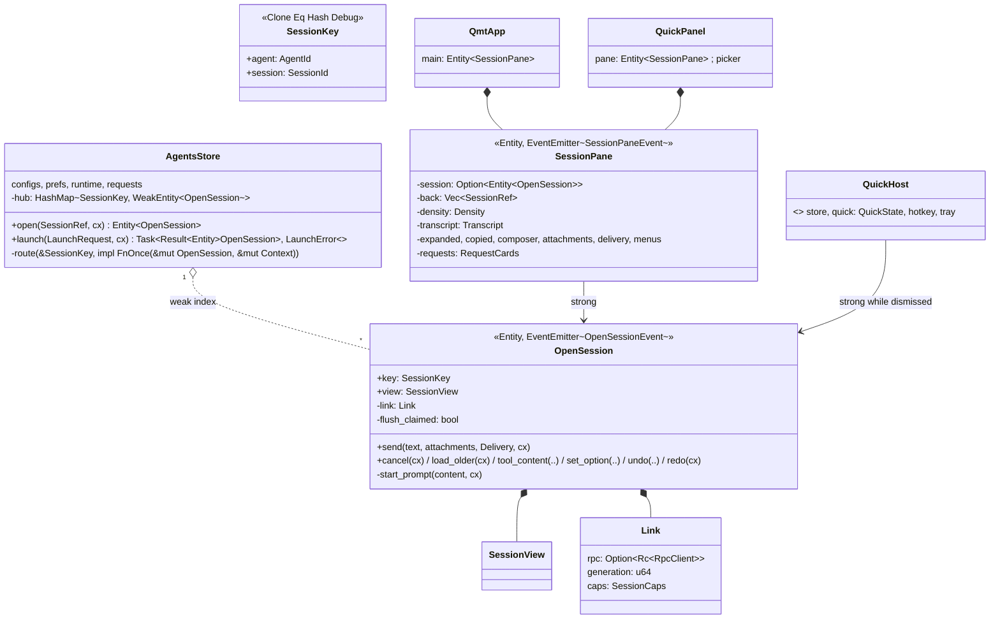
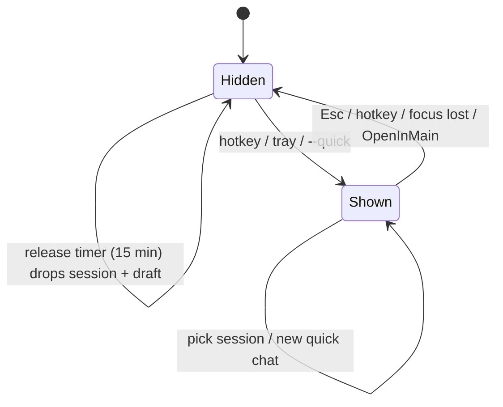
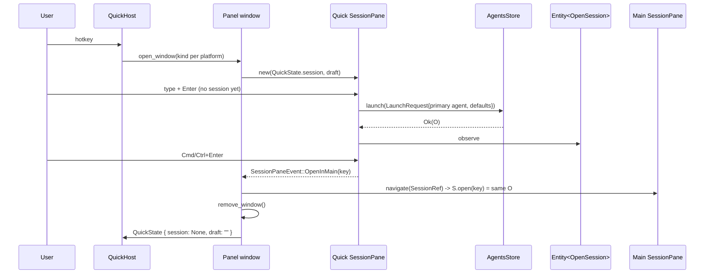
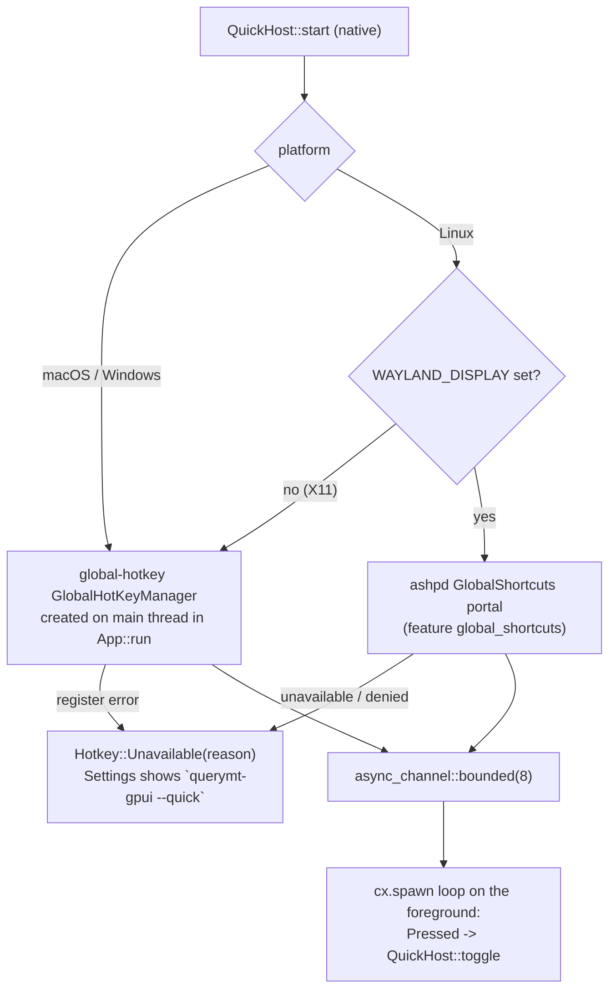
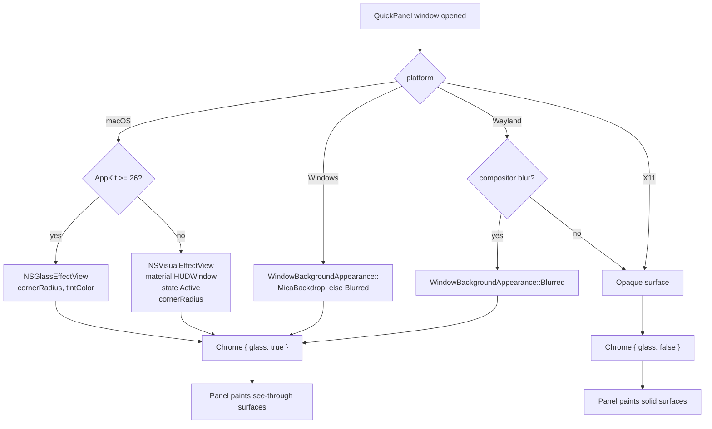

# Design

## Context

- **Prerequisite.** `use-agent-session-core` is archived first. `SessionView` is then a `SessionCore` with a projection and an overlay (`src/session/view.rs`), so one per open session is cheap and self-contained.
- **One slot today.** `AgentsStore.session: Option<SessionView>` (`src/store.rs:1688`) is "the" open session. Roughly 31 places in `store.rs`, 7 in `src/store/{delegates,fork,mcp_notice,worktree}.rs` and about 70 in `src/ui` read it. Five notification branches in `on_incoming` (`store.rs:4397-4470`) and the 8 ms flush (`schedule_session_flush`, `:4554`) filter on it. Every flush calls `cx.notify()` on the whole store, which `QmtApp` observes (`ui/mod.rs:382`).
- **Launch takes over the main window.** `launch` sets `self.session = None` and later `Some(view)` (`:2821`, `:2928`). It keeps one `_launch_task` (a second launch drops, and so cancels, the first) and one `LaunchState { busy, error, … }`.
- **The prompt start is duplicated.** `launch` (`:2918-2944`) and `send_prompt` (`:3642-3661`) both do optimistic prompt → `prompting = true` → `sync_inputs` → `session/prompt` with `_meta.querymt.client_prompt_id` → a spawned `finish_prompt`.
- **Navigation lives in the data model.** `SessionView.parent: Option<Box<ParentSession>>`. `open_child_session`, `open_parent_session` and `reload_session` carry it across by hand (`:3462-3525`).
- **Rendering.** The row renderers in `src/ui/session_view.rs` (about lines 600-3666) are free functions over `&RenderCtx`. They are tied to `QmtApp` only through `RenderCtx.weak: WeakEntity<QmtApp>` (13 `weak.update` callbacks). The chrome, composer and `render_session` (`:3668-5694`) read about 15 `QmtApp` fields. Request cards (`ui/inbox.rs:574`) use the `QmtApp` fields `form_inputs` and `request_collapsed`.
- **GPUI 0.3.12.**
  - Floating windows: `WindowKind::PopUp` is an `NSPanel` (non-activating, all Spaces) on macOS and `WS_EX_TOOLWINDOW | WS_EX_TOPMOST` on Windows. On X11 it is override-redirect, so the window manager doesn't give it focus. On Wayland it is a plain toplevel; `WindowKind::LayerShell(LayerShellOptions)` with `KeyboardInteractivity` exists for that case.
  - Quit and windows: `App::set_quit_mode` is runtime-settable. `on_window_closed`, `Window::display`, `activate_window` and `remove_window` exist.
  - Displays: there is no pointer-position or display-under-pointer API.
- **Build constraints.** One binary crate whose tests live in the bin target. The web build (`wasm32`) shares `main.rs::run`. There is no `anyhow`/`thiserror` dependency; errors are `String`s.

## Goals / Non-Goals

**Goals:**
- Any number of independent open sessions, each one an entity whose lifetime is owned by the surfaces that hold it.
- One session pane implementation for the main window and the panel, with no copied rendering code.
- Remove the duplicated prompt path, the repeated `filter(agent && session)` lookups and the navigation state inside `SessionView`.
- The quick panel on macOS, Windows, X11 and Wayland, with a working fallback wherever a global shortcut or floating window isn't available.

**Non-Goals:**
- Converting every `agent_id: &str` in the store to a newtype. Newtypes are introduced at the open-session boundary only.
- Turning `PendingInput.state` and `SessionView.phase` into enums. The core and projection own those strings; they are left for a later change.
- Closing or unsubscribing sessions on the agent. The ACP surface used here has no such method (see Risks).
- Several quick panels, quick panel tabs, a separate quick-chat history.

## Decisions

### D1. One entity per open session, indexed weakly by the store



- `AgentsStore.session` is removed. `open(SessionRef)` returns the existing entity when `hub[key]` upgrades, or else creates one, inserts a `WeakEntity` and starts `session/load`. Dead entries are pruned when a lookup fails to upgrade and on each `session/list` refresh.
- The session closes when the last strong handle drops. GPUI frees the entity and the next routed input finds a dead weak handle. No reference counting by hand (`own-rc-single-thread`).
- The flush timer and `cx.notify()` move into `OpenSession`. A streamed chunk re-renders only the panes that observe that session. The store still notifies for list-level changes (phase, titles).
- *Alternative: slots in the store* (`views: HashMap<SessionKey, SessionView>`, `main`, `quick`). Rejected for three reasons: the store would encode window layout, releasing a slot would be manual, and every chunk would still notify every store observer.

### D2. Calls go one way: store → session; session → store by event

GPUI panics when an entity is updated while it is already being updated. The rule:
- The store may call into an `OpenSession` (routing, reconnect).
- An `OpenSession` never reads or updates `AgentsStore` inside its own update. It holds what it needs in `Link`: the `Rc<RpcClient>`, the connection generation, and `SessionCaps` (can control the run, tool content, undo, history window), copied from the runtime when it opens.
- Anything the store must do afterwards goes out as an `OpenSessionEvent`. GPUI delivers events after the emitting update ends. The events are `TurnFinished { error: Option<String> }` (log it and refresh the session list), `Loaded` (delegate routes and the MCP notice, both keyed per session on the runtime already), and `ListChanged`.
- On reconnect or disconnect the store calls `rebind(link)` on every live session of that agent. Today `store.rs:2704` does this only for the open one.

```mermaid
sequenceDiagram
    participant A as Agent
    participant S as AgentsStore
    participant O as Entity<OpenSession>
    participant P1 as Main SessionPane
    participant P2 as Quick SessionPane

    A->>S: session/update {sessionId}
    S->>S: key = SessionKey::from_update(agent, params)  (let-else)
    S->>S: hub.get(&key).and_then(WeakEntity::upgrade)
    alt alive
        S->>O: update: view.queue_session_update; claim flush
        Note over O: 8 ms timer owned by O
        O->>O: view.flush()
        O-->>P1: notify (observer)
        O-->>P2: notify (observer)
    else dead or absent
        S->>S: hub.remove(&key) (if dead)
    end
    S->>S: schedule_sessions_refresh (list phase, unchanged)
```

### D3. `SessionKey` and newtypes at the boundary

`AgentId(String)` and `SessionId(String)` (`#[derive(Clone, Debug, PartialEq, Eq, Hash)]`, `as_str()`, `Display`) and `SessionKey { agent, session }`. `SessionRef { key, cwd, title }` is what a surface asks to open and what the back stack stores. The hub, `OpenSession`, panes and events use them. The rest of the store keeps `&str` and converts at those calls (`type-newtype-ids`, `anti-stringly-typed`, scoped per Non-Goals). Constructors that read wire JSON return `Option` (`api-parse-dont-validate`). The about 12 `.as_mut().filter(|v| v.agent_id == … && v.session_id == …)` chains become `hub` lookups with `let … else` (`pat-let-else`).

### D4. One prompt path

`OpenSession::start_prompt(content, cx)` does the optimistic prompt, `prompting`, `sync_inputs`, sends `session/prompt` with `client_prompt_id`, and spawns the completion through a `WeakEntity<OpenSession>`. That completion is today's `finish_prompt`, minus the store work, which goes out as `TurnFinished`. `send` calls it for an idle session and `launch` calls it for the first prompt. `Delivery { Prompt, Steer, Queue }` replaces the `&'static str` in `QmtApp.delivery` (`ui/mod.rs:306`) and in `send_prompt`. It maps to the wire method in one exhaustive `match` (`type-enum-states`, `pat-exhaustive-enum`).

### D5. Launch returns the session; the caller owns the progress

```mermaid
sequenceDiagram
    participant C as Caller (start page / quick panel)
    participant S as AgentsStore
    participant R as RpcClient
    participant O as Entity<OpenSession>

    C->>S: launch(LaunchRequest{agent, cwd, prompt, attachments, placement})
    S-->>C: Task<Result<Entity<OpenSession>, LaunchError>> (#[must_use])
    S->>R: session/new | _querymt/remote/createSession, config options
    S->>O: cx.new(OpenSession::launched(..)); hub.insert(key, weak)
    S->>O: start_prompt(first prompt)
    S-->>C: Ok(entity)
    C->>C: pane.show(entity) and clear its own busy/error
```

- `LaunchState` is split. The placement choices (`target`, `worktree`, `remote_profile`) stay in the store as start-page preferences and are copied into `LaunchRequest`. Progress (`busy`, `error`, `creating_on`, `last_started`) moves to the caller, which holds the `Task`. `_launch_task` is removed, so two launches no longer cancel each other.
- `LaunchError` is a small enum with `Display`: `NotConnected`, `Create(String)`, `PeerProfileGone`. It is hand-written because the crate has no `thiserror` (`err-custom-type`).
- The quick panel launches with `placement: Placement::Local` and the primary agent, so the start page's peer and worktree choice doesn't leak into quick chats.

### D6. `SessionPane`: one pane, two densities

- The pane takes `QmtApp`'s session fields: `transcript`, `expanded_items`, `copied`, `session_prompt`, `session_attachments`, `session_attach_error`, `delivery`, `session_details_open`, `session_menu_open`, `session_options_open`, `plan_open`, `waiting_open`, `usage_hovered`, `usage_pinned`, `smooth_scroll` and the turn diff state. Its methods are `chrome`, `composer`, `options_panel` and `render`.
- The free row renderers stay where they are. `RenderCtx.weak` becomes `WeakEntity<SessionPane>` and `RenderCtx` gains `density: Density`. Compact density changes defaults and limits (tool and reasoning rows collapsed, lower `OUTPUT_LINES`/`READ_LINES`/`DIFF_LINES`, narrower column, actions on hover, no usage ring or details panel). It does not add separate row code. No trait or generic over the host (`anti-over-abstraction`).
- `Density::composer_lines` is `(2, 6)` for Compact: two lines at rest, growing to six. The model chip is part of the compact composer (D12); the options panel still is not.
- What belongs to the app leaves as `SessionPaneEvent { OpenChild(SessionRef), Fork(..), OpenImage(..), OpenInMain(SessionKey), Back }`. `QmtApp` and `QuickPanel` each handle it (`api-common-traits`: `Debug`, `Clone`).
- **Back stack.** `back: Vec<SessionRef>` replaces `SessionView.parent`. `navigate` pushes and `back` pops (`mem::take` when swapping). Reload reopens the same key and doesn't touch the stack.
- **Request cards.** `form_inputs` and `request_collapsed` move into a `RequestCards` value, so the Inbox page and each pane own their own. The card renderer takes it plus a filter (all requests for the Inbox, one `SessionKey` for a pane).

### D7. Quick panel window and state



- `QuickHost` (a GPUI `Global`, native only) owns `Entity<AgentsStore>`, so the store outlives the main window. It also owns the hotkey and tray handles and `QuickState { session: Option<Entity<OpenSession>>, draft: String, hidden_at: Option<Instant> }`.
- Each time the panel is shown, a new window and a new `SessionPane` are created from `QuickState`. On close, the draft and the session handle are written back. Text inputs are created per window (`InputState::new(window, …)`), so the pane isn't reused across windows. The strong handle in `QuickState` keeps the session open while the panel is hidden. A 15-minute timer clears it (see the `open-sessions` lifetime requirement).
- **Window kind per platform.**

  | Platform | Kind | Notes |
  |---|---|---|
  | macOS | `PopUp` | |
  | Windows | `PopUp` | |
  | X11 | `Floating` | not `PopUp`: override-redirect windows don't get keyboard focus from the window manager; confirmed by spike task 6.1 |
  | Wayland | `LayerShell` | layer `Overlay`, `KeyboardInteractivity::Exclusive`, when the compositor has wlr-layer-shell |
  | Wayland (GNOME) | `Normal` | |

  `titlebar: None`, `Transparent` background, not resizable by the user (the panel resizes itself, D13). Width 680. A new quick chat opens as a 64 px bar and a conversation at 260; both grow (D13, D15).
- `WindowBackgroundAppearance` stays `Transparent` on macOS, so GPUI does not add its own blur view next to the one `chrome` installs (D11). On Windows and Linux `chrome` picks the appearance.
- Position: `Bounds::centered(main_window.display(cx).map(|d| d.id()), …)`, else the primary display.
- Dismissal: `observe_window_activation`, then `remove_window` when the window becomes inactive. Esc is handled with `capture_key_down` so the composer can't swallow it.
- **Open in main.** If the main window isn't open, create it with `ui::open_main_window(store, cx)`, which is extracted from `main.rs`. Then call `main.pane.navigate(SessionRef)`; the same entity comes from the hub, so there is no reload. Then activate the window and remove the panel.



### D8. Global shortcut backends



- `enum Hotkey { Native(GlobalHotKeyManager, HotKey), Portal(Task<()>), Unavailable(String) }`. It is an enum, not a trait object, because there are three closed cases (`anti-type-erasure`).
- Events are pushed from the crate's event handler, or from the portal task on the background executor, into a bounded channel (`async-bounded-channel`). A foreground loop awaits it, so there's no polling. Only `Pressed` acts.
- Changing the shortcut registers the new one first and unregisters the old one only on success, so a taken shortcut leaves the previous one working.
- Default bindings come from the spec. They are stored as a string in `Prefs.quick` (`#[serde(default)]`, `serde-default-compat`), parsed with `HotKey::from_str` at the boundary, and recorded from GPUI keystrokes through one mapping function with unit tests for each modifier and key.

### D9. Single instance, `--quick` and background mode

- The first instance listens on a local socket named per user (the `interprocess` crate's local sockets: a Unix socket in the runtime dir on Unix, a named pipe on Windows). A later instance connects, sends `quick` (with `--quick`) or `show`, and exits. A failed connect means no instance is running, so this one starts. With `--quick` it starts with only the panel shown. Accepting connections runs on the background executor and forwards over the same channel as the hotkey.
- **Panel enabled:**
  - `cx.set_quit_mode(QuitMode::Explicit)`.
  - A tray icon with Open QueryMT, Quick panel and Quit. It uses `tray-icon` with `default-features = false, features = ["ksni"]`, so Linux needs no GTK3 or libappindicator; it is created on the main thread inside `App::run`.
  - `Quit` calls `cx.quit()`.
- **Panel disabled:** `QuitMode::Default`, no tray, no socket listener (so `--quick` starts a normal instance).
- Everything in this decision is `#[cfg(not(target_family = "wasm"))]` in `src/quick/`. `main.rs::run` calls `quick::start(store, cx)` on native only.

### D10. Module layout and visibility

- `src/session/open.rs`: `SessionKey`, `SessionRef`, `OpenSession`, `Link`, `OpenSessionEvent`.
- `src/ui/session/`: `pane.rs`, `rows.rs` (today's free renderers), `composer.rs`.
- `src/quick/`: `mod.rs` (`QuickHost`), `panel.rs`, `hotkey.rs`, `tray.rs`, `instance.rs`.
- New APIs are `pub(crate)` (`proj-pub-crate-internal`), with doc comments on the public items (`doc-all-public`). Methods returning an `Entity` or a `Task` are `#[must_use]` (`api-must-use`). Ignored `this.update` results on a dropped entity log at `debug` with structured fields (`obs-structured-fields`) instead of `let _ =`.

### D11. Panel chrome: the platform's own material, always dark



- `src/quick/chrome/` with `mod.rs` (the `Chrome` value and the platform call), `macos.rs`, `windows.rs`, `linux.rs`, all `#[cfg(not(target_family = "wasm"))]`. `Chrome { glass: bool, radius: Pixels }` is the only thing the panel's render code reads: with `glass`, surfaces use `p.bg.opacity(..)` and a light hairline border; without it, today's opaque `p.bg`, `p.surface` and `p.card`.
- **macOS, written against `objc2-app-kit` directly.** `Window` implements `HasWindowHandle`, and the handle is GPUI's drawing view (`gpui-pre-macos/src/window.rs:2465`). The material view must not be a subview of it (it would cover GPUI's content): it goes into the window's `contentView`, added `NSWindowOrderingMode::Below` GPUI's view, which is what GPUI's own `Blurred` path does (`window.rs:1908-1917`).
  - `NSVisualEffectView` with `material: HUDWindow`, `blendingMode: BehindWindow`, `cornerRadius: 14`, autoresizing in both axes, and **`state: Active`**. The default, `FollowsWindowActiveState`, would grey the material permanently, because a non-activating `NSPanel` never becomes the active window.
  - `appearance` is set to dark aqua once, whatever the app theme or the desktop. The panel is a HUD (D15), so it does not follow the theme and the `observe_global::<Palette>` hook goes away.
  - **Nothing of ours covers it.** The panel makes this material dark itself, so the root paints no tint over it (`hud::DARK_MATERIAL_TINT` is 0), or the glass would not show. Liquid Glass draws its own edge, so the panel paints no hairline over it; the visual-effect view has none and keeps the hairline. `Chrome` carries both (`tint`, `rimmed`). Liquid Glass's Regular style is clear enough that text behind the panel can be read through it (seen once the window's root stopped covering it, below), so it gets a dark `tintColor`, its strength settled by eye (task 7.19); the visual-effect `HUDWindow` material is dense enough as it is.
  - **The window's root is transparent.** `gpui_kit::open_window` wraps the view in `gpui_base::Root`, and gpui-component's root plugin paints that surface with the app theme's opaque background (`gpui-component-0.9.1/src/root.rs:725`). In the panel that covered the material on every desktop, Mica and compositor blur included, until the spike of task 7.14 found it. The panel opens its window with its own `Root` given a transparent background, which is applied after the plugin's style; a test guards it.
  - macOS 26 and later (`NSAppKitVersionNumber >= 2685`): `NSGlassEffectView` with `cornerRadius` and an optional `tintColor` instead. One runtime check, one fallback.
  - `invalidateShadow` after every resize (D13), or the window shadow keeps the old outline.
- **Why not `window-vibrancy`.** It is a good reference for the AppKit calls, but its entry points attach the effect to the view behind the window handle, which for GPUI is the drawing view, so the effect would cover the UI. Working around that means handing it a fake handle, which is more code than calling AppKit directly. `objc2`, `objc2-app-kit`, `objc2-foundation` and `raw-window-handle` are already in the lock file through GPUI, so using them adds no new builds, and they are needed anyway for D13 and the window shadow.
- **Windows and Linux** cannot force the backdrop dark: the system picks it. So on these two the panel's root carries a dark tint (`hud::TINT`, 58 % black) that keeps text legible over a light backdrop, and a desktop with no material gets a near-opaque `#14161a`. They need no new crate: `window.set_background_appearance(..)` covers Mica, Mica Alt and blur. Windows picks Mica from build 22621 and blur before it. GPUI 0.3.12 has no query for whether a compositor blurs, so Linux cannot probe `Blurred`: it reports `glass: true` only on Wayland KDE (read from `XDG_CURRENT_DESKTOP`), and X11, GNOME and other desktops get `glass: false`.
- *Alternative: GPUI's `WindowBackgroundAppearance::Blurred` on macOS too.* Rejected: its blur view is a full-window rectangle with no corner radius (blurred square corners outside the rounded card), no material choice, and no way to set the state or the appearance.

### D15. The panel's own look

The panel is a HUD (Spotlight, Raycast), not a small main window.

- **One fixed palette.** `hud_palette()` in `src/quick/hud.rs` returns a `Palette` with `dark: true` and its own tokens. The accent is the user's accent, lightened to read on dark glass. `Chrome::surfaces` tints from it instead of from the theme.
- **It reaches the transcript.** The transcript takes its colours from the global `Palette`, read once per frame (`session_view.rs:5348`, `session_pane.rs:592`) and passed down. `SessionPane` gets an optional palette that replaces the global one there; `md.rs` (5 reads) and `turn_diff.rs:152` take the palette as an argument instead of reading the global. Popovers and tooltips outside the pane stay on the global.
- **Shape.** Corner radius 20. No rule under the header, which becomes a small dim title row. The composer is a floating pill with a 1 px highlight along its top edge instead of a border, and no shadow over a material.
- **A new quick chat is one bar**, like Raycast's: the input at 18 px straight on the panel's surface, then the agent and folder, the model as a chip that opens the model picker, and a button for the session picker. No header and no box around the input. The header, with new chat, the session picker and "open in main window", appears with a conversation; its buttons are drawn in the panel's colours. The input rests at one line in the bar and at two in a conversation (`SessionPane::set_composer_bar`).
- **See-through tokens over a material.** `hud_palette(user, glass)`: wells (`bg`: code blocks, tool cards) are 24 % black, raised bits (`card`, `border`) a little white, so the material shows through them instead of being covered by slabs. `surface` stays 86 % opaque, because popovers over the conversation are painted with it. Without a material every token is opaque. In the pane, the fades and halos that blend into a page colour are left out over a material.
- **Transcript.** Assistant text sits directly on the glass, without a card. Your messages are a right-aligned pill tinted with the accent. Tool calls are one-line chips of low contrast (about 8 % white), not bordered cards. These are `Density::Compact` styling, so the main window is untouched.
- **Type.** The system UI font at 14 to 15 px for the conversation; monospace only for tool output and code.
- **Accent use.** Only for the edge light, the focus ring and your messages.
- *Alternative: follow the app theme with a lighter palette.* Rejected: it would look like the main window half of the time, which is what this change is meant to stop.

### D12. One model picker, two windows

- The picker's state and rendering live in `QmtApp` today (`ui/start.rs:566-684`, `:1377-1730`, plus `delegates.rs`). They move into a `ModelPicker` entity (`src/ui/model_picker.rs`) holding the query input and the open flag, rendering the search, the sections and the reasoning footer, and emitting `ModelPicked { key }`.
- Its target is an enum: `Target::Session(Entity<OpenSession>)` sets the session's `model` option; `Target::Launch { agent }` reports the choice to the caller instead of writing a preference. The start page keeps writing `prefs.launch_models` on `ModelPicked`; the quick panel keeps the key in its own `QuickState.model: Option<String>` and puts it in `LaunchRequest.model`, so a model picked in the panel does not change what the start page starts new sessions with (spec: *Change the model from the panel*).
- `LaunchRequest` gains `model: Option<String>`, applied as a config option at session creation the way the launch default is today. `None` keeps today's behaviour.
- In the panel the picker opens from the model chip in the compact composer and from the `agent · model · folder` line of an empty quick chat (both become buttons), and from Cmd/Ctrl+M, as in the main window (`ui/keys.rs:60`). It renders inside the panel like the session picker, so it is not a second window.
- `SessionPaneEvent::ModelPicker` is then handled by the panel itself instead of falling through to "open in the main window" (`quick/panel.rs:234`).

### D13. The window grows with the conversation

```
  new quick chat        first replies           past the cap
  +--------------+      +--------------+        +--------------+
  | header       |      | header       |        | header       |
  | composer     |      | turn 1       |        | ... scrolls  |
  +--------------+      | composer     |        | composer     |
   680 x 260 (bar: 64)  +--------------+        +--------------+
                         grows upward,           stops at
                         bottom edge fixed       min(760, 70% of display)
```

- **A new quick chat is its bar** (D15): 64 px, one line of text. It grows with the lines typed and with an error shown above it (the bar's laid-out height is the floor), and returns to 64. The window is placed where a centred 260 px panel has its bottom edge, so the bar leaves the conversation room to grow upward. Showing a conversation raises the panel to 260 at once, before it is laid out.
- The pane reports its content height; the panel asks for `clamp(content + chrome, 260, min(760, 0.7 * display height))`, in steps of 8 px to avoid a resize on every streamed chunk, and never smaller while a conversation is shown. `new_chat` and the release timer reset it to 260.
- Overlays set a floor: while the session picker or the model picker is open, the requested height is at least what the overlay needs, so it is never clipped (spec: *Picker in a small panel*).
- **macOS**: `setFrame:display:animate:` through `objc2-app-kit`, with the origin recomputed so the **bottom edge stays fixed** and the composer does not move under the cursor, followed by `invalidateShadow`.
- **Windows and X11**: `Window::resize(size)`. GPUI has no reposition API in 0.3.12, so the top-left stays fixed and the panel grows downward. Accepted divergence (D11's stance: the panel is native per desktop, not identical).
- **Wayland**: the compositor places the panel; with `LayerShell` the panel is centred by the compositor and the resize is applied where it sits.
- GPUI applies a macOS resize one frame later, so the growth is driven from the pane's measured height after layout, never during paint, and is rate-limited to one resize per frame.

### D16. Keyboard and the panel's own choices

- `Picks { model, cwd, reasoning }` replaces the lone model the panel kept: all three are the panel's own and survive a close like the model did. `LaunchRequest` gained `reasoning: Option<String>`; `None` is the launch default. A launch still remembers its folder as the last used one, for any surface.
- The folder is chosen in an overlay that reuses `WorkspaceField` (arrows, Enter, Tab, completion), which now emits `Picked`; Enter on a typed path confirms it. The agent is named in the bar only when several are configured, to leave the input its width; the folder chip's tooltip names it always.
- `ModelPicker` has a keyboard cursor over the pickable rows (headers and "N more" rows are skipped, the list scrolls to it); it rests on the chosen model, or the first while searching. Enter picks the cursor row, no longer always the first.
- Cmd/Ctrl+1…8 reuse the app's `OpenSidebarSession` action: with the session list open they show that row; closed they do nothing in the panel.
- The compact composer rests at one line (it grew from two) so the placeholder and the buttons share a centre line; the empty bar's height is no longer rounded to steps, which left a gap above it.

### D14. Motion: opening, and a light along the edge while the agent works

- **Opening.** 280 ms, shaped by two curves of our own over a linear `with_animation` (`open_opacity`, `open_scale` in `quick/panel.rs`). Opacity eases in and out (smoothstep) and is full after 64 % of the time, about 180 ms. Scale starts at 0.94 and gathers speed into the full size, which it reaches at the same moment; the remaining 100 ms are a **bump**: it springs back by 1.4 % and settles slowly. The scale never passes 1, because the window is the panel's final size and would clip an overshoot. GPUI has no transform for a `div`, so the scale is an inset of the absolutely placed root. On macOS the material is a view of ours that GPUI's animation does not reach, so each frame a `canvas` in the root hands the same values to AppKit (`chrome::open_step`): the window's `alphaValue`, which fades material, content and shadow as one (the root then does not fade on its own), and the material view's frame, scaled around its centre; `invalidateShadow` at the end. The window starts at alpha 0 so the material does not show ahead of the animation. `cx.reduce_motion()` is respected for free, since GPUI renders a single final frame then (`gpui-pre/src/elements/animation.rs:301`), and the window is not made invisible first. The window itself is shown at its final bounds, and the composer is focused before the first frame, so typing during the animation is not lost. **Dismissal is not animated**: the window is removed at once.
- **Working indication: a light along the edge, the same on every desktop.** A 1.5 pt line on the panel's rounded edge with a soft glow inward of at most 14 pt at 12 % or less, so it stays in the 20 px either side of the 640 px transcript column and never runs under text. Only the renderer differs per desktop (below).

  | Activity (below) | What the edge shows |
  |---|---|
  | Running | a highlight with a fading tail travels round the edge; a lap takes 2.4 s for a slow stream, down to 1.2 s for a fast one |
  | a tool call starts or ends (a spark) | the highlight flares once, 250 ms |
  | Waiting | the highlight stops; the whole edge breathes slowly (2.4 s) in the `warn` colour |
  | Error | one soft pulse in `danger`, 0.6 s, then off; no flicker |
  | Done | the highlight finishes its lap, the whole edge lights once and fades, 0.7 s |
  | Idle | nothing, and no frames |

  Changes cross-fade over 200 ms. A run shorter than 150 ms shows nothing (the light waits that long before it appears), and a run shorter than 1 s ends with a fade, without the finishing lap. Colours come from the HUD palette (D15): the accent, `warn` and `danger`. Every number here is a constant in `EdgeMotion`, to tune by eye.
  - *Rejected: the plasma band of the first plan.* A 24 px band of flowing noise runs under the text at the panel's sides (the column leaves 20 px), noise behind text costs legibility, and a red flicker reads as a glitch. The flat test band of the spike (task 7.14) confirmed that a band that wide looks heavy.
  - **Activity: what the edge follows.** The panel derives one `Activity` value from the session it shows, each time that session or its requests change (pure logic in `src/quick/activity.rs`, built on every platform so its tests run everywhere):

    | What the session shows | Phase |
    |---|---|
    | phase `starting`, `model` or `tools`, or a prompt in flight | Running |
    | a tool call starts or ends | Running, plus a spark |
    | phase `waiting`, or a pending request for this session | Waiting |
    | a run ends and the session has an error it did not have before | Error |
    | a run ends without one | Done |
    | idle, no session shown, or another session was just shown | Idle |

    The session has no "done" or "error" phase (`session/projection.rs:829` maps the run state to `idle`, `starting`, `model`, `tools`, `waiting`), so Done and Error are transitions: they are only raised by a run that ends while its session is shown. Showing another session, or a new quick chat, takes that session's state as it is, with no finishing lap and no pulse for an error it already had. The bar of a new quick chat (D15) shows no session, so the edge is off there; a quick chat being created keeps the bar's spinner.
  - **Stream rate.** The client is not told tokens per second. The rate is an estimate: characters appended per second to the reply and the reasoning being streamed, smoothed over about half a second and scaled so that a fast stream is 1. It only sets the lap time.
  - **Speed changes keep the position.** The lap time follows the rate in steps, at most four times a second. The position is anchored, `position(t) = anchor + (t - anchor_t) / lap`, and a new lap time re-anchors at the current position, so the highlight never jumps. A renderer that multiplied time by speed would make it jump at every change.
- **One model, renderers behind a trait.** `src/quick/edge.rs`, pure and built on every platform:
  - `EdgeMotion`: every constant above, in one place.
  - `Edge`: turns `Activity`, the rate and the clock into an `EdgeState` (what is shown, since when, the anchor and the lap time, the colour role, and whether motion is allowed), and says when a flare, a pulse or a finish is over, which then settles the `Tracker` (7.13). It replaces `activity::link`, whose display-link table no renderer needs any more.
  - `frame_at(&EdgeState, t) -> EdgeFrame`: the head's position along the perimeter (0 to 1), the tail's length, the strength of the line and of the glow, and the colour role at time `t`. This is the definition of the motion; its tests are the motion's tests.
  - `trait EdgeLight`: `show(&EdgeState, &EdgeColours) -> Result<(), EdgeError>` (a state that shows nothing hides it) and `resize(width, height) -> Result<(), EdgeError>`. A renderer that draws outside GPUI implements it. The panel holds `Option<Box<dyn EdgeLight>>`: when it is `None`, or a call fails (the panel then drops it for the rest of the panel's life), the panel draws the ring below. Tests put fakes in its place: one that fails, to check the switch, and one that works, to check that the ring is not drawn as well.
- **macOS: Core Animation (`CoreAnimationRim`, `src/quick/chrome/rim.rs`).** A view of our own hosting plain layers, between the material (D11) and GPUI's view: the position the spike proved on both materials (task 7.14). `show` turns the state into layer animations whose timing is `frame_at`'s (the same anchor, lap and durations, with `beginTime` taken from `CACurrentMediaTime`), and the system compositor runs them. There is no frame callback and no work on our main thread between changes, so a busy main thread (renders of 16 to 25 ms were logged in a debug build) does not stall the light. The conversion from state to animation parameters is a pure function, tested against `frame_at` at sample times so the two cannot drift.
  - Layers: the edge's path is a rounded rectangle at the panel's corner radius, inset by half the line width. The highlight is a `CAShapeLayer` stroking that path traced twice, so `strokeStart`/`strokeEnd` can run across the start, with a round cap; the tail is two shorter, fainter segments behind it; the glow is the highlight's shadow (`shadowRadius`, no offset) clipped by a mask of the panel's shape, so it falls inward only. Breath, pulse, flare and finish animate `opacity`, `lineWidth` and `shadowOpacity`.
  - Resizing: `resize` rebuilds the paths inside a `CATransaction` with actions disabled, so Core Animation does not animate the change by itself. It is called where the spike drew: in `chrome::open_step`, which scales the view with the material, and after the deferred resize of D13.
  - Reduced motion and Low Power Mode (`NSProcessInfo.isLowPowerModeEnabled`, read at each change of state): Running and Waiting show a still, lit edge with no animation; Error and Done go straight off.
  - Where it runs: over the material the panel installs (`Chrome::dark_material`), on every macOS version the panel supports. Without the material the panel's root is opaque and would cover it, so the ring is drawn.
- **Windows, Linux and the fallback: the ring, drawn by GPUI from `frame_at`.** A non-interactive `canvas` inside the panel's rounded root strokes the same line and the travelling highlight as a path along the rounded rectangle (`PathBuilder::stroke`, `Window::paint_path`), with the same constants. It replaces the pulsing ring of task 7.5. It requests frames only while the edge is not Idle, and draws one still frame under reduced motion. It runs on the main thread, so a long layout can stall it there. Its cost is path work on the main thread at every frame while the light moves: on a 680 × 260 panel the outline is about 700 points, and up to ten strokes are triangulated per frame, rebuilt each time; task 7.21 builds the points once per size and measures what is left. It must draw below the pickers and overlays: as the root's last child (`panel.rs:1434`) it now draws over the model picker where that reaches the edge (task 7.21).
- **Later, if wanted: Metal.** A procedural effect (noise, a glow that follows the text) would be a `MetalRim` implementing `EdgeLight`: the same place, the same `frame_at`, and a display link on a thread of its own so the main thread cannot stall it. The spike (task 7.14) settled what was unknown: a `CAMetalLayer` composites there on Liquid Glass and on the visual-effect material, and a shader compiled at runtime takes about 0.4 ms. It is not built now, and its code is removed with the spike.
- **Dependencies.** `objc2-quartz-core` (layers, shape layers, animations, transactions) and `objc2-core-graphics` (paths, colours) 0.3.2 are direct macOS dependencies, the versions GPUI builds, so `Cargo.lock` only gains edges. `objc2-metal`, added for the spike, is removed with it.
- **What it cannot do.** Nothing of ours can see or blur the desktop behind the window: that stays the material's job (D11).
- **Why not off the main thread inside GPUI (checked November 2026).** GPUI builds, paints and presents every frame on the main thread, on every platform; nothing in it draws elsewhere. What exists:
  - *Custom shaders: none.* Zed #42905 (custom fragment shaders) was closed unmerged in December 2025 for want of a Zed use case; its continuation in the community fork, gpui-ce#4, was closed unmerged in March 2026; Zed issue #43273 stays open.
  - *`TimedTransformation`* (Zed #66896, merged 13 November 2026): GPUI advances an SVG sprite's scale, translation, rotation and alpha just before presenting a frame, without re-rendering the view (37 to 73 times fewer main-thread instructions per animated frame in its benchmark). It still runs on the main thread and only for SVG sprites, so it could carry the breath and the pulse but not a highlight travelling along the edge. It is not in the GPUI this app builds (`gpui-pre` 0.3.12, a snapshot of `zed@d2a4fb6`) until gpui-kit moves to a newer snapshot.
  - *GPUI Fast* (longbridge's fork; gpui-kit 0.9.1 has an opt-in `gpui-fast` feature): retained mode cuts main-thread time per frame (in its benchmark a spinner goes from 5.91 ms to 0.73 ms), still on the main thread; and window composition (a port of Zed #62379, closed upstream) that puts native surfaces between GPUI's layers on every desktop: AppKit views, DirectComposition visuals on Windows, Wayland subsurfaces, X11 child windows.
  So on macOS the light leaves GPUI for Core Animation (task 7.20); on Windows and Linux the ring stays in GPUI and is made cheap (task 7.21), and a renderer of its own there is a spike (task 7.22).
- **Windows and Linux, later: a renderer outside GPUI.** The same `EdgeLight` and `frame_at`, in a surface of our own that the system composites. On Windows a DirectComposition visual whose animations the composition engine runs, as Core Animation does on macOS; GPUI already presents through DirectComposition (a target for the window with `topmost = false`, `gpui-pre-windows-0.3.12/src/directx_renderer.rs:1017`). On Wayland a subsurface above GPUI's surface, drawn from a thread of our own; GPUI's Linux backend has no subsurfaces. X11 keeps the ring. Whether either can be placed and kept in step with GPUI's window is unknown: task 7.22 decides, as task 7.14 did for macOS, and a working path becomes a change of its own.

## Risks / Trade-offs

- **The agent keeps streaming every session loaded on the connection.** There is no `session/close`, so this already happens today and grows with more open sessions. → Accepted: inputs for unknown keys cost one hash lookup. A follow-up can use an agent-side unsubscribe if QueryMT adds one.
- **Re-entrancy panics if an `OpenSession` method reaches into the store.** → D2 rule, plus a test that opens, prompts, finishes and reconnects with two open sessions under the GPUI test app; a double lease panics there.
- **X11 floating focus and stacking differ between window managers.** → Spike task before building the panel. The fallback is `Normal` kind with always-on-top requested where the window manager supports it.
- **GNOME has no wlr-layer-shell.** → `Normal` window; the panel may open behind fullscreen apps. Accepted and noted in the release notes.
- **Portal shortcuts need user approval and a portal backend.** → `Hotkey::Unavailable` with the `--quick` hint; the spec covers it.
- **A global shortcut can collide with other apps** (Option+Space is Alfred's default). → Configurable; registration errors are shown; the previous shortcut stays.
- **The split is large**: about 70 UI reads of `store.session` and a 6,300-line `session_view.rs`. → Done in no-behaviour-change steps (Migration Plan). Each step keeps the existing session tests and the `perf`/`split_tests` harnesses green, rebuilt around `SessionPane`.
- **More windows mean more render work when both show one streaming session.** → Each pane syncs its own `Transcript`; rows are cached per pane. Watch the existing transcript telemetry (`transcript_frame_cost`) for the main pane, which must not regress.
- **Closing the main window drops its pane, so its session may close.** → Intended. The sidebar lists it, and reopening the main window starts on the start page as it does on launch.
- **The AppKit material view is attached to a view GPUI owns.** GPUI drops the content view and its subviews when the window closes (`gpui-pre-macos/src/window.rs:1400-1412`), which is what we want, but a future GPUI version could rebuild the view hierarchy under us. → `chrome::macos` installs the view once after the window is open, holds no strong reference beyond the window, and every call is a no-op when the view it expects is missing; the panel still works, without glass.
- **The panel looks different on each desktop** (material, corner radius, growth direction). → Chosen, not accidental (D11, D13): one look faked everywhere would be worse on every desktop. The spec says so, and `Chrome { glass }` keeps the difference to one flag in the UI code.
- **Resizing on every streamed chunk would thrash the compositor.** → 8 px steps, grow-only, one resize per frame at most, and a cap (D13).
- **The edge light costs work while an agent runs.** → On macOS the compositor runs the animations, with no frame callback and nothing on our main thread between changes of state. The GPUI ring requests frames only while the edge is not Idle. Nothing runs while idle, and reduced motion or Low Power Mode give one still frame. Measured in task 7.20: the main thread's time per change, and the CPU of the app and of WindowServer while an agent streams, with and without the light.
- **On Windows and Linux the ring draws on the main thread at display rate while the edge moves, and stalls with it** (GPUI offers no other path, D14). → The outline's points are built once per size, frames are requested only while the light moves, and its cost is measured in task 7.21, with and without GPUI Fast; a renderer outside GPUI is a spike (task 7.22).
- **Two descriptions of the same motion could drift**: the Core Animation timing and `frame_at`. → Both come from one `EdgeState` and one `EdgeMotion`; the conversion to animation parameters is a pure function tested against `frame_at` at sample times.
- **A layer between the material and GPUI's view must follow the window.** → Autoresizing mask, as the material has, and paths rebuilt with actions disabled at each step of the opening and after each resize; checked by hand while the panel grows and opens.
- **The rim may not be created, or GPUI may rebuild its views under it.** → Every `EdgeLight` call returns an error that switches the panel to the ring for the rest of its life; tests cover the switch.
- **Something can paint over the whole window.** The component library's root painted the app theme's background over the material on every desktop, unnoticed until the spike. → The panel's root is transparent, and a test guards it (D11).
- **Recolouring the transcript touches code shared with the main window.** → The palette is passed in, with the global as its default, so the main window's colours are unchanged; the existing tests stay green (task 7.11).

## Migration Plan

1. Archive `use-agent-session-core`, so the `session-transcript` spec exists.
2. `SessionKey`/`SessionRef`, `Delivery`, and the shared `start_prompt` inside today's single-slot store. No behaviour change.
3. `OpenSession` entity and the weak hub; `store.session` becomes the main pane's handle; `launch` returns the entity. No behaviour change.
4. `SessionPane` extraction and the back stack; `QmtApp` holds one pane. No behaviour change.
5. Compact density and `RequestCards`.
6. `QuickHost`, panel window, hotkey backends, tray, single instance, settings.
7. Chrome, motion, sizing and the shared model picker.
8. End-to-end checks on each platform.

Rollback: steps 2–5 are refactors that can stay. Step 6 is behind the "Quick panel" setting (off by default until step 7 passes), and reverting `src/quick/` plus its `main.rs` call removes it.

## Open Questions

- Whether the 15-minute release time, the 680 px width, the 64 px bar and the 260 px conversation minimum and the 70 %-of-display cap feel right. All are constants to tune after use.
- Which macOS material reads best behind the transcript (`HUDWindow`, `Popover` or `Menu`), and how dark Liquid Glass must be tinted for text to stay legible over a bright window (task 7.19).
- Whether the edge marking a session that is waiting for the user, in a different colour (D14), replaces the request card's own attention cue or only adds to it.
- Whether to build the app on GPUI Fast (gpui-kit's `gpui-fast` feature) for its retained mode: it would make the ring's frames and the main window's cheaper alike, so it is a change of its own, informed by the figures of task 7.21.
- Whether a renderer outside GPUI on Windows and Wayland is worth its cost (task 7.22).
- The edge's constants (D14): the line's width, the glow's width and strength, the lap times, how long the flare, the breath, the pulse and the finish last, the delay before the light appears, and the stream rate that counts as fast.
