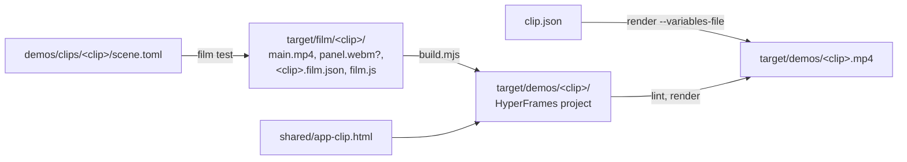

# Demo videos

Finished 1920x1080 demo videos of QueryMT Desktop, made from scene files. A scene is filmed by the
real app, offscreen (the film harness, `crates/querymt-gpui/src/film/`). A shared
[HyperFrames](https://hyperframes.heygen.com) composition then adds a rounded window with the macOS buttons (drawn where the app leaves room for them), a cursor, zoom,
captions and title cards, driven by the timing file the harness writes next to the footage.



## Prerequisites

- Node 22 or newer, with `npx`.
- `ffmpeg` and `ffprobe` with `libx264` and `libvpx-vp9` (the quick panel is filmed as a VP9 alpha track).
- `cargo-nextest` (`cargo install cargo-nextest --locked`).
- Chrome. HyperFrames uses the system one when it finds it. The first `npx` run downloads HyperFrames
  (and a headless Chrome if there is none), so start with `npx hyperframes@0.9.98 doctor`.
- Network access to jsDelivr: the composition loads GSAP 3 from there. If that ever causes failed
  renders, vendor GSAP into `demos/shared/`.

## Making a video

From the repository root:

```bash
demos/film.sh prompt-and-reply        # one clip
demos/film.sh --all                   # every clip under demos/clips/
demos/film.sh --no-film quick-chat    # re-render from the footage already in target/film/
```

`--no-film` is the fast path when only the composition (`shared/app-clip.html`) or a `clip.json`
changed: it skips the film test, about 25 to 45 seconds a clip.

Per clip, `film.sh`:

1. films `demos/clips/<clip>/scene.toml` with the `film::film_scene` test;
2. runs `node demos/build.mjs <clip>`, which writes the HyperFrames project to `target/demos/<clip>/`;
3. lints it (`hyperframes lint`; errors stop the clip);
4. renders it (`hyperframes render`, `--quality delivery`) to `target/demos/<clip>.mp4`.

The scene's `name` must equal the clip's folder name.

## Where things go

| Path | What |
|---|---|
| `demos/clips/<clip>/scene.toml` | the scene (format: "Filming demo clips" in `crates/querymt-gpui/knowledge/development.md`) |
| `demos/clips/<clip>/clip.json` | the clip's composition variables |
| `demos/shared/app-clip.html` | the composition template |
| `demos/shared/hyperframes.json` | project settings, copied into every generated project |
| `target/film/<clip>/` | footage and timing file from the film harness (`QMT_FILM_OUT` changes the base) |
| `target/demos/<clip>/` | the generated HyperFrames project |
| `target/demos/<clip>.mp4` | the finished video |

Everything generated is under `target/`; nothing is committed except the sources in `demos/`.

## Adding a clip

1. Copy a clip folder: `cp -r demos/clips/quick-chat demos/clips/my-clip`.
2. Edit `my-clip/scene.toml`. Set `name = "my-clip"`.
3. Edit `my-clip/clip.json` (see the variables below).
4. Run `demos/film.sh my-clip` and open `target/demos/my-clip.mp4`.

For a click that gets a cursor, a click ring and a zoom, give the step a target (`click = "composer-input"`).
Typing, hovering and scrolling get a cursor move; only clicks, typing with a known field and `mark` steps zoom.
Typing in the quick panel has no known position yet, so it moves no cursor.

## Composition variables

Set in `clip.json`; any left out use the default.

| Variable | Type | Default | Meaning |
|---|---|---|---|
| `title` | string | empty | title card (and end card) heading |
| `subtitle` | string | empty | title card (and end card) second line |
| `show_title_card` | boolean | `true` | show the title card; if false, the first frame is held instead |
| `show_end_card` | boolean | `true` | show the end card; if false, the last frame is held instead |
| `cursor` | boolean | `true` | draw the cursor and click rings |
| `zoom` | number, 1.0 to 2.0 | `1.35` | zoom strength on clicks and marks; 1.0 turns zoom off |
| `background` | `dark`, `light` or `accent` | `dark` | stage background |
| `accent` | color | `#f97316` | click ring, card rule and the `accent` background |

The title and end cards are 2.5 seconds each (`TITLE_S` and `END_S` in `build.mjs`), so the video is
the footage plus 5 seconds.

## Looking around

```bash
npx hyperframes@0.9.98 preview target/demos/<clip>
```

shows the generated project in the HyperFrames studio. Edits made there are not written back to
`demos/`; change the template or the clip files and re-run `film.sh --no-film`.
`npx hyperframes@0.9.98 snapshot target/demos/<clip> --at 3,5.5` writes PNGs of single moments (with
the default variables: it has no `--variables-file`). `check target/demos/<clip>` runs the layout,
motion and contrast checks.

## Tests

```bash
node --test demos/build.test.mjs
```

covers `build.mjs` and the zoom rules (`zoomPlan`, cut out of the template).

## The pinned version

`film.sh` runs `npx hyperframes@$HYPERFRAMES`, with `HYPERFRAMES=0.9.98` at the top of the script. To
bump it: change that line, run `HYPERFRAMES=<new> demos/film.sh --all`, check the output, and update
the version in this README. Transitive npm dependencies are not locked; renders on one machine stay
consistent while npm's cache holds.

Pixel-identical output across machines is not a goal (no `--docker`).
