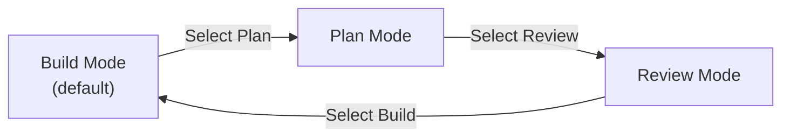

# QueryMT Agent - Agent Modes

QueryMT Agent supports three runtime modes that control what the agent can do and how it behaves. Modes can be switched at runtime, allowing flexible workflows.

## Available Modes

| Mode | Access Level | Primary Use Case |
|------|--------------|------------------|
| **Build** | Full read/write | Implementing code changes |
| **Plan** | Read-only | Analyzing and planning |
| **Review** | Read-only | Code review and feedback |

## Mode Details

### Build Mode

**Default mode** - Full read and write access to the workspace.

**Capabilities:**
- Read and modify any file
- Execute shell commands (including mutating ones)
- Create and delete files
- Use all configured tools

**System Reminder:** None (full access)

**When to use:**
- Implementing features
- Fixing bugs
- Making code changes
- Any task requiring modifications

**Example:**
```
User: "Add a new API endpoint for user registration"
Agent: [In Build mode]
  - Reads existing routes
  - Creates new controller file
  - Updates database schema
  - Writes tests
```

### Plan Mode

**Read-only mode** - Agent can observe and analyze but cannot make changes.

**Capabilities:**
- Read files
- Search code
- List directories
- Run read-only shell commands (`git log`, `grep`, `find`, etc.)
- Create todo lists
- Ask clarifying questions

**Restrictions:**
-  Cannot edit files
-  Cannot create files
-  Cannot delete files
-  Cannot run mutating shell commands (`sed`, `tee`, `echo >`, `rm`, `cargo build`, etc.)

**System Reminder:**
```
# Plan Mode

You are in **plan mode**. You may only observe, analyze, and plan.

## What You CAN Do
- Read files, search code, list directories
- Analyze architecture and patterns
- Create todo lists and task breakdowns
- Ask the user clarifying questions
- Run read-only shell commands (git log, grep, find, etc.)

## What You MUST NOT Do
- Do NOT edit, create, or delete files
- Do NOT run mutating shell commands (no sed, tee, echo >, rm, cargo build, etc.)
- Do NOT write code — only plan what code should be written

## Your Goal
Produce a clear, actionable implementation plan. Break work into small, concrete
steps. Identify risks and tradeoffs. When the user is ready to implement, they
will switch to Build mode.

Ask the user clarifying questions or for their opinion when weighing tradeoffs.
```

**When to use:**
- Before implementing complex changes
- Understanding existing codebase
- Creating implementation plans
- Risk assessment
- Architecture analysis

**Example:**
```
User: "I want to add user registration"
Agent: [In Plan mode]
  - Reads existing user models
  - Analyzes authentication flow
  - Creates implementation plan
  - Lists required changes
  - Asks about preferred approach
```

### Review Mode

**Read-only mode** - Agent acts as a code reviewer providing feedback.

**Capabilities:**
- Read files and search code
- Analyze code quality
- Identify bugs and issues
- Check for security concerns
- Run read-only commands (tests with `--dry-run`, linting, etc.)

**Restrictions:**
-  Cannot edit files
-  Cannot create files
-  Cannot delete files
-  Cannot run mutating shell commands

**System Reminder:**
```
# Review Mode

You are in **review mode**. You are a code reviewer providing constructive feedback.

## What You CAN Do
- Read files and search code to understand context
- Analyze code quality, correctness, and style
- Identify bugs, performance issues, and security concerns
- Suggest improvements and alternative approaches
- Check adherence to best practices and project conventions
- Run read-only commands (tests with --dry-run, linting, etc.)

## What You MUST NOT Do
- Do NOT edit, create, or delete files
- Do NOT run mutating shell commands
- Do NOT implement fixes — only describe what should be fixed

## Your Goal
Provide thorough, constructive code review feedback. Be specific about issues
and suggest concrete fixes. Prioritize findings by severity. Focus on:
1. Correctness — bugs, logic errors, edge cases
2. Security — vulnerabilities, unsafe patterns
3. Performance — bottlenecks, unnecessary allocations
4. Maintainability — readability, naming, documentation
5. Architecture — design patterns, coupling, cohesion
```

**When to use:**
- Reviewing PRs
- Code quality checks
- Security audits
- Performance reviews
- Architecture validation

**Example:**
```
User: "Review this authentication implementation"
Agent: [In Review mode]
  - Reads authentication code
  - Identifies security issues
  - Suggests improvements
  - Provides specific fix recommendations
```

## Switching Modes

### Via Dashboard (Interactive)

The embedded dashboard exposes the agent mode as an ACP session configuration option. Use the mode control in the session composer to select Build, Plan, or Review.

### Via API

```rust
use querymt_agent::prelude::*;

// Create session
let session = agent.new_session().await?;

// Switch to plan mode
session.set_mode(AgentMode::Plan)?;

// Switch to review mode
session.set_mode(AgentMode::Review)?;

// Switch back to build mode
session.set_mode(AgentMode::Build)?;
```

### Via ACP

```rust
// Send notification to change mode
agent.notify_session(SessionNotification::SetAgentMode {
    session_id: session_id.to_string(),
    mode: AgentMode::Plan,
})?;
```

## ACP Session Updates

QueryMT publishes the session state it already tracks so ACP clients stay
synchronized. Stable updates are emitted to every ACP v1 client; Preview
updates are emitted only when the client advertises the matching capability
during `initialize`.

### Stable updates

| Update | Emitted when |
|--------|--------------|
| `current_mode_update` | The active session mode changes |
| `config_option_update` | Mode, model, profile, or reasoning effort changes; always carries the complete option set |
| `session_info_update` | A session title or last-activity timestamp is persisted |
| `usage_update` | Provider request usage or a post-compaction context size becomes available |
| `plan` | Legacy plan replacement for clients without plan operations |

A mode change produces `current_mode_update` first, followed by
`config_option_update`. `usage_update` reports `used` as the tokens currently
occupying model context (cached tokens included) and `size` as the active
model's effective context limit; the update is omitted when the limit is
unknown, and cumulative USD cost is included only when available.

### Preview (capability-gated) updates

| Update | Client capability | Notes |
|--------|-------------------|-------|
| `plan_update` / `plan_removed` | `plan` (top level) | Item-based plan with the stable ID `querymt-todos` |
| `notice` | `session.notices` | Advisory hook notices only; never conversation history |
| `compaction_update` / `compaction_summary_chunk` | `session.compaction` | ID-addressed compaction lifecycle |

Omitted and `null` capability fields mean unsupported. Capabilities are parsed
per connection, so one client's Preview support never affects another client.

A fully capable client advertises all three during `initialize`:

```json
{
  "clientCapabilities": {
    "plan": {},
    "session": {
      "notices": {},
      "compaction": {}
    }
  }
}
```

Leaving any of these fields out (or setting them to `null`) treats that Preview
surface as unsupported for that connection.

### Fallbacks

Clients without plan operations receive the legacy full-replacement `plan`
update (an empty snapshot stays an empty replacement because v1 has no removal
primitive). Clients without compaction support receive neither
`compaction_update` nor `compaction_summary_chunk`. Notices fall back to the
event source's existing user-visible behavior.

### Replay semantics

When session history is replayed (for example on `session/load`), QueryMT
materializes current state instead of replaying every historical event:

- One current mode/config snapshot, one folded metadata patch, and the latest
  valid `usage_update`.
- The current todo plan using its stable ID.
- Terminal compactions with their original IDs and final summaries.
- Notices, historical compaction summary chunks, and obsolete in-progress
  compaction states are never replayed.

Replay applies the connection's capabilities after materialization, so
unsupported Preview variants are never sent.

### Via Configuration

Set the initial mode with the typed `mode` key on `[agent]`, `[planner]` or a `[[delegates]]` entry:

```toml
[agent]
provider = "anthropic"
model = "claude-sonnet-4-5-20250929"
mode = "plan"  # "build" (default), "plan" or "review"; new sessions start in this mode.
```

An unknown value fails the config load with an error naming `mode`. The `agent_mode` middleware only configures reminders and rejects unknown keys, so a leftover `default = "plan"` there fails the build.

## Mode Transition Flow



## Mode-Aware Behavior

Modes change what the agent is *told*, not what it is *allowed* to do.

### System Prompt Injection

In Plan and Review mode the `AgentModeMiddleware` injects the configured reminder before each model call. The reminder is the only effect of the mode on the model.

### Enforcement

Tools are not filtered or denied by mode. To restrict a mode, enforce it yourself:

- give a profile only the tools it needs, and
- use a `pre_tool_use` hook, which sees the mode as `permission_mode` (`default` = build, `plan` = plan, `accept_edits` = review) and can block the call. See `examples/confs/trading_desk.toml`.

## Use Cases

### Development Workflow

1. **Plan Phase** (Plan Mode)
   - Analyze requirements
   - Understand existing code
   - Create implementation plan
   - Get user approval

2. **Implementation Phase** (Build Mode)
   - Implement the planned changes
   - Write tests
   - Verify functionality

3. **Review Phase** (Review Mode)
   - Review own changes
   - Check for issues
   - Ensure code quality

4. **Repeat** as needed

### Code Review Workflow

1. **Submit Changes**
   - Developer makes changes in Build mode

2. **Request Review**
   - Switch to Review mode
   - Ask agent to review changes

3. **Get Feedback**
   - Agent provides detailed feedback
   - Lists issues by severity
   - Suggests specific fixes

4. **Iterate**
   - Developer addresses feedback in Build mode
   - Request additional review if needed

### Architecture Analysis

1. **Initial Analysis** (Plan Mode)
   - Explore codebase structure
   - Identify dependencies
   - Map data flow

2. **Planning** (Plan Mode)
   - Create migration plan
   - Identify risks
   - Estimate effort

3. **Implementation** (Build Mode)
   - Execute the plan
   - Make changes incrementally

4. **Validation** (Review Mode)
   - Verify changes meet requirements
   - Check for regressions

## Configuration

### Custom Mode Reminders

Customize the system reminders for Plan and Review modes:

```toml
[[middleware]]
type = "agent_mode"
reminder = """<system-reminder>
Custom plan mode reminder here.
</system-reminder>"""
review_reminder = """<system-reminder>
Custom review mode reminder here.
</system-reminder>"""
```


## Best Practices

### When to Use Each Mode

**Use Plan Mode when:**
- Task complexity is high
- You want to avoid accidental changes
- You need to understand the codebase first
- You want user approval before implementing

**Use Review Mode when:**
- You want objective code feedback
- You're checking for security issues
- You need quality assurance
- You're doing a pre-commit check

**Use Build Mode when:**
- You're ready to implement
- You need to make changes
- You're fixing bugs
- You're adding features

### Mode Switching Tips

1. **Start in Plan Mode** for complex tasks
2. **Switch to Build Mode** when ready to implement
3. **Use Review Mode** before finalizing changes
4. **Cycle through modes** for thorough development

### Communication

When switching modes, communicate with the user:
- "Switching to Plan mode to analyze the requirements"
- "Ready to implement, switching to Build mode"
- "Changes complete, switching to Review mode for final check"

## Troubleshooting

### Agent Still Making Changes in Plan/Review Mode

1. Check that `AgentModeMiddleware` is in the middleware stack
2. Verify the mode is actually set in the session configuration
3. Check logs for mode-related warnings
4. Remember modes only inject reminders; enforce restrictions with `tools`, `[agent.permissions]` or hooks

### Mode Not Switching

1. Verify the dashboard was built with the `dashboard` feature and started with `--dashboard`
2. Check that the mode session configuration option is available
3. Try switching via the ACP API instead
4. Check for middleware errors in logs

### Permission Errors in Build Mode

1. Check `[agent.permissions]` (`ask` / `always_ask`) and the `permission_request` hooks
2. Check that `tools` selects the tool
3. Ensure tools are properly registered
4. Check for tool-specific permission requirements

## Examples

See `examples/confs/single_coder.toml` for a complete configuration with mode-aware middleware.

## Related Documentation

- [Middleware Guide](middleware.md) - AgentModeMiddleware configuration
- [Configuration Guide](configuration.md) - Full config reference
- [API Reference](api_reference.md) - Mode API types