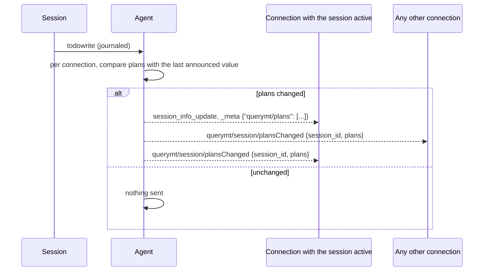

# QueryMT Agent - API Reference

This document provides a reference for the QueryMT Agent public API.

## Module Structure

```
querymt_agent
── prelude          # Re-exports common types
── api              # Primary public API
│   ├── Agent        # Main agent runtime
│   ├── AgentSession # Per-session interface
│   ── callbacks    # Callback types
── agent            # Agent core types
│   ├── AgentConfig  # Shared configuration
│   ├── SessionActor # Session runtime
│   ── handle       # AgentHandle trait
── acp              # Agent Client Protocol
── delegation       # Multi-agent delegation
── export           # Session data export
│   ├── turns        # Shared turn materialization
│   ├── atif         # ATIF trajectory export
│   ── sft          # SFT training data export
── middleware       # Middleware system
── session          # Session management
── tools            # Tool registry
── events           # Event system
```

## Prelude

The `prelude` module re-exports the most commonly used types:

```rust
use querymt_agent::prelude::*;
```

## Agent Creation

### Single Agent

```rust
use querymt_agent::prelude::*;

let agent = Agent::builder()
    .provider("anthropic", "claude-sonnet-4-5-20250929")
    .cwd(".")
    .tools(["read_tool", "shell", "edit"])
    .mesh(Mesh::hybrid())
    .build()
    .await?;
```

Use `Mesh::hybrid()` when you want one process-shared runtime that supports both LAN discovery and later iroh invite joins.

### Agent with Delegates

Every agent is a root with a roster of members it can delegate to. A plain agent has an empty roster; `.delegate(..)` adds members.

```rust
let agent = Agent::builder()
    .cwd(".")
    .provider("anthropic", "claude-sonnet-4-5-20250929")
    .tools(["delegate"])
    .delegate("coder", |d| {
        d.provider("anthropic", "claude-sonnet-4-5-20250929")
            .tools(["shell", "edit"])
            .capabilities(["coding"])
    })
    .build()
    .await?;
```

### From Config

```rust
use querymt_agent::config::{load_config, ConfigSource};

// From file
let config = load_config("config.toml").await?;
let agent = Agent::from_config(config, infra).await?;

// From string
let config = load_config(ConfigSource::Toml(toml_string)).await?;
let agent = Agent::from_config(config, infra).await?;
```

## Agent Types

### Agent

The main agent runtime: one root agent plus the members it can delegate to. The delegation service runs in every runtime whose root may call `delegate`.

`Agent::builder()` returns an `AgentBuilder`; `.subagent(id, |s| ..)` (alias `.delegate`), `.delegation(bool)` and `.delegation_settings(..)` configure delegation. `Agent::has_subagents()` reports whether the root has subagents it can delegate to, and `Agent::delegate(id)` returns a member's handle by ID. `Agent::single()` and `is_multi()` are deprecated aliases of `builder()` and `has_subagents()`.

#### Methods

| Method | Description |
|--------|-------------|
| `chat(&self, message: &str) -> Result<String>` | Send a message and get response |
| `new_session(&self) -> Result<AgentSession>` | Create a new session |
| `list_sessions(&self) -> Result<Vec<SessionInfo>>` | List active sessions |
| `mesh(&self) -> Option<AgentMesh>` | Access mesh APIs when the agent was built with mesh support |
| `subscribe_events(&self) -> Receiver<EventEnvelope>` | Subscribe to events |
| `shutdown(&self) -> Result<()>` | Gracefully shutdown |

### AgentMesh

Mesh-aware facade returned by `agent.mesh()`.

```rust
let outcome = agent.mesh().unwrap().join(invite_code).await?;
println!("joined {}", outcome.mesh_id);
```

#### Methods

| Method | Description |
|--------|-------------|
| `join(&self, invite: impl AsRef<str>) -> Result<MeshJoinOutcome>` | Join an iroh mesh scope on the shared runtime |
| `ensure_published(&self) -> Result<()>` | Publish local mesh actors for this agent |
| `runtime(&self) -> &MeshRuntimeHandle` | Access the underlying shared runtime handle |

### AgentSession

Per-session interface for agent interaction.

```rust
pub struct AgentSession {
    // Session-specific operations
}
```

#### Methods

| Method | Description |
|--------|-------------|
| `chat(&self, message: &str) -> Result<String>` | Send message in this session |
| `cancel(&self) -> Result<()>` | Cancel current operation |
| `set_mode(&self, mode: AgentMode) -> Result<()>` | Change agent mode |
| `set_allowed_tools(&self, tools: &[String]) -> Result<()>` | Set allowed tools |
| `set_denied_tools(&self, tools: &[String]) -> Result<()>` | Set denied tools |
| `get_history(&self) -> Result<Vec<AgentMessage>>` | Get conversation history |
| `fork(&self, instructions: &str) -> Result<AgentSession>` | Fork to new session |

### Changing subagents while running

```rust
let agent = Agent::builder()
    .provider("anthropic", "claude-sonnet-4-5")
    .tools(["delegate", "read_tool"])   // `delegate` is required
    .build().await?;

agent.on_subagents_changed(|c| println!("{} {} (generation {})", c.kind.label(), c.id, c.generation.get()));

agent.add_subagent("reviewer", |s| s.provider("anthropic", "claude-haiku-4-5")
    .description("Reviews code").tools(["read_tool"])).await?;
agent.chat("...").await?;                 // the root can now delegate to `reviewer`
agent.remove_subagent("reviewer").await?;
```

`subagents()` lists the current subagents and `roster_generation()` counts changes. `on_subagents_changed` and `subscribe_subagent_changes()` report every successful add or remove from any path (Rust, ACP, profiles). Shell hooks `subagent_added` / `subagent_removed` are described in [Hooks](hooks.md). See `crates/agent/examples/dynamic_subagents.rs`.

## Agent Modes

```rust
pub enum AgentMode {
    Build,   // Full read/write access
    Plan,    // Read-only, planning
    Review,  // Read-only, code review
}
```

### Mode Switching

```rust
// Via session
session.set_mode(AgentMode::Plan)?;

// Via ACP notification
agent.notify_session(SessionNotification::SetAgentMode {
    session_id: "...".to_string(),
    mode: AgentMode::Plan,
})?;
```

## Callbacks

### MessageCallback

```rust
pub type MessageCallback = Arc<dyn Fn(&str, &str) -> Result<()> + Send + Sync>;
```

Called when a message is sent or received.

### ToolCallCallback

```rust
pub type ToolCallCallback = Arc<dyn Fn(&str, &str, &str) -> Result<()> + Send + Sync>;
```

Called before a tool is executed.

### ToolCompleteCallback

```rust
pub type ToolCompleteCallback = Arc<dyn Fn(&str, &str, &str, &str) -> Result<()> + Send + Sync>;
```

Called after a tool completes.

### DelegationCallback

```rust
pub type DelegationCallback = Arc<dyn Fn(&str, &str, &str) -> Result<()> + Send + Sync>;
```

Called during delegation operations.

### ErrorCallback

```rust
pub type ErrorCallback = Arc<dyn Fn(&str, &str) -> Result<()> + Send + Sync>;
```

Called when an error occurs.

## Events

### EventEnvelope

```rust
pub struct EventEnvelope {
    pub session_id: String,
    pub kind: AgentEventKind,
    pub timestamp: u64,
}
```

### AgentEventKind

The concrete event enum evolves over time; consult `crates/agent-core/src/events.rs` for the canonical Rust definition. Common event families include session lifecycle, prompts/messages, tool execution, permissions, compaction, delegation, and hook diagnostics.

Hook-related diagnostics are surfaced as:

```rust
HookNotice {
    event_name: String,
    message: String,
    is_error: bool,
}
```

`hook_notice` is emitted when a hook exits successfully but returns invalid output that QueryMT ignores for control-flow purposes.

### Cost accounting

Cost is a supported token-cost estimate computed from recorded provider usage and the pricing bound when each request was sent. It is not a provider invoice. Four scopes are used, and every figure belongs to exactly one of them:

| Scope | Meaning | Where it appears |
| --- | --- | --- |
| **attempt** | One physical provider request. A retry is a new attempt. | `llm_attempt_started` / `llm_attempt_settled` (the durable ledger) |
| **operation** | One logical model request, i.e. all of its attempts. | `llm_request_end.cost_usd` and `llm_request_end.accounting` |
| **cycle** | Everything attributed to one execution cycle (one prompt run). A new cycle starts at zero. | `AgentStats` cost fields (a read-only view) |
| **session** | Everything recorded for the session, across cycles and restarts. | `llm_request_end.cumulative_cost_usd` |

`llm_request_end` is derived presentation. It is never an additional ledger entry, and new accounting is recorded only through the attempt events.

```json
{
  "type": "llm_request_end",
  "data": {
    "usage": { "input_tokens": 100, "output_tokens": 10, "reasoning_tokens": 5,
               "cache_read": 50, "cache_write": 20 },
    "tool_calls": 0,
    "finish_reason": "Stop",
    "cost_usd": 0.000615,
    "cumulative_cost_usd": 0.000615,
    "context_tokens": 185,
    "metrics": { "steps": 1, "turns": 1 },
    "accounting": {
      "operation_id": "op-1",
      "attempt_ids": ["att-1"],
      "known_subtotal_usd": 0.000615,
      "complete": true,
      "reasons": []
    }
  }
}
```

- `cost_usd` is the complete supported cost of the whole **operation**, retries included, and includes cache read and write charges. It is `null` unless that total is complete.
- `cumulative_cost_usd` is the **session** total, with the same `null` rule. A session total is complete only when nothing in it is unresolved or incomplete, so a single interrupted attempt clears it. An all-excluded session (for example a subscription provider) has no dollar amount instead of a known zero.
- `accounting.attempt_ids` and `operation_id` match the durable attempt records, so consumers can deduplicate. `known_subtotal_usd` and `reasons` explain a `null` cost. Events written before accounting existed omit `accounting`.
- An execution that ends before a normal `llm_request_end` (cancellation, error) still has its attempts recorded. Its charges and uncertainty are in the attempt events and the session total, but no request-end event is emitted for it.
- Retry attempts are valued separately. A rejected attempt that reports usage is charged; a provider-confirmed non-billable rejection adds nothing; an unconfirmed transport failure stays uncertain rather than zero.

#### Auxiliary generation

Besides the main response, two components make paid provider requests. Both are recorded in the same ledger, with their own `purpose`, and neither changes the main conversation's context size or step counters:

| Purpose | Dispatched by | Charged to |
| --- | --- | --- |
| `main_response` | the execution loop | the executing cycle |
| `compaction` | AI context compaction | the cycle that triggered it (a dedicated `maintenance-…` cycle when compaction runs outside a prompt) |
| `delegation_summary` | the delegation planning summary | the parent cycle that requested the delegation |

Compaction lowers the effective context while increasing spend. A summary refused or rejected by validation (empty, truncated, or with tool calls) still incurs and records its usage, and each retry is a separate attempt.

Every dispatch site is either recorded or explicitly classified. The `AgentRunner::chat` / `Agent::chat` convenience API runs an ordinary prompt cycle and so reaches a provider only through the recorded main loop. `SessionHandle::submit_request` and `SessionHandle::chat` require a ledger argument and have no unrecorded variant. A test (`accounting::dispatch_coverage_tests`) fails if a new provider call appears outside this list. A node that merely hosts a provider for a remote peer does not record the attempt: the requesting node's session does, because the host has no session to charge.

#### Accounting metadata (ACP)

Clients receive the reducer's state as one versioned replacement DTO, `AccountingSnapshot` (generated TypeScript: `target/generated/types.ts`, produced with `PATH=/Users/wiking/.cargo/bin:$PATH ./scripts/generate-types.sh`). The same payload is carried three ways:

| Carrier | When | Where |
| --- | --- | --- |
| `usage_update` | a reliable main-context measurement and the active model's limit are known | `_meta.querymt.accounting` |
| `session_info_update` | otherwise (unknown limit, or a model switch invalidated the last measurement) | `_meta.querymt.accounting`; no `title`/`updatedAt`, no fabricated `used`/`size` |
| `SessionLoadSnapshot` | `session/load` | the required `accounting` field, reduced from the same audit events as `cursor`, present even without historical replay |

Delivery does not depend on negotiated notice support or on the context size. Attempt *starts* are not published (they would flash an incomplete total during every request); each *settlement* that changes state is, and an identical redelivery publishes nothing.

```json
{
  "version": 1,
  "session": {
    "knownSubtotalUsd": 0.000615,
    "completeTotalUsd": 0.000615,
    "complete": true,
    "billing": "metered",
    "reasons": [],
    "pricedAttempts": 1,
    "excludedAttempts": 0,
    "unresolvedAttempts": 0,
    "incompleteAttempts": 0,
    "unaccountedGenerations": 0
  },
  "cycle": {
    "cycleId": "cycle-1",
    "scope": {
      "knownSubtotalUsd": 0.000615,
      "completeTotalUsd": 0.000615,
      "complete": true,
      "billing": "metered",
      "reasons": [],
      "pricedAttempts": 1,
      "excludedAttempts": 0,
      "unresolvedAttempts": 0,
      "incompleteAttempts": 0,
      "unaccountedGenerations": 0
    },
    "budget": {
      "knownSubtotalUsd": 0.000615,
      "completeTotalUsd": 0.000615,
      "reasons": [],
      "incompleteAttempts": 0,
      "bestEffort": false
    }
  }
}
```

A cost that turns incomplete keeps its known subtotal and replaces the total with an explicit `null`:

```json
{
  "version": 1,
  "session": {
    "knownSubtotalUsd": 0.001,
    "completeTotalUsd": null,
    "complete": false,
    "billing": "mixed",
    "reasons": [{ "kind": "valuation", "reason": { "kind": "missing_rate", "category": "cache_write" } }],
    "pricedAttempts": 2,
    "excludedAttempts": 1,
    "unresolvedAttempts": 0,
    "incompleteAttempts": 1,
    "unaccountedGenerations": 0
  },
  "cycle": null
}
```

Semantics:

- **Replacement.** A present payload replaces the previous accounting state atomically. `completeTotalUsd` and `cycle` are always serialized (explicit `null`), never omitted. A message without the payload does not touch accounting. Omission of standard ACP `cost` alone is not a clearing signal.
- **Standard `cost`.** Sent on `usage_update` only from the session's complete metered estimate. It is omitted when the total is partial, unresolved, all-excluded or based on legacy history, and `usage_update`'s `cost` is never taken from `llm_request_end.cumulative_cost_usd`.
- **Scopes.** `session` is lifetime API spend. `cycle` is the cycle of the most recent *main-response* attempt, or `null` when there is none; a delayed compaction or summary settling for an older cycle never selects that cycle as active. `billing` is `empty`, `metered`, `excluded` (never a zero-dollar invoice) or `mixed` (amounts cover metered attempts only).
- **Budget view.** `cycle.budget` is the valuation `max_price_usd` enforces: manual rates when configured, otherwise the recorded API valuation. It is kept apart from API spend; `reasons` lists settled gaps only (in-flight attempts are not a reason) and `bestEffort` is true when the cap is enforced against a known subtotal.
- **Token telemetry is separate.** `_meta.querymt.usage` v1 (`latestRequest`, `sessionTotals`, `partial`) keeps its shape and its main-request token scope. Retry and auxiliary attempts do not enter it, so its totals are not the monetary ledger's tokens.
- **Ordering.** Live and replayed delivery reduce the same records, so they agree. Snapshot and captured-live application use the existing local/remote cursors; older state never overwrites newer accounting, and a duplicate is a no-op.
- **Export.** ATIF `final_metrics.total_cost_usd` is the reducer's complete session total or absent. `final_metrics.extra` carries the same `accounting` snapshot plus an `attempts` list covering main, auxiliary, failed and unresolved attempts. A step's `metrics.extra.accounting` gives an incomplete operation's known subtotal and reasons. Auxiliary attempts have no step, and an `llm_request_end` without `accounting` (legacy history) exports no dollar cost.

##### Required client behavior (`querymt-desktop` follow-up)

This repository defines the payload only. The desktop client must be updated together with the backend:

- Apply the payload atomically and treat a present `null` `completeTotalUsd` as "cleared". Do not write `update.cost ?? previous`.
- `mergeMissingSessionUsage` must not refill an intentionally cleared cost from an older candidate. Merge precedence follows the snapshot/live cursors.
- Hydrate from `SessionLoadSnapshot.accounting`. Stop deriving money from `llm_request_end.cumulative_cost_usd`; token-history telemetry may stay as is.
- Read the same DTO from `usage_update` or `session_info_update`, and do not refresh the session catalog for an accounting-only `session_info_update` (it changes no summary field).
- Label figures as "Estimated API cost" (complete), "Known API subtotal - incomplete" (with reasons) and "Subscription usage excluded"; show the manual-rate cycle budget separately.

##### Breaking changes and deployment

- `Usage` gains optional `cache_write_tiers`; `ModelPricing` gains cache and one-hour write rates and applicability metadata; `LlmRequestEnd` gains `accounting`; the events `llm_attempt_started` / `llm_attempt_settled` are new; `SessionLoadSnapshot` gains `accounting`; `AgentStats` costs are views of recorded components and the aggregate-token repricing helpers are removed. There are no legacy adapters.
- Upgrade the backend, providers/plugins, remote peers, bindings and clients together. Mixed-version accounting is not supported.
- Existing sessions keep their history. Local generation recorded before accounting has no basis and is reported as `unaccountedGenerations`, so such a session never claims a complete total, and no historical rates are applied.
- Rollback needs matching binaries and a database copy taken before the upgrade. Do not run an older event decoder against a journal containing the new events, and do not delete accounting events to make a rollback succeed.

## Delegation

### Delegation

```rust
pub struct Delegation {
    pub public_id: String,
    pub target_agent_id: String,
    pub objective: String,
    pub context: Option<String>,
    pub constraints: Option<String>,
    pub expected_output: Option<String>,
    pub task_id: Option<String>,
    pub planning_summary: Option<String>,
    pub verification_spec: Option<VerificationSpec>,
    pub isolation: DelegationIsolation, // Inherit (default) | Shared | Isolated
}
```

### DelegationStatus

```rust
pub enum DelegationStatus {
    Pending,
    Running,
    Complete,
    Failed,
    Cancelled,
}
```

### VerificationSpec

```rust
pub struct VerificationSpec {
    pub verification_type: VerificationType,
    pub parameters: HashMap<String, String>,
}

pub enum VerificationType {
    ShellCommand { command: String },
    FileExists { path: String },
    FileContains { path: String, content: String },
    Custom { spec: serde_json::Value },
}
```

## Middleware

### Middleware and TurnMiddleware

```rust
/// Agent-scoped: configuration and shared services.
pub trait Middleware: Send + Sync {
    fn name(&self) -> &'static str;
    fn begin_turn(&self, turn: &TurnInfo<'_>) -> Box<dyn TurnMiddleware>;
    fn bind_agent(&self, registry: &Arc<ToolRegistry>, events: &Arc<EventSink>) {}
    fn limits(&self) -> Option<SessionLimits> { None }
    fn budget_pricing(&self) -> Option<ModelPricing> { None }
}

/// One per run; all run state lives in `self`.
#[async_trait]
pub trait TurnMiddleware: Send {
    async fn on_turn_start(&mut self, cx: &mut HookCx<'_>) -> Result<StepVerdict>;
    async fn on_step_start(&mut self, cx: &mut HookCx<'_>) -> Result<StepVerdict>;
    async fn on_after_llm(&mut self, cx: &mut HookCx<'_>, reply: &LlmResponse) -> Result<ReplyVerdict>;
    async fn on_prepared_tool_calls(&mut self, cx: &mut HookCx<'_>, batch: &PreparedBatch<'_>)
        -> Result<Vec<PreparedCallVerdict>>;
    async fn on_turn_end(&mut self, cx: &mut HookCx<'_>) -> Result<EndVerdict>;
    async fn on_stopped(&mut self, cx: &mut HookCx<'_>, stop: &Stop) -> Result<StopVerdict>;
}

pub enum StepVerdict { Proceed, Stop(Stop) }
pub enum ReplyVerdict { Proceed, Stop(Stop), Retry }
pub enum EndVerdict { Finish, Continue, Stop(Stop) }
pub enum StopVerdict { Pass, Recover }
```

See the [Middleware guide](middleware.md) for what each hook may decide and for examples.

### CompositeDriver

```rust
pub struct CompositeDriver {
    // The agent's middleware, in configured order
}

impl CompositeDriver {
    pub fn new(middleware: Vec<Arc<dyn Middleware>>) -> Self;
    pub fn begin_turn(&self, info: &TurnInfo<'_>) -> TurnStack; // the state of one run
}
```

## Tools

### ToolRegistry

```rust
pub struct ToolRegistry {
    // Registered tools
}

impl ToolRegistry {
    pub fn find(&self, name: &str) -> Option<Arc<dyn Tool>>;
    pub fn names(&self) -> Vec<String>;
    pub fn definitions(&self) -> Vec<chat::Tool>;
    pub fn register(&mut self, tool: Arc<dyn Tool>);
}
```

### Built-in Tools

| Tool | Description |
|------|-------------|
| `read_tool` | Read file contents |
| `edit` | Edit file with patch |
| `write_file` | Write/overwrite file |
| `delete_file` | Delete file |
| `shell` | Execute shell command |
| `glob` | File pattern matching |
| `search_text` | Text search in files |
| `ls` | List directory contents |
| `create_task` | Create task |
| `todowrite` | Update todo list |
| `todoread` | Read todo list |
| `question` | Ask user question |
| `web_fetch` | Fetch web content |

## Configuration Types

### AgentConfig

```rust
pub struct AgentConfig {
    pub provider: Arc<SessionProvider>,
    pub event_sink: Arc<EventSink>,
    pub agent_registry: Arc<dyn AgentRegistry>,
    pub default_mode: Arc<Mutex<AgentMode>>,
    pub tool_config: ToolConfig,
    pub tool_registry: ToolRegistry,
    pub middleware_drivers: Vec<Arc<dyn Middleware>>,
    pub mcp_servers: Vec<McpServerConfig>,
    pub max_steps: Option<usize>,
    pub snapshot_policy: SnapshotPolicy,
    pub permissions: Permissions, // ask / always_ask / timeout
    pub execution_policy: RuntimeExecutionPolicy,
    // ... more fields
}
```

### ToolConfig

```rust
pub struct ToolConfig {
    pub policy: ToolPolicy,
    pub allowlist: Option<HashSet<String>>,
    pub denylist: HashSet<String>,
}

pub enum ToolPolicy {
    BuiltInOnly,
    ProviderOnly,
    BuiltInAndProvider,
}
```

### ExecutionPolicy

```rust
pub struct ExecutionPolicy {
    pub tool_output: ToolOutputConfig,
    pub pruning: PruningConfig,
    pub compaction: CompactionConfig,
    pub snapshot: SnapshotBackendConfig,
    pub rate_limit: RateLimitConfig,
}
```

## Error Handling

### AgentError

```rust
pub enum AgentError {
    // Core errors
    InternalError(String),
    InvalidConfig(String),
    NotFound(String),
    
    // Session errors
    SessionNotFound(String),
    SessionNotActive(String),
    SessionLimitReached,
    
    // Tool errors
    ToolNotFound(String),
    ToolPermissionDenied(String),
    ToolExecutionFailed(String),
    
    // LLM errors
    LLMProviderError(String),
    LLMRateLimit,
    LLMContextExceeded,
    
    // Delegation errors
    DelegationNotFound(String),
    DelegationFailed(String),
    VerificationFailed(String),
    
    // Permission errors
    PermissionDenied(String),
    PermissionCancelled,
}
```

## ACP (Agent Client Protocol)

### Transport

```rust
// Stdio transport
pub async fn serve_stdio(agent: Arc<LocalAgentHandle>) -> Result<()>;

// WebSocket transport
pub async fn serve_websocket(agent: Arc<LocalAgentHandle>, addr: &str) -> Result<()>;
```

### RPC Messages

```rust
pub struct RpcRequest {
    pub id: String,
    pub method: String,
    pub params: serde_json::Value,
}

pub struct RpcResponse {
    pub id: String,
    pub result: Option<serde_json::Value>,
    pub error: Option<RpcError>,
}
```

### Turn usage on `session/prompt`

The `session/prompt` response carries `usage` with the token counts of the execution cycle that answered the prompt:

| Field | Meaning |
|---|---|
| `inputTokens` | input tokens of every provider request in the cycle |
| `outputTokens` | output tokens |
| `thoughtTokens` | reasoning tokens |
| `cachedReadTokens` | cache-read tokens |
| `cachedWriteTokens` | cache-write tokens |
| `totalTokens` | sum of the five categories above |

- **Per cycle, not per session.** Although the ACP schema describes these counts as "across session", QueryMT reports the usage of the prompt that was just answered. A second prompt in the same session starts from zero. For session totals use the `usage_update` accounting described above.
- **Omitted when unknown.** When no provider attempt in the cycle reported token usage, `usage` is left out of the response rather than reported as zero. A cycle whose providers genuinely reported zero tokens is indistinguishable from this case and is also omitted.
- **Every stop reason.** The field is set for end of turn, cancelled, refusal, budget or price limit, and compaction-only (`/compact`) responses, and counts what was incurred up to that point (a cancelled turn reports the requests that had already settled).
- The counts come from the cycle's settled accounting attempts (the same ledger as the cost accounting above), so they agree with the cycle's recorded spend.

```json
{
  "stopReason": "end_turn",
  "usage": {
    "totalTokens": 1800,
    "inputTokens": 1500,
    "outputTokens": 300,
    "thoughtTokens": 0,
    "cachedReadTokens": 0,
    "cachedWriteTokens": 0
  }
}
```

### Session cursors and fork at a cursor

A client that advertises `clientCapabilities.session.cursors` receives a `cursor_update` for each position it can address in a session's timeline. Clients that omit the capability (or send `null`) receive none, live or replayed.

A `cursor_update` is sent **after** the entity it is anchored to, with `position: "after"`, once the entity's own update has been sent:

| Anchor | Announced when | Forkable |
|---|---|---|
| `user_message` | the prompt is stored | yes |
| `agent_message` | the assistant message is stored | yes |
| `agent_thought` | the assistant message that holds the thought is stored | no |
| `tool_call` | the tool call has finished | no |
| `compaction` | a compaction completes (only to clients that also advertise `compaction`, since it follows that update) | no |

- **Opaque ids.** A cursor id is an opaque string. Clients must only echo ids the agent announced and must not parse or build them. The agent derives each id from the anchored entity, so the same anchor has the same id live, on `session/load` replay, after a reconnect and after an agent restart. Nothing is stored for it.
- **Forkable cursors** carry `capabilities.fork`. This is fixed for the cursor's lifetime.
- **Replay.** `session/load` replay announces a cursor for every anchor in the replayed history. A windowed load announces cursors for the returned window only.

`session/fork` accepts `cursorId`. The fork's history is the source history through the anchored message, that message included. This is the same boundary as `_meta.querymt.message_id`:

| Request | Fork boundary |
|---|---|
| `cursorId` | through the cursor's message |
| `cursorId` and `_meta.querymt.message_id` | `cursorId` wins |
| only `_meta.querymt.message_id` | through that message |
| neither | the whole session |

A `cursorId` that is unknown, was announced on another session, or is not forkable (thought, tool call, compaction) fails with `-32602`, creates no session and does not fall back to forking the whole session. A `_meta.querymt.message_id` that is not a message of the source session is rejected the same way.

**Remote-hosted sessions.** When the source session is hosted on another mesh node, that node creates the fork (so the fork is hosted there) and the forking node records it as a remote session, so `session/load` works on the returned id. The target rules are the same, and a rejected request creates no session on either node. The owner's refusals keep their error code and data: `-32602` for an invalid target, `-32600` with `code` `owner_transferred` or `workspace_archived` for a read-only source.

Of the request's `_meta`, only `querymt.message_id` is forwarded. Workspace options (`querymt.sessionWorkspace`) are not: such a request fails with `-32602` (`data.code` `remote_fork_workspace_options`) and creates nothing, instead of forking without the requested isolation. The owner applies its own workspace policy, so a source that is managed there stays isolated.

Once the owner has created the fork it is a session there, as a local fork is. If the forking node cannot attach it right away, the request still succeeds and `session/load` connects it from the recorded bookmark.

```json
{"sessionUpdate": "cursor_update", "cursorId": "<opaque>",
 "anchor": {"type": "agent_message", "messageId": "…", "position": "after"},
 "capabilities": {"fork": {}}}
```

**Snapshots and history pages.** The `querymt/sessionLoadSnapshot.v1` object in a `session/load` response and each `querymt/session/history` response carry `cursorUpdates`: the same cursors, with the same ids, that replaying the events they hold announces, each once, in event order. Each element is a `cursor_update` without the `sessionUpdate` tag. A load replaces a client's cursors with its list; a page adds its own. A client that did not advertise `session.cursors` receives no `cursorUpdates`, and one that did not advertise `compaction` receives no compaction cursors (it was never sent the compactions they follow).

```json
{"method": "session/fork", "params": {"sessionId": "…", "cwd": "/work", "cursorId": "<opaque>"}}
```

### Subagent updates for delegations

A client that advertises the top-level `clientCapabilities.subagents` capability (omitted or `null` means unsupported) receives each delegated child session as a `subagent_update` sent on the **parent** session. See [Delegation](delegation.md#subagents-over-acp) for the lifecycle and the full mapping.

```json
{"sessionUpdate": "subagent_update", "sessionId": "<child session id>",
 "title": "coder", "description": "fix the build",
 "state": {"state": "running"},
 "capabilities": {"cancel": {}},
 "_meta": {"querymt": {"delegationId": "…", "stage": "verifying", "modelId": "gpt-5",
                       "providerNodeId": "gpu-node", "requestedAt": 0, "forkedAt": 0, "updatedAt": 0}}}
```

- **Ordering.** The announcement arrives before any live event of the child and before any update that references the child. A child event that reaches the connection first is preceded by the announcement.
- **State.** `running` while the delegation executes, verifies or finalizes, `idle` once it completed, failed or was cancelled. The verifying, finalizing and cancel-requested stages are `running` with `_meta.querymt.stage`; the stage is dropped when the delegation ends.
- **Metadata.** `_meta.querymt` carries `delegationId`, the confirmed child `modelId` and `providerNodeId` when known, and the `requestedAt`, `forkedAt`, `finishedAt` and `updatedAt` timestamps (unix seconds).
- **Cancel.** `capabilities.cancel` is advertised while the delegation runs and withdrawn (`capabilities: null`) with the final update. `session/cancel` on a running child cancels that delegation, exactly as a delegation cancel requested by the agent would. A cancel for a child that is no longer running behaves like any other `session/cancel`.
- **Delegate tool call.** The `delegate` tool call ends `completed` as soon as the delegation is accepted. Once the child is announced, a `tool_call_update` with `content: [{"type": "session", "sessionId": "<child>"}]` follows the announcement. A delegation that later **fails or is cancelled** sends a final `tool_call_update` with status `failed` after the child's final `subagent_update`. A completed delegation leaves the call `completed`.
- **Load and replay.** `session/load` replays one materialized `subagent_update` per child, before the history that references it, and the failed status at the point where the journal recorded the failure. Load snapshots carry the latest update of every child in `subagentUpdates`, including the live state of delegations that are still running. The snapshot still carries `delegationUpdates` and the `querymt/session/delegationUpdate` notification is still sent alongside, until both are removed in the release that switches the desktop client.

Clients without the capability receive no `subagent_update`, no session reference and no failed status update. They still receive the delegate tool call and the child session's events.

### Session plans in `session/list`

A session picker can show each session's todo progress without loading the session. `session/list` entries for local sessions carry the session's current plans under the top-level `_meta` key `querymt/plans`, an array of ACP plan content objects. Today it holds one `items` plan, the todo list:

```json
{"sessionId": "…", "title": "…",
 "_meta": {
   "querymt/plans": [
     {"type": "items", "planId": "querymt-todos",
      "entries": [{"content": "Add table", "priority": "high", "status": "completed"},
                  {"content": "Wire list query", "priority": "medium", "status": "in_progress"}]}
   ]
 }}
```

- **Same entries as `plan_update`.** The entries are what a `plan_update` for the same todo list carries: same order, `content`, `priority` and `status`. `cancelled` todos and todos with an unknown status are left out.
- **Absent when empty.** A session that never called `todowrite`, or whose last `todowrite` stored an empty list, has no `querymt/plans` key. Entries for sessions listed from mesh peers (`_meta.location` `remote`) never carry it.
- **Top-level key.** The key is not nested under `_meta.querymt`: ACP metadata patches replace a top-level key whole, so a plans patch cannot overwrite the workspace, pin or lifecycle values nested there.
- **Persisted.** The current plan is stored per session, so the list reports it after an agent restart. Sessions that wrote todos before this existed report the plan of their last `todowrite` once the session database is upgraded. Deleting a session discards its plan. Rewinding history past the last `todowrite` restores the previous plan, or removes it when no call remains. The prune happens when the next prompt starts, and that is when the change is announced (see below). `todoread` then returns the restored list too.
- **`todoread`.** It still reads the in-memory todo list, which starts empty after a restart.

To keep a listed row current:



- **`session_info_update` patch.** On connections where the session is active, the update's `_meta` sets only `querymt/plans`, to the value `session/list` now reports, or to `null` when the list was emptied. It carries no `title`, `updatedAt` or other `_meta` key.
- **`querymt/session/plansChanged`.** An extension notification sent to every connection, listed in the control capabilities' `notifications`. Params: `{"session_id": "…", "plans": [...]}`, where `plans` is what `session/list` would report (`[]` when the key is omitted). Clients use it to update a listed session mid-turn without calling `session/list` again. The Rust type is `SessionPlansChangedNotification`.
- **Both reach the active connection.** A connection where the session is active receives the patch and the notification for the same change, carrying the same plans. Both set the whole value, so applying either or both leaves the same result.
- **When it is sent.** After a journaled `todowrite` call whose arguments are a todo list and whose plans differ from the last ones announced to that connection for that session. A repeat of the listed entries and a `todowrite` with arguments that are not a todo list send nothing. Each connection keeps its own last announced value in memory, so the first `todowrite` of a session on a connection is always announced.
- **After a rewind.** When the prompt that follows an undo removes the session's last `todowrite`, the change is announced like a `todowrite`: the patch and `plan_update` or `plan_removed` on connections where the session is active, and `plansChanged` on every connection. A rewind that leaves the plan as it was announces nothing.
- **After loading a session.** A client that loaded the session by replay holds the replayed plan, so a later emptied list removes it with `plan_removed`.
- **Falling behind.** A connection that falls behind the agent's event stream catches up from the stored plans, which also covers the rewind announcement (a live hint that is not journaled). For each session where it holds a plan (the sessions it was told about, or that it has active), it is sent what changed meanwhile, as `plansChanged` and, where the session is active, as the patch and `plan_update` or `plan_removed`. A session the connection was never told about is not covered: `session/list` reports its plans, and its next `todowrite` is announced. With a store that cannot report plans, the connection forgets what it announced, so the next change is announced again.
- **Rejected calls.** Plans are projected when the `todowrite` call starts, like `plan_update`, so a call the tool later rejects still changes the listed plan.

## Remote/Mesh API

### Mesh Configuration

```rust
pub struct MeshConfig {
    pub listen: Option<String>,
    pub discovery: MeshDiscovery,
    pub bootstrap_peers: Vec<String>,
    pub directory: DirectoryMode,
    pub request_timeout: Duration,
}

pub enum MeshDiscovery {
    Mdns,
    Kademlia,
    None,
}
```

### Remote Session

```rust
pub struct RemoteSession {
    pub peer_id: String,
    pub session_id: String,
    pub agent_id: String,
}

impl RemoteSession {
    pub async fn create(agent: &Agent, peer_id: &str, config: &str) -> Result<Self>;
    pub async fn attach(agent: &Agent, remote: RemoteSession) -> Result<AgentSession>;
}
```

## Examples

See `examples/` directory for complete usage examples:

- `qmtcode.rs` - Full-featured coder agent
- `acp_agent.rs` - ACP stdio server
- `auto_delegation_example.rs` - Multi-agent delegation
- `from_config.rs` - Configuration-based agent
- `morning_brief.rs` - Daily summary agent
- `replay_session.rs` - Session replay

## Version Compatibility

| QueryMT Agent | QueryMaTe | Rust Edition |
|---------------|-----------|--------------|
| 0.2.x | 0.2.x | 2021 |
| 0.1.x | 0.1.x | 2021 |

## Breaking Changes

### v0.2.0

- `AgentHandle` trait introduced for unified local/remote interface
- Delegation uses `AgentHandle::create_delegation_session()`
- `SessionActor` now uses kameo actor model
- Event system uses `EventFanout` instead of direct subscriptions

### v0.1.0

- Initial release with single-agent support