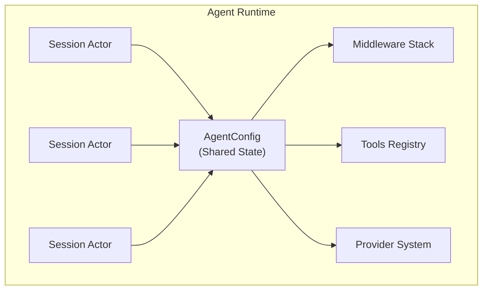
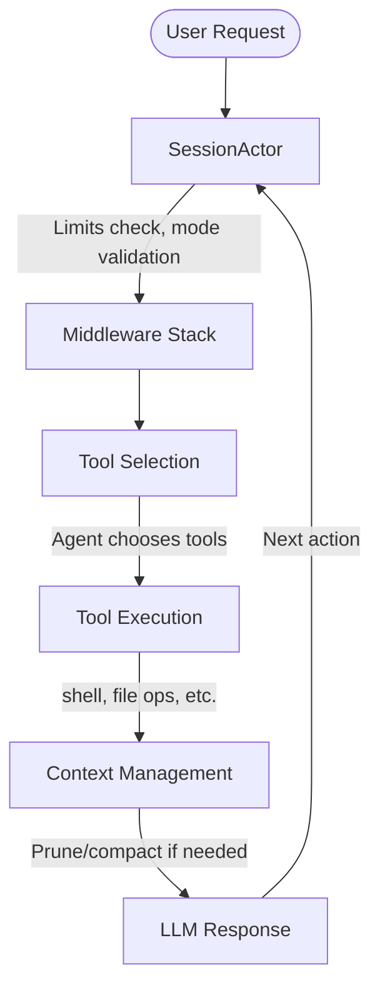
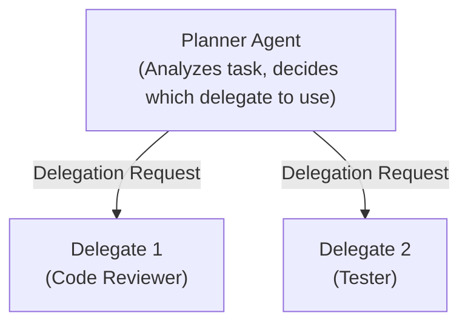

# QueryMT Agent - Overview

The `querymt-agent` crate is a high-level agent runtime for QueryMaTe, providing a flexible framework for building AI agents with support for single-agent and multi-agent (quorum) configurations.

## What is QueryMT Agent?

QueryMT Agent is a Rust library that enables you to:

- **Build AI agents** with configurable tools, models, and behaviors
- **Run agents in multiple modes**: ACP stdio, embedded Svelte dashboard over ACP, or mesh networking
- **Support multi-agent workflows** with planner-delegate delegation patterns
- **Manage context efficiently** with automatic compaction and pruning
- **Enable cross-machine collaboration** via libp2p mesh networking

## Architecture Overview



### Core Components

#### 1. AgentConfig
The central configuration structure containing:
- **Provider**: LLM provider configuration (Anthropic, OpenAI, etc.)
- **Tool Registry**: Available tools (built-in, MCP, provider-specific)
- **Middleware Stack**: Processing pipeline for agent decisions
- **Event Sink**: Event publishing and subscription
- **Session Provider**: Session management and history storage

#### 2. SessionActor
Per-session runtime state managed as a kameo actor:
- **Execution State**: Current turn, step count, tool usage
- **Conversation Context**: Message history with compaction
- **Runtime State**: MCP tools, workspace index, permissions
- **Execution Permit**: Ensures FIFO ordering of prompts

#### 3. Middleware Stack
A pluggable processing pipeline that intercepts and modifies agent behavior:
- **LimitsMiddleware**: Step and turn limits
- **ContextMiddleware**: Token management and compaction
- **AgentModeMiddleware**: Mode-aware restrictions (build/plan/review)
- **DedupCheckMiddleware**: Duplicate code detection
- **DelegationMiddleware**: Multi-agent coordination

#### 4. Tool Registry
Unified tool system supporting:
- **Built-in tools**: `edit`, `read_tool`, `shell`, `glob`, etc.
- **Provider tools**: Tools exposed by the LLM provider
- **MCP tools**: Model Context Protocol servers

## Agent Modes

QueryMT Agent supports three runtime modes, switchable at runtime:

| Mode | Description | Use Case |
|------|-------------|----------|
| **Build** | Full read/write access | Implementing code changes |
| **Plan** | Read-only, planning focus | Analyzing and planning before implementation |
| **Review** | Read-only, code review | Reviewing code quality and providing feedback |

The embedded dashboard exposes modes through the ACP session configuration controls.

## Execution Flow



## Multi-Agent (Quorum) Architecture

For complex tasks, QueryMT supports a planner-delegate pattern:



## Key Features

### Context Management

QueryMT implements a 3-layer context management system:

1. **Tool Output Truncation**: Limits tool output to configurable size
2. **Pruning**: Removes old tool results after every turn
3. **AI Compaction**: Summarizes history when context approaches limits

### Delegation System

- **Automatic delegation**: Agents can delegate tasks to specialized agents
- **Verification**: Optional verification of delegate results
- **Planning context**: Summarized context passed to delegates
- **Parallel execution**: Multiple delegations can run concurrently

### Mesh Networking

- **Cross-machine sessions**: Share sessions across multiple machines
- **Internet-capable transport**: iroh-based NAT traversal with invite tokens
- **Multi-transport**: LAN + Internet mesh simultaneously
- **Remote session management**: Forking, resuming, and recovery
- **Streaming stability**: Robust handling of network interruptions

### Profiles

- **Multiple configurations**: Switch between different agent setups instantly
- **Task-specific settings**: Different profiles for coding, reviewing, planning
- **Team collaboration**: Share profiles via version control
- **Session binding**: Sessions remember their profile

### Slash Commands

- **Custom commands**: Define commands in markdown files
- **Tab completion**: Fuzzy matching for fast command lookup
- **Argument substitution**: Dynamic prompts with `$1`, `$2`, `$ARGUMENTS`
- **Team sharing**: Share commands via `.qmt/commands/`

### Hooks

- **Profile-level automation**: Enable lifecycle policies per config or profile
- **Command-based checks**: Run local commands before prompts, tools, approvals, or turn completion
- **Schema-backed contract**: Validate hook stdin/stdout against generated JSON schemas
- **Stop-time continuation**: Request one extra LLM step before a turn fully completes

### Code Intelligence Tools

- **AST-aware analysis**: `index`, `get_symbol`, `get_function`
- **Safe refactoring**: `replace_symbol` with AST-based replacement
- **Symbol references**: `find_symbol_references` across codebase
- **Multi-language support**: Rust, Python, TypeScript, Go, Java, C/C++

### Scheduled Tasks

- **Interval schedules**: Run tasks at fixed intervals
- **Event-driven schedules**: Trigger on file changes, knowledge ingestion
- **Automation**: Background tasks for maintenance and analysis

### Worktree Workspaces

Sessions execute in one of two modes: **local** (the default — the working
directory you launched from) or **isolated** (a managed Git linked worktree
created for the session). Isolation is strictly opt-in: sessions without
isolation options keep existing local behavior unchanged.

Key model invariants:

- **Project identity vs checkout identity**: A project is identified by its
  canonical Git common directory, so every linked worktree of one repository
  shares a single project identity. Each checkout (the main working tree or a
  linked worktree) keeps its own execution path; code indexes and snapshot
  state are keyed by checkout identity, never shared by project identity.
- **Snapshot storage is separate**: The undo/redo snapshot cache remains a
  disposable, path-keyed store. Managed worktrees never live inside it —
  isolated worktree storage is durable and lives under the storage root you
  pass to `WorkspaceService::new` (there is no built-in default), laid out as
  `<storage-root>/<repo-slug>/<workspace-id>`, never inside your project.
- **Single writable owner**: A managed workspace is bound to at most one
  writable session; additional connections to that same session are fine, a
  second writable session attachment is rejected. Forks and delegates receive
  their own workspaces.
- **Explicit lifecycle**: Workspaces track durable states
  (`provisioning → ready`, with `failed`, `missing`, `archived`, `removing`,
  `removed`)
  so crashes and externally deleted checkouts are detected and recoverable.
  Removal never reuses a checkout path.
- **Delegation defaults**: Delegates of isolated sessions run isolated by
  default; local sessions keep shared (in-place) delegation unless isolation
  is configured or explicitly requested. Shared execution is always
  disclosed as shared — isolation is never faked, and it is not filesystem
  sandboxing: delegates operate on a real checkout of the same repository.

#### Lifecycle operations and recovery

The durable lifecycle (`provisioning`, `ready`, `failed`, `missing`,
`archived`, `removing`, `removed`) is inspected and advanced through three workspace
operations. None of them has a force flag:

- **status** — live observation only: whether the checkout exists, whether
  Git registers it on the managed branch, uncommitted/untracked/ignored
  files, the checked-out branch, and how many commits the managed branch is
  ahead of the recorded baseline. Dirty/clean is observed live, never
  persisted as lifecycle state.
- **reconcile** — when a checkout directory disappeared (deleted
  externally), the workspace is marked `missing` with a diagnostic. Missing
  workspaces are never silently re-created and never fall back to executing
  in the original checkout.
- **remove** — explicitly conservative. Removal is refused while a session
  owns the workspace, while the checkout contains uncommitted, untracked, or
  ignored files, when the directory is not a registered checkout of the
  managed branch (externally owned content is never deleted), and when the
  branch contains commits beyond the baseline that no retained result
  reference preserves. On success it reports exactly what was deleted and
  which refs (if any) were retained.

Recovering interrupted operations:

1. **Crash during creation** — a crash between persisting the intent and
   finishing the checkout leaves the workspace `provisioning`. Recovery
   replays the idempotent provisioning steps (branch, checkout, binding) and
   the workspace becomes `ready`. Pre-existing unknown directories at the
   checkout path are preserved and reported, never overwritten.
2. **Externally deleted checkout** — the next status/reconcile marks the
   workspace `missing`. Re-create the workspace (a new isolated session) or
   remove the record explicitly; a `missing` workspace with no unpreserved
   commits can be removed safely, which prunes the stale Git metadata.
3. **Failed allocation** — the record carries `last_error` naming the
   failing step. Fix the cause (missing Git, invalid ref, absent
   subdirectory) and retry creation; the failed record can be removed
   explicitly.

There is deliberately **no force-delete**. To remove a workspace you must
detach its session owner, deal with its contents yourself (commit, or delete
files), and retain or integrate any commits. Refusals name the blocking
state and leave every file in place.

#### Baseline capture semantics and limits

When a delegate (or an isolated session created with
`include-local-changes`) must see the parent's uncommitted work, QueryMT
captures the parent's *actual working contents* into a private, immutable
Git baseline before the child launches. What that means, precisely:

- **Supported Git layouts**: ordinary non-bare repositories and linked
  worktrees with at least one commit. The capture refuses — with an
  explicit diagnostic, before any child starts — repositories with unborn
  HEAD, unresolved merge conflicts, sparse checkouts, submodules, or
  Git-LFS-managed content, rather than silently producing an incomplete
  checkout.
- **Working contents, not the staging partition**: a partially staged file
  contributes its *working-file* content to the baseline. The parent's
  index is not read as the source of truth and is left byte-for-byte
  unchanged; the parent's HEAD, branch, stash, and working files are never
  modified either.
- **Tracked and untracked handling**: tracked working edits and tracked
  deletions are captured, including tracked files that happen to match
  `.gitignore` patterns and tracked dotfiles. Non-ignored untracked files
  are included. **Ignored untracked files are excluded** (secrets,
  `node_modules`, environment files) and that exclusion is disclosed in the
  capture result.
- **File semantics preserved**: executable bits, symlinks, binary contents,
  and tracked hidden paths are captured with their real Git semantics —
  the capture drives Git's own index machinery.
- **Shared batch baselines**: delegates dispatched as one parallel batch
  are captured once and start from identical contents. Delegates requested
  later capture the parent's then-current state, so subsequent parent
  edits are visible to them.
- **Private objects stay private**: baseline commits use an internal
  `QueryMT` identity, never require or use your commit identity, and never
  run commit hooks. They live only in your local object database under
  managed refs (`refs/qmt/baselines/…`) that keep them reachable; QueryMT
  never pushes private refs anywhere. Note that captured baselines can
  therefore contain secret-looking content that exists in your working
  tree.
- **External writers**: QueryMT coordinates its own writers with a
  checkout-scoped mutation gate and validates a HEAD/working-state manifest
  around the capture window, retrying a bounded number of times when an
  external editor changes files mid-capture, then failing explicitly. This
  is cooperation, not a transactional snapshot: a write that lands after
  validation is not detectable, and shell/MCP tool writes are opaque to
  the gate by design.

## Getting Started

### Quick Start

```bash
# From the workspace root, run the coder agent with the pinned embedded dashboard.
cargo run --example qmtcode --features dashboard -- --dashboard

# Run as ACP stdio server
cargo run --example qmtcode -- --acp
```

### Programmatic Usage

```rust
use querymt_agent::prelude::*;

#[tokio::main]
async fn main() -> Result<(), Box<dyn std::error::Error>> {
    // Create a single agent
    let agent = Agent::single()
        .provider("anthropic", "claude-sonnet-4-5-20250929")
        .cwd(".")
        .tools(["read_tool", "shell", "edit"])
        .build()
        .await?;

    // Chat with the agent
    let response = agent.chat("Hello!").await?;
    println!("{}", response);

    Ok(())
}
```

## Documentation Structure

- **Overview** (this document): Architecture and concepts
- **[Configuration Guide](configuration.md)**: TOML configuration reference
- **[Hooks Guide](hooks.md)**: Config-level lifecycle hooks and command schemas
- **[Mesh Networking Guide](mesh.md)**: Cross-machine collaboration and internet mesh
- **[Profiles Guide](profiles.md)**: Save and switch between configurations
- **[Slash Commands Guide](slash-commands.md)**: Custom commands and workflows
- **[Delegation Guide](delegation.md)**: Multi-agent coordination
- **[Middleware Guide](middleware.md)**: Custom middleware development
- **[Agent Modes](agent_modes.md)**: Build, plan, and review modes
- **[Export Guide](export.md)**: Session export for fine-tuning
- **[API Reference](api_reference.md)**: Rust API documentation
- **[Examples](examples.md)**: Usage examples and patterns

## Related Documentation

- [QueryMaTe Main Documentation](https://docs.query.mt)
- [MCP Integration](../mcp.md) - Model Context Protocol
- [Agent Examples](examples.md)
- [Configuration Examples](configuration.md)