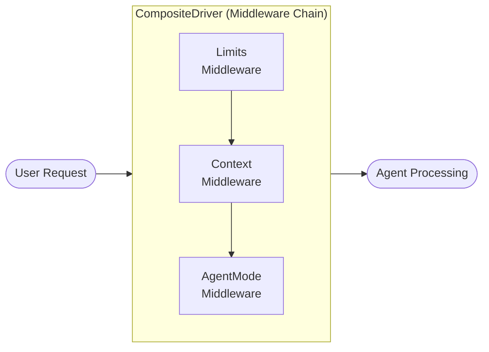
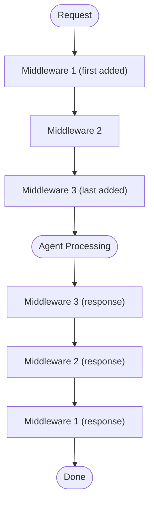

# QueryMT Agent - Middleware System

Middleware in QueryMT Agent provides a pluggable way to extend and modify agent behavior. The middleware system processes requests, responses, tool calls, and tool results through a configurable chain of handlers.

## Architecture

The middleware system uses a **driver-based architecture** where each middleware implements the `MiddlewareDriver` trait. Multiple drivers are chained together in a `CompositeDriver` that processes each agent interaction.



## Hooks vs Middleware

Middleware is compiled Rust code that participates directly in the agent execution pipeline. Hooks are profile/config-level external commands with JSON stdin/stdout schemas.

If you need local scripts, policy checks, approval automation, or profile-level lifecycle command hooks, use hooks. If you need typed in-process behavior or deep runtime integration, use middleware.

See the [Hooks Guide](hooks.md) for config-level lifecycle command hooks.

## Middleware Driver Trait

All middleware must implement the `MiddlewareDriver` trait:

```rust
pub trait MiddlewareDriver: Send + Sync {
    /// Unique name for this middleware
    fn name(&self) -> &str;
    
    /// Process incoming request (before agent processes)
    fn process_request(&self, request: &mut Request) -> Result<()>;
    
    /// Process outgoing response (after agent processes)
    fn process_response(&self, response: &mut Response) -> Result<()>;
    
    /// Process tool call (before tool execution)
    fn process_tool_call(&self, tool_call: &mut ToolCall) -> Result<()>;
    
    /// Process tool result (after tool execution)
    fn process_tool_result(&self, result: &mut ToolResult) -> Result<()>;
}
```

### Reviewing prepared tool calls

Middleware that needs to reason about what a tool call will do should implement
`on_prepared_tool_calls(&PreparedBatch)` rather than parse `ToolCall` arguments. Each
`PreparedToolCall` carries the call, its **effective** arguments and the file access
declared for them; the raw model text on `ToolCall.function.arguments` must not be
used for conflict decisions. Return one `PreparedCallVerdict` per call: `Proceed`, or
`Reject(result)` with the call's final error result. Rejected calls are not executed
and still produce exactly one result. See
[Raw and effective arguments](configuration.md#raw-and-effective-arguments).

## Built-in Middleware

### LimitsMiddleware

Enforces execution limits on agent operations.

**Configuration:**
```toml
[[middleware]]
type = "limits"
max_steps = 200
max_turns = 50
```

**Features:**
- `max_steps`: Maximum tool calls per session
- `max_turns`: Maximum conversation turns
- `max_price_usd`: Maximum USD spend per execution cycle (see [Price limits](#price-limits))
- `input_cost_per_million`, `output_cost_per_million`, `cache_read_cost_per_million`, `cache_write_cost_per_million`, `cache_write_1h_cost_per_million`: optional manual budget rates

**Behavior:**
- Tracks step and turn counts
- Rejects requests when limits exceeded
- Provides clear error messages

#### Price limits

```toml
[[middleware]]
type = "limits"
max_price_usd = 1.0

# Optional manual budget rates, USD per million tokens.
input_cost_per_million = 3.0
output_cost_per_million = 15.0
cache_read_cost_per_million = 0.3
cache_write_cost_per_million = 3.75
cache_write_1h_cost_per_million = 6.0   # only for 1-hour cache writes
```

**Scope.** The cap applies to one execution cycle (one prompt run). It counts every paid attempt attributed to that cycle: main responses, retries, compaction and delegation summaries, including cache read and write charges. Spend from earlier cycles of the same session does not count against a new cycle, and a charge that settles late stays with the cycle that started it. The session lifetime total is reported separately (see "Cost accounting" in the [API Reference](api_reference.md#cost-accounting)).

**Best-effort enforcement.** The cap is checked before each paid attempt is dispatched. If the known spend of the cycle has reached the cap, the attempt is not sent and the run stops with a price-limit outcome. This is not a reservation: requests already in flight, including parallel ones, are not counted until they settle, so spend can overshoot the cap by the cost of those requests.

**Incomplete pricing warns and continues.** If a used category cannot be priced (for example cache writes with no rate, or an interrupted request with no final usage), the run continues against the *known* subtotal and a `HookNotice` with `event_name = "price_limit"` (`is_error = false`) explains why enforcement is best-effort. It is sent once per cycle for each distinct reason, not on every usage update, and it does not need acknowledgement. A request that is still in flight is not an uncertainty and does not warn. Clients that did not negotiate notice support receive no notice; the condition is still carried in the accounting metadata. Failure to record accounting in the journal is different: it is an execution error and no further paid request is sent.

**Manual rates.** Without manual rates the budget uses the same catalog-priced components as reported API spend. Setting any rate makes a separate *budget valuation*, computed with the same calculator and snapshotted per attempt when it is dispatched. Changing the rates later does not reprice earlier charges, and reported API cost keeps its own pricing basis. Rates must be finite and not negative, otherwise the configuration is rejected. A rate you do not set stays unset: cache reads and writes are never priced at the input rate, and one-hour writes are never derived from the base write rate. Non-zero usage in a category with no rate makes the budget valuation partial, while an explicit `0.0` rate is a known zero.

**Unsupported dimensions.** Only token components are valued: uncached input, output including reasoning, cache reads, cache writes (base rate and an optional one-hour rate). Server-tool fees, cache storage or time charges, and other pricing modifiers are not valued. When one is known to apply, the cost is reported as incomplete instead of being treated as zero.

**Exclusions.** Usage from providers that are not metered per token (Codex, kimi-code, and OAuth/subscription-backed providers) is recorded with an excluded billing class. It gets no catalog charge, and manual rates do not turn it into API spend, so it never counts toward `max_price_usd`. A session that is entirely excluded has no dollar total, which differs from a known zero.

### ContextMiddleware

Manages conversation context and token usage.

**Configuration:**
```toml
[[middleware]]
type = "context"
warn_at_percent = 80
compact_at_percent = 90
fallback_max_tokens = 128000
```

**Features:**
- `warn_at_percent`: Trigger warning at this % of context limit
- `compact_at_percent`: Trigger compaction at this %
- `fallback_max_tokens`: Fallback context limit

**Behavior:**
- Monitors token usage
- Triggers compaction when approaching limits
- Emits warnings for monitoring

### AgentModeMiddleware

Enforces mode-specific restrictions (build/plan/review).

**Configuration:**
```toml
[[middleware]]
type = "agent_mode"
default = "build"
reminder = """<system-reminder>
You are in plan mode. Read-only access.
</system-reminder>"""
review_reminder = """<system-reminder>
You are in review mode. Provide feedback only.
</system-reminder>"""
```

**Features:**
- `default`: Default mode on session start
- `reminder`: System message for plan mode
- `review_reminder`: System message for review mode

**Behavior:**
- Injects mode-specific reminders
- Restricts tool access based on mode
- Allows runtime mode switching

### DedupCheckMiddleware

Detects duplicate or similar code patterns.

**Configuration:**
```toml
[[middleware]]
type = "dedup_check"
threshold = 0.85
min_lines = 10
```

**Features:**
- `threshold`: Similarity threshold (0.0 - 1.0)
- `min_lines`: Minimum lines to consider

**Behavior:**
- Analyzes code before writing
- Warns about similar existing code
- Helps avoid code duplication

### ParallelEditGuard

Detects a single model response that writes the same file with several tool calls
(for example two `edit` calls on `design.md`) and steers the model toward one
`multiedit` call per file.

Same-file writes in one batch are always executed one after another in the model's
order, so no edit is lost, whether or not this middleware is active. The guard only
changes what the model is told.

The guard reviews *prepared* calls (`MiddlewareDriver::on_prepared_tool_calls`): the
file access it inspects was declared for each call's final effective arguments, after
alias normalisation and pre-tool hook updates, and is the same access the scheduler
plans from. Two calls that only look disjoint in the model's raw arguments, but are
redirected to one file by a hook, are therefore treated as writing the same file. The
review runs once per execution segment; writes separated by a stateful or
clarification barrier are not compared with each other because the barrier already
orders them.

**Configuration:**
```toml
[[middleware]]
type = "parallel_edit_guard"
mode = "warn"   # "warn" (default) or "deny"
```

**Modes:**
- `warn` (default): every call runs. Before the next model request, a guidance
  message naming the affected files and recommending `multiedit` is added after the
  tool results. It is sent once.
- `deny`: only the first writing call per file runs. Each later writing call to that
  file gets an error result that names the file and tells the model to combine the
  edits into one `multiedit` call. Calls to other files still run, and every tool
  call still gets exactly one result.

**Default:** the guard is active in `warn` mode for every agent. Adding a
`parallel_edit_guard` entry replaces the default instance.

**Disable:**
```toml
[[middleware]]
type = "parallel_edit_guard"
enabled = false
```

Only calls that declare file writes count (`edit`, `multiedit`, `write_file`,
`delete_file`, `replace_symbol`). `shell` and read-only calls are not counted.

When a batch is flagged, a `HookNotice` event (`parallel_edit_guard`) is also
published so UIs can show the warning. It is persisted in the background and
never delays the tool calls. A guidance message that was not delivered
(for example because the turn was cancelled) is discarded at the next turn start.

Read-only file tools (`read_tool`, `get_function`, `get_symbol`, `index`, `mdq`,
`find_symbol_references`, `search_text`, `ls`, `glob`) are ordered after earlier writes to
the files (or directories) they read, so they never observe a half-written file.
`search_text` and `glob` only wait for writes their filter could see: a
`search_text` with `include = "*.md"` runs alongside an `edit` of `src/a.rs`.

### OutputLimitRecoveryMiddleware

Recovers when a model reply is cut off by the output-token limit, instead of ending
the run with a "model hit token limit" stop. It is active for every agent by default.

**Configuration:**
```toml
[[middleware]]
type = "output_limit_recovery"
enabled = true                        # default
escalate = true                       # default
max_continuations = 3                 # default
lower_effort_on_thinking_only = true  # default
instruction = "..."                   # default shown below
```

**Recovery steps**, in order, per turn:

1. **Escalate** (`escalate`): when a request sent below the model's output ceiling is
   cut off, the reply is discarded and the same request is retried once with
   `max_tokens` set to the ceiling. The discarded reply never reaches history, but its
   token usage and cost are counted. Escalation needs a provider that honours a
   per-request `max_tokens` (currently Anthropic). It never goes past an explicit
   `max_tokens` from your configuration, which is its own ceiling, and it is capped by
   the room left in the context window.
2. **Continue** (`max_continuations`): when the reply is cut off again (or escalation
   is not possible), the run continues with a temporary instruction. The instruction
   is removed after the next reply that is not cut off. A cut-off that contained only
   reasoning is not stored in history, and, when `lower_effort_on_thinking_only` is
   set and the provider honours it, the continuation uses a lower reasoning effort
   (one step down, `medium` when none was configured, never below `low`).

After `max_continuations` continuations in one turn the run stops as before, with stop
type `model_token_limit`. A reply that is cut off in the middle of a tool call never
runs that call; the model is told to split the write into smaller calls.

**Initial cap and ceiling.** With no `max_tokens` configured, Anthropic requests start at
`min(32000, model output limit)` and the model's output limit is the ceiling. If the
limit is unknown, 32,000 is used for both.

**Default instruction.** `{cap}` expands to the cap that was hit:

```text
Your previous response was cut off by the output-token limit ({cap} tokens). Continue
directly from where you stopped without repeating or summarising earlier output. Split
large file writes or edits into several smaller tool calls, and keep reasoning brief.
```

**Events.** Each escalation or continuation publishes a durable `output_limit_recovery`
event with the turn, attempt number, action (`escalate` or `continue`), the cap before
and after, whether the reply was thinking-only, and, for an escalation, the id of the
discarded streamed message so clients can drop it.

**Disable:**
```toml
[[middleware]]
type = "output_limit_recovery"
enabled = false
```

Adding an `output_limit_recovery` entry replaces the default instance. See
`crates/agent/examples/confs/output_limit_recovery.toml` for a complete example.

### ContextFactory Middleware

Legacy context management middleware.

**Configuration:**
```toml
[[middleware]]
type = "context"
max_tokens = 128000
compact_on_overflow = true
```

## Creating Custom Middleware

### Basic Middleware

```rust
use querymt_agent::middleware::{MiddlewareDriver, MiddlewareError, Result};
use querymt_agent::middleware::state::{ExecutionState, ToolCall, ToolResult};
use std::sync::Arc;

pub struct LoggingMiddleware {
    name: String,
}

impl LoggingMiddleware {
    pub fn new() -> Self {
        Self {
            name: "logging".to_string(),
        }
    }
}

impl MiddlewareDriver for LoggingMiddleware {
    fn name(&self) -> &str {
        &self.name
    }
    
    fn process_request(&self, request: &mut Request) -> Result<()> {
        log::info!("Request: {:?}", request);
        Ok(())
    }
    
    fn process_response(&self, response: &mut Response) -> Result<()> {
        log::info!("Response: {:?}", response);
        Ok(())
    }
    
    fn process_tool_call(&self, tool_call: &mut ToolCall) -> Result<()> {
        log::info!("Tool call: {}({})", 
            tool_call.function.name, 
            tool_call.function.arguments);
        Ok(())
    }
    
    fn process_tool_result(&self, result: &mut ToolResult) -> Result<()> {
        log::info!("Tool result: {} -> {} bytes", 
            result.tool_name, 
            result.result.len());
        Ok(())
    }
}
```

### Middleware with State

```rust
use std::sync::{Arc, Mutex};

pub struct RateLimitMiddleware {
    name: String,
    requests: Arc<Mutex<Vec<u64>>>,
    max_per_second: usize,
}

impl RateLimitMiddleware {
    pub fn new(max_per_second: usize) -> Self {
        Self {
            name: "rate_limit".to_string(),
            requests: Arc::new(Mutex::new(Vec::new())),
            max_per_second,
        }
    }
    
    fn cleanup_old_requests(&self) {
        let now = std::time::SystemTime::now()
            .duration_since(std::time::UNIX_EPOCH)
            .unwrap()
            .as_secs();
        
        let mut requests = self.requests.lock().unwrap();
        requests.retain(|&t| now - t < 1);
    }
}

impl MiddlewareDriver for RateLimitMiddleware {
    fn name(&self) -> &str {
        &self.name
    }
    
    fn process_request(&self, request: &mut Request) -> Result<()> {
        self.cleanup_old_requests();
        
        let mut requests = self.requests.lock().unwrap();
        if requests.len() >= self.max_per_second {
            return Err(MiddlewareError::rate_limit_exceeded(
                self.name().to_string()
            ));
        }
        requests.push(std::time::SystemTime::now()
            .duration_since(std::time::UNIX_EPOCH)
            .unwrap()
            .as_secs());
        
        Ok(())
    }
    
    // Other methods...
}
```

### Middleware with Configuration

```rust
use serde::{Deserialize, Serialize};
use serde_json::Value;

#[derive(Debug, Clone, Deserialize)]
pub struct MyMiddlewareConfig {
    pub enabled: bool,
    pub option1: String,
    pub option2: Option<usize>,
}

pub struct MyMiddleware {
    config: MyMiddlewareConfig,
}

impl MyMiddleware {
    pub fn new(config: MyMiddlewareConfig) -> Self {
        Self { config }
    }
}

impl MiddlewareDriver for MyMiddleware {
    fn name(&self) -> &str {
        "my_middleware"
    }
    
    fn process_request(&self, request: &mut Request) -> Result<()> {
        if !self.config.enabled {
            return Ok(());
        }
        
        // Custom logic here
        Ok(())
    }
    
    // Other methods...
}
```

## Registering Middleware

### Via Config File

```toml
[[middleware]]
type = "my_middleware"
enabled = true
option1 = "value1"
option2 = 42
```

### Programmatically

```rust
use querymt_agent::prelude::*;
use querymt_agent::middleware::MiddlewareDriver;

let agent = Agent::single()
    .provider("anthropic", "claude-sonnet-4-5-20250929")
    .cwd(".")
    .tools(["read_tool", "shell"])
    .middleware(LoggingMiddleware::new())
    .middleware(RateLimitMiddleware::new(10))
    .build()
    .await?;
```

## Middleware Factory Pattern

For config-based middleware creation, implement the `MiddlewareFactory` trait:

```rust
use querymt_agent::middleware::{MiddlewareFactory, MiddlewareDriver, Result};
use querymt_agent::agent::agent_config::AgentConfig;
use serde_json::Value;
use std::sync::Arc;

pub struct MyMiddlewareFactory;

impl MiddlewareFactory for MyMiddlewareFactory {
    fn type_name(&self) -> &'static str {
        "my_middleware"
    }
    
    fn create(
        &self,
        config: &Value,
        _agent_config: &AgentConfig,
    ) -> Result<Arc<dyn MiddlewareDriver>> {
        let config: MyMiddlewareConfig = serde_json::from_value(config.clone())
            .map_err(|e| anyhow::anyhow!("Invalid config: {}", e))?;
        
        Ok(Arc::new(MyMiddleware::new(config)))
    }
}

// Register the factory
use querymt_agent::middleware::MIDDLEWARE_REGISTRY;
MIDDLEWARE_REGISTRY.register(Arc::new(MyMiddlewareFactory));
```

## Middleware Execution Order

Middleware is executed in the order it was added to the chain:



## Common Patterns

### Request Validation

```rust
pub struct PermissionMiddleware {
    // ...
}

impl MiddlewareDriver for PermissionMiddleware {
    fn process_tool_call(&self, tool_call: &mut ToolCall) -> Result<()> {
        if self.requires_permission(&tool_call.function.name) {
            // Request permission from user
            let granted = self.request_permission()?;
            if !granted {
                return Err(MiddlewareError::permission_denied(
                    tool_call.function.name.clone()
                ));
            }
        }
        Ok(())
    }
}
```

### Response Modification

```rust
pub struct SanitizationMiddleware {
    // ...
}

impl MiddlewareDriver for SanitizationMiddleware {
    fn process_response(&self, response: &mut Response) -> Result<()> {
        // Remove sensitive information
        response.content = self.sanitize(&response.content);
        Ok(())
    }
}
```

### Tool Call Interception

```rust
pub struct ToolLoggingMiddleware {
    // ...
}

impl MiddlewareDriver for ToolLoggingMiddleware {
    fn process_tool_call(&self, tool_call: &mut ToolCall) -> Result<()> {
        // Log before execution
        self.log_tool_call(tool_call);
        
        // Modify arguments if needed
        if tool_call.function.name == "shell" {
            // Add safety prefix
            tool_call.function.arguments = self.sanitize_shell_args(
                &tool_call.function.arguments
            );
        }
        
        Ok(())
    }
}
```

## Error Handling

Middleware errors are categorized:

```rust
pub enum MiddlewareError {
    InternalError(String),
    ValidationError(String),
    PermissionDenied(String),
    RateLimitExceeded(String),
    ConfigError(String),
}
```

Errors can:
- **Block execution**: Return error to stop processing
- **Modify behavior**: Return Ok() with modified data
- **Log only**: Log and continue

## Best Practices

1. **Keep middleware focused**: Each middleware should do one thing well
2. **Be idempotent**: Middleware should produce same result on repeated runs
3. **Handle errors gracefully**: Don't crash the agent on middleware errors
4. **Log appropriately**: Use logging for debugging, not for every call
5. **Consider performance**: Avoid expensive operations in hot paths
6. **Document behavior**: Clearly document what each middleware does

## Troubleshooting

### Middleware Not Running

- Check middleware type is registered in `MIDDLEWARE_REGISTRY`
- Verify config has correct `type` field
- Check for config parsing errors in logs

### Middleware Order Issues

- Middleware executes in registration order
- Use `CompositeDriver` to control order explicitly
- Consider using middleware presets for common patterns

### Performance Issues

- Profile middleware execution time
- Avoid blocking operations in middleware
- Use async where possible
- Cache expensive computations

## Examples

See `examples/` for middleware usage:

- `qmtcode.rs` - Uses agent_mode, limits, context middleware
- Custom middleware examples in tests

## Related Documentation

- [Configuration Guide](configuration.md) - Configuring middleware
- [Agent Modes](agent_modes.md) - Mode-specific behavior
- [API Reference](api_reference.md) - Middleware types