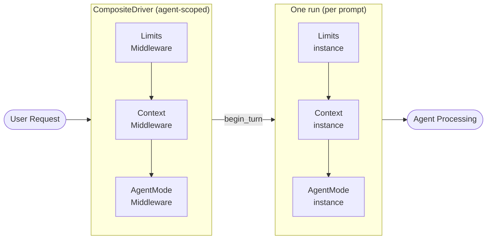
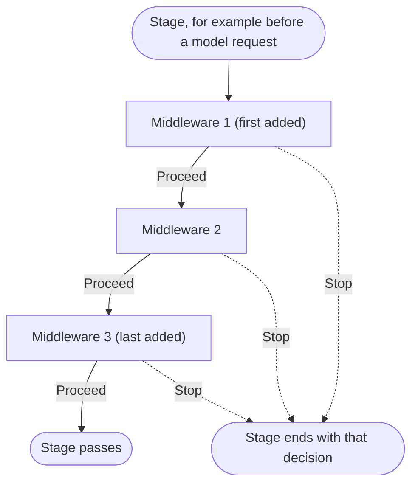

# QueryMT Agent - Middleware System

Middleware in QueryMT Agent provides a pluggable way to extend and modify agent behavior. The middleware system processes requests, responses, tool calls, and tool results through a configurable chain of handlers.

## Architecture

A middleware has two parts. The `Middleware` is agent-scoped: it holds configuration and shared services and lives as long as the agent. For every run (one prompt of one session) it creates a `TurnMiddleware`, which owns all state of that run and is dropped when the run ends. Several middleware are chained in a `CompositeDriver`; each run consults the instances in the order the middleware were configured.



State a middleware keeps while a run executes belongs to that run only: it is not visible to a run of another session and does not carry into the next run of the same session. A middleware that needs something across runs reads it from the session's stored history or from its configuration.

## Hooks vs Middleware

Middleware is compiled Rust code that participates directly in the agent execution pipeline. Hooks are profile/config-level external commands with JSON stdin/stdout schemas.

If you need local scripts, policy checks, approval automation, or profile-level lifecycle command hooks, use hooks. If you need typed in-process behavior or deep runtime integration, use middleware.

See the [Hooks Guide](hooks.md) for config-level lifecycle command hooks.

## The Middleware Traits

```rust
/// Agent-scoped. Holds configuration and shared services only.
pub trait Middleware: Send + Sync {
    fn name(&self) -> &'static str;
    /// Create the state of one run.
    fn begin_turn(&self, turn: &TurnInfo<'_>) -> Box<dyn TurnMiddleware>;
    fn bind_agent(&self, registry: &Arc<ToolRegistry>, events: &Arc<EventSink>) {}
    fn limits(&self) -> Option<SessionLimits> { None }
    fn budget_pricing(&self) -> Option<ModelPricing> { None }
}

/// One per run. All run state of a middleware lives in `self`.
#[async_trait]
pub trait TurnMiddleware: Send {
    async fn on_turn_start(&mut self, cx: &mut HookCx<'_>) -> Result<StepVerdict>;
    async fn on_step_start(&mut self, cx: &mut HookCx<'_>) -> Result<StepVerdict>;
    async fn on_after_llm(&mut self, cx: &mut HookCx<'_>, reply: &LlmResponse) -> Result<ReplyVerdict>;
    async fn on_prepared_tool_calls(
        &mut self,
        cx: &mut HookCx<'_>,
        batch: &PreparedBatch<'_>,
    ) -> Result<Vec<PreparedCallVerdict>>;
    async fn on_turn_end(&mut self, cx: &mut HookCx<'_>) -> Result<EndVerdict>;
    async fn on_stopped(&mut self, cx: &mut HookCx<'_>, stop: &Stop) -> Result<StopVerdict>;
}
```

Every hook has a default that passes, so a middleware implements only the hooks it needs. Each hook returns a verdict that names only what that stage allows:

| Hook | Runs | Verdict | Meaning |
|---|---|---|---|
| `on_turn_start` | once, before the first step | `StepVerdict`: `Proceed`, `Stop(Stop)` | `Stop` ends the run before any model request. The run's model is already resolved, so `cx.profile()` is the model's real profile; a run whose provider cannot be built fails before this hook and no hook runs |
| `on_step_start` | before every model request | `StepVerdict` | as above |
| `on_after_llm` | after a reply, before it is stored | `ReplyVerdict`: `Proceed`, `Stop(Stop)`, `Retry` | `Retry` discards the reply, counts its usage and sends the request again |
| `on_prepared_tool_calls` | before a batch of tool calls is scheduled | one `PreparedCallVerdict` per call | `Reject(result)` replaces the call with its final result |
| `on_turn_end` | when the model has ended its turn | `EndVerdict`: `Finish`, `Continue`, `Stop(Stop)` | `Continue` sends another request in the same run |
| `on_stopped` | when the run is about to end on a stop | `StopVerdict`: `Pass`, `Recover` | `Recover` replaces the stop with another request |

The first middleware that returns a decision other than the passing one (`Proceed`, `Finish`, `Pass`) ends the stage; later middleware are not consulted for it. Notices and overrides queued by earlier middleware in that stage are kept.

`HookCx` is what a hook may read of the run (`session_id`, `history` (the stored messages, `&[AgentMessage]`), `stats`, `provider`, `model`, `profile`, `mode`, `last_applied`, `request_overrides`, `last_mode_notice`, `changed_paths`, `runtime`) and the two things it may write, at any stage: `queue_notice(source, text)` stores a notice before the next model request, and `set_request_overrides(options)` sets generation overrides for that request.

When a run is cancelled while a hook is running, the hook's future is dropped and the run ends as cancelled without waiting for it. A hook must leave `self` usable at every `.await`, which is trivially true because the instance is dropped with the run.

### Reviewing prepared tool calls

Middleware that needs to reason about what a tool call will do should implement
`on_prepared_tool_calls(cx, &PreparedBatch)` rather than parse `ToolCall` arguments. Each
`PreparedToolCall` carries the call, its **effective** arguments and the file access
declared for them; the raw model text on `ToolCall.function.arguments` must not be
used for conflict decisions. Return one `PreparedCallVerdict` per call: `Proceed`, or
`Reject(result)` with the call's final error result. Rejected calls are not executed
and still produce exactly one result. See
[Raw and effective arguments](configuration.md#raw-and-effective-arguments).

## Built-in Middleware

### LimitsMiddleware

Enforces execution limits on agent operations.

**Configuration:**
```toml
[[middleware]]
type = "limits"
max_steps = 200
max_turns = 50
```

**Features:**
- `max_steps`: Maximum tool calls per session
- `max_turns`: Maximum conversation turns
- `max_price_usd`: Maximum USD spend per execution cycle (see [Price limits](#price-limits))
- `input_cost_per_million`, `output_cost_per_million`, `cache_read_cost_per_million`, `cache_write_cost_per_million`, `cache_write_1h_cost_per_million`: optional manual budget rates

**Behavior:**
- Tracks step and turn counts
- Rejects requests when limits exceeded
- Provides clear error messages

#### Price limits

```toml
[[middleware]]
type = "limits"
max_price_usd = 1.0

# Optional manual budget rates, USD per million tokens.
input_cost_per_million = 3.0
output_cost_per_million = 15.0
cache_read_cost_per_million = 0.3
cache_write_cost_per_million = 3.75
cache_write_1h_cost_per_million = 6.0   # only for 1-hour cache writes
```

**Scope.** The cap applies to one execution cycle (one prompt run). It counts every paid attempt attributed to that cycle: main responses, retries, compaction and delegation summaries, including cache read and write charges. Spend from earlier cycles of the same session does not count against a new cycle, and a charge that settles late stays with the cycle that started it. The session lifetime total is reported separately (see "Cost accounting" in the [API Reference](api_reference.md#cost-accounting)).

**Best-effort enforcement.** The cap is checked before each paid attempt is dispatched. If the known spend of the cycle has reached the cap, the attempt is not sent and the run stops with a price-limit outcome. This is not a reservation: requests already in flight, including parallel ones, are not counted until they settle, so spend can overshoot the cap by the cost of those requests.

**Incomplete pricing warns and continues.** If a used category cannot be priced (for example cache writes with no rate, or an interrupted request with no final usage), the run continues against the *known* subtotal and a `HookNotice` with `event_name = "price_limit"` (`is_error = false`) explains why enforcement is best-effort. It is sent once per cycle for each distinct reason, not on every usage update, and it does not need acknowledgement. A request that is still in flight is not an uncertainty and does not warn. Clients that did not negotiate notice support receive no notice; the condition is still carried in the accounting metadata. Failure to record accounting in the journal is different: it is an execution error and no further paid request is sent.

**Manual rates.** Without manual rates the budget uses the same catalog-priced components as reported API spend. Setting any rate makes a separate *budget valuation*, computed with the same calculator and snapshotted per attempt when it is dispatched. Changing the rates later does not reprice earlier charges, and reported API cost keeps its own pricing basis. Rates must be finite and not negative, otherwise the configuration is rejected. A rate you do not set stays unset: cache reads and writes are never priced at the input rate, and one-hour writes are never derived from the base write rate. Non-zero usage in a category with no rate makes the budget valuation partial, while an explicit `0.0` rate is a known zero.

**Unsupported dimensions.** Only token components are valued: uncached input, output including reasoning, cache reads, cache writes (base rate and an optional one-hour rate). Server-tool fees, cache storage or time charges, and other pricing modifiers are not valued. When one is known to apply, the cost is reported as incomplete instead of being treated as zero.

**Exclusions.** Usage from providers that are not metered per token (Codex, kimi-code, and OAuth/subscription-backed providers) is recorded with an excluded billing class. It gets no catalog charge, and manual rates do not turn it into API spend, so it never counts toward `max_price_usd`. A session that is entirely excluded has no dollar total, which differs from a known zero.

### ContextMiddleware

Manages conversation context and token usage.

**Configuration:**
```toml
[[middleware]]
type = "context"
warn_at_percent = 80
compact_at_percent = 90
fallback_max_tokens = 128000
```

**Features:**
- `warn_at_percent`: Trigger warning at this % of context limit
- `compact_at_percent`: Trigger compaction at this %
- `fallback_max_tokens`: Fallback context limit

**Behavior:**
- Monitors token usage
- Triggers compaction when approaching limits
- Stores one `context_usage` notice per run, before the first model request at which usage is at or above `warn_at_percent` of the model's context limit. The next run of the session warns again if it is still above the threshold, so a long session is reminded once per run, not on every step. Sessions are independent: one session's warning never silences another's, whatever model each uses. `warn_at_percent = 0` turns the warning off.

### AgentModeMiddleware

Enforces mode-specific restrictions (build/plan/review).

**Configuration:**
```toml
[[middleware]]
type = "agent_mode"
reminder = """<system-reminder>
You are in plan mode. Read-only access.
</system-reminder>"""
review_reminder = """<system-reminder>
You are in review mode. Provide feedback only.
</system-reminder>"""
```

**Features:**
- The initial session mode is not set here; use `mode` on `[agent]` or `[[delegates]]`
- `reminder`: System message for plan mode
- `review_reminder`: System message for review mode

**Behavior:**
- Stores the mode's reminder in the history once, when a request is first sent in that mode (or when the mode's last stored reminder is no longer in the history, for example after compaction). It is not added again to every model call, so it does not change the cached prefix.
- When the session leaves a mode that had a reminder for a mode without one, stores a short notice that the earlier reminder no longer applies.
- Switching modes without sending a request stores nothing
- Restricts tool access based on mode
- Allows runtime mode switching

### DedupCheckMiddleware

Detects duplicate or similar code patterns.

**Configuration:**
```toml
[[middleware]]
type = "dedup_check"
threshold = 0.85
min_lines = 10
```

**Features:**
- `threshold`: Similarity threshold (0.0 - 1.0)
- `min_lines`: Minimum lines to consider

**Behavior:**
- Runs when a run is about to complete and its tool calls added or modified files; a run that changed no files is not reviewed
- Reviews once per run, in every run of every session, and considers only the files changed by that run. Changes of an earlier run (for example one that ended while the workspace index was still being built) and changes made after the review are dropped, not carried into a later run
- If functions in the changed files are similar to indexed code above `threshold`, stores a `duplicate_code` notice in that session and continues the run with another model request, so the model can reuse the existing code. The request holds the reviewed session's conversation followed by the notice
- When the review cannot run (`enabled = false`, or the workspace index is not ready yet) the run completes as if it were not configured

### ParallelEditGuard

Detects a single model response that writes the same file with several tool calls
(for example two `edit` calls on `design.md`) and steers the model toward one
`multiedit` call per file.

Same-file writes in one batch are always executed one after another in the model's
order, so no edit is lost, whether or not this middleware is active. The guard only
changes what the model is told.

The guard reviews *prepared* calls (`TurnMiddleware::on_prepared_tool_calls`): the
file access it inspects was declared for each call's final effective arguments, after
alias normalisation and pre-tool hook updates, and is the same access the scheduler
plans from. Two calls that only look disjoint in the model's raw arguments, but are
redirected to one file by a hook, are therefore treated as writing the same file. The
review runs once per execution segment; writes separated by a stateful or
clarification barrier are not compared with each other because the barrier already
orders them.

**Configuration:**
```toml
[[middleware]]
type = "parallel_edit_guard"
mode = "warn"   # "warn" (default) or "deny"
```

**Modes:**
- `warn` (default): every call runs. Before the next model request, a guidance
  message naming the affected files and recommending `multiedit` is added after the
  tool results. It is queued once per flagged batch.
- `deny`: only the first writing call per file runs. Each later writing call to that
  file gets an error result that names the file and tells the model to combine the
  edits into one `multiedit` call. Calls to other files still run, and every tool
  call still gets exactly one result.

**Default:** the guard is active in `warn` mode for every agent. Adding a
`parallel_edit_guard` entry replaces the default instance.

**Disable:**
```toml
[[middleware]]
type = "parallel_edit_guard"
enabled = false
```

Only calls that declare file writes count (`edit`, `multiedit`, `write_file`,
`delete_file`, `replace_symbol`). `shell` and read-only calls are not counted.

When a batch is flagged, a `HookNotice` event (`parallel_edit_guard`) is also
published so UIs can show the warning. It is persisted in the background and
never delays the tool calls. A guidance message that was not delivered (for
example because the run was cancelled) is dropped with the run.

Read-only file tools (`read_tool`, `get_function`, `get_symbol`, `index`, `mdq`,
`find_symbol_references`, `search_text`, `ls`, `glob`) are ordered after earlier writes to
the files (or directories) they read, so they never observe a half-written file.
`search_text` and `glob` only wait for writes their filter could see: a
`search_text` with `include = "*.md"` runs alongside an `edit` of `src/a.rs`.

### OutputLimitRecoveryMiddleware

Recovers when a model reply is cut off by the output-token limit, instead of ending
the run with a "model hit token limit" stop. It is active for every agent by default.

**Configuration:**
```toml
[[middleware]]
type = "output_limit_recovery"
enabled = true                        # default
escalate = true                       # default
max_continuations = 3                 # default
lower_effort_on_thinking_only = true  # default
instruction = "..."                   # default shown below
```

**Recovery steps**, in order, per turn:

1. **Escalate** (`escalate`): when a request sent below the model's output ceiling is
   cut off, the reply is discarded and the same request is retried once with
   `max_tokens` set to the ceiling. The discarded reply never reaches history, but its
   token usage and cost are counted. Escalation needs a provider that honours a
   per-request `max_tokens` (currently Anthropic). It never goes past an explicit
   `max_tokens` from your configuration, which is its own ceiling, and it is capped by
   the room left in the context window.
2. **Continue** (`max_continuations`): when the reply is cut off again (or escalation
   is not possible), the run continues with a temporary instruction. The instruction
   is removed after the next reply that is not cut off. A cut-off that contained only
   reasoning is not stored in history, and, when `lower_effort_on_thinking_only` is
   set and the provider honours it, the continuation uses a lower reasoning effort
   (one step down, `medium` when none was configured, never below `low`).

After `max_continuations` continuations in one turn the run stops as before, with stop
type `model_token_limit`. A reply that is cut off in the middle of a tool call never
runs that call; the model is told to split the write into smaller calls.

**Initial cap and ceiling.** With no `max_tokens` configured, Anthropic requests start at
`min(32000, model output limit)` and the model's output limit is the ceiling. At
reasoning effort `high` or `max` the requests start at `min(64000, model output limit)`
instead, because reasoning tokens count against the cap and long replies were being cut
off and discarded at 32,000. The effort is read when the provider is built for a request,
so a change of effort applies from the next request. If the limit is unknown, 32,000 is
used for both at every effort. An explicit `max_tokens` is used as it is and is also the
ceiling.

**Default instruction.** `{cap}` expands to the cap that was hit:

```text
Your previous response was cut off by the output-token limit ({cap} tokens). Continue
directly from where you stopped without repeating or summarising earlier output. Split
large file writes or edits into several smaller tool calls, and keep reasoning brief.
```

**Events.** Each escalation or continuation publishes a durable `output_limit_recovery`
event with the turn, attempt number, action (`escalate` or `continue`), the cap before
and after, whether the reply was thinking-only, and, for an escalation, the id of the
discarded streamed message so clients can drop it.

**Disable:**
```toml
[[middleware]]
type = "output_limit_recovery"
enabled = false
```

Adding an `output_limit_recovery` entry replaces the default instance. See
`crates/agent/examples/confs/output_limit_recovery.toml` for a complete example.

### ContextFactory Middleware

Legacy context management middleware.

**Configuration:**
```toml
[[middleware]]
type = "context"
max_tokens = 128000
compact_on_overflow = true
```

## Creating Custom Middleware

### Basic Middleware

A middleware that logs every model reply and tool batch. It keeps no run state, so its per-run instance is empty.

```rust
use async_trait::async_trait;
use querymt_agent::middleware::{
    HookCx, LlmResponse, Middleware, PreparedBatch, PreparedCallVerdict, ReplyVerdict, Result,
    TurnInfo, TurnMiddleware,
};

pub struct LoggingMiddleware;

impl Middleware for LoggingMiddleware {
    fn name(&self) -> &'static str {
        "logging"
    }

    fn begin_turn(&self, turn: &TurnInfo<'_>) -> Box<dyn TurnMiddleware> {
        log::info!("run started for session {}", turn.session_id);
        Box::new(LoggingTurn)
    }
}

struct LoggingTurn;

#[async_trait]
impl TurnMiddleware for LoggingTurn {
    async fn on_after_llm(&mut self, cx: &mut HookCx<'_>, reply: &LlmResponse) -> Result<ReplyVerdict> {
        log::info!("reply in {}: {} tool call(s)", cx.session_id(), reply.tool_calls.len());
        Ok(ReplyVerdict::Proceed)
    }

    async fn on_prepared_tool_calls(
        &mut self,
        _cx: &mut HookCx<'_>,
        batch: &PreparedBatch<'_>,
    ) -> Result<Vec<PreparedCallVerdict>> {
        for prepared in batch.calls {
            log::info!("tool call: {}({})", prepared.call.function.name, prepared.args);
        }
        Ok(batch.calls.iter().map(|_| PreparedCallVerdict::Proceed).collect())
    }
}
```

### Middleware with Run State

State that belongs to a run lives on the `TurnMiddleware`. This one stops the run after it has made too many requests in a single run, and reminds the model once:

```rust
use querymt_agent::events::StopType;
use querymt_agent::middleware::{HookCx, Middleware, Result, StepVerdict, Stop, TurnInfo, TurnMiddleware};
use querymt_agent::model::NoticeSource;

pub struct RequestBudget {
    pub max_requests: usize,
}

impl Middleware for RequestBudget {
    fn name(&self) -> &'static str {
        "request_budget"
    }

    fn begin_turn(&self, _turn: &TurnInfo<'_>) -> Box<dyn TurnMiddleware> {
        Box::new(RequestBudgetTurn { max: self.max_requests, seen: 0, reminded: false })
    }
}

struct RequestBudgetTurn {
    max: usize,
    seen: usize,
    reminded: bool,
}

#[async_trait::async_trait]
impl TurnMiddleware for RequestBudgetTurn {
    async fn on_step_start(&mut self, cx: &mut HookCx<'_>) -> Result<StepVerdict> {
        self.seen += 1;
        if self.seen > self.max {
            return Ok(StepVerdict::Stop(Stop::new(StopType::Other, "request budget used")));
        }
        if self.seen == self.max && !std::mem::replace(&mut self.reminded, true) {
            cx.queue_notice(NoticeSource::ProgressReview, "This is your last request in this run.");
        }
        Ok(StepVerdict::Proceed)
    }
}
```

Because the instance is created for each run, the counter starts at zero in every run and two sessions never share it. Do not keep per-run state in the `Middleware` itself.

### Middleware with Configuration

Configuration belongs to the agent-scoped `Middleware`; hand a copy to each run in `begin_turn`.

```rust
use serde::Deserialize;

#[derive(Debug, Clone, Deserialize)]
pub struct MyMiddlewareConfig {
    pub option1: String,
    pub option2: Option<usize>,
}

pub struct MyMiddleware {
    config: MyMiddlewareConfig,
}

impl Middleware for MyMiddleware {
    fn name(&self) -> &'static str {
        "my_middleware"
    }

    fn begin_turn(&self, _turn: &TurnInfo<'_>) -> Box<dyn TurnMiddleware> {
        Box::new(MyTurn { config: self.config.clone() })
    }
}
```

## Registering Middleware

### Via Config File

```toml
[[middleware]]
type = "my_middleware"
enabled = true
option1 = "value1"
option2 = 42
```

### Programmatically

```rust
use querymt_agent::prelude::*;

let agent = Agent::builder()
    .provider("anthropic", "claude-sonnet-4-5-20250929")
    .cwd(".")
    .tools(["read_tool", "shell"])
    .middleware(|_agent| LoggingMiddleware)
    .middleware(|_agent| RequestBudget { max_requests: 50 })
    .build()
    .await?;
```

## Middleware Factory Pattern

For config-based middleware creation, implement the `MiddlewareFactory` trait:

```rust
use querymt_agent::middleware::{Middleware, MiddlewareFactory};
use querymt_agent::agent::agent_config::AgentConfig;
use serde_json::Value;
use std::sync::Arc;

pub struct MyMiddlewareFactory;

impl MiddlewareFactory for MyMiddlewareFactory {
    fn type_name(&self) -> &'static str {
        "my_middleware"
    }

    /// `Ok(None)` declines to build (for example `enabled = false`).
    fn create(
        &self,
        config: &Value,
        _agent_config: &AgentConfig,
    ) -> anyhow::Result<Option<Arc<dyn Middleware>>> {
        let config: MyMiddlewareConfig = serde_json::from_value(config.clone())?;
        Ok(Some(Arc::new(MyMiddleware { config })))
    }
}
```

The registry holds the factories of the built-in middleware types. Middleware of your own is added in code with `AgentBuilder::middleware`.

## Middleware Execution Order

At every stage the middleware are consulted in the order they were added to the chain, and the first decisive verdict ends the stage:



## Common Patterns

### Stopping a run

```rust
#[async_trait::async_trait]
impl TurnMiddleware for QuotaTurn {
    async fn on_step_start(&mut self, cx: &mut HookCx<'_>) -> Result<StepVerdict> {
        if cx.stats().total_output_tokens > self.quota {
            return Ok(StepVerdict::Stop(Stop::new(StopType::Other, "quota used")));
        }
        Ok(StepVerdict::Proceed)
    }
}
```

### Rejecting a tool call

```rust
async fn on_prepared_tool_calls(
    &mut self,
    _cx: &mut HookCx<'_>,
    batch: &PreparedBatch<'_>,
) -> Result<Vec<PreparedCallVerdict>> {
    Ok(batch
        .calls
        .iter()
        .map(|prepared| {
            if prepared.call.function.name == "shell" {
                PreparedCallVerdict::Reject(Box::new(denied_result(prepared)))
            } else {
                PreparedCallVerdict::Proceed
            }
        })
        .collect())
}
```

### Continuing at the end of a run

```rust
async fn on_turn_end(&mut self, cx: &mut HookCx<'_>) -> Result<EndVerdict> {
    if self.checked {
        return Ok(EndVerdict::Finish);
    }
    self.checked = true;
    cx.queue_notice(NoticeSource::DuplicateCode, "Re-read your changes once more.");
    Ok(EndVerdict::Continue)
}
```

## Error Handling

A hook returns `Result<Verdict>`. An `Err` ends the run with a middleware error that keeps its source; a verdict never signals an error. To end a run on purpose, return `Stop`.

## Best Practices

1. **Keep middleware focused**: Each middleware should do one thing well
2. **Keep run state on the `TurnMiddleware`**: never in the `Middleware`, which every session shares
3. **Handle errors gracefully**: Return `Err` only when the middleware itself is broken
4. **Log appropriately**: Use logging for debugging, not for every call
5. **Consider performance**: Avoid expensive operations in hot paths
6. **Document behavior**: Clearly document what each middleware does

## Troubleshooting

### Middleware Not Running

- Check middleware type is registered in `MIDDLEWARE_REGISTRY`
- Verify config has correct `type` field
- Check for config parsing errors in logs

### Middleware Order Issues

- Middleware is consulted in registration order
- Use middleware presets for common patterns

### Performance Issues

- Profile middleware execution time
- Avoid blocking operations in middleware
- Use async where possible
- Cache expensive computations

## Examples

See `examples/` for middleware usage:

- `qmtcode.rs` - Uses agent_mode, limits, context middleware
- Custom middleware examples in tests

## Related Documentation

- [Configuration Guide](configuration.md) - Configuring middleware
- [Agent Modes](agent_modes.md) - Mode-specific behavior
- [API Reference](api_reference.md) - Middleware types
