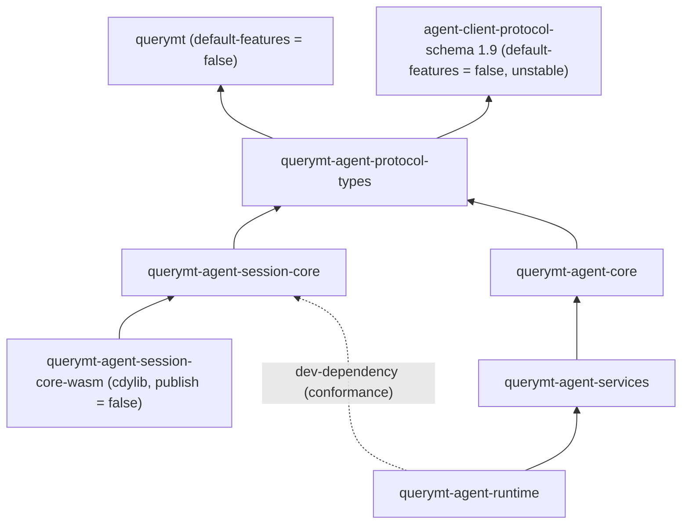

# Design

## Context

See proposal.md (Why). Current state that shapes the approach:

- **Where the wire types live today:**
  - `crates/agent-core/src/events.rs` `AgentEvent`, `AgentEventKind` (103 variants), `EventEnvelope`, `DurableEvent`. Their non-test dependencies are:
    - in agent-core: `protocol` (`ContentBlock`, `StopReason`, `RequestPermissionRequest`), `accounting` (`AttemptStart`, `AttemptSettlement`, `RequestAccounting`, `AccountingReason`), `agent_mode::AgentMode`, `dedup::DuplicateWarning`, `delegation_update`, `elicitation::ElicitationAction`, `hash::RapidHash`, `runtime_status`, `session::domain::*`, `session::projection::SessionWorkspaceView`;
    - in `querymt`: `Usage`, `chat::FinishReason`, `chat::Tool`, `providers::{BillingClass, IncompleteReason, ModelPricing, UsageValuation}`.
  - `config::mcp::McpServerConfig` is used only by `impl From<McpServerConfig> for McpServerInfo`.
  - `crates/agent-core/src/session/projection.rs` `AuditView` sits next to the async storage traits `EventJournal` and `ViewStore` (`async_trait`). `crates/agent-core/src/stream_cursor.rs` `StreamCursor`.
  - `crates/agent-services/src/accounting/snapshot.rs` `AccountingSnapshot` and its scope, budget and cycle parts. `from_reducer` and `from_events` call `AccountingReducer`.
  - `crates/agent-services/src/session/history_window.rs` `LoadWindow`, `HistoryInfo`, `ToolContentPart`, `TruncatedEntry`, `SessionHistorySummary` and its parts. The windowing functions and `WindowRead` stay.
  - `crates/agent-runtime/src/session/load_snapshot.rs` `SessionLoadSnapshot`, `UserPromptRecord`. `crates/agent-runtime/src/control/notifications.rs` `SessionInputStateNotification`, `SessionInputDelivery`, `SessionInputState`.
- **What blocks a browser build:**
  - agent-core depends on `tokio`, `async-trait`, `whatlang`, `rust-stemmers`, `mockall`, and on `agent-client-protocol` 2.2, which pulls in `async-io`, `async-process`, `blocking` and `rustix`.
  - `querymt` with `default-features = false` still depends on `which`, but only `mcp/config.rs` (behind `mcp`) uses it.
- **ACP schema.** `agent-client-protocol` 2.2 re-exports `agent-client-protocol-schema` 1.9 (`schema::v1::*`). The schema crate needs only serde, serde_json, serde_with, strum, derive_more and anyhow.
- **Compaction and plans are standard ACP.** The ACP v1 schema defines `CompactionCapabilities` (client capability `session.compaction`), `CompactionUpdate`, `CompactionSummaryChunk`, `CompactionId` and `CompactionStatus`; the schema crate ships them behind `unstable_session_compaction`. Plan operations (`plan_update`, `plan_removed`) ship behind `unstable_plan_operations`. The agent already emits these as `SessionUpdate::CompactionUpdate` (`crates/agent-runtime/src/acp/shared.rs` `AcpLiveEventTranslator`, gated on the client capability), and querymt-desktop already advertises `session: { compaction: {} }` (`src/lib/querymt/acp-client.ts` `buildClientCapabilities`).
- **How the agent replays history.** `crates/agent-runtime/src/acp/shared.rs` `replay_agent_events_to_session_notifications` and `translate_replay_event_to_updates` turn journal events into the ACP updates that clients receive live. The new conformance test uses them as the reference.
- **Load ordering.** For a client without the snapshot capability, `session/load` sends the replayed `session/update` notifications (marked `_meta.querymtReplay`) *before* the response (`RpcDispatchOutput::notify_before_response`). A snapshot-capable client gets no replay (`prefers_snapshot_history`), but a client must still cope with an agent that replays anyway.
- **Older-history response.** `_querymt/session/history` returns `events`, `history`, `truncated` and, for remote sessions, `userPrompts` (`crates/agent-runtime/src/agent/handle/ext_session_history.rs` `SessionHistoryResponse`).
- **Prompt echo and QueryMT `_meta`.** The agent reads `_meta.querymt.client_prompt_id` from `session/prompt` and puts it back on the echoed `user_message_chunk` (`user_prompt_chunk` in `shared.rs`). Reasoning chunks carry `_meta.querymt.reasoning_part_id`; `usage_update` carries the token breakdown in `_meta.querymt.usage`.
- **Other clients:** querymt-desktop (`session-updates.ts`, `session-snapshot.ts`, `session-conversation.ts`), querymt-mobile (`sessionUpdateReducer.ts`) and querymt-gpui (`src/session.rs`, a native Rust reducer over `serde_json::Value`). They are the behavioural reference for the reducer.
- **Workspace hack.** `.config/hakari.toml` builds `querymt-workspace-hack` (tokio full, rusqlite, libp2p, reqwest) and adds it to every agent-stack crate; `querymt` is in `[final-excludes]` because the wasm32-wasip1 plugins share it. `lint.yml` runs `cargo hakari verify`.
- **Related change.** `split-agent-crate` has landed and is archived (2026-11-15); its facade paths are final.

## Goals / Non-Goals

**Goals:**
- One reducer, written once, that builds natively and for `wasm32-unknown-unknown`, and that a Rust client outside the workspace (querymt-gpui) can depend on directly.
- The reducer reads the agent's real wire types, so a change to them breaks the reducer build, not a client at runtime.
- Updates cost time in proportion to what changed, not to the session size.

**Non-Goals:**
- Rendering (markdown, HTML, diffs). Clients keep it.
- A JS-side state copy. The state lives inside the module.
- Changing what the agent emits.

## Decisions

### D1. Crate graph

- `querymt-agent-protocol-types` depends on serde, serde_json, typeshare, time (`serde`, `formatting`, `parsing`), rapidhash, `querymt` with `default-features = false`, and `agent-client-protocol-schema`. All of them are added as workspace dependencies.
  - `agent-client-protocol-schema = { version = "1.9", default-features = false, features = ["unstable"] }` is a new workspace entry. It must be the same major/minor version that `agent-client-protocol` 2.2 re-exports, so the types are identical. A compile-time assertion (`fn same(_: querymt_agent_protocol_types::protocol::SessionNotification) -> agent_client_protocol::schema::v1::SessionNotification`) in agent-core enforces this.
  - The agent's own build still enables the schema's `schemars` feature through `agent-client-protocol`. Feature unification makes that harmless.
- `querymt-agent-session-core` depends only on protocol-types, serde and serde_json.
- **Workspace hack.** `querymt-agent-protocol-types`, `querymt-agent-session-core` and `querymt-agent-session-core-wasm` go under hakari `[final-excludes]`, like `querymt`. They still count for feature unification but never get the `querymt-workspace-hack` dependency, so their closure has no tokio or rusqlite on any target and is the same when built from another workspace.
  - Dev-dependencies, crate-local: `proptest` (new, `default-features = false, features = ["std"]`) and `criterion = "0.8"` (already in the lockfile, without `async_tokio`).
- `querymt-agent-session-core-wasm` depends on session-core and `wasm-bindgen = "=0.2.129"` (the version already locked). The pin keeps the generated JS glue in step with `wasm-bindgen-cli`.
- Provider crates and their `wasm32-wasip1` builds are untouched. The tasks check one provider build anyway, because `querymt` features change.
- *Alternative considered:* mirror types inside session-core (option A). Rejected by the user in favour of a real extraction, so drift becomes a compile error.

### D2. Extraction keeps existing paths
- **What moves.** Types move with their serde and typeshare attributes and with any inherent methods that only use other moved types (for example `LoadWindow::clamped`, `AccountingSnapshot::mark_untransferred_history`, `observe_cursor`).
- **Re-exports.** Each old module re-exports the moved items under the same name: `querymt_agent_core::events::*`, `::hash`, `::stream_cursor`, `::runtime_status`, `::delegation_update`, `::session::domain`, `projection::{AuditView, SessionWorkspaceView}`, services `accounting::snapshot::*` and `session::history_window` payload types, runtime `session::load_snapshot::*` and `control::notifications` input-state types. Callers compile unchanged.
- **Methods that need agent logic become functions in the crate that owns the logic.** Rust forbids inherent impls on foreign types:
  - `AccountingSnapshot::{from_reducer, from_events}` → `querymt_agent_services::accounting::{snapshot_from_reducer, snapshot_from_events}`.
  - `impl From<McpServerConfig> for McpServerInfo` → `McpServerConfig::server_info()`, because the orphan rule allows neither side to hold the impl.
  - Task 2.1 lists every such impl before moving anything.
- **Test samples stay where they are.** For example `accounting::samples` stays behind agent-core `test-support`.
- **`AuditView` and `SessionWorkspaceView`** move into `protocol_types::session::views`. The storage traits stay in `projection.rs`.
- **Typeshare.** `scripts/generate-types.sh` adds `crates/agent-protocol-types` and `crates/agent-session-core`. Declarations for existing types must stay identical. Ordering may change, so they are compared after sorting declarations by name.

### D3. `querymt` builds for wasm32-unknown-unknown without default features
`which` becomes `optional = true` and the `mcp` feature adds `dep:which`. Every other non-optional dependency is already wasm-safe, and `tokio`, `reqwest` and `once_cell` are already behind `cfg(not(target_arch = "wasm32"))`. Task 1.1 is a spike that confirms the whole protocol-types closure checks for `wasm32-unknown-unknown` before any type moves. If something else blocks the build, it is feature-gated the same way. If `time`'s `local-offset` feature (enabled workspace-wide) causes trouble, protocol-types does not use the workspace entry; it declares `time` with only the features it needs.

### D4. Reducer model
- **Not a wire protocol.** `SessionInput` and `ChangeReport` are an in-process API between a client's ACP transport and the reducer. They never go between agent and client. The agent and client still exchange only ACP messages, unchanged.
- **API.** `SessionCore::new(session_id)`, `apply(&mut self, batch: &[SessionInput]) -> ChangeReport`, plus read accessors `header()`, `turn_ids()`, `turn(id)`, `turns(ids)` and `debug_log()`. Every input goes through `apply`, so the module is the single writer. `SessionCore` is `Send + 'static` (no `Rc`, no `RefCell`); a compile-time assertion keeps it so.
- **`SessionInput`** (typeshare, `#[serde(tag = "type")]`):
  - `snapshot_loaded { response }`: the raw load response.
  - `acp_notification { notification, replayed, at_ms }`
  - `history_page { response }`: the raw `_querymt/session/history` response (`events`, `history`, `truncated`, `userPrompts`).
  - `prompt_optimistic { client_prompt_id, blocks, at_ms }`, `prompt_completed { stop_reason, at_ms }`, `prompt_failed { client_prompt_id, message }`. Clients send the same id as `_meta.querymt.client_prompt_id` on `session/prompt`; the agent echoes it on the `user_message_chunk`, which is how the echo is matched.
  - `runtime_observed { status }`, `input_state { notification }`, `undo_stack { frames }`, `config_options { options }`, `delegation_update { update }`, `tool_content { tool_call_id, part, content }`
- **Load response and replay.**
  - Replayed notifications (`_meta.querymtReplay`) that arrive before the response are applied like live ones; they are not deduplicated, because they were never applied live.
  - `snapshot_loaded` with a snapshot rebuilds the item store from the snapshot, which replaces any replayed items.
  - `snapshot_loaded` without a snapshot keeps the items, and takes config options and modes from the response.
  - Tools without a result in an idle snapshot keep their last status; the run state only stops naming them as the active tool. Clients decide how to present them.
- **Decoding is two-step for tolerance.**
  - Snapshot and history-page events decode first as `{ seq, timestamp, kind: Value }`, then `kind` decodes as `AgentEventKind`, one event at a time. An unknown `type` counts as unknown. Any other decode failure is an error for that event only, reported with its `seq`; the rest of the snapshot or page is applied. A failure of the envelope itself (not an object, `audit.events` not an array) is an error for the whole input.
  - ACP notifications decode the same way, always into the ACP schema's `SessionUpdate`. That includes `compaction_update` and `compaction_summary_chunk` (standard ACP, `CompactionCapabilities`) and `plan_update` / `plan_removed`. The reducer defines no local structs for any session update kind.
  - Compaction follows the ACP contract: the first `compaction_update` for a `compactionId` fixes the compaction's position in the timeline; later updates patch it in place (`summary`, `error` and `_meta`: omitted leaves the value, `null` clears it, `summary: []` clears the summary); `compaction_summary_chunk` appends in receive order and creates an in-progress compaction for a first-seen id; an unknown `status` is kept as other and is not treated as completed. A settled status (completed, failed, cancelled) is final: a later `in_progress` is ignored, but the update's other fields still patch.
  - Plans: `plan` and `plan_update` replace the plan, `plan_removed` clears it. Reasoning chunks with `_meta.querymt.reasoning_part_id` merge per part; chunks without one merge with the last part of the same message. `usage_update` `_meta.querymt.usage` gives the token breakdown; for a windowed snapshot the `summary.usage` totals win.
  - Ignored, unknown and error counts go into the change report (spec: Tolerant input handling).
- **State layout.**
  - An item store (transcript items, tool calls, compactions) keyed by stable id and ordered by history position (`seq`).
  - Turns are built from the item store. A turn starts at a user prompt or a compaction boundary.
  - Each turn exposes ordered **entries** (user message, assistant message, reasoning part, tool call, compaction), each `{ id, revision, … }`. Entry ids come from the item store (message id plus part id, tool call id, compaction id), so they are stable for the life of the view.
  - Index maps (`tool_call_id → turn`, `message_id → item`, `client_prompt_id → item`) let one update find its turn in O(1) instead of scanning.
- **Cost of an update.**
  - A live update rebuilds only the turns it touches, usually the last one. Each turn and each entry carries a `revision: u64` from one view-wide counter that grows on every change. Clients can cache per turn `(id, revision)` (desktop) or per entry (gpui, whose virtual list rows are entries).
  - A history page builds only the new turns and inserts them in front; turn boundaries in pages follow the agent's turn definition (`session-history-loading` / Turn boundaries).
  - Rebuilding everything happens only on `snapshot_loaded`.
- **Turn ids** come from the first item's history position (`turn-<seq>`), or from the client prompt id for optimistic prompts. When the echo arrives, the optimistic item is re-keyed in place and the turn id stays the same.
- **Determinism.** No clock and no randomness. Times come from `at_ms` or event `timestamp`. Iteration uses ordered maps or vectors, never `HashMap` iteration order.
- **Replay dedup.** A bounded set of hashes of the newest 2,000 applied live notifications. Inputs with `replayed: true` are dropped when their hash is in the set. Live inputs are never deduplicated.
- **Debug log.** A ring of 1,000 entries plus a dropped count.
- **Run state and usage** are derived exactly as the desktop does today (`applySessionNotification`, `projectSessionRuntime`, `endSessionWork`). Cost comes only from `accounting` and `usage_update`.
- **Schema version.** `SCHEMA_VERSION: u32 = 1` is exported. It is bumped whenever an input or output shape changes in a way old clients cannot read.

### D5. WebAssembly boundary
- **Exported class.** `SessionCore` with `new(sessionId)`, `apply(batchJson: string): string`, `applyBytes(batch: Uint8Array): string`, `header(): string`, `turnIds(): string`, `turns(idsJson: string): string`, `debugLog(): string`, `free()`, plus `schemaVersion()` and `version()`.
- **JSON strings in both directions.** Clients already hold JSON text from the transport, and only changed turns cross the boundary. `serde-wasm-bindgen` is not used.
- **Build.**
  - `cargo build -p querymt-agent-session-core-wasm --release --target wasm32-unknown-unknown`, with a `[profile.wasm-release]` that inherits `release` and sets `opt-level = "s"`, `lto = true`, `codegen-units = 1`, `panic = "abort"`.
  - Then `wasm-bindgen --target web` and `wasm-opt -Os`.
  - `scripts/session-core-wasm/build.sh` runs all three steps and writes `dist/` with `agent_session_core.js`, `agent_session_core_bg.wasm`, `agent_session_core.d.ts` and `metadata.json` (`version`, `commit`, `schema_version`).
- **Size budget.** The script fails above 600 KiB gzipped and prints the size every time.
- **Toolchain.** `rust-toolchain.toml` gains the `wasm32-unknown-unknown` target. The flake devShell gains `binaryen` and a `wasm-bindgen-cli` built at 0.2.129, because the cli and library versions must match exactly. CI installs the same pinned cli.

### D5a. Native consumers
- **Dependency.** A client outside the workspace (querymt-gpui) declares `querymt-agent-session-core` as a git dependency pinned to a `rev`. Cargo resolves the crate and its path dependencies from that checkout, including the workspace's `[workspace.dependencies]` entries. The client never depends on the wasm crate, so its own `wasm-bindgen` version does not have to match 0.2.129.
- **No workspace hack.** Because the three crates are in hakari `[final-excludes]` (D1), the client's tree has no `querymt-workspace-hack`.
- **Nix.** A client using `rustPlatform.buildRustPackage` adds an `outputHashes` entry for the git source; a rev bump updates it.
- **Threads.** `SessionCore: Send + 'static`, so a client can hydrate a large snapshot on a background executor and move the result to its UI thread.
- **Out-of-workspace check.** `scripts/session-core-native/check.sh` creates a temporary crate outside the workspace with a path dependency on session-core, runs `cargo check` natively and for `wasm32-unknown-unknown`, and fails if `cargo tree` lists tokio, rusqlite or `querymt-workspace-hack`.
- *Alternative considered:* publish to crates.io. Rejected for now; protocol-types would pull `querymt` into the published set, and a git rev is enough for one consumer.

### D6. Release publishing
- `nightly.yml` and `release.yml` build the module in a new job. The job's artifact is named `qmt-agent-session-core-wasm` so the existing `qmt*-*` download pattern picks it up.
- The job uploads `agent-session-core-wasm-<version>.tar.gz` and its `.sha256`.
- `scripts/release/write-release-json.sh` gains an optional fifth argument, the archive path. It adds `session_core_wasm: { file, sha256, schema_version }` to `release.json`. The fields that querymt-desktop's `resolve-qmtcode.mjs` reads today are unchanged.

### D7. Tests without a live backend
- **Seeded trace generator.** It lives in `agent-session-core` behind a `test-support` feature. It emits lorem-ipsum `AgentEvent` sequences: prompts, streamed text, reasoning, tool calls with large results, compactions, delegations, steering, errors.
- **Conformance in `querymt-agent-runtime`** (dev-dependency on session-core with `test-support`). Generated events are turned into:
  - a load snapshot, by building `SessionLoadSnapshot`, and
  - a live stream, through `replay_agent_events_to_session_notifications`.
  
  Session-core must produce equal turns from both. This guards drift between the agent's translation and the reducer, without a running agent.
- **Proptest** in session-core for chunking invariance, determinism and the "unchanged turns keep id and content" property.
- **Golden traces.** `crates/agent-session-core/tests/traces/*.json` holds inputs plus expected outputs, regenerated by `cargo run -p querymt-agent-session-core --example regen-traces --features test-support`. The native tests compare against them. `scripts/session-core-wasm/conformance.mjs` loads the built module in Node, applies the same traces and diffs the output byte for byte. The desktop reuses these traces.
- **Criterion benchmark** `stream_into_long_session` at 1x and 4x session size. It is informational; the CI gate is the change-report test in the spec.

## Risks / Trade-offs

- **[Extraction churns the agent facade]** → `split-agent-crate` has landed; moved modules are re-exported at their facade paths, so callers compile unchanged.
- **[Workspace hack leaks into the new crates]** → hakari `[final-excludes]` plus the out-of-workspace check (D5a); `cargo hakari verify` in `lint.yml` catches config drift.
- **[Git-dependency consumers lag]** → gpui pins a rev and moves it deliberately; `SCHEMA_VERSION` signals breaking view changes.
- **[Entry revisions add bookkeeping cost]** → One counter per view and in-place updates; the criterion bench covers it.
- **[ACP schema version skew]** → The compile-time identity assertion (D1) fails the build if `agent-client-protocol` and the direct schema dependency diverge.
- **[WASM size]** → The ACP schema and serde_json dominate. Mitigated by the size budget, `opt-level = "s"` and `wasm-opt`. If the budget fails, decode ACP updates through narrower local structs.
- **[Reducer behaviour differs from today's desktop]** → The desktop change runs a differential test against its current TS path on the same traces before switching. Intentional differences are listed there.
- **[Hidden non-wasm dependency in the extracted closure]** → Spike task 1.1 runs first, and a CI step `cargo check -p querymt-agent-session-core --target wasm32-unknown-unknown` keeps it that way.

## Migration Plan

1. Land protocol-types with re-exports. This is a pure move; typeshare declarations stay identical.
2. Land session-core, the wasm crate, the traces and the release job. Nightly then publishes the module.
3. querymt-desktop adopts it (`adopt-agent-session-core`).
4. querymt-gpui adopts it natively (git dependency on a pinned rev); it can start once step 2's native crates land, without waiting for the release job.
5. Rollback: the desktop pins a module version and gpui pins a rev; the crates can stay in the agent unused.

## Open Questions

- Should querymt-mobile-ffi expose session-core over FFI for querymt-ios? Deferred; nothing in this change blocks it.
