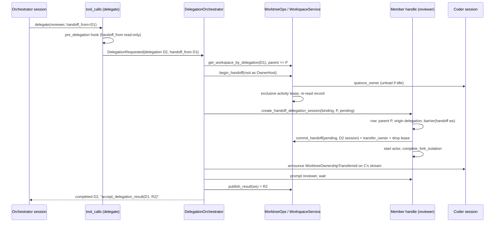

# Design

## Context

The two flows this change joins already exist:

- **Isolated delegation.** `DelegateTool::call` (`crates/agent-runtime/src/agent/builtin_tools/delegate.rs`) only validates. The parent's tool loop (`crates/agent-runtime/src/agent/execution/tool_calls.rs`, the `delegate` branch) runs the `pre_delegation` hook, resolves isolation, records the delegation and emits `AgentEventKind::DelegationRequested` (`crates/agent-protocol-types/src/events.rs`). `DelegationOrchestrator::handle_envelope` (`crates/agent-runtime/src/delegation/core.rs`) claims it. `execute_delegation_inner` then allocates a fresh worktree (`WorkspaceService::allocate_for_delegation_checked`, recording `parent_session_id` and `delegation_id`), creates the child with `LocalAgentHandle::create_isolated_delegation_session` (`agent/handle/agent_handle_impl.rs`), and runs it. Session creation goes through `SessionMaterializer::prepare_new_session_with_workspace`, which writes the row with an isolation barrier, calls `bind_owner`, starts the actor and releases the barrier (`complete_fork_isolation`). On completion it publishes a result on the worktree and prints `accept_delegation_result(delegation_id=<this delegation>, …)`. `WorkspaceService::accept_delegation_result` (`crates/agent-services/src/worktree/integrate.rs`) finds the worktree by delegation id, checks the requester is its `parent_session_id`, and matches any retained result.
- **Ownership handoff.** `WorktreeOps::handoff_announced` (`crates/agent-services/src/worktree/ops.rs`) resolves the workspace, quiesces the owner (`OwnerHost::quiesce_owner`, then the exclusive `CheckoutActivityLease`), creates a blank successor (`HandoffHost::create_pending_successor` → `SessionMaterializer::create_pending_handoff_successor`: parent = previous owner, origin `worktree`, barrier with `handoff_workspace_id`), transfers with `WorkspaceRepository::transfer_owner` (compare-and-swap plus a `workspace_handoffs` row, `crates/agent-sqlite/src/repo_workspace.rs`), drops the lease, publishes the successor and announces `WorktreeOwnershipTransferred`. `LocalAgentHandle` implements both host traits (`agent/handle/ext_worktree_ops.rs`).

The call graph and the target sequence:

## Goals / Non-Goals

**Goals:**
- One ordering for every ownership move (quiesce → lease → pending successor → compare-and-swap → release), shared by `/worktree handoff` and delegation.
- A delegation handoff session is created exactly like an isolated delegate, except for how it becomes owner.
- No storage schema change.

**Non-Goals:**
- Changing `/worktree handoff` behaviour or replies.
- Making `accept_delegation_result` accept the handoff delegation's own id. The worktree keeps one name (see D4).

## Decisions

### D1. The request travels on the event, not the delegation row

`handoff_from` is parsed in the `delegate` branch of `tool_calls.rs`, passed to the `pre_delegation` hook as a read-only field on `PreDelegationRequest` (`crates/agent-runtime/src/hooks/engine.rs`), written into the persisted `tool_arguments` and added to `DelegationRequested` as `#[serde(default, skip_serializing_if = "Option::is_none")] handoff_from: Option<String>`. The orchestrator reads it in `handle_envelope` and passes it into `execute_delegation` next to `batch_id`.

`DelegateTool::call` rejects `handoff_from` combined with `isolation = "shared"` and a non-string value. With `handoff_from`, the resolved isolation is forced to `Isolated`, the isolation source stays the request, and the disclosure text says the delegate runs in the existing worktree of that delegation.

*Alternative: a `handoff_from` column on `delegations`.* Rejected: the orchestrator only acts on the live event, the value is not needed after the run starts, and the tool arguments already keep it for history.

*Alternative: let hooks rewrite `handoff_from` through `UpdatedDelegation`.* Rejected for now: a hook that redirects a delegate into another worktree needs its own authorization story. Hooks can still block.

### D2. Split the handoff core instead of adding a second one

`WorktreeOps::handoff_announced` is split into two public steps with the same checks and errors:

- `begin_handoff(host: &dyn OwnerHost, target) -> PendingHandoff` resolves the record, refuses `not_owner` / `workspace_not_ready`, quiesces, takes the exclusive lease and re-reads the record. `PendingHandoff` holds the record, the previous owner and the lease.
- `PendingHandoff::commit(self, ops, successor) -> WorkspaceRecord` calls `transfer_owner`, maps its error with `handoff_transfer_error`, and drops the lease.

`handoff_announced` becomes begin → summarize → `create_pending_successor` → seed → commit → publish → announce, so `/worktree handoff`, the ACP extension, the simple API and Python keep their behaviour.

*Alternative: a `SuccessorFactory` trait passed into `handoff_announced`.* Rejected: the delegate session is created inside the member's materializer, between the row write and the actor start, which a callback into services cannot express without moving materializer steps into services.

### D3. The delegate successor is created by the delegation path, and transfer replaces `bind_owner`

`prepare_new_session_with_workspace` takes its preallocated workspace as an enum:

- `Fresh(WorkspaceBinding)`: today's path, `bind_owner`, and a failed start marks the workspace failed.
- `Handoff { binding, pending: PendingHandoff }`: the isolation barrier carries `handoff_workspace_id`, and `pending.commit(session_id)` replaces `bind_owner`. The lease is dropped there, before MCP and actor start.

The existing parent check at the top of the function (`binding.record.ownership.parent_session_id == parent_session_id`) already holds, because the worktree's parent is the orchestrator. The row gets parent = orchestrator and origin `Delegation`, so listing hides it like any delegate.

Failure handling for `Handoff`:
- Before the transfer: discard the pending row (as `discard_pending_handoff_successor` does). The previous owner is untouched.
- After the transfer, when the actor fails to start: transfer back (`transfer_owner(ws, delegate, previous)`) and discard the row. If that compare-and-swap fails too, leave the barrier in place and fail with `handoff_incomplete` naming the session, like `/worktree handoff` does; `/worktree recover` resolves it. The workspace is never marked failed.

New entry points:
- `LocalAgentHandle::create_handoff_delegation_session` (next to `create_isolated_delegation_session`).
- `MemberAgent::create_handoff_delegation_session` (`delegation/roster.rs`). Local members only; remote members are refused before `begin_handoff`, as isolated delegation to a remote member already is.
- `WorkspaceService::binding_for(record)`, a public constructor over the private `WorkspaceBinding::new` (`crates/agent-services/src/worktree/service.rs`).

In `execute_delegation_inner`, the isolated-allocation branch gains a sibling for `handoff_from`:
1. Look up the named delegation in the store; refuse an unknown id.
2. Find its worktree with `get_workspace_by_delegation`; refuse `no_isolated_workspace`.
3. Refuse `not_parent_session` when the worktree's parent is not the requesting session.
4. Call `begin_handoff` with the root handle as `OwnerHost`, then create the session through the member.

Every refusal goes through `fail_delegation` with the code in the message. After the session starts, the root's `HandoffHost::announce_handoff` records `WorktreeOwnershipTransferred { summary_seeded: false }` on the previous owner's stream and retires that stream.

### D4. The worktree keeps the delegation that created it

The worktree record's `delegation_id` stays D1. For a delegate that ran by handoff, the completion block in `execute_delegation_inner` (the `publish_result` branch) prints `binding.record.ownership.delegation_id` instead of `delegation.public_id` in the `accept_delegation_result` hint. `accept_delegation_result` needs no change: lookup by D1, the parent check, and `match_result` over every retained result already accept R2.

`handoff_from` resolves through the same lookup, so later rounds also name D1. A handoff delegation's own id (D2) is refused with `no_isolated_workspace` in both places. This matches the single "worktree id" the orchestrator already sees in completion text.

*Alternative: move `delegation_id` to the new delegation on transfer.* Rejected: it rewrites history used for the integration record trailer (`QueryMT-Delegation`), changes `transfer_owner` for every caller, and makes earlier completion hints stale.

### D5. Find delegate sessions when stopping an owner

`unload_session_if_idle` and `session_is_busy` (`agent/handle/session_control.rs`) look in the profile-bound runtime, then the root's registry. In a config-file run a delegate's actor lives in its member handle's registry, so the root reports it as unloaded while it is still loaded. Both methods gain the fallback `owned_session_ref` already uses: search `local_members()` registries and run the in-runtime step on the member handle that has the session. This also fixes `/worktree handoff`, archive and removal of delegate-owned worktrees in config-file runs.

### D6. `coder-team` profile

`crates/agent/examples/confs/coder_team.toml`, embedded in `crates/agent/src/profiles.rs` next to `coder-delegate`:

- `[dotagents] enabled = true` and `[agent.workspace] enabled = true` (`baseline = "current_working_tree"`, so delegates start from the user's current edits).
- `[agent]` (orchestrator): `mode = "plan"`, read-only tools plus `delegate`, `accept_delegation_result`, `question`, todos, `skill`, `browse`. No `shell` and no edit tools: exploration that needs commands goes to `explorer`.
- `[agent.permissions] always_ask = ["accept_delegation_result"]`, so every merge asks the user.
- `[agent.delegation]`: as `coder-delegate`, plus `[agent.delegation.summary]`.
- Delegates:
  - `coder`: `isolation = "isolated"`, edit tools and `shell`.
  - `reviewer`: `isolation = "isolated"`, the same tools. Its system prompt says it always runs by handoff in a coder's worktree, and must reply BLOCKED if the described work is absent. It reviews against the objective, runs the project's checks, fixes what it finds in place, and ends with `VERDICT: PASS` or `VERDICT: FAIL` plus reasons.
  - `explorer`: `isolation = "shared"`, read-only.
- The orchestrator's `agent_mode` reminder describes the loop:
  1. Explore and plan.
  2. `coder`.
  3. `reviewer` with `handoff_from = <coder delegation>`.
  4. On FAIL, `coder` with `handoff_from = <same id>` and the reviewer's findings, then review again.
  5. On PASS, `accept_delegation_result(<coder delegation>, <latest result>)`, phrasing the coder objective as a commit subject.

## Risks / Trade-offs

- **The lease is held across a cross-runtime call.** `begin_handoff` takes the exclusive lease in the root and the member commits it. → `PendingHandoff` owns the lease and is moved into the member call; dropping it on any error path releases the checkout.
- **A model forgets `handoff_from`.** The reviewer then gets a fresh worktree forked from the orchestrator. → The reviewer prompt requires BLOCKED when the work is absent; the orchestrator reminder names the argument.
- **Previous owner left loaded in another runtime.** If D5 misses a host, the transfer happens while the coder actor is still loaded. → The `quiesce` re-read and the read-only gate still refuse its prompts. A focused test runs the handoff in a config-file runtime.
- **`.agents` in worktrees.** Delegates read `.agents` from their own checkout. A gitignored `.agents/` is excluded from delegate baselines. → Documented in the profile comment and `docs/docs/agent/worktrees.md`.
- **Wire change.** `DelegationRequested` is `#[typeshare]`. → The field is optional and additive; querymt-gpui must keep `cargo t-gpui` green, and querymt-desktop gets a report-only follow-up.

## Migration Plan

No data migration. Old journals deserialize without `handoff_from`. Rolling back removes the argument; worktrees that changed owner stay valid because they use the existing handoff records.

## Open Questions

- The reviewer prompt's project-specific checks (which commands to run) can be refined after first use without changing the specs or tasks.
