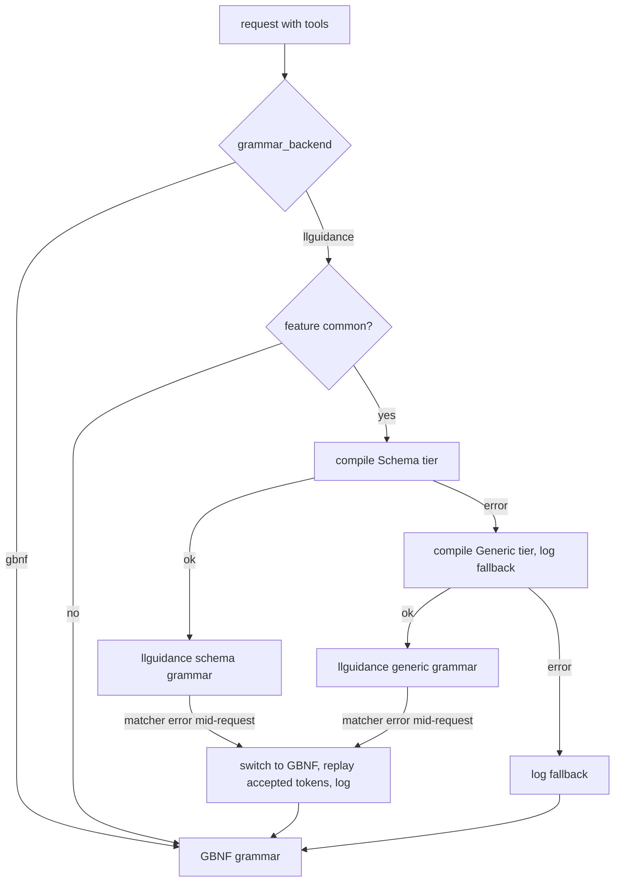

## Context

See proposal.md (Why) for the motivation. This change builds on uncommitted work on branch `perf/llamacpp-grammar`, which already contains:

- `crates/providers/llama-cpp/src/gbnf.rs` `ExclusionDfa::transitions` / `ExclusionDfa::rules`: collapsed exclusion rules (at most 4 alternatives per state).
- `crates/providers/llama-cpp/src/tools/sampler.rs` `ConstrainedSampler`: rejection sampling, used by `build_tool_sampler`, `build_structured_sampler`, `crate::mtp::run_mtp` and `crate::generation::force_text` (through the `AcceptToken` trait).
- `crates/providers/llama-cpp/src/tools/llg.rs` `LlgToolGrammar`: lazy llguidance tool grammar with a byte-level trigger watcher, a per-model `ParserFactory` cache (`with_env`), and Lark ports `qwen_function_lark` (schema-aware) and `ministral_lark` (generic).
- `crates/providers/llama-cpp/src/config.rs` `GrammarBackend` and `LlamaCppConfig::grammar_backend`, default `Gbnf`.
- `crates/providers/llama-cpp/src/common_chat.rs` `ToolGrammar::format`, which the backend uses to choose a port.

The GBNF grammars live in `crates/providers/llama-cpp/src/chat_format.rs` (`qwen3_tool_grammar`, `qwen_function_tool_grammar`, `ministral_tool_grammar`, `lfm2_tool_grammar`, `function_gemma_tool_grammar`, `gemma4_tool_grammar`). Tool calls are parsed back out of the text by `extract_tool_calls` in the same file.

Measured on an M-series Mac in a release build with the qwen35 vocabulary (151,936 tokens), per token inside a `write_file` value:

| Grammar | Whole-vocab mask | Single-token check |
|---|---|---|
| GBNF uncollapsed | 512 ms | 49 µs |
| GBNF collapsed | 13.4 ms | 6.5 µs |
| llguidance | 0.28 ms | 0.4 µs |

## Goals / Non-Goals

**Goals**
- Lark ports for Qwen3 JSON, LFM2, FunctionGemma and Gemma 4.
- A schema-aware tier and a generic tier for every format.
- A GBNF fallback during generation instead of dropping the constraint.
- llguidance as the default backend.

**Non-Goals** (design level)
- Changing the GBNF grammars beyond the collapse that is already done.
- Changing `extract_tool_calls`. The grammars must produce text it already parses.
- Using the llguidance sampler from llama-cpp-2 (`LlamaSampler::llguidance`) for tool grammars. It has no lazy mode.

## Decisions

### D1: Lark per format, with two tiers built from one generator
Each port is a function `fn <format>_lark(tools, tag, tier) -> Option<String>`. `tier` is `Schema` or `Generic`:

- **Generic** reproduces the GBNF language exactly: tool-name alternation, plus structural JSON (`%json {}`, or `%json {"type":"object"}` for argument objects) or text values.
- **Schema** replaces argument rules per tool:
  - JSON-argument formats (Qwen3, Ministral) use `%json { "type":"object", "properties":…, "required":…, "additionalProperties":… }` taken from the tool schema.
  - Keyword formats (Qwen XML-function, LFM2, FunctionGemma, Gemma 4) get one rule per declared parameter, typed through `value_expr`. Required parameters are mandatory and optional ones get `?`.
  - Undeclared names are allowed through a generic `IDENT`-keyed member only when `additionalProperties` is not `false`.

*Alternative:* translate the GBNF strings into Lark mechanically. Rejected: the GBNF is not schema-aware for 4 formats, and the text-exclusion rules translate into large automata instead of one regex lexeme.

### D2: Parameter order
Keyword formats emit parameters in schema `properties` order, which is the existing `qwen_function_tool_rules` behaviour and what chat templates render. JSON formats rely on `%json`, which accepts any key order. LFM2 and FunctionGemma follow D1 keyword ordering. This matches the order models are trained on, and it is already what the Qwen XML-function GBNF enforces.

### D3: Special-token delimiters
All format delimiters go through `tag(text)`. It emits `(<[id]> | "text")` when the text is one special token in the model's vocabulary, and a plain literal otherwise. In llguidance, special tokens are bytes prefixed with `0xFF`. They are not valid UTF-8, so a `/(?s:.*)/` text lexeme never consumes them.

Text values are therefore encoded in one of two ways:
- If the terminator is a special token (Gemma 4 `<|"|>`; FunctionGemma `<escape>` if its vocab makes it special): `TEXT tag(term)`, where `TEXT: /(?s:.*)/ & ~/(?s:.*)TERM(?s:.*)/` greedy.
- If the terminator is ordinary text (Qwen `\n</parameter>\n`): `text[suffix=…]: TEXT`, as today.

The `&~` exclusion keeps the textual spelling of the terminator out of the value in both cases.

### D4: Tier and engine selection

The JSON-schema compiler runs with `coerce_one_of = true` and `lenient = true`. Schemas that still fail use the generic tier.

### D5: Switching to GBNF mid-request
`Constraint::Llg` keeps the GBNF `ToolGrammar` and the tokens it has accepted since the start of generation. On a matcher error it builds the GBNF sampler (`build_gbnf_sampler`), replays the accepted tokens through `accept`, which re-runs the lazy trigger, and replaces itself with `Constraint::Sampler`. The replay is O(tokens), happens at most once per request, and cannot fail differently from a fresh GBNF request. *Alternative:* drop the constraint, which is what the code does today. Rejected because it allows unconstrained output.

### D6: Grammar caching
`ModelEnv` caches compiled matchers by Lark text, keeping the last 8 per model (`GRAMMAR_CACHE`). Agents send the same tool list on every request, so the schema tier is compiled once per tool set. `deep_clone` of a cached matcher costs microseconds.

### D7: Test vocabularies
Every format is checked against its real tokenizer. Vocab-only GGUFs are produced by the test helper and cached under `$TMPDIR/qmt-llama-vocab/`. Downloads are opt-in (`QMT_LLAMA_VOCAB_DOWNLOAD=1`) and happen only when the file is missing; without the opt-in, or offline, tests that need a missing vocabulary skip with a message. `QMT_LLAMA_VOCAB_DIR` overrides the cache directory.

| Formats | Vocabulary | Source (pinned) |
|---|---|---|
| Qwen3 JSON, Qwen XML-function, Ministral | qwen35 (151,936) | llama.cpp `models/ggml-vocab-qwen35.gguf` at the commit already pinned in `grammar_tests::VOCAB_URL` |
| Gemma 4 | gemma-4 (262,144) | llama.cpp `models/ggml-vocab-gemma-4.gguf`, same commit; has `<\|tool_call>`, `<tool_call\|>`, `<\|"\|>` |
| LFM2 | LFM2 (65,536) | Hugging Face `LiquidAI/LFM2-350M-GGUF` @ `8fdc9d526b7ed346b19257551b05816c7912ecc2`, `LFM2-350M-Q4_0.gguf`; has `<\|tool_call_start\|>`, `<\|tool_call_end\|>` |
| FunctionGemma | FunctionGemma (262,144) | Hugging Face `ggml-org/functiongemma-270m-it-GGUF` @ `2566ce14aedfc14fdd0de955ba67346425e67126`, `functiongemma-270m-it-q8_0.gguf`; has `<start_function_call>`, `<end_function_call>`, `<escape>` |

The Hugging Face files are full models (220-300 MB), but GGUF stores all metadata, including the tokenizer, before tensor data. The helper downloads only a prefix with an HTTP `Range` request (8 MiB, doubled up to 64 MiB until the key/value section fits) against the pinned revision (`https://huggingface.co/<repo>/resolve/<sha>/<file>`), parses the GGUF header to the end of the key/value section, and writes that prefix with the tensor count set to 0. llama.cpp loads the result with `vocab_only`. Measured: the KV section ends at 2.37 MB (LFM2) and 6.53 MB (FunctionGemma); both files load and report the expected `n_vocab`. If the KV section does not end within 64 MiB, the helper fails the test with a clear message instead of skipping (the pin changed or the format moved).

MTP needs real weights, not just a vocabulary. The speculative-decoding test uses Hugging Face `unsloth/Qwen3.5-0.8B-MTP-GGUF` @ `cf8a611f6ed2c2060046219a19f12cd3d5ecd67c`, `Qwen3.5-0.8B-Q4_0.gguf` (521 MB; header checked: `general.architecture = qwen35`, `qwen35.nextn_predict_layers = 1`, so MTP tensors are bundled). Because it downloads a full model, the test is `#[ignore]` and runs only with `QMT_RUN_LIVE_LLAMA_MTP=1`, like the existing `QMT_RUN_LIVE_*` tests.

*Alternative:* synthetic `toktrie` vocabularies for LFM2 and FunctionGemma. Kept only for the fast byte-level language tests; parity and trigger tests use the real vocabularies.

### D8: Default flip
`GrammarBackend::default()` becomes `Llguidance`. `gbnf` stays as an explicit option for builds without `common` and for debugging.

## Risks / Trade-offs

- **Forced-but-wrong values.** A schema-aware grammar forces the most likely allowed token when the model wants something the schema forbids, which can produce a valid but wrong call → the tool schema is the contract. Generic fallbacks and `grammar_backend = "gbnf"` remain available, and fallbacks are logged.
- **Schema compiler gaps** (unsupported keywords, `$ref` cycles) → lenient options, then the generic tier. A test covers an uncompilable schema.
- **First-request latency.** Building the token trie walks the whole vocabulary once per loaded model → cached per model. A benchmark records the cost.
- **llguidance and llama.cpp disagree on partial UTF-8 byte tokens.** llguidance tracks partial UTF-8 across tokens; llama.cpp rejects such tokens outright → the parity test documents and excludes this class. Generated text still decodes through `decode_token_piece`.
- **Control/special tokens inside values.** GBNF matches a special token's spelling as text, while llguidance never lets a text lexeme consume one (D3) → the parity test excludes this second class too; the grammar's language over ordinary text is identical.
- **Hugging Face availability or re-uploads** -> revisions are pinned by commit SHA; offline runs skip; a pinned file whose header no longer parses fails loudly.
- **Multi-token triggers with a different tokenisation.** The watcher matches bytes, so any tokenisation of the trigger activates the grammar. Bytes after the trigger are re-tokenised with `tokenize_bytes` for the matcher, which only works for ordinary text → special tokens never straddle a trigger in practice. This is covered by the special-token trigger scenario.
- **Seeded runs change output** (rejection sampling consumes an extra random draw) → documented in the CHANGELOG.

## Open Questions

None that change what is built.
