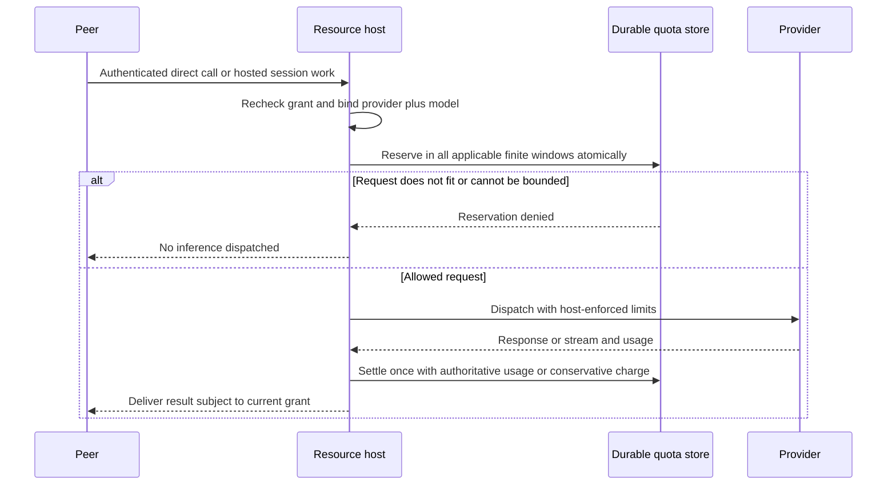

# Design: Per-peer mesh sharing

## Goals and boundaries

- A peer should be able to borrow a model without opening the host's sessions or files.
- A standing grant is the final mesh approval decision. It is not an override for the agent's existing tool policy, isolation, hooks, or question flow.
- Protect resources served by QueryMT. Full access includes a process running as the host OS user and is appropriate only for peers the owner trusts at that level. There is no promise to contain Full access shell commands or reclaim delivered data.

## D1: Authorize at authenticated ingress

`crates/querymt-remote/src/mesh_runtime.rs` (`bootstrap_mesh_handle`) assembles the LAN and Iroh paths. In the pinned Kameo version, `kameo::remote::messaging::Behaviour::handle_request_response_event` receives libp2p's authenticated peer, but hands off the request without it. `kameo::message::Context` has no authenticated sender. A claimed peer ID, callback address, membership token's subject field, or DHT registration is not an adequate substitute.

Prefer a narrow Kameo change that exposes authenticated origin at authorization and actor dispatch for all inbound asks/tells. Use an existing upstream release if it meets the contract; if not, evaluate a pinned upstream patch against a QueryMT-owned authenticated ingress. Do not implement permission-bearing wire endpoints until that boundary is proven on both transports. With a replacement ingress, route supported legacy requests through the same authorization boundary and unregister or block any unguarded paths. With a Kameo change, deny unmatched protected message types and retain origin through queued dispatch. Treat local origins as a distinct internal type, never as a failed peer lookup. Validate callback ownership, peer-bind leases/status/cancel/ack and actor lifecycle control, and bind admission requests to transport identity as well. Membership remains a prerequisite where a transport requires it, not a resource grant.

## D2: One authoritative policy per host

- Persist `(host PeerId, caller PeerId)` grants independent from mesh scopes, invites, display names, and per-agent profile state. All runtimes sharing one mesh identity use the same authority. Missing policy is No access; unreadable or stale policy is not permission to fall back to an old positive grant.
- The `mesh-access-acp` delta defines the client contract. `crates/agent-runtime/src/control/mesh.rs` (`list_nodes`) and `crates/agent-runtime/src/agent/handle/ext.rs` (`handle_ext_method`) are control integration points. Advertise supported methods and invalidations per authorized connection, building on `crates/agent-runtime/src/control/capabilities.rs` (`get_capabilities`) and `crates/agent-runtime/src/acp/shared.rs` (`ext_notification`). Do not rely on a process-wide advertised list or session ownership as a security check. Bind owner authority at ACP ingress and carry it into control calls. The stdio path can use the owner-started process boundary; for WebSocket, an origin or loopback address alone does not prove owner authority. No privileged reads, writes, or invalidation fan-out on a connection that cannot prove it.
- Separate directional read models. The local owner can see `outgoing` policy even when a node is offline; the remote host only returns the caller's effective `incoming` policy. An ACP client loads Nodes, reads the selected peer snapshot, and supplies its `outgoing.revision` to `setPeerAccess`, `setPeerQuota`, or `resetPeerQuota`. A stale edit requires a refresh and user review. Treat invalidations as refresh hints, not durable event replay. For a new Custom grant with finite caps, the client can save the caps while the grant is still disabled, then enable access using the returned revision. Node identity is discoverable through `RemoteNodeManager` (`GetNodeInfo`, `crates/agent-runtime/src/agent/remote/node_manager.rs`); counts and models are protected details. Publish affected-recipient invalidation and recheck on reconnect. No generic mesh broadcast of owner policy, usage, or other peers' activity.
- Add a protected-sharing protocol capability/version for grant-aware clients. Reuse existing identities and membership records without converting them to grants.

### Mixed-version sharing

| Request direction | Access on the resource host |
| --- | --- |
| Upgraded client to upgraded host | Current host grant via the new sharing contract. |
| Upgraded client to legacy host | Whatever the legacy host already exposes through a supported protocol. Show **Legacy sharing (no granular controls)**, not a verified Full access grant. |
| Legacy client to upgraded host | Identity-only discovery by default. An explicit Full access grant for its authenticated `PeerId` permits supported legacy requests; Custom does not. |

Select legacy consumption from authenticated version/protocol evidence for the resource host, not a timeout, failed decode, policy denial, or a discovery badge. Reevaluate on reconnect. Retain known protected support for a peer identity across reconnects; conflicting or unknown information must not silently switch that peer to legacy. Legacy consumption grants nothing in the opposite direction. Accept result or event callbacks for legacy work only from the expected authenticated host and for a matching active local request or subscription; the callback is not a grant to call other APIs.

On an upgraded host, legacy wire encoding changes only decoding and response formatting. Check the same current host grant on every protected legacy request and keep the peer origin for revocation, queued work and delivery. A request using the legacy wire format requires Full even if the caller also supports the new protocol. Refuse any legacy operation that cannot preserve authorization or callback ownership. An old client may render refusals as generic errors; the upgraded owner sees the actual grant and compatibility state. Verify both directions with an actual legacy binary. A supported upgrade need not be simultaneous, but existing legacy clients lose access to the upgraded host until explicitly granted it.

## D3: Carry the initiator into execution

`crates/agent-runtime/src/agent/remote/node_manager.rs` (`handoff_for_local_actor`) can export direct session references; `crates/agent-runtime/src/agent/remote/remote_actor_impl.rs` registers session RPCs; `crates/agent-runtime/src/agent/session_actor.rs` handles `SubmitSessionInput`, `SubscribeEvents`, `GetFileIndex`, and `ReadRemoteFile`. Gate listing/handoff at the manager and gate every operation at the session boundary; do not authorize only at attach. Include alternate RPCs and registry/discovery data in the review. Check protected responses again before delivery when the work spans a policy change.

Capture the authenticated origin on the accepted turn, scheduled job, and child execution. Use it when starting queued work and before privileged effects or model dispatch. Do not infer identity from the current subscriber, session owner or a provider request's session ID. A restricted peer cannot inject into a more privileged run, grant tool permissions to itself, or use an owner job to launder its authority. Use the existing durable schedule payload path for origin; legacy jobs whose local-vs-remote origin cannot be established must not be promoted to owner authority. For Custom, disallow onward cross-node delegation/provider fallback on the host in v1 rather than inventing transitive authorization; allow same-host work only under the original grant. Host and unrelated peer work must not be cancelled by another peer's policy update.

Use tool capability checks at selection and dispatch, beginning before side-effectful hooks in `crates/agent-runtime/src/agent/execution/tool_calls.rs` (`prepare_tool_call_inner`, `dispatch`). Review built-ins, prompt commands, hooks, MCP/provider tools, worktree/undo and any privileged session control. Explicitly classify supported restricted operations; hide or refuse anything that cannot be constrained, including filesystem paths that could alter policy, credentials, or executable configuration. Preserve confinement at actual path use, not just string filtering. The existing `ShellTool::call` (`crates/agent-services/src/tools/builtins/shell.rs`) is not a sandbox. In this draft, only Full can use it. Remote file paths in v1 are session-bound, so Filesystem requires Sessions; there is no new generic file server. Already shared history may contain old file content or tool outputs.

Revoke by grant revision, cancelling affected run/stream tokens and stopping actor forwards and queued work. For outbound callbacks, bind the destination to the initiating authenticated peer. The owner cannot recall a copy already given to a peer; the official client will not serve its cache as a substitute for a confirmed denial. A filesystem or shell action already committed is not rolled back.

## D4: Enforce provider policy where inference is dispatched

`crates/querymt-remote/src/provider_catalog.rs` (`ProviderCatalogActor`) and `crates/querymt-remote/src/provider_host_actor.rs` (`ProviderHostActor`) need the same policy. `ModelAllowlistBackend` in `crates/querymt-remote/src/provider_backend_helpers.rs` is static and covers provider build, not caller-aware catalog or metering. `merge_remote_provider_params` in `crates/querymt-remote/src/provider_host_support.rs` currently overlays peer-supplied parameters onto host defaults; use a typed allowlist of inference options instead, with binding, endpoint, credentials, and effective model fixed by the host. Scope stream ownership by authenticated peer plus request identity, not a peer-provided session ID alone. Do not treat policy denial or timeout as a reason to retry via legacy protocol or another model/host. An upgraded client may use the selected legacy provider route only under the mixed-version rules in D2.

Hosted-session inference may call the local provider without going through `ProviderHostActor`. Bind a policy-and-quota wrapper to the initiating peer at execution, not to a shared cached provider in `crates/agent-runtime/src/session/provider.rs` (`SessionProvider::build_provider_snapshot`, `SessionHandle::provider`). Cover streams, one-shot calls, compaction, summarization, and retries; deny unhandled inference entry points for Custom. Use the same admission/settlement service for this wrapper and the provider actor, but charge an actual upstream attempt once on the host dispatching it. `ProviderShare` in `crates/querymt-remote/src/provider_share.rs` must use the same service for standalone provider hosts, not provide a policy-free route.

## D5: Quota accounting and persistence

- **Selection and quotas are separate.** `All models` follows the current catalog for the selected provider, including later additions. `Selected models` compares canonical IDs, not labels. The provider quota is shared across those models. A model may add its own quota, never override the provider's. For example, a 20 Mtok weekly provider cap and a 2 Mtok daily cap for one model mean that calls to that model consume both budgets; other allowed models share the weekly budget but not the daily one. An absent model cap adds no restriction, and a model quota never grants access.
- **Reserve and settle at both scopes.** Key the quotas by `(host, peer, canonical provider, optional canonical model)` and balances by scope plus period. Store integer tokens, parse Mtok exactly, and use checked arithmetic. Serialize preflight checks and writes for all finite scopes in one transaction. Associate the host attempt ID and peer-scoped replay identity with its original reservation rows. Update all rows once on settlement without treating the attempt as multiple uses in aggregate usage. Distinguish upstream retries from repeated delivery.
- **Use UTC calendar windows.** Manual quotas remain active until reset. Daily windows end at midnight UTC, weekly windows end Monday at midnight UTC, and monthly windows end on the first at midnight UTC. Model and provider schedules can differ. Derive half-open windows lazily from one host time reading per reservation (no scheduled reset job); persist the newest window per configured scope so clock rollback or restart cannot reopen a closed window. An in-flight attempt settles to its original windows, not whichever ones are current when it completes; balances never roll over.
- **Preserve quota state across edits.** Change finite amounts in place, counting settled usage and outstanding reservations against the new amount. Keep Custom quota records through provider/model selection edits and grant-mode changes; Full access does not draw from them. A manual reset starts a fresh accounting period for the targeted scope without moving its calendar boundary. A change to cadence or between unlimited and finite is a separate explicit reconfiguration of that scope, not a side effect of editing a grant. Check both reserved and unlimited in-flight work for the target before opening a new finite period. Report peer-visible status and quota rejection with provider/model scope and exact next renewal time where applicable.
- A finite grant is only supported when the binding can conservatively bound the prepared request, including system context, tool schemas, media and reasoning where applicable, and can enforce its output ceiling. A heuristic estimator is not a hard bound. Publish which bindings qualify; certify at least one real supported binding before offering finite quotas to users. Prove correctness with a deterministic provider fixture; qualify the real binding's bound from its adapter contract and prepared wire request, not a single observed small result. If no real binding qualifies, the finite-quota milestone is not ready. Unlimited does not promise exact usage where the upstream does not report it.
- Settle normalized `querymt::Usage` (`crates/querymt/src/lib.rs`), following the existing non-overlapping counters. Reuse normalization and attempt-lifecycle concepts from `crates/agent-services/src/accounting/dispatch.rs` (`ActiveAttempt`); do not derive quotas from replayed session events or financial totals. Persist a may-have-dispatched boundary before upstream invocation. On restart charge unresolved may-have-dispatched reservations conservatively; release only confirmed unused reservations. Keep archived periods and preserve consumed capacity on ordinary grant edits.
- Put the policy and ledger contracts in `querymt-remote`; use a separate host-local SQLite database through an opt-in, crate-local `querymt-agent-sqlite` `mesh-access` feature (optional path dependency on `querymt-remote`, defaults off, and no SQLite imports in `querymt-remote`). Wire the adapter through `querymt-agent` without coupling to individual session stores. Initialize the standalone store with the forward-only mesh migrations (v1 grants, v2 quota scopes, periods, attempts and reservations). Existing installs without a mesh store get an empty policy store and no session DB migration. An existing v1 mesh store keeps its grants and revisions when upgraded. Provider-only hosts can supply the same store or another durable implementation. Storage failure denies protected sharing, not local agent usage.
- No new third-party build dependency is planned beyond a compatible Kameo upgrade or a pinned patch to that existing dependency if needed. Mesh paths stay gated by `kameo-mesh` and `remote`; SQLite stays off in builds not wiring the adapter. The Extism contract and `wasm32-wasip1` provider builds do not change. Verify affected agent Python and mobile-ffi builds and regenerate affected typeshare contracts; desktop UI is a separate follow-up.

## Decisions to Review

1. **Shell:** The draft requires Full for the current unsandboxed shell. A sandbox would be a prerequisite if restricted shell is a v1 requirement.
2. **Full access prompts:** The draft skips mesh approval only. It does not suppress existing tool approvals or agent questions.
3. **Quota windows:** Each provider and model scope uses one independent schedule: manual, daily, weekly, or monthly. Recurring windows use UTC calendar boundaries, with Monday as the start of the week and no carryover.
4. **Upgrade:** Existing peers start with No access on an upgraded host. Upgraded clients can consume legacy sharing; legacy clients can consume upgraded-host resources only with an explicit Full grant and a supported, guarded legacy operation.
