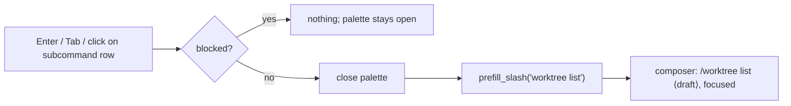

# Design

## Context

See proposal.md, Why. The parts this change builds on:

- **Catalog.**
  - `crates/agent-runtime/src/slash_commands/acp.rs` `descriptor_meta` builds `_meta.querymt` (`source`, `effect`, `input`, `accepts`) for both user and built-in commands.
  - `crates/agent-runtime/src/slash_commands/builtin.rs` `Builtin::entry` adds it to the built-ins.
  - `crates/agent-runtime/src/agent/handle/core.rs` `catalog_notification` appends the available built-ins to the user registry's update.
- **Parser.** `crates/agent-runtime/src/agent/handle/ext_worktree_ops.rs` `NativeCommand::parse` matches the first word of `/worktree`'s arguments. It has ten arms. `NATIVE_USAGE` is its error text.
- **Session core.** `crates/agent-session-core/src/updates.rs` `slash_commands` reads the descriptor field by field into `SlashCommandView` (`src/view.rs`, `#[typeshare]`). Unknown or malformed values become `None`. Tests are in `tests/live_updates.rs` (`descriptor_is_read_from_the_catalog`, `malformed_command_entries_are_skipped`).
- **Palette.** `crates/querymt-gpui/src/ui/keys.rs`:
  - `palette_groups` builds one `PaletteEntry` per command, with `PaletteTarget::SlashCommand { name, input, blocked }`;
  - `filter_palette` ranks the rows of each group;
  - picking calls `run_slash_command`, and Tab calls `palette_tab`;
  - `src/ui/slash.rs` `SessionPane::prefill_slash` puts `/name ` in the composer and keeps a draft (design D7 of the archived `slash-command-actions`);
  - `SessionPane::readiness` gives the `Blocked` reason.

## Goals / Non-Goals

**Goals:**
- One source for the `/worktree` subcommand names, checked against the parser by a test.
- Subcommand rows reuse the parent's readiness and the existing prefill path. Nothing new runs from the palette.

**Non-Goals:**
- Rewriting `NativeCommand::parse` to be driven by the table. Its arms have different argument rules, and the test is enough to stop drift.
- Per-subcommand descriptor fields (input need, accepts, hint).

## Decisions

### D1. Wire shape: `subcommands: [{ name, description }]` inside `_meta.querymt`

`descriptor_meta` takes a `&[Subcommand]` slice. `Subcommand` is `{ name: &'static str, description: &'static str }`. The function writes `subcommands` only when the slice is not empty. User commands pass `&[]`, so their entries are byte-for-byte unchanged.

Alternatives considered:
- A separate `_meta.querymt.worktree` key. Rejected: the field is generic, and `/agents` may use it later.
- Encoding the subcommands in the ACP input hint. Rejected: the hint is free text for people.

### D2. One table in `builtin.rs`, tested against the parser

`builtin.rs` gets `const WORKTREE_SUBCOMMANDS: &[Subcommand]`, in the order of the spec, and `Builtin::subcommands(self) -> &'static [Subcommand]`. `Compact` returns `&[]`. `Builtin::entry` passes it to `descriptor_meta`.

Descriptions, one line each, taken from `NATIVE_USAGE` and the `WorktreeOps` docs:

| name | description |
|---|---|
| `create` | Start an isolated session in a new worktree |
| `handoff` | Hand this session's work to a new isolated session |
| `list` | List the worktrees of this checkout |
| `status` | Show a worktree's state |
| `result` | Show a worktree's result |
| `publish` | Pin a worktree's working state under a result ref |
| `merge` | Merge a worktree into its source checkout |
| `archive` | Archive a worktree session |
| `remove` | Remove a worktree; refuses to drop unsaved work |
| `recover` | Finish an interrupted create or remove |

`ext_worktree_ops.rs` gets `NativeCommand::subcommand(&self) -> &'static str`, an exhaustive match. The test `advertised_subcommands_are_accepted` runs `NativeCommand::parse` for every table entry, with the minimal arguments that entry needs (`recover` needs an id). It asserts that `parse` returns `Ok` and that `subcommand()` equals the table name. It also asserts that the table has as many entries as `NativeCommand` has variants, using a hand-kept constant next to the exhaustive match.

The two directions are covered differently:
- **A table name the parser does not accept:** the test fails.
- **A new variant missing from the table:** the exhaustive match forces a name, and the count assertion fails.

Alternative considered: deriving the table from `parse`. Rejected, see Non-Goals.

### D3. Session core: `SlashSubcommandView` and `SlashCommandView.subcommands`

The new type `SlashSubcommandView { name: String, description: String }` is `#[typeshare]` and serde `camelCase`, like its parent. The field is `SlashCommandView.subcommands: Vec<SlashSubcommandView>` with `#[serde(default)]`.

`slash_commands` reads the subcommands with these rules:
- the value must be an array, else the list is empty;
- elements whose `name` is missing, empty or contains whitespace are dropped;
- of two elements with the same name, the first is kept;
- a missing `description` becomes `""`.

`Vec` rather than `Option<Vec>`: unlike `accepts`, "absent" and "empty" mean the same here, and the palette needs no fallback.

### D4. Palette: a new target, rows built after the parent, prefill only

The new target is `PaletteTarget::SlashSubcommand { command: String, subcommand: String, blocked: Option<Blocked> }`. In `palette_groups`, each command row is followed by its subcommand rows. Each subcommand row has:
- `blocked` set to the parent's `readiness` result;
- the label `"{command} {subcommand}…"`;
- as its description, the subcommand's description or the blocked reason;
- `.dim(blocked.is_some())`;
- as keywords, the subcommand's description, the parent's source word, and `prompt` when the parent is a prompt.

`filter_palette` needs no change: with no search it keeps the built order, and with a search it ranks the rows.

Picking and Tab:
- **Picking** (`run_palette` in `keys.rs`): with `blocked: None`, close the palette and call `pane.prefill_slash(&format!("{command} {subcommand}"))`. With `Some(_)`, do nothing and keep the palette open, as for a blocked command.
- **Tab:** `palette_tab` accepts `SlashSubcommand { blocked: None, .. }` and does the same as picking.
- **Footer:** the key hint stays on `SlashCommand { input: Optional }` rows only.

`prefill_slash` already formats `/{name} ` and keeps a draft. Passing `"worktree list"` as the name gives `/worktree list ` or `/worktree list <draft>`.

Alternatives considered:
- Adding `subcommand: Option<String>` to `SlashCommand`. Rejected: every match on `SlashCommand` would have to decide what a subcommand means for Enter and the footer. A separate variant makes the compiler list those places.
- Showing subcommand rows only while searching. Rejected: it hides them from someone browsing, and it adds a mode.

## Risks / Trade-offs

- **The palette grows by ten rows when `/worktree` is available.** With no search, the Slash commands group is longer. → Groups already scroll, and a search narrows it at once. If this proves noisy, the rows can be shown only while searching, as a later change.
- **A draft that is itself a command keeps its arguments.** Picking `worktree list…` over the draft `/worktree create foo` gives `/worktree list create foo`, because D7 replaces only the first word. → This is the same rule as for commands and is visible before sending. It is not worth a special case.
- **Subcommand descriptions are hand-written** and can go stale against `NATIVE_USAGE`. → They sit next to the table that the parser test checks, so a renamed operation fails the test. Text drift is reviewed, not tested.
- **typeshare change.** querymt-desktop must regenerate its types (proposal, Impact). The field has a serde default, so an older desktop build ignores it.
