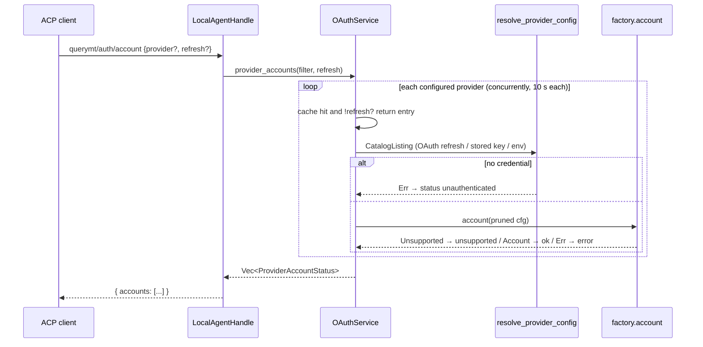

# Design: Provider account snapshots

## Goals and boundaries

One additive contract, the same shape for every provider, and no new code path for credentials, HTTP or plugin loading. Everything below builds on the model-listing path, which already solves "run a credentialed, provider-specific GET through the host for static, Wasm and native factories".

Boundaries: no header or stream capture, one request per snapshot, no persistence, no config keys.

## D1: The snapshot is an *account*, usage is one field of it

`crates/querymt/src/plugin/account.rs` (new, re-exported from `querymt::plugin`):

```rust
/// What a factory answers to an account query. In-process only (never serialized);
/// the Extism boundary carries `Option<SerializableHttpRequest>` and `ProviderAccount`.
#[derive(Debug, Clone, PartialEq)]
pub enum AccountReport {
    /// This provider, or this credential, has no account data (most inference API keys, local models).
    Unsupported,
    Account(ProviderAccount),
}

#[cfg_attr(feature = "type-generation", typeshare::typeshare)]
#[derive(Debug, Clone, PartialEq, Serialize, Deserialize, Default)]
#[non_exhaustive]
pub struct ProviderAccount {
    /// Plan or tier as the provider names it ("pro", "claude_max"); None when unknown.
    #[serde(default, skip_serializing_if = "Option::is_none")]
    pub plan: Option<String>,
    /// Rolling or calendar limits; empty for providers that only report credits.
    #[serde(default)]
    pub limits: Vec<UsageLimit>,
    #[serde(default, skip_serializing_if = "Option::is_none")]
    pub credits: Option<CreditBalance>,
}

#[cfg_attr(feature = "type-generation", typeshare::typeshare)]
#[derive(Debug, Clone, PartialEq, Serialize, Deserialize)]
#[non_exhaustive]
pub struct UsageLimit {
    /// Provider-stable key: "primary", "secondary", "five_hour", "seven_day", "weekly", a metered feature id.
    pub id: String,
    /// Human label when the provider gives one ("Weekly", "Api"); clients fall back to `id`.
    #[serde(default, skip_serializing_if = "Option::is_none")]
    pub label: Option<String>,
    /// Model or product the limit applies to ("Opus", "Api", "gpt-6-astra"); None = all usage.
    #[serde(default, skip_serializing_if = "Option::is_none")]
    pub scope: Option<String>,
    /// Percent of the allowance consumed; may exceed 100.
    pub used_percent: f64,
    #[serde(default, skip_serializing_if = "Option::is_none")]
    pub window_seconds: Option<u32>,
    /// Unix seconds (UTC) when the window resets.
    #[cfg_attr(feature = "type-generation", typeshare(serialized_as = "Option<number>"))]
    #[serde(default, skip_serializing_if = "Option::is_none")]
    pub resets_at: Option<i64>,
    /// The provider reports this limit as blocking requests now.
    pub reached: bool,
}

#[cfg_attr(feature = "type-generation", typeshare::typeshare)]
#[derive(Debug, Clone, PartialEq, Serialize, Deserialize)]
#[non_exhaustive]
pub struct CreditBalance {
    /// Decimal string in the provider's unit ("12701.63", "0.00"); None when the provider only reports has/has-not.
    #[serde(default, skip_serializing_if = "Option::is_none")]
    pub balance: Option<String>,
    /// ISO 4217 code when known.
    #[serde(default, skip_serializing_if = "Option::is_none")]
    pub currency: Option<String>,
    pub unlimited: bool,
}
```

Construction: the structs are `#[non_exhaustive]` (as `ChatCall` is) so later fields are not a break for plugin crates, which therefore build them through `#[must_use]` constructors instead of literals: `ProviderAccount::new()` with `with_plan`, `push_limit`, `with_credits`; `UsageLimit::new(id, used_percent)` with `with_label`, `with_scope`, `with_window_seconds`, `with_resets_at`, `with_reached` (unset → derived from `used_percent >= 100.0` at construction); `CreditBalance::new()` with `with_balance`, `with_currency`, `unlimited()`. Fields stay `pub` for reading. Integer conventions follow the repo: epoch seconds are `i64` with `typeshare(serialized_as = "number")` (`agent-core/src/delegation_update.rs`), durations that fit are `u32`; conversions from provider payloads use `TryFrom`/`saturating_sub`, never `as`.

Why percent and not tokens: Codex, Claude and Grok all report percent used; none reports the token allowance. Why epoch seconds: no date dependency in `querymt`, and Codex already uses it. Claude and Grok return RFC 3339 timestamps; `querymt` already depends on `humantime`, whose `parse_rfc3339_weak` handles both (`2026-11-25T22:09:59.989045+00:00` needs the offset form; verify at implementation and, if `humantime` rejects a `+00:00` offset, add `humantime`'s sibling-free fallback: a small RFC 3339 parser in `querymt::plugin::account::parse_rfc3339_utc`, no new dependency). The helper lives in `querymt` so all plugins share it and wasm32 builds need nothing extra. `reached` is the provider's own flag (`limit_reached`, `locked_reason`), else `used_percent >= 100`.

Typeshare attributes follow `crates/querymt/src/chat/mod.rs`. `AccountReport` is a plain in-process enum; the ACP layer flattens it into the status entry (D5), and it is matched exhaustively there (adding a variant later is a deliberate, visible break for the one in-workspace matcher).

## D2: Factory contract mirrors model listing

`crates/querymt/src/plugin/http.rs HTTPLLMProviderFactory` gains:

```rust
/// Build the request for the account snapshot, or None when this provider or
/// this credential has nothing to report (most inference API keys, local providers).
fn account_request(&self, _cfg: &str) -> Result<Option<Request<Vec<u8>>>, LLMError> { Ok(None) }
fn parse_account(&self, _resp: Response<Vec<u8>>) -> Result<ProviderAccount, LLMError> {
    Err(LLMError::NotImplemented("account snapshot".into()))
}
```

`crates/querymt/src/plugin/mod.rs LLMProviderFactory` gains the one method callers use:

```rust
fn account<'a>(&'a self, _cfg: &str) -> Fut<'a, Result<AccountReport, LLMError>> {
    Box::pin(async { Ok(AccountReport::Unsupported) })
}
```

`account_request` keeps `Option<Request>` because it answers a narrower question ("is there anything to fetch?"); only `account` is part of the caller-facing vocabulary, and there `Unsupported` is a named outcome rather than `None`.

- `crates/querymt/src/plugin/adapters.rs HTTPFactoryAdapter::account`: `account_request` → `call_outbound` → `parse_account`, like `list_models`. A non-success status goes through `classify_http_status` (the `handle_http_error!` rule for non-chat paths) so 401/403 map to an auth error and 429/5xx stay retryable.
- `crates/querymt/src/plugin/extism_impl/host/mod.rs`: `ExtismFactory` implements both traits' new methods the way `list_models_request` / `parse_list_models` are implemented (lock plugin, `call_get_error_code`, `decode_plugin_error`), with the `spawn_blocking` wrapping from `ExtismFactory::list_models`. `account_request` returns `Ok(None)` without calling the plugin when `!plug.function_exists("account_request")`, so `account` reports `Unsupported`.
- Native non-HTTP factories (llama-cpp, mrs, izwi) inherit the default `None`.

The config string is the same pruned JSON the factory accepts for `from_config` and `list_models`; it contains `api_key` (already an OAuth access token when that is the active method), `base_url` and provider fields such as `auth_type`, so the plugin decides from the credential whether to issue a request.

## D3: Extism exports

`crates/querymt-extism-macros/src/lib.rs impl_extism_http_plugin!` adds:

```rust
#[plugin_fn] pub fn account_request(Json(input): Json<ExtismAccountRequest>) -> FnResult<Json<Option<SerializableHttpRequest>>>
#[plugin_fn] pub fn parse_account_response(Json(input): Json<ExtismAccountParseRequest>) -> FnResult<Json<ProviderAccount>>
```

with `ExtismAccountRequest { cfg: Value }` and `ExtismAccountParseRequest { resp: SerializableHttpResponse }` in `crates/querymt/src/plugin/extism_impl/interface.rs`, next to `ExtismListModelsRequest`. Errors are encoded with `PluginError::encode`, as every other export. A plugin built before this change simply lacks the exports; the host's `function_exists` probe makes it `Unsupported`. No contract-version constant changes (see proposal Impact for the review flag).

## D4: Plugin implementations

- `crates/providers/codex/src/lib.rs CodexFactory`: `account_request` builds `GET {base_url}/../wham/usage` (base URL `https://chatgpt.com/backend-api/codex/` → `https://chatgpt.com/backend-api/wham/usage`; derive by joining `../wham/usage` so custom base URLs keep working) with `Authorization: Bearer`, `ChatGPT-Account-ID` from `api.rs chatgpt_account_id`, `User-Agent` as chat. `parse_account`: `plan = plan_type`; limits `primary`/`secondary` from `rate_limit.{primary_window,secondary_window}` (`used_percent`, `limit_window_seconds`, `reset_at`, `reached = rate_limit.limit_reached` for primary), plus one limit per `additional_rate_limits[]` entry (`id = metered_feature`, `label = limit_name`, `scope = normal_model_slug`); credits from `credits.{balance, unlimited}` with currency `None` (ChatGPT credits are a unit, not a currency).
- `crates/providers/xai/src/lib.rs XaiFactory`: `account_request` returns `None` unless `auth_type == "oauth"`; otherwise `GET https://cli-chat-proxy.grok.com/v1/billing?format=credits` with `Authorization: Bearer`, `X-XAI-Token-Auth: xai-grok-cli`, `x-userid: <JWT sub>` (decode the unsigned payload like `chatgpt_account_id` does). The host URL is a constant, not derived from `base_url` (`api.x.ai`). `parse_account`: one limit `weekly` (`label` from `currentPeriod.type`, `used_percent = creditUsagePercent`, `window_seconds = end - start`, `resets_at = end`), one scoped limit per `productUsage[]` entry (`id = "weekly:" + product`, `scope = product`), credits from `prepaidBalance.val` cents → `"12.34"`, currency `USD`. `plan = None`.
- `crates/providers/anthropic/src/factory.rs`: `account_request` returns `None` unless `detect_auth_type` says OAuth; otherwise `GET {base_url}/api/oauth/usage` with `Authorization: Bearer`, `anthropic-beta: oauth-2025-04-20`, `anthropic-version: 2023-06-01`. `parse_account`: limits `five_hour`, `seven_day` from the top-level objects (`used_percent = utilization`, `window_seconds` 18000 / 604800, `resets_at` parsed from RFC 3339, `reached = locked_reason.is_some() || utilization >= 100`), plus one scoped limit per `limits[]` entry whose `scope.model` is set (`id = kind`, `scope = scope.model.display_name`). `plan = None`. Credits from `spend.balance` when present.

Extism host allow-lists: the Extism host restricts outbound hosts to the plugin's base URL plus configured `allowed_hosts` (`crates/querymt/src/plugin/extism_impl/host/mod.rs build_allowed_hosts`). The host runs the account request itself through `call_outbound`, not through the plugin's HTTP host function, so the allow-list does not apply; `chatgpt.com` and `cli-chat-proxy.grok.com` need no plugin manifest change. State this in the plugin docs so authors do not add them.

## D5: Runtime method and caching



- Handler in `crates/agent-runtime/src/agent/handle/ext_auth.rs` next to `handle_ext_auth_status`; dispatch entry in `handle/ext.rs`; method and `auth_account: true` in `crates/agent-runtime/src/control/capabilities.rs`.
- Logic in a new `crates/agent-runtime/src/auth/account.rs` as `impl OAuthService` (it already owns `config`, the registry and `invalidate_auth_caches`). Provider set: `auth_provider_names(registry)` filtered like `auth_status`. Credentials: `crate::session::provider_config::resolve_provider_config(&binding, config.provider.initial_config(), ProviderConfigMode::CatalogListing)` exactly as `model_registry.rs fetch_catalog_models`. Non-HTTP factories skip resolution and report `unsupported`.
- Status type (typeshared, in `auth/service.rs` next to `AuthProviderStatus`):

```rust
pub struct ProviderAccountStatus {
    pub provider: String,
    pub status: ProviderAccountState,      // ok | unsupported | unauthenticated | error
    pub account: Option<ProviderAccount>,  // ok only
    #[typeshare(serialized_as = "Option<number>")]
    pub fetched_at: Option<i64>,           // ok and unsupported; unix seconds
    pub error: Option<String>,             // error only
}
```

- Cache: `parking_lot::Mutex<HashMap<String, (Instant, ProviderAccountStatus)>>` on `OAuthService` (short critical sections, never held across an `.await`; the same choice as `ModelInventory`'s caches, while `OAuthService`'s existing `tokio::sync::Mutex` guards awaited flows), TTL 60 s for `ok` and `unsupported`; `unauthenticated` and `error` are never cached. `invalidate_auth_caches` clears it, so login, logout, token changes and method changes take effect on the next call. `refresh: true` ignores the cache for the requested providers.
- Errors: `SessionError::CredentialRefresh` and missing-credential errors map to `unauthenticated`; `LLMError` from the factory maps to `error` with `Display` text and no secrets (request URLs and bodies are not echoed).

## D6: Live snapshots from chat response headers

Codex and Claude OAuth send the usage windows as headers on every chat response; xAI sends nothing (grok-build re-fetches `/billing` after each prompt instead). The hook is stateless and I/O-free so it costs one function call per response and nothing for providers that do not implement it.

Plugin side (`crates/querymt/src/plugin/http.rs HTTPLLMProvider`):

```rust
/// Map a chat response's headers to a partial snapshot; None when the headers carry nothing.
fn account_from_headers(&self, _headers: &http::HeaderMap) -> Option<ProviderAccount> { None }
```

- Codex (`crates/providers/codex/src/lib.rs`): parse the `x-codex-primary-*` / `x-codex-secondary-*` families (`used-percent`, `window-minutes` → seconds, `reset-at`) and `x-codex-credits-*` (`has-credits`, `unlimited`, `balance`), plus any other `x-<limit>-primary-used-percent` family as a limit with that id (Codex's `parse_all_rate_limits`). Only for OAuth (always, for Codex).
- Anthropic (`crates/providers/anthropic/src/factory.rs`): only when the provider is OAuth; parse `anthropic-ratelimit-unified-5h-utilization` → `five_hour`, `-7d-utilization` → `seven_day`, `-reset` (RFC 3339 or epoch; verify at implementation) → `resets_at` on the window it names, `-status` (`rejected`) → `reached`. API-key `anthropic-ratelimit-requests-*` headers are ignored (non-goal).
- xAI: default `None`.
- Extism: the macro exports `account_from_headers(Json<ExtismAccountHeadersRequest { headers: Vec<(String, String)> }>) -> Json<Option<ProviderAccount>>`; the host probes with `function_exists` once per provider instance and never calls it when absent.

Host side (`crates/querymt/src/adapters.rs HTTPProviderAdapter`, `crates/querymt/src/plugin/extism_impl/host`):

- `OutboundStreamResult::Success` gains `headers: http::HeaderMap` (`crates/querymt/src/outbound.rs`; no users outside `querymt`) and both variants become `#[non_exhaustive]` so the next field is not a second break. The adapter's `chat` already holds the full response; both `chat` and `chat_stream` call `inner.account_from_headers(headers)` before parsing the body and hand a `Some` result to the observer. The Extism provider does the same in its `chat` export path and in `qmt_http_stream_open` after the status check (`functions.rs:300`).
- Observer: `LLMProvider::set_account_observer(&mut self, Arc<dyn AccountObserver>)`, default no-op, mirroring `set_key_resolver`. `AccountObserver` is `trait AccountObserver: Send + Sync { fn observe(&self, account: ProviderAccount); }` in `querymt::plugin::account`. The adapter stores it as `Option<Arc<dyn AccountObserver>>`; `ExtismProvider` likewise.

Runtime side:

- `crates/agent-runtime/src/session/provider.rs build_provider_snapshot_with_route` attaches an observer right where it attaches the key resolver (`:741`), for every HTTP provider (not only OAuth: the hook itself decides). The observer holds the logical provider name and an `Arc<AccountCache>` shared with `OAuthService`.
- Merge rule in `AccountCache::merge(provider, partial)`: if the provider has a cached `ok` entry, replace limits whose `id` matches, append new ids, keep the rest, replace `plan` and `credits` only when the partial has them; if there is no cached entry (or it is `unsupported`), store the partial as `ok`. `fetched_at` becomes now. The TTL in D5 applies from the merge time.
- After a merge the runtime broadcasts `ExtNotification::new("querymt/auth/accountChanged", { provider, account, fetched_at })` through `broadcast_ext_notification`, debounced to at most one per provider per 2 s (a Codex turn with tool calls produces several responses in a row). Clients that did not call `auth/account` still receive it; it carries the full merged entry so no follow-up read is required.
- Turn completion: when a session's run ends (`RunEnded`), the runtime marks the run's provider entry stale (`fetched_at` cleared; still returned until re-fetched) so the next `auth/account` call for that provider bypasses the 60 s TTL. This covers xAI and any provider without headers, without any background request.

## D7: What stays out of the plugin trait on purpose

A single async `account(cfg)` on `HTTPLLMProviderFactory` that does its own HTTP would let plugins chain requests, but the HTTP factory traits are deliberately sync request builders so one host implementation serves static, Wasm and native loading and so outbound policy stays in the host. Chaining can be added later as `parse_account` returning "done or next request" without changing this wire shape.

## Validation builds

- `querymt`: `--all-features` (CI set).
- Providers: `--no-default-features --features native` for tests; `cargo build -p qmt-{codex,xai,anthropic} --release --target wasm32-wasip1` to prove the new exports compile for Wasm.
- `querymt-agent-runtime`: `cargo t-runtime`; `querymt-agent`: `cargo t-agent --no-run` with `QMT_UI_DIST`.
