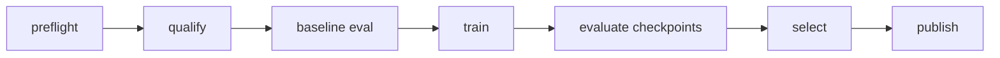

# Design

## Context

See proposal.md (Why). The reference recipe is the harness-hub `Qwen3.8-27B-pi-adapted` model card plus TRL `examples/async_grpo_harbor` (`async_grpo_harbor.py`, `launcher.py`), pinned to `openenv[harbor]==0.7.0`:

- Harbor runs a task in a sandbox with an installed agent.
- OpenEnv's capture proxy sits between that agent and vLLM. Every rollout gets a session id, and the agent uses it as its API key. The proxy records prompt ids, sampled ids, logprobs and loss masks.
- TRL `HarnessAsyncGRPOTrainer` trains a LoRA on those tokens and hot-swaps it into the same vLLM.
- Per-harness wiring lives in OpenEnv's seam table (`openenv/harbor/seams.py` `SEAMS`, `Seam`). Harbor agents subclass `BaseInstalledAgent` (`harbor/agents/installed/base.py`); an agent with `SUPPORTS_ATIF = True` writes `agent/trajectory.json`, which OpenEnv reconciles against its token capture (`openenv/harbor/atif.py` `reconcile`, reported as `atif=match|MISMATCH|none`).

What QueryMT already provides:

- A profile can be run without any server: `AgentInfra::shared_with_db_path` opens a session DB, `from_config_with_infra` loads the profile into an `AgentRunner`, `chat_session()` returns a session whose `id()` is known, and `subscribe()` delivers `RunCompleted { outcome, stop_type }` (`crates/agent/src/runner.rs`, `crates/agent/src/api/agent.rs`, `crates/agent-core/src/events.rs`). `crates/agent/examples/from_config.rs` is a 69-line interactive version of this.
- File session databases use WAL with `synchronous=NORMAL` (`crates/agent-sqlite/src/session/sqlite_storage/mod.rs`), which can lose recent commits only on power or OS failure, not when the process is killed. A killed run therefore leaves every step it committed. Run leases live beside the database as `<db_stem>.run-leases` (`crates/agent-core/src/run_lease_path.rs`).
- `session_atif` reads the session's audit view only; orphaned-run reconciliation runs when a session is loaded for execution, not on export (`crates/agent-runtime/src/session/run_reconcile.rs` callers).
- `querymt_agent::export::session_atif(view_store, session_id, options)` builds ATIF v1.5 from the session's audit view, one agent step per turn with per-step prompt/completion tokens and cost (`crates/agent-services/src/export/mod.rs`, `atif.rs`). Harbor 0.25.0 accepts ATIF v1.0 to v1.8.
- Config strings support `${VAR}` interpolation, and a missing variable is an error (`crates/agent-runtime/src/config/loader.rs` `load_config`, `interpolate_env_vars`).
- `base_url` is taken from the agent's parameters for the active provider (`crates/agent-runtime/src/session/provider_config.rs` `apply_initial_overrides`).
- The `limits` middleware caps model calls with `max_steps` (`crates/agent-runtime/src/middleware/limits.rs` `LimitsFactoryConfig`).
- Pruning and compaction can be disabled with `[agent.execution.pruning] enabled` and `[agent.execution.compaction] auto` (docs/docs/agent/configuration.md, Execution Policy).
- Static musl archives for x86_64 and aarch64 are released as `<binary>-<ver>-<target>/<binary>` inside a tar.gz (`.github/workflows/build.yml`); `qmtcode` is built there as a cargo example with the dashboard, mesh and OAuth features.
- Provider plugins resolve from `$QMT_CONFIG_DIR`/`$QMT_HOME` `providers.toml` (`crates/querymt-utils/src/providers.rs` `config_dir`, `get_providers_config`).

Constraints found while reviewing:

- Harbor's generic ACP agent (`AcpAgent`) installs its runner inside the sandbox at rollout time (apt packages, the `uv` installer from astral.sh, `agent-client-protocol` from PyPI, which at 1.0.0 no longer works with Harbor 0.25.0's runner). It also converts ACP session updates to ATIF on a best-effort basis and attaches token usage only to the last step (`acp.py`, `_write_trajectory`). Found while running task 3.7 locally.
- Harbor 0.25.0 runs the agent as `asyncio.wait_for(agent.run(...), timeout=agent_timeout_sec)` and, in a `finally`, downloads the agent log directory and calls `populate_context_post_run` on the host (`harbor/trial/trial.py` `_run_agent_phase`, `_sync_agent_output`). On Python 3.12 `wait_for` cancels `run()` once, so a `finally` in `run()` can still execute sandbox commands. The agent is never told the timeout (only `cline` accepts it, as an explicit kwarg). Docker terminates the `docker exec` client (SIGTERM, then SIGKILL after 5 s); a process started inside the container may outlive it. Other installed agents (pi, claude_code, opencode) write native logs into the log directory as they run and convert them to ATIF afterwards.
- QueryMT archives nest the executable in a directory.
- `reqwest` 0.13 with the `rustls` feature verifies certificates through `rustls-platform-verifier`. On Linux that loads the system CA store when a client is built, and `build()` fails if the store is empty (`rustls-platform-verifier` `verification/others.rs`, `reqwest` `async_impl/client.rs`), whatever scheme the client later uses. Four clients on `qmt-headless`'s path are built this way and panic on that failure: the shared outbound client (`crates/querymt/src/outbound.rs`, `Lazy::new(Client::new)`, used by the extism host for non-streaming plugin calls), the extism host's per-plugin client (`crates/querymt/src/plugin/extism_impl/host/functions.rs`, `Client::new()`), and the `browse` and `web_fetch` tools (`.expect`/`.unwrap`). Every agent builds those two tools when it registers its built-ins, even when its profile does not offer them. Many task images ship without `ca-certificates`; the first live Docker rollout of `qmt-headless` died this way before any model call, with a plain-http endpoint.
- OpenEnv 0.7.0 has no `querymt` seam. Its `acp` seam is `blocked:needs-registry-entry`.
- `async_grpo_harbor.py` hard-codes a bonus weight of 0.3 and uses one `--vllm-url` for both rollouts and weight sync. It also takes a single `--split`, and has no guard option.

## Goals / Non-Goals

**Goals:**
- One config file and one command (`pipeline run`) take a 2-GPU host from nothing to a published adapter. Each stage can be resumed and run alone.
- Upstream OpenEnv, Harbor and TRL are used unmodified and pinned. All glue lives in this repo.
- The profile trained on is byte-identical to the profile shipped with the adapter.

**Non-Goals:**
- Changing QueryMT runtime behaviour beyond the three fixes in the proposal. Otherwise only a new example profile, prompt and the `qmt-headless` example binary are added.
- Running in GitHub CI. The Python package gets its own pytest suite, run locally; GPU and sandbox stages are manual.

## Decisions

### D1. A dedicated, frozen profile rather than reusing `single_coder.toml`
New `crates/agent/examples/confs/harness_adapter.toml`:

```toml
[profile]
id = "harness-adapter"
name = "Harness adapter"

[agent]
provider = "openai"
model = "${QMT_MODEL}"
api_key = "${QMT_API_KEY}"
tools = ["edit", "read_tool", "write_file", "multiedit", "replace_symbol",
         "glob", "search_text", "ls", "index", "get_symbol", "get_function",
         "find_symbol_references", "shell", "todowrite", "todoread"]
system = [{ file = "../prompts/default_system.txt" },
          { file = "../prompts/harness_adapter_meta.jinja2" }]

[agent.parameters]
base_url = "${QMT_BASE_URL}"
temperature = 0.8
top_p = 1.0

[agent.execution.pruning]
enabled = false
[agent.execution.compaction]
auto = false
[agent.execution.snapshot]
backend = "none"

[[middleware]]
type = "limits"
max_steps = 50
```

`harness_adapter_meta.jinja2` is `code_meta.jinja2` without the `You are powered by {{ provider }}/{{ model }}` line.

Rationale:
- OpenEnv stitches turns by exact token prefix. A rewritten history forks into separate training rows, and a compaction call would be credited with the task reward. That is why pruning, compaction and the `context` middleware are all off.
- `question` blocks with no user present, and `browse` adds network access the guard would mostly flag.
- The model name would otherwise bake the training endpoint into the prompt.
- Snapshots do not change model-visible input. They are off so sandbox workspaces are not written to. A user may enable them when deploying without leaving the trained distribution.

*Alternative:* patch `single_coder.toml` at rollout time. Rejected because the trained profile would then exist only inside sandboxes and could not be published or hash-checked.

### D2. A dedicated headless binary, `qmt-headless`: run, then export

**The binary.** `crates/agent/examples/qmt-headless.rs` starts from `from_config.rs` and replaces its chat loop with two subcommands:

```
qmt-headless run <profile.toml> --cwd <dir> --instruction-file <file> --db <path>
qmt-headless export --db <path> [--session <id>] --atif <out.json> --summary <out.json>
```

- The CLI uses clap derive (`Parser`, `Subcommand`) from `querymt-agent`'s existing `clap` dev-dependency, which examples may use and the library never links. No crate dependency or `Cargo.toml` change. Usage errors exit with status 2 (clap's default).
- **`run`** opens the session database at `--db` through `AgentInfra::shared_with_db_path`, loads the profile with `from_config_with_infra`, creates one session in `--cwd`, and sends the file's content as the one prompt. The instruction is read from a file so no shell quoting touches it. It writes nothing besides the database (and its WAL and run-lease files). Exit code: 0 when the run ends normally or by the step limit (a budget stop is a normal rollout end); non-zero for load, provider or runtime errors. It has no time budget of its own: the agent's caller bounds it.
- **`export`** opens the database read-only for its purpose (it only calls `session_atif` and reads events). Without `--session` it selects the single top-level session and fails if there is not exactly one. It writes `--atif` (`export::session_atif`, agent name `querymt`, version = build version) and `--summary` (`session_id`, `outcome`, `stop_type`, `error`, `model_calls` = agent steps in the ATIF). The outcome comes from the session's last `RunCompleted` event:

  | Last `RunCompleted.outcome` | summary `outcome` |
  |---|---|
  | `completed` | `end_turn` |
  | `stopped` | `stopped`, with its `stop_type` |
  | `failed` | `error`, with its reason |
  | `cancelled`, `interrupted`, or no `RunCompleted` | `incomplete` |

  It always writes the summary, writes the ATIF whenever a session exists, and exits non-zero only when the database cannot be read or no session can be chosen.
- Default features only (`plugin-loaders`): no dashboard, mesh, OAuth or ACP server. Permissions follow the profile; nothing waits for a user.

**The Harbor agent.** `querymt_harbor.agent.QueryMTAgent(BaseInstalledAgent)` with `SUPPORTS_ATIF = True`:

- **`install()`** downloads (on the host) and checks the pinned `qmt-headless` archive for the sandbox platform (D2b), uploads it and extracts the binary to `/opt/qmt/bin/qmt-headless`. It uploads the profile and prompts to `/installed-agent/qmt/`, rewriting only `max_steps` when a step limit is given, and installs the provider plugin locally (D2a). Nothing is installed from a package index, and no install command touches the network.
- **`run()`** uploads the instruction to a file, then:
  1. runs `qmt-headless run` once as the agent user with `QMT_HOME`, `QMT_CONFIG_DIR` and `QMT_PROVIDER_CACHE_DIR` set to `/installed-agent/qmt`, `--cwd` = the task workspace and `--db` = `<agent log dir>/qmt/sessions.db`. The command records its PID first (`echo $$ > <agent log dir>/qmt/run.pid; exec qmt-headless run …`).
  2. in a `finally` (so also on cancellation by Harbor's timeout and on errors): kills that PID if it is still alive (TERM, then KILL after a short wait), then runs `qmt-headless export --db … --atif <agent log dir>/trajectory.json --summary <agent log dir>/qmt/summary.json`, bounded by `export_timeout_sec` (default 60). A failed or timed-out export is logged and leaves no trajectory (`atif=none`); the original error or cancellation is re-raised.
- **`populate_context_post_run()`** reads token totals and cost from the ATIF's `final_metrics` (on the host, after Harbor downloads the log directory).

Rationale:
- QueryMT's exporter sees every model call with its own usage, so the trajectory OpenEnv reconciles is exact rather than reconstructed from ACP updates. That makes `atif=match` a meaningful qualification check (it compares per-call completion tokens with the capture).
- The sandbox install has no runtime network dependency, so `no-network` and `allowlist` tasks work and a moving package (as `agent-client-protocol` 1.0.0 did) cannot break rollouts.
- The served model reaches the binary only through `QMT_MODEL`; there is no session-model negotiation to work around.
- The session database is already an incremental, crash-safe record, so exporting after the process ends covers every way a run can end (normal, step limit, error, Harbor's timeout, a kill or an OOM) without the agent knowing the timeout. This mirrors how Harbor's other installed agents keep a native log and convert it afterwards.
- The database sits in the agent log directory, so Harbor downloads it with the trajectory and a rollout can be re-exported or inspected on the host.

*Alternative:* keep `AcpAgent` and export ATIF from the session DB after the run. Rejected: it keeps the in-sandbox package install. *Alternative:* add a headless flag to `qmtcode`. Rejected: that binary carries the dashboard, mesh and OAuth features, which the harness does not need and which complicate the musl build. *Alternative:* an in-memory store with the binary's own time budget set below Harbor's (the first implementation). Rejected: Harbor never passes the agent timeout to the agent, and a kill, OOM or crash leaves no trajectory. *Alternative:* rewrite the ATIF after every model call. Rejected: the database already is the incremental record. *Alternative:* export on the host in `populate_context_post_run`. Rejected: it needs the binary on the host and still needs the in-sandbox kill; the database in the log directory keeps a host re-export possible for debugging.

### D2b. Building and pinning `qmt-headless`

- CI: `.github/workflows/build.yml` builds `qmt-headless` for `x86_64-unknown-linux-musl` and `aarch64-unknown-linux-musl` with `cargo build --release -p querymt-agent --example qmt-headless` and packages it as `qmt-headless-<ver>-<target>/qmt-headless` in a tar.gz, like `qmtcode`. Nightly and stable releases publish the archives with the other `qmt*` assets.
- Locally (until a nightly carries it): cross-build both targets with `cargo zigbuild`, falling back to a Docker musl toolchain image, and package them the same way.
- `[headless_binary]` in `reference.toml` pins one archive per platform: `url` or `path`, plus a required `sha256`. The host downloads or reads it once, verifies it, and caches it by hash; a mismatch fails `install()` before anything is uploaded. The binary's version and hash are recorded in the training record and the model card.

### D2a. The provider plugin is pinned by SHA-256 and installed as a local file
Without a local `providers.toml`, the harness downloads a provider list from `repo.query.mt` (`openai = oci://ghcr.io/querymt/openai:latest`) and pulls the wasm from ghcr.io on first use, and every start also tries `https://models.dev/api.json`. Inside a sandbox that means a network fetch during the agent run (it fails under `no-network`/`allowlist` tasks, losing the rollout), a plugin that changes under the adapter, and thousands of anonymous registry pulls. So:

- `[plugin]` in `reference.toml` pins `ghcr.io/querymt/openai` by manifest digest and wasm SHA-256. `querymt_harbor.plugin.fetch_plugin` downloads the blob by digest once on the host, verifies manifest, layer and blob hashes, and caches it by hash.
- `install()` uploads the wasm and writes `providers.toml` with `path` set to the local file and `[providers.config] allowed_hosts = [<endpoint host>]`. The plugin only allows its default host (`api.openai.com`) and does not derive hosts from the profile's `base_url`, so the endpoint host must be listed.
- `install()` writes an empty `models.dev.json` (fresh for 24 h) into `QMT_PROVIDER_CACHE_DIR`, so no models.dev call is made and no models.dev defaults vary the requests.
- The plugin hash is recorded in the training record and the published bundle, and publishing checks it like the profile hash.

*Alternative:* `oci://...@sha256:<manifest>` in `providers.toml`. Rejected because it still downloads during the agent run.

*Alternative:* a Python `querymt_agent` runner. Rejected: the binding has no ATIF export, cancellation or run events (it offers `from_config`, `chat_session` and `chat() -> str`), so it would need a binding change, and its wheels are glibc-only (manylinux2014) for Python ≥ 3.10, which would bring back a Python install in every sandbox.

### D2c. HTTP clients fall back to bundled roots when the system has none

`querymt::outbound::build_client(configure)` builds a `reqwest::Client` from `configure(Client::builder())`. If that build fails, it builds once more with the Mozilla roots from `webpki-root-certs` added through `tls_certs_merge`, and logs one warning naming the cause. With extra roots, `rustls-platform-verifier` accepts an empty system store, so the second build succeeds; it fails only for builder errors unrelated to roots, which callers handle as they do today. The four clients listed under Context use it, each keeping its own configuration (timeout, redirect policy, user agent).

- Plain http needs no certificates. That is OpenEnv's `DirectExposure`, the preferred exposure whenever the sandbox can route to the capture proxy (local Docker, same network). https endpoints (tunnel exposure, hosted providers) still verify, against the bundled roots. So the sandbox needs no CA bundle and no `SSL_CERT_FILE`, and D2/D2a are unchanged.
- On hosts with system roots nothing changes: the fallback runs only where today's code panics.
- `webpki-root-certs` (already in `Cargo.lock`) becomes a direct optional dependency of `querymt` under the `http-client` feature, which `querymt-agent-services` already enables through `runtime`.
- Not covered: `querymt-utils` `fetch_providers_repository` (`Client::new()`; not reached when `providers.toml` is local, and `querymt-utils` does not depend on `querymt`) and the MCP HTTP clients in `crates/agent-runtime/src/agent/protocol.rs` (they return an error rather than panic, and run only with configured MCP servers).

*Alternative:* build the two tools' clients lazily. Rejected: it fixes only the tools, adds a fallible path inside each, and leaves both provider clients to panic on the first model call. *Alternative:* a lazy tool registry, or registering only the tools a profile enables. Rejected: `ToolSet::definitions()` reads every registered tool's schema each turn, so laziness would need tool metadata split from the instance across all built-ins; a session can enable tools at runtime (`SetAllowedTools`), so construction would still need an error path; and a tool list that depends on whether construction succeeded would break the fixed tool set. Only two built-ins build anything at construction. *Alternative:* upload a CA bundle and set `SSL_CERT_FILE` in `install()`. Rejected: it fixes only this experiment, adds a pinned file to every sandbox, and the direct endpoint is plain http anyway. *Alternative:* always use the bundled roots (`tls_certs_only`). Rejected: it would ignore enterprise and user-installed roots on normal hosts.

### D3. Seam registered by a wrapper process, not an OpenEnv fork

`querymt_harbor.seam` adds an entry to `openenv.harbor.seams.SEAMS`:

```python
Seam(name="querymt", dialect="openai_chat", model_fmt="{model}",
     import_path="querymt_harbor.agent:QueryMTAgent",
     agent_env={"QMT_BASE_URL": "{base_url}/v1", "QMT_API_KEY": "{session}",
                "QMT_MODEL": "{model}"},
     step_limit=lambda n: {"step_limit": n}, status="untested")
```

How it reaches the OpenEnv processes:
- `python -m querymt_harbor.serve` and `python -m querymt_harbor.rollout` register the seam, then call OpenEnv's CLI entry point with the same argv.
- Training and evaluation import the module before creating sessions.

Why only `agent_env`: it is scoped to Harbor's agent phase, so the verifier's `OPENAI_API_KEY` is never touched. No `env`/`proc_env` entry means no process-global lock.

*Alternative:* an upstream PR, which is a follow-up after validation. *Alternative:* `--harness module:Class`, which `seams.get` in 0.7.0 does not accept.

### D4. One merged training split built locally
`querymt_harbor.dataset` builds the training split:

1. Downloads `harness-hub/scale800-harbor` and `harness-hub/termgrade-train-harbor` at pinned revisions.
2. Samples 750 and 300 tasks with the seed.
3. Interleaves them round-robin, weighted by ratio.
4. Drops any task whose normalised instruction SHA-1 matches a task in `harness-hub/swebench-pro-v2-hard51-harbor` or `harborframework/terminal-bench-2.1`; an overlap is an error.
5. Writes a local Harbor dataset directory plus a `manifest.json` (task id, source, revision, index).

The server is started with that directory as its one split, so TRL's single-factory trainer needs no change.

*Alternative:* two OpenEnv factories. Rejected because the trainer takes exactly one.

### D5. Training script: a thin fork of `async_grpo_harbor.py`
`querymt_harbor.train` copies the script at a pinned TRL commit and changes only these things:

- The reward lives in `querymt_harbor.reward`: correctness with `reward` fallback, configurable bonus weight (default 0.1) and tool budget, guard zeroing, and unscored stays unscored.
- A separate `--rollout-llm-url` (the safeagents proxy) and `--vllm-url` (weight sync).
- `save_total_limit=None`.
- Resume from the latest `checkpoint-*` in the run directory.
- Defaults are taken from the pipeline config.
- The resolved config, including the profile SHA-256, is written before `trainer.train()`.

Card values map onto `AsyncGRPOConfig` as follows:

| Card value | Config field |
|---|---|
| r=32, alpha=64, target modules | `LoraConfig` |
| lr 2e-5 | `learning_rate` |
| 8 generations, T 0.8, top-p 1.0, thinking off | `num_generations`, `temperature`, `top_p`, `chat_template_kwargs` |
| staleness 16 | `max_staleness` |
| 16 micro-batches of ≤65,536 tokens | `gradient_accumulation_steps=16`; the per-micro-batch token cap goes to the TRL field that bounds packed length (the exact field is confirmed in task 4.1) |
| 50 steps / 1,800 s | `agent_step_limit` / `agent_timeout_sec` on the session factory |

### D6. Guard placement
safeagents sits between the capture proxy and vLLM: `safeagents start http://127.0.0.1:8000 --port 8787`. Rollouts use `llm_url=http://127.0.0.1:8787` while TRL syncs weights to `:8000` directly.

- **Upstream of the proxy:** blocked calls are replaced in the response before the proxy records it. Training therefore sees exactly what the harness saw.
- **Block detection:** the reward function scans the rollout transcript for the safeagents block notice. The marker string is taken from the pinned safeagents version and asserted in a unit test.
- **Gate:** if the proxy loses token ids or logprobs behind safeagents, the qualification gate fails with "no trainable tokens". The documented fallback is `guard.enabled=false`.

### D7. Pipeline orchestration and launcher
`querymt_harbor.pipeline` reads `configs/reference.toml`. Each stage writes `stages/<name>.done.json` with its outputs; `run` skips completed stages.



`launcher` starts processes and waits for them to come up healthy, following TRL's `launcher.py`:
1. The Harbor server wrapper, exposed through a public tunnel and checked with `/health`.
2. vLLM on GPU 0 with `--enable-lora --max-lora-rank 32 --max-loras 18`, `VLLM_ALLOW_RUNTIME_LORA_UPDATING=1`, `VLLM_SERVER_DEV_MODE=1`, `--language-model-only --enable-prefix-caching --mamba-cache-mode align`, `--tool-call-parser qwen3_xml --reasoning-parser qwen3`, `--default-chat-template-kwargs '{"enable_thinking": false}'`, `--logprobs-mode processed_logprobs --return-tokens-as-token-ids`, `--weight-transfer-config '{"backend":"nccl"}'` and `--max-model-len 131072`.
3. The safeagents proxy.
4. The trainer on GPU 1.

The same launcher runs as an `hf jobs uv run --flavor h200x2` script, with a bucket mounted at `/data` for checkpoints.

### D8. Evaluation and selection
`querymt_harbor.evaluate` serves each candidate with `vllm serve … --lora-modules <name>=<checkpoint dir>` (all candidates at once, up to `--max-loras`). It runs OpenEnv eval-tier rollouts through the `querymt` seam with:
- 100 agent steps;
- 2 h per task on SWE-bench Pro hard51 and 1 h on Terminal-Bench 2.1;
- the training sampling policy.

Rerun rule: a rollout with zero captured turns plus a connection error, sandbox start failure or install failure is an infrastructure failure, rerun up to twice.

`querymt_harbor.stats` produces the paired report:
- difference of means;
- a 95% normal interval on the paired per-task differences (divisor n);
- newly solved / lost;
- an exact two-sided sign test on the discordant pairs.

`querymt_harbor.select` picks the best checkpoint on the selection set declared in the config. That set is hard51 plus 18 Terminal-Bench 2.1 ids fixed by seed; it is recorded before any evaluation. Held-out Terminal-Bench numbers are reported separately.

### D9. Publishing
`querymt_harbor.publish` first refuses if the current profile and prompt SHA-256 differ from the training record. It then uploads to the configured repository:

- the adapter, tokenizer, `querymt/` profile and prompts, `training_config.json`, `eval_report.json` and `selection.json`;
- a generated `README.md`. It covers the base model, harness and `qmt-headless` version, recipe, results tables, and serving commands: vLLM `--lora-modules`, llama.cpp `llama-server --lora`, and `qmt-headless run` with the three environment variables.

Optional extras:
- a GGUF LoRA through llama.cpp `convert_lora_to_gguf.py`;
- trajectories via `safeagents publish` with the canary added beforehand.

### D10. Tests
- **Rust (`querymt-agent`, integration binary `it`):** the profile loads, missing-variable errors, the exact tool list, `limits` set to 50, pruning and compaction disabled, and the rendered prompt free of endpoint identity.
- **Python (`experiments/harness-adapter/tests`, pytest):**
  - Pure-function tests: reward, stats, dataset, selection, publish checks, pipeline resume, seam registration and agent environment scoping.
  - A fake-endpoint end-to-end test that runs the real `qmt-headless` binary (`run`, then `export`) against a scripted chat-completions server and checks wire-level behaviour (endpoint, tools, prefix property, no auxiliary calls, budget and model name), the exported ATIF and summary, and export after a killed run.
  - A Docker-based Harbor test gated by `QMT_RUN_LIVE_HARBOR=1`.
- GPU stages are verified by recorded artifacts.

## Risks / Trade-offs

- **[A QueryMT turn may not map to exactly one model call, so OpenEnv's cross-check would report `MISMATCH`]** → A fake-endpoint test asserts agent steps = model requests and per-step tokens = the endpoint's usage before any live run. The qualification gate accepts only `atif=match`.
- **[The run process may outlive Harbor's cancellation (Docker stops only the `exec` client), keep calling the model and write to the database during export]** → `run()`'s `finally` kills the recorded PID before exporting. The live test (task 3.8) checks that no `qmt-headless run` process remains after a timed-out rollout.
- **[The agent can read its own session database in the log directory]** → It holds only this rollout's conversation, which the model already saw. Training tokens come from the capture proxy; the database feeds only the ATIF cross-check.
- **[Export fails or hangs]** → It is bounded by `export_timeout_sec`; the rollout reports `atif=none`, its capture tokens still train, and only the qualification gate requires `match`. The database is still downloaded, so the rollout can be re-exported on the host.
- **[Cross-building `qmt-headless` for musl may fail on bundled native dependencies (SQLite, crypto)]** → Fall back to a Docker musl toolchain image locally; CI already builds musl `qmtcode` with the same dependencies.
- **[safeagents may drop logprobs or token ids]** → Caught by the qualification gate; `guard.enabled=false` keeps the experiment unguarded and documented.
- **[The openai provider plugin and models.dev metadata would be fetched over the network during every rollout]** → Pinned by SHA-256 and installed as a local file, with an empty models cache (D2a, tasks 2.6 and 3.4). The live test runs the real plugin with dead HTTP proxies.
- **[The profile's `api_key` was dropped at session creation]** → Fixed in the runtime (`SessionProvider::profile_api_key`, task 2.5). The key is applied only for the profile's own provider and model and is never persisted.
- **[The agent appended a per-step `[Run objective revision N]` block to the latest message and removed it on the next step, forking the prefix]** → Disabled by `[agent.execution] run_objective = false`, which the profile sets explicitly (it is also the default now). The wire test `consecutive_requests_share_the_prior_prefix` passes and the live rollout shows `roots=1`; the qualification gate still blocks training if a harness change brings the fork back.
- **[Bundled roots (D2c) age with the binary and add to its size]** → They are used only when the system store is empty, where nothing works today. Task 3.10 records the size change of `qmt-headless`.
- **[A per-call efficiency bonus may push the agent toward large `shell` calls rather than its fine-grained tools]** → The weight is configurable. Evaluation reports tool-mix shift (share of `shell` calls) beside solve rate.
- **[A 27B model on 2 GPUs is expensive, and the reference run stopped at step 191]** → Stages resume, checkpoints are kept every 10 steps, and selection may run on a partial run.
- **[Template skew between vLLM training and llama.cpp deployment]** → The model card states that the GGUF path is not re-evaluated, as harness-hub did.
- **[Upstream pins drift (OpenEnv internals, Harbor `BaseInstalledAgent` API)]** → Everything is pinned exactly in `uv.lock`. The seam and agent tests import the pinned versions and fail on API changes.

## Migration Plan

Additive apart from the two runtime fixes. Rollback is deleting `experiments/harness-adapter/`, the profile, the prompt, `qmt-headless` and its CI entries. The runtime fixes (profile `api_key`, CA-root fallback) stand on their own and stay. No existing profile or config key changes.

## Open Questions

- *(Resolved in task 4.4.)* `HarnessRolloutOutcome` carries both `trace` (every proxy-recorded request and response of the selected turns) and `completion` (only the last request's messages plus the final reply). Detection reads `trace`, which holds every post-safeagents response, so an early block is found even when the harness no longer shows it in its final request; `completion` is the fallback when there is no trace. Only assistant output is scanned, never tool results, so an agent that prints the marker cannot zero its own rollout.
