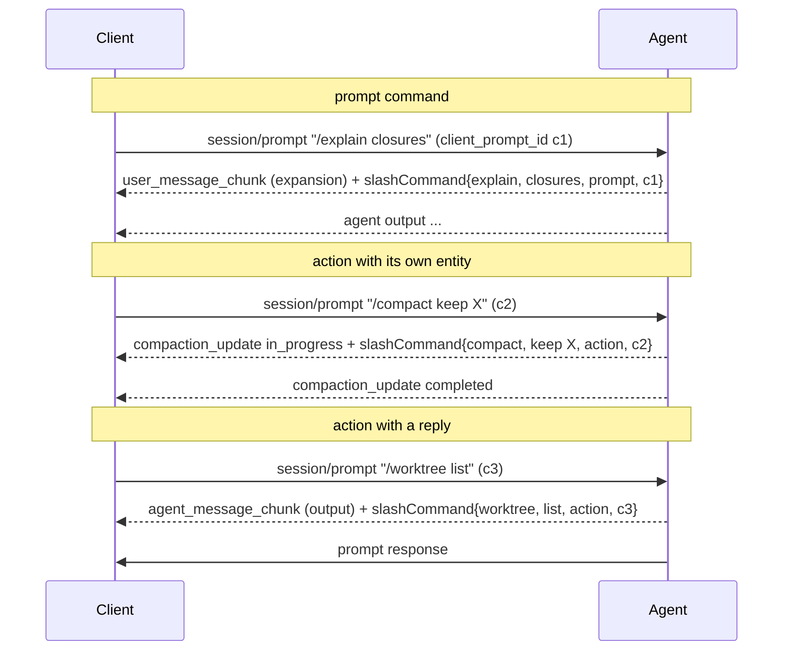

# Design

## Context

See proposal.md for the motivation. The current state:

- **Catalog.** `crates/agent-runtime/src/agent/handle/core.rs` `catalog_notification` joins two lists:
  - user commands from `crates/agent-runtime/src/slash_commands/acp.rs` `registry_to_acp_update` (name, description, ACP `input` when the file has a hint or `$ARGUMENTS`);
  - built-ins from `crates/agent-runtime/src/slash_commands/builtin.rs` `Builtin::entry`.
  Neither sets `_meta`. `Builtin::accepts(Submission)` already decides which submissions a built-in runs from, but it is not advertised.
- **User commands.** `crates/agent-runtime/src/slash_commands/types.rs` `SlashCommand` knows its `SlashCommandSource` (`Global`, `Project`, `Configured`). `CommandFrontmatter` keeps unknown keys in `extra`. `parser.rs` `parse_command_file` turns a bad file into a `SlashCommandDiagnostic`.
- **Expansion.** `crates/agent-runtime/src/agent/session_actor.rs` `execute_prompt_inner` calls `expander.rs` `try_expand` and overwrites `req.prompt[0]` before the message is stored. `MessagePart::Prompt`, `AgentEventKind::UserPromptBlock` and `AgentEventKind::PromptReceived` all hold the expansion. The typed text is gone.
- **`/compact`.** The same function handles it before the prompt is stored and returns. `crates/agent-runtime/src/agent/execution/maintenance.rs` `compact_history_with` emits `CompactionStart { token_estimate, compaction_id }`. Two outcomes emit only an `AgentEventKind::HookNotice`: `CompactionOutcome::NothingToCompact` and `CompactionOutcome::Blocked`.
- **`/worktree`.** `crates/agent-runtime/src/agent/handle/ext_worktree_ops.rs` `handle_native_worktree_prompt` runs before the session actor. Its outcome is one of:
  - the transient `WorktreeCommandOutput { text }`;
  - the durable `WorktreeCommandCompleted { id, command, code, archived, text }` (`NativeCommand::durable_reply`);
  - an announcement already written by `announce_handoff` or `announce_archived` (`WorktreeOwnershipTransferred`, `WorktreeArchived`).
- **Projection.** `crates/agent-protocol-types/src/replay.rs` `replayable_updates` turns these events into `agent_message_chunk`s (`worktree_command_chunk`, `worktree_handoff_chunk`, `worktree_archived_chunk`). Live delivery (`crates/agent-runtime/src/acp/shared.rs` `translate_unstamped_updates`, `user_prompt_chunk`), materialized replay (`materialize_replay_state`, `replay_agent_events_with_user_prompts`) and the session view (`crates/agent-session-core/src/project.rs` `event_updates`, `snapshot.rs` `replay_events`) each build updates from events.
- **Steering.** `session_actor.rs` (`SubmitInput` handler, `InputDelivery::Steer`) calls `Builtin::parse_for(.., Submission::Steer)`. A user command is not checked and is pushed to the running turn as typed.
- **Session view.** `crates/agent-session-core`:
  - `updates.rs` `slash_commands` builds `SlashCommandView { name, description, input_hint }`.
  - `assistant_chunk` drops chunk `_meta`; a native reply becomes an `AssistantMessage`.
  - `client.rs` `prompt_completed` settles a prompt the agent never echoed (`settle_unechoed_prompt`) and uses "it was still pending" to end the submission.
  - `store.rs` `Store::push` lets only user messages and compactions open a turn outside a run.

Constraint: `SessionUpdate` is the upstream ACP schema (`agent-client-protocol-schema`), so a new update kind is not available. QueryMT data rides in `_meta.querymt` (`replay.rs` `QUERYMT_META_NAMESPACE`), as run ids and compaction token counts already do.

## Goals / Non-Goals

**Goals:**
- One descriptor shape and one record shape for every command, built-in or user-defined.
- The agent states what a command is and that it ran. A client reads it and never parses prompt text.
- One projection helper for the record, used by live delivery, replay and the session view.

**Non-Goals:**
- A generic "command run" journal entry. The record is attached to updates that already exist.
- Renaming or merging the worktree events.
- Reconstructing records for history written before this change.

## Decisions

### D1. The descriptor is four fields in `_meta.querymt` of each catalog entry

```json
{ "name": "explain", "description": "…", "input": { "hint": "[topic]" },
  "_meta": { "querymt": { "source": "project", "effect": "prompt",
                          "input": "required", "accepts": ["prompt", "queue"] } } }
```

- `catalog_notification` is the only place that sets it, for both lists:
  - built-ins: `source` is `builtin`, `effect` is `action`, `accepts` comes from `Builtin::accepts` for `Submission::Prompt` and `Submission::Turn`, and a new `Builtin::input` gives `optional` for `Compact` and `required` for `Worktree`;
  - user commands: `source` from `SlashCommandSource`, `effect` is `prompt`, `accepts` is `["prompt", "queue"]`, `input` from D2.
- `steer` is not a value of `accepts`: after D6 no command is steerable.
- Keys are camelCase where they have more than one word, as ACP's own fields are.
- Alternative considered: separate booleans (`native`, `takesInput`). Rejected: `native` says where a command is implemented, not what the user gets, and a boolean cannot tell optional input from required.

### D2. `arguments` in frontmatter, with a default that keeps today's behaviour

- `CommandFrontmatter` gains `arguments: Option<ArgumentsNeed>` (`none`, `optional`, `required`), copied to `SlashCommand`.
- Without the key: `required` when the file has `argument-hint` or the template contains `$ARGUMENTS`, else `none`. Clients prefill such commands today, and `required` keeps that.
- `registry_to_acp_update` sets the ACP `input` exactly when the need is not `none`.
- An unknown value fails deserialization, so `parse_command_file` already reports it as a diagnostic and the file is skipped.
- The need is advice for clients. `execute_prompt_inner` keeps expanding a command sent without arguments.
- Alternative considered: reading `[x]` against `<x>` in the hint. Rejected: hints are free text.

### D3. One record type, attached to the event that carries the outcome

`crates/agent-protocol-types` gains:

```rust
pub struct SlashCommandRecord {
    pub name: String,
    pub arguments: String,
    pub source: SlashCommandSource,   // builtin | global | project | configured
    pub effect: SlashCommandEffect,   // prompt | action
    pub client_prompt_id: Option<String>,
}
```

- It is not named `SlashCommandInvocation`: `slash_commands/types.rs` already has a runtime type of that name.
- These events gain `slash_command: Option<SlashCommandRecord>` (`#[serde(default, skip_serializing_if = "Option::is_none")]`):

| Event | Durability | Set by |
| --- | --- | --- |
| `UserPromptBlock`, `PromptReceived` | live / durable | `execute_prompt_inner`, when `try_expand` matched |
| `CompactionStart` | durable | `compact_history_with`, for `TRIGGER_MANUAL` |
| `WorktreeCommandOutput`, `WorktreeCommandCompleted` | transient / durable | `handle_native_worktree_prompt` |
| `WorktreeOwnershipTransferred`, `WorktreeArchived` | durable | `announce_handoff`, `announce_archived`, when a native command of that session caused them |
| `SlashCommandReply` (new, D5) | transient | `execute_prompt_inner` |

- `WorktreeCommandOutput` also gains `code: Option<String>`; the handler already has it.
- The field is `slash_command`, not `command`: `WorktreeCommandCompleted.command` is the subcommand name.
- `client_prompt_id` comes from `session_actor.rs` `client_prompt_id_from_meta`, which moves to a place both the actor and the worktree handler can call.
- No migration: the events are JSON in the journal and the field is optional. `AgentEventKind` does not deny unknown fields, so an older binary reads a newer journal and ignores the record.
- Alternative considered: a new `MessagePart` for the typed command. Rejected: message parts feed the model request and the prompt-record reads; the record is display data and belongs with the events that drive display.
- Alternative considered: one durable `SlashCommandRun` event per invocation. Rejected: it duplicates the compaction and the worktree reply, and the user chose to keep transient replies transient.

### D4. One projection helper stamps the wire metadata

- `replay.rs` gains `stamp_slash_command(update: &mut SessionUpdate, record: &SlashCommandRecord, error: Option<&str>)`, next to `stamp_run_id` and `stamp_compaction_tokens`. It writes `_meta.querymt.slashCommand` (`name`, `arguments`, `source`, `effect`, `clientPromptId`) and, when given, `_meta.querymt.slashCommandError`.
- Every projection calls it:
  - `replayable_updates`: `PromptReceived` and the four worktree events;
  - `user_prompt_chunk` and `replay_agent_events_with_user_prompts`: every chunk of the message;
  - `translate_unstamped_updates` and `agent-session-core` `event_updates`: `CompactionStart`;
  - `agent-session-core` `replay_events`: the chunks it builds from prompt records for a `PromptReceived`.
- Materialized replay sends only the terminal `compaction_update`. `CompactionIds` already carries the token count from start to end (`start_tokens`, `take_tokens_before`); it carries the record the same way.
- `worktreeCommand` and `worktreeHandoff` metadata stay as they are.



### D5. `SlashCommandReply` covers outcomes that have no update

- New `AgentEventKind::SlashCommandReply { slash_command, text, code: Option<String> }`:
  - `Durability::Ephemeral` in `events.rs` `classify_durability`;
  - event name `slash_command_reply`;
  - projected as an `agent_message_chunk` with the text, stamped by D4.
- `execute_prompt_inner` emits it instead of `HookNotice` for `CompactionOutcome::NothingToCompact` (no code) and `CompactionOutcome::Blocked` (code `blocked_by_hook`).
- It is emitted through the session's ordered stream, so it precedes the prompt response like the worktree output does.
- Every other `/compact` outcome already has a compaction to carry the record (`Completed`, `PriceLimit`, failed, cancelled) or fails the request (provider not buildable before the start).
- Alternative considered: leaving the notices. Rejected: the client would keep an unanswered `/compact` prompt with no record, and would have to recognise it by its text.

### D6. A recognised command is rejected as steering

- In the `SubmitInput` handler's `InputDelivery::Steer` branch, after `Builtin::parse_for`, call `try_parse_invocation` with `runtime.effective_slash_registry(..)`. A match returns a new error that converts to `AgentError::InvalidPromptContent`, like `BuiltinError` (`crates/agent-runtime/src/error.rs`).
- The message follows `BuiltinError::NotAccepted`: `/explain cannot be steered into a running turn; queue it or submit it with session/prompt`.
- `ext_session_ops.rs` `handle_ext_session_submit_input` keeps only its built-in pre-check: the session's registry lives with the actor.
- Alternative considered: expanding on steer. Rejected by the user: a template is a new task, not a correction to the running one.

### D7. Worktree announcements take the record as a parameter

- `run_native_command` passes the record down to `announce_handoff` and `announce_archived`. Callers that are not a native command of the announced session pass `None`:
  - the ACP extension methods;
  - `announce_recovered_handoff`;
  - an archive issued from another session.
- In the last case the issuing session gets `WorktreeCommandCompleted` with the record; the owner's announcement has none.
- Alternative considered: sending a second, empty reply that only carries the record. Rejected: an older client would show an empty message.

### D8. Session view

- `view.rs` `SlashCommandView` gains `source`, `effect`, `input` (each `Option` of a `#[non_exhaustive]` enum) and `accepts: Option<Vec<..>>`. `updates.rs` `slash_commands` reads them from `_meta.querymt`; an unknown value is `None`, and an unknown element is dropped from `accepts`.
- `accepts` is an `Option` so that "the agent sent no descriptor" (`None`) differs from "the command accepts no submission" (`Some(vec![])`). A client decides its fallback from `None`, never from an empty list.
- `querymt-gpui` (same workspace) builds `SlashCommandView` in its tests (`crates/querymt-gpui/src/ui/slash.rs` `command`); those constructions are fixed in the same task, with every new field `None`.
- `entry.rs`:
  - `UserMessage` and `CompactionEntry` gain `slash_command: Option<SlashCommandRecord>`;
  - new `EntryKind::CommandReply(CommandReply { message_id, slash_command, text, code })`. `EntryKind` is `#[non_exhaustive]`.
- `updates.rs`:
  - `user_chunk` and `compaction_update` copy the record; a later update without one leaves it.
  - `apply_update_inner` routes an `AgentMessageChunk` with `slashCommand` to a new `command_reply_chunk`. It has its own id index, so it never merges with `assistant_chunk`'s "newest id-less assistant message" rule.
- **Pending prompt.** When an entry with `client_prompt_id` is created, the pending prompt is removed (`client.rs` `drop_unsent_prompt`) and `idx.prompt` points at the new entry. `prompt_completed` treats "the prompt's entry is a command reply or compaction created outside a run" as answered without a run, so `RunState::Submitting` still ends. Today that signal comes from `settle_unechoed_prompt` finding the prompt pending, which no longer happens.
- **Turns.** `store.rs` `Store::push` adds `EntryKind::CommandReply` to `opens_turn`. With a running run it joins that run's turn through the existing `active_run` rule.
- `snapshot.rs` keeps skipping prompts settled without a run on reload, for agents that send no records.

### D9. No capability negotiation

- All additions are `_meta` keys on update kinds clients already handle. `agent-session-core` `apply_update_inner` and other clients ignore unknown `_meta`.
- The one visible change for an older client is D5: two `/compact` outcomes arrive as a message instead of a notice.

## Risks / Trade-offs

- **`PromptReceived` and `CompactionStart` are constructed in many tests and examples** (about 30 sites across `agent-runtime`, `agent-services`, `agent-session-core`, `agent`). → Add the field with `Default`-friendly construction first and fix call sites in one task; no behaviour changes in that task.
- **Typeshare consumers break at build time** (`querymt-desktop`). → Listed as a follow-up in the proposal; the fields are optional on the wire.
- **A catalog can change between advertising and submitting** (a command file edited or removed). → The record is built from the registry the session expands with at submission, so it describes what ran, not what was advertised.
- **A reply during a run lands inside the running turn.** → Accepted; it is the existing rule for content without a run id, and `/worktree` is the only command that can do it.
- **`add-agent-session-core` is not archived yet.** → This change's `session-view-state` delta only adds requirements. Archive that change first.
- **`querymt-gpui` is a workspace member with a path dependency on `querymt-agent-session-core`.** New `SlashCommandView` fields break its test build at once. → Task 4.1 fixes its constructions; task 5.3 checks it.

## Migration Plan

- Additive on the wire and in the journal; deploy without data steps.
- Rollback: an older binary ignores `slash_command` in journals written by a newer one and replays those sessions without records.
- Clients: `querymt-gpui` is in this workspace and builds against the change directly (`slash-command-actions`, `slash-command-transcript`); `querymt-desktop` regenerates types.

## Open Questions

- **`/agents` output.** `add-agents-slash-command` D2 plans `AgentEventKind::AgentsCommandOutput { text }`. It should use `SlashCommandReply` instead, which gives it the record and the error code without a third output event. Whichever change lands second makes the adjustment; this does not change this change's specs or tasks.
- **`/agents` descriptor.** With `Builtin::Agents` in `Builtin::ALL`, `catalog_notification` must describe it too: `source` `builtin`, `effect` `action`, `input` `required` (every form needs a subcommand), `accepts` `["prompt"]`. If `add-agents-slash-command` lands first, task 2.2 adds that arm to `Builtin::input` and a catalog test; if this change lands first, that change does (its Workflow follow-up).
