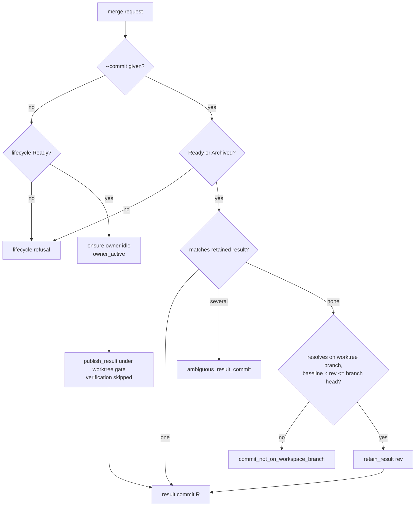
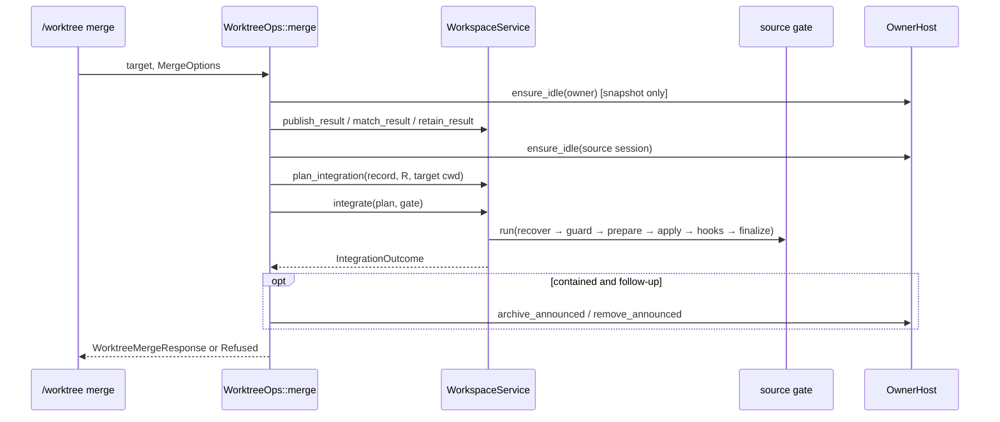

# Design

## Context

Requirements are in `specs/git-worktree-workspaces/spec.md`; motivation in
proposal.md.

Existing building blocks:

- Delegate acceptance, `crates/agent-services/src/worktree/integrate.rs`
  `WorkspaceService::accept_delegation_result`: delegation checks, result
  lookup by prefix, target checks (`wrong_repository`, `wrong_target`), an
  `AcceptPlan` (target root, common dir, baseline, result commit, integration
  ref, message), then `integrate_under_gate` under a `CheckoutMutationGate`:
  recover → replay guard (`refs/qmt/integrations/<ws>/<result>`, reachable
  from HEAD) → `prepare_integration` (three-way `B0`/`HEAD`/`R`, local-state
  and `baseline_local_edits` refusal, index lock) → `apply_integration` →
  `run_integration_hooks` → `finalize_integration` (CAS branch update plus
  create-only integration ref), with rollback/recovery on every exit.
- Publication, `crates/agent-services/src/worktree/service.rs`
  `WorkspaceService::publish_result`: capture under the checkout gate,
  create-only `refs/qmt/results/<ws>/<uuid>`, `registry.record_result`.
  `WorktreeOps::publish` (`ops.rs`) wraps it for every surface.
- Lineage: `/worktree create` records the source session as
  `ownership.parent_session_id` and the grouping cwd as `source_cwd`
  (`service.rs` `allocate_for_new_session`). `source_cwd` is inherited by
  nested isolation, so it names the original project, not an intermediate
  worktree.
- Native commands and replies: `crates/agent-runtime/src/agent/handle/ext_worktree_ops.rs`
  (`NativeCommand`, `durable_reply`, `handle_native_worktree_prompt`,
  `run_native_command`, `worktree_ops(target)`), the `OwnerHost`
  implementation (`quiesce_owner`, `announce_archived`), and
  `WorktreeOps::{archive_announced, remove_announced}`. Durable replies and
  `ArchiveRemoval` come from `allow-removal-of-published-worktrees`, which
  this change builds on.

## Goals / Non-Goals

**Goals:**

- One integration transaction for delegate acceptance and worktree merge;
  acceptance behaviour and its tests unchanged.
- Merge is a `WorktreeOps` operation, so native, ACP, Rust and Python share
  it (and its runtime routing from `SessionHost`).

**Non-Goals:**

- No change to `prepare/apply/finalize/recover_integration` or the hook
  runner.
- No new persistence: results and integration records are refs and
  existing registry rows.

## Decisions

### 1. Split acceptance into plan + transaction

`AcceptPlan` becomes `pub(crate) struct IntegrationPlan` with the same fields.
New `pub(crate) fn plan_integration(record, result_commit, target_cwd,
message) -> Result<IntegrationPlan, Refusal>` holds the checks both callers
share: baseline present (`no_baseline`), target resolution,
`wrong_repository`, `wrong_target`, integration ref
`refs/qmt/integrations/<ws>/<result>`. New `pub(crate) async fn
integrate(&self, plan, gate: Option<&CheckoutMutationGate>)` chooses the gate
(given one when it guards the same checkout, else the checkout-keyed
fallback) and runs `integrate_under_gate`.

`accept_delegation_result` keeps `delegation_not_complete`,
`invalid_result_commit`, `no_isolated_workspace`, `not_parent_session` and
result-prefix matching, then calls both. Result-prefix matching moves into a
shared `match_result(record, prefix)` used by both callers.

Alternative: call `accept_delegation_result` with a synthetic delegation.
Rejected: it would fake delegation state and couple merge to delegate rules.

### 2. Outcome type

Merge reuses `IntegrationOutcome`. `WorktreeOps::merge` maps it:

| `IntegrationOutcome` | Surface |
|---|---|
| `Integrated(done)` | `outcome: "merged"`, commit, branch, changed paths |
| `AlreadyIntegrated { commit }` | `outcome: "already_merged"` |
| `NoChanges` | `outcome: "no_changes"` |
| `Conflicted { paths }` | error `merge_conflict` + paths |
| `Refused(refusal)` | error `refusal.code` + paths |

`WorktreeOpError` gains `Refused { code, message, paths }` (constructed from
`Refusal`); `error_data()` adds `paths` when non-empty. The integration
refusal codes are reused verbatim, so acceptance and merge agree.

### 3. Version selection

`publish_result` is split: capture stays there, and a new `retain_result(
record, commit, captured_head, verification)` writes the create-only result
ref and the registry row. `--commit <rev>` for a branch commit calls
`retain_result` directly, so every merged version is a retained,
reviewable result and the replay guard keys on it uniformly. Branch
membership uses `RepositoryOps::is_ancestor(baseline, rev)` and
`is_ancestor(rev, branch head)` through the common dir.

Snapshot requires an idle owner via a new `OwnerHost::ensure_idle(session)`
that reports `owner_active` without unloading (unlike `quiesce_owner`); a
tool write mid-turn would otherwise land in a half-finished snapshot.
Archived workspaces can only merge an explicit version: their live state is
retired.

### 4. Target and gates

Target cwd: the source session's effective cwd
(`WorkspaceService::resolve_session_cwd(parent_session_id, row cwd)`) when
`ownership.parent_session_id` is set and the session exists, else
`record.source_cwd`. Either must resolve to a checkout of the same common
dir; otherwise `source_missing`. `plan_integration` then applies
`wrong_repository`/`wrong_target`.

Gate: when the target checkout is itself a managed workspace
(`registry.get_workspace_by_checkout`), the gate for that checkout under the
service's storage root (the one its owner's actor uses); otherwise the
checkout-keyed fallback, as acceptance does. The source session must not be
mid-turn (`ensure_idle(parent_session_id)` → `source_active`), because shell
and MCP tool writes do not take the gate (built-in write tools do, on the
session's managed or checkout-keyed gate, and so serialize with integration).
`ensure_idle` is a point-in-time observation, not an admission reservation: a
turn that starts after it returns can still run shell/MCP writes during
integration. This is a known, documented limitation; the index lock and the
local-state checks cover the rest. Closing it needs a session-level
turn-admission hold across integration, which is out of scope here.

### 5. Commit message

`Merge worktree <session name or branch>\n\nQueryMT-Workspace: <ws>\nQueryMT-Result: <R>\nQueryMT-Baseline: <B0>\n`,
subject through the existing `sanitize_subject`. No `QueryMT-Delegation`
trailer.

### 6. Follow-up archive/remove

`MergeOptions { commit: Option<String>, follow_up: Option<FollowUp> }` with
`enum FollowUp { Archive, Remove }`, so the invalid combination cannot be
represented past parsing. After `merged`, `already_merged` or `no_changes`,
`WorktreeOps::merge` calls `archive_announced` or `remove_announced(archive:
true)` with `by_session` = issuer, and stores the result in
`WorktreeMergeResponse.follow_up: Option<FollowUpOutcome { archived, removed,
error: Option<{code, message, paths}> }>`. A follow-up error never turns the
merge into an error.

### 7. Durable reply and self-archive

`NativeCommand::Merge` is mutating and `durable_reply()` returns `"merge"`,
so its reply is a `worktree_command_completed` event. When the follow-up
archives the issuing session's own workspace, the archive announcement is
the reply (existing rule for self-archive), so `worktree_archived` gains
`merged: Option<ArchiveMerge { commit, branch }>`, filled by
`OwnerHost::announce_archived` (new parameter) and projected by replay as
part of the archived text. `ArchiveMerge` is typeshare-annotated like
`ArchiveRemoval`.

### 8. Surfaces and routing

- Native: `/worktree merge [id] [--commit <rev>] [--archive|--remove]`;
  `MERGE_USAGE`; target `native_target(id, session)`; routed with
  `worktree_ops(Some(&target))` so the hosting runtime's service is used.
- ACP: `querymt/worktree/merge` with `{workspace_id|session_id, commit?,
  archive?, remove?}`; `archive && remove` → `invalid_options`.
- Rust: `AgentWorktrees::merge(target, MergeOptions)`.
- Python: `Worktrees.merge(workspace_id=None, session_id=None, commit=None,
  archive=False, remove=False)` returning the response dict; refusals raise
  the existing coded exception with `paths`.
- Capability: `WorkspaceService::capability_meta_for` adds `"merge": true`.

## Risks / Trade-offs

- [Squash semantics under the name "merge"] → documented in the command
  help, docs and the commit message; history-preserving merge is a non-goal.
- [Writers in an unmanaged source checkout other than the source session]
  → index lock, local-state refusal and stat-checked finalize, the same
  protection acceptance has; documented.
- [`--commit` retains an arbitrary branch commit as a result] → only commits
  between baseline and branch head; recorded with verification `skipped`.
- [Worktrees created with `--include-local-changes`] → paths that were
  uncommitted in the source and changed by the worktree are refused
  (`baseline_local_edits`); documented with the manual alternative.
- [Out-of-tree `OwnerHost` implementors] → trait gains `ensure_idle` and an
  `announce_archived` parameter; in-tree implementors only.

## Migration Plan

No data migration. Land after `allow-removal-of-published-worktrees`.
Existing `refs/qmt/integrations` records keep working; merge records use the
same namespace keyed by workspace id, so delegate and worktree records never
collide.
