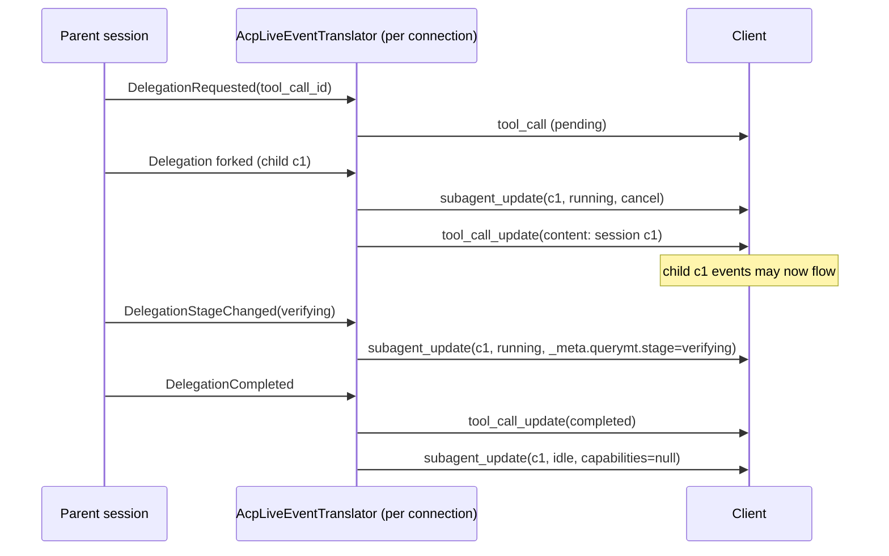

# Design

## Context

See proposal.md (Why). The workspace already depends on `agent-client-protocol` 5.4 with `features = ["unstable", "schemars"]`, and `crates/agent-core/src/protocol.rs` re-exports `agent_client_protocol::v1::schema::*`. As a result `SubagentUpdate`, `SessionReference`, `CursorUpdate`, `Usage`, `ForkSessionRequest.cursor_id` and the `subagents` / `session.cursors` client capabilities (`clientCapabilities.subagents`, `clientCapabilities.session.cursors`) are already available through `crate::acp::protocol`.

Existing code this change builds on:

- **Capability gating:** `crates/agent-runtime/src/acp/shared.rs` `AcpSessionUpdateCapabilities::from_client_capabilities` already gates plan, notice and compaction per connection. `AcpLiveEventTranslator` holds one capability set per connection.
- **Live translation:** `AcpLiveEventTranslator::translate_updates` converts internal `EventEnvelope`s into `SessionUpdate`s. `translate_delegation_update` projects delegation events through `DelegationUpdateProjector` (`crates/agent-services/src/control/delegation_notifications.rs`).
- **Delegation delivery today:** the stdio forwarder (`crates/agent-runtime/src/acp/stdio.rs`, the `delegation_update` branch that sends `QMT_NOTIFICATION_DELEGATION_UPDATE`) and the WebSocket path (`crates/agent/src/acp/…`, through the same translator) send the result as an `ExtNotification`. `send_recovered_delegations` re-sends recovered state.
- **Replay:** `replay_agent_events_materialized` and `translate_replay_event_to_updates` in `shared.rs`, driven by `replay_loaded_session` / `replay_loaded_session_with_cut` (`acp/stdio.rs`). Stateless event-to-update rules are shared with the session reducer through `querymt_agent_protocol_types::replay` (re-exported as `querymt_agent_core::replay`; `add-agent-session-core` D2).
- **Load snapshot:** the `SessionLoadSnapshot` type (typeshare) lives in `crates/agent-protocol-types/src/session/load_snapshot.rs`; it is built in `crates/agent-runtime/src/session/load_snapshot.rs` from `delegation_updates_from_events` plus `runtime_status.delegation_activity`. `DelegationUpdateNotification` lives in `crates/agent-protocol-types/src/delegation_update.rs` and is re-exported by agent-core.
- **Session reducer:** `querymt-agent-session-core` (`add-agent-session-core`) already reads only `subagent_update`, tool-call `session` references and the snapshot's `subagentUpdates`, and ignores `delegationUpdates`.
- **Fork:** `crates/agent-runtime/src/agent/session_materializer.rs` `prepare_fork_session` resolves the target message with `fork_message_id_from_meta` and otherwise uses the last message.
- **Accounting:** `CycleAccounting` (`crates/agent-services/src/accounting/cycle.rs`) is started per prompt in `crates/agent-runtime/src/agent/session_actor.rs`. `cycle_totals()` returns `ScopeTotals { tokens: TokenSums { input, output, reasoning, cache_read, cache_write }, priced_attempts, excluded_attempts, unresolved_attempts, … }`. `PromptResponse::new(StopReason::…)` is built at each exit of the prompt run (`PromptRun::finished` and its siblings).
- **Cancel:** `crates/agent-runtime/src/agent/handle/send_agent_impl.rs` `cancel` cancels the session actor. `AgentEventKind::DelegationCancelRequested` is handled in `crates/agent-runtime/src/delegation/core.rs`.
- **qmacp:** `crates/qmacp/src/client.rs` `client_capabilities` and the `querymt/session/delegationUpdate` branch. `crates/qmacp/src/session.rs` `compact_delegations` reads `delegationUpdates`. `crates/qmacp/src/events.rs` has `compact_delegation_update`.

## Goals / Non-Goals

**Goals:**
- Every requirement in `specs/` is produced from data QueryMT already stores, with no session DB migration.
- One translation path for live, replay and snapshot, so cursor ids and subagent state agree across the three.

**Non-Goals:**
- Persisting cursors. They are derived, not stored.
- Changing how child-session events are routed to the parent's connection.

## Decisions

### D1. Cursor ids are derived from anchor identity
A cursor id is a pure function of its anchor: `m:<message_id>` for user and agent messages, `t:<message_id>` for thoughts, `c:<tool_call_id>` for tool calls, and `k:<compaction_id>` for compactions. The position is always `after`.

Message, tool call and compaction ids are already durable, and fork copies get their own message ids (`session-prompt-records` "Forked sessions reference their own messages"). Derived ids are therefore stable across replay, reconnect and restart with no storage. Resolving a fork cursor means parsing the prefix and checking that the message exists in the source session's history.

- *Alternative:* a random cursor id with a persisted map. Rejected, because it needs a migration and has to be kept consistent across remote attach.
- *Alternative:* the raw message id as cursor id. Rejected, because thought, message and tool-call anchors could then collide.

A message anchor needs a message id. Every message QueryMT stores has one. A streamed update without a message id (legacy events) produces no cursor.

The codec and the `cursor_update` builder live in `querymt_agent_protocol_types::replay`, next to the other rules shared by the agent and the session reducer. The live translator, history replay, and the load-snapshot and history-page builders (`add-agent-session-core` 4.5b, `cursorUpdates`) all call it, so their ids agree by construction. The reducer never builds or parses a cursor id.

### D2. Cursor emission sits inside the translator, after the entity's terminal update
`AcpLiveEventTranslator` emits the `cursor_update` from the event that completes the entity:
- **User message:** prompt received.
- **Agent message and thought:** the assistant message is stored.
- **Tool call:** tool call result.
- **Compaction:** terminal compaction.

The cursor is appended to the update vector after the entity's own update, which gives the ordering scenario. Replay uses the same helper over the materialized events, so live and replayed ids match by construction (D1). The translator remembers which cursors it has announced per session, so live and recovered paths don't send duplicates.

### D3. Fork resolves the cursor before any other fork work
`prepare_fork_session` resolves the target in this order:
1. `req.cursor_id`, if present.
2. `_meta.querymt.message_id`.
3. The last message.

An invalid cursor is rejected with `Error::invalid_params()` (`-32602`) before `plan_fork_isolation`, so no row and no worktree are created. This covers a malformed or non-forkable prefix, and a message id that is not in the source session's history, which also catches cursors from other sessions. Remote-hosted sources go through the same materializer path, so the remote scenario needs no separate code.

### D4. Subagent updates replace the delegation projector's output type
`DelegationUpdateProjector` keeps its event folding: lifecycle state, stage, selected model and node, timestamps, and live/historical seeding. Its output changes from `DelegationUpdateNotification` to an internal `SubagentSnapshot`, which a pure function in `shared.rs` maps to `SubagentUpdate`. The mapping is:

| Delegation state | `state` | `_meta.querymt` | `capabilities` |
|---|---|---|---|
| Requested (no child yet) | no update | — | — |
| Forked / Executing | `running` | — | `cancel` |
| Verifying / Finalizing / CancelRequested | `running` | `stage` | `cancel` |
| Completed / Failed / Cancelled | `idle` | final `stage` cleared | `null` (cancel withdrawn) |

The model id, provider node id, requested/forked/finished/updated timestamps and the delegation id always go in `_meta.querymt`. The title is the target agent id and the description is the objective.

Keeping the projector avoids re-deriving delegation state, and its existing tests (`delegation_notifications_load_tests.rs`) carry over with new assertions.

- *Alternative:* `StateUpdate::Other("_querymt_<stage>")`. Rejected: the user chose `running` + `_meta.querymt.stage`, so generic clients still show the child as active.

### D5. Announce-before-traffic is enforced at the translator
Child events reach the parent's connection through the same forwarder. When the translator sees the first event of a session that is a known delegation child of a session the connection owns, and that child has not been announced yet, it emits the `subagent_update` first. The fork event normally announces it already, so this is a guard for ordering races, such as remote children whose first events arrive before the fork event is relayed.

### D6. Session references are attached when the child is announced
The `tool_call_update` with `ToolCallContent::Session` is emitted right after the announcing `subagent_update`, keyed by the delegation's `tool_call_id`. When there is no `tool_call_id` (older events), no reference is sent.

### D7. Client cancel of a child maps to delegation cancel
In `send_agent_impl.rs` `cancel`, if the target session is the child of a running delegation, the handler emits `DelegationCancelRequested { delegation_id }` on the parent. That reuses the existing cancel path, and the actor-level cancel still happens through it. Otherwise behaviour is unchanged.

### D8. Load snapshot field is added first, the old one removed with the desktop switch
`SessionLoadSnapshot` gains `subagent_updates: Vec<SubagentUpdate>` with `#[serde(rename = "subagentUpdates")]`, built by the same projector and mapping (D4) and merged with `runtime_status.delegation_activity` as today. `delegation_updates` stays until task 4.6, which removes it together with the extension notification in the same release as the desktop switch (Migration Plan). Until then both keys are sent, so querymt-desktop keeps working while the session reducer and gpui already read `subagentUpdates`.
- *Alternative:* replace the field in one step. Rejected: it would break querymt-desktop before its switch ships and block the session reducer's consumers on the desktop release.

### D9. Turn usage comes from the cycle totals at every prompt exit
A helper `turn_usage(&CycleAccounting) -> Option<Usage>` reads `cycle_totals()`. It returns `None` when the cycle recorded no attempt carrying usage. Otherwise it returns `Usage::new(total, input, output)` with `thought_tokens = reasoning`, `cached_read_tokens = cache_read` and `cached_write_tokens = cache_write`. `total` is the sum of the five categories.

`PromptRun` construction applies the helper at every exit, including cancelled, refusal, budget and compaction-only runs. The schema documents `totalTokens` as "across session", but the field is end-of-turn usage and the spec requires per-cycle counts. That interpretation is recorded here.

### D10. Delete the extension notification, keep recovery semantics
Removed:
- `QMT_NOTIFICATION_DELEGATION_UPDATE`
- the `delegation_update` branch of the stdio forwarder and its WebSocket equivalent
- `send_recovered_delegations`, which becomes a re-send of the current `SubagentUpdate`s through `session/update`

Also removed: `SessionLoadSnapshot.delegation_updates` (D8). The wire type `DelegationUpdateNotification` (`querymt-agent-protocol-types::delegation_update`, re-exported by agent-core) is no longer serialized to clients. It stays only if the projector still needs it internally; otherwise it is removed.

## Risks / Trade-offs

- **[Upstream schema churn]** `unstable_subagents` and `unstable_session_cursors` can change in an SDK minor release. → All mapping goes through `shared.rs` helpers with focused unit tests, so a schema bump fails in one place.
- **[Clients without `subagents` lose delegation metadata]** → Accepted (proposal, BREAKING). The tool call and child events are still delivered. qmacp and desktop both advertise the capability.
- **[Cursor volume]** One `cursor_update` per message, thought, tool call and compaction adds updates on long replays. → Only sent to clients that opt in. Windowed loads emit cursors only for the returned window.
- **[Ordering with remote children]** A remote child's first relayed event can race the fork event. → D5 announces on first sight.
- **[Fork semantics of "after"]** "After message X" must equal the existing fork-at-message behaviour. → A task verifies that `prepare_fork_session` with `message_id` X includes X, and a test pins it.
- **[Typeshare break]** → Desktop update and pin bump land in the same release (Migration Plan).

## Migration Plan

1. Land the additive agent-side changes: capability gating (1.1), subagent updates live and on replay and `subagentUpdates` in snapshots (4.1–4.5), turn usage (group 2) and cursors (group 3). The old notification and `delegationUpdates` are still sent. The session reducer and querymt-gpui can use this step.
2. Land the qmacp changes (group 5).
3. In one release: remove the extension notification and `delegationUpdates` (4.6, 4.7), update querymt-desktop to consume `subagent_update`, `ToolCallContent::session` and `subagentUpdates`. It should advertise `subagents` (and `session.cursors` if it uses fork-at-cursor) and drop its `querymt/session/delegationUpdate` handler.
   Then bump the embedded UI pin to that desktop commit with the `update-desktop-pin` skill (`crates/agent/embedded-ui-revision`, `flake.nix`, `flake.lock`) in the same PR or release.
4. **Rollback:** step 3 can be reverted on its own (the additive step keeps both forms); steps 1–2 revert without migration, since no persisted data changes.

Special builds:
- **querymt-mobile-ffi:** only its snapshot passthrough tests change.
- **Python bindings:** no change.
- **wasm32-wasip1 provider plugins:** unaffected, since no provider crate depends on `agent-client-protocol`.
