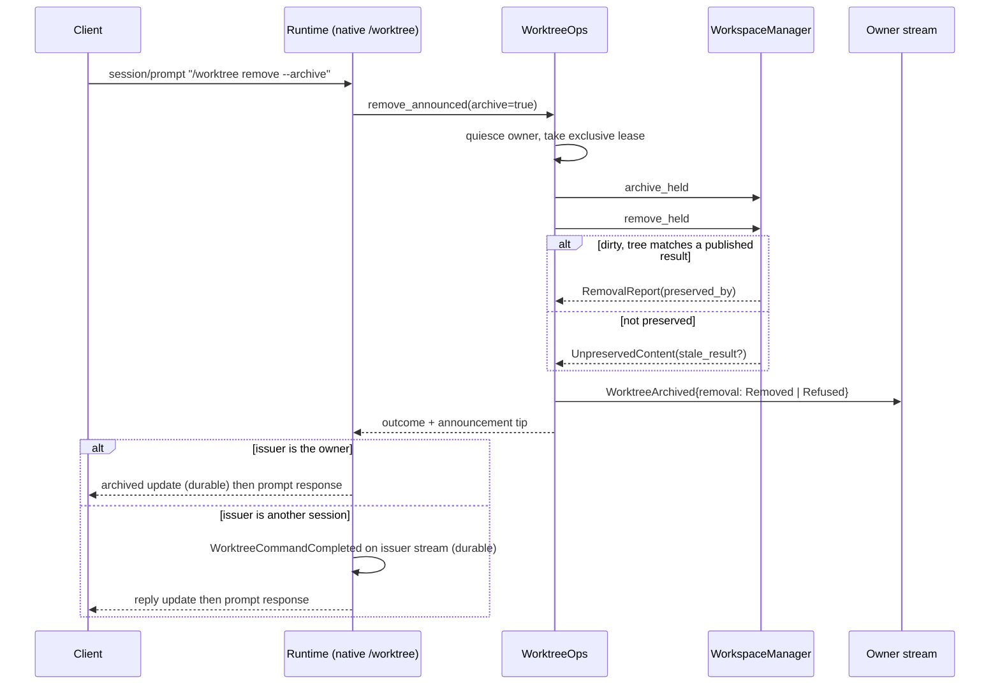

# Design

## Context

See proposal.md (Why). The relevant code today:

- `crates/agent-services/src/worktree/lifecycle.rs` `WorkspaceManager::remove_locked`
  runs the removal checks under the repository admin lock and the caller's
  exclusive activity lease: (1) registration safety, (2) content safety
  (`WorkspaceStatus::is_clean_for_removal`, any uncommitted/untracked/ignored
  path refuses with `WorktreeError::UnpreservedContent`), (3) commit safety
  against `registry.list_results` refs, then the `Removing` transition, then
  `RepositoryOps::remove_worktree`.
- `crates/agent-services/src/worktree/repo_ops.rs` `GixRepositoryOps::remove_worktree`
  calls gix with `gix::worktree::remove::Force::Never`, which itself refuses a
  dirty worktree. Relaxing step 2 alone is therefore not enough.
- `crates/agent-services/src/worktree/service.rs` `WorkspaceService::publish_result`
  captures the full working state with `capture::capture_working_state_validated`
  (private index, real index and files untouched; ignored files excluded),
  pins it under `refs/qmt/results/<workspace>/<uuid>` and records a
  `ResultProvenance` (`result_commit`, `result_ref`). The commit message comes
  from `repo_ops.rs` `INTERNAL_COMMIT_MESSAGE` ("QueryMT private baseline"),
  shared with baseline capture.
- `crates/agent-services/src/worktree/ops.rs` `WorktreeOps::remove_announced`
  quiesces the owner, archives, calls `announce_archive` (which records
  `AgentEventKind::WorktreeArchived` through `OwnerHost::announce_archived` and
  retires the owner's stream), then removes. The runtime's native command
  (`crates/agent-runtime/src/agent/handle/ext_worktree_ops.rs`
  `NativeCommand::Remove` in `run_native_command`) discards that announcement.
- `ext_worktree_ops.rs` `handle_native_worktree_prompt` renders every reply,
  success or `WorktreeOpError`, as an ephemeral
  `AgentEventKind::WorktreeCommandOutput { text }` unless an announcement tip
  is returned; `crates/agent-protocol-types/src/replay.rs` `replayable_updates`
  projects it to an `AgentMessageChunk` without `messageId` or `_meta`.
- `crates/agent-runtime/src/agent/handle/send_agent_impl.rs` `cancel`: with
  `remote`, a local session without an actor fails in
  `session_operation.rs` `session_ref_for_operation` as
  `SessionOperationError::Storage` → JSON-RPC -32603; without `remote` it
  already returns `Ok(())`.

## Goals / Non-Goals

**Goals:**
- Removal decides "preserved" from content identity (Git tree ids), never
  from timestamps or the fact that a publish happened.
- One place decides the discard: the content check that proved preservation
  is the only path that can select a discarding removal.
- Durable replies reuse the existing ordered session stream and event-tip
  hold; no new delivery path.

**Non-Goals:**
- Changing publication itself (what it captures, its ref layout).
- Persisting the native command's prompt text as a user message.
- Changing `create` replies (they stay transient; the new session is
  discoverable through listing and lineage).

## Decisions

### D1. Preservation is tree equality with a retained result

In step 2 of `remove_locked`, when the checkout is not clean:

1. Ignored paths present → refuse as today (capture excludes ignored files, so
   no result can preserve them).
2. Load `list_results(record.id)`; keep entries with a `result_commit` and a
   valid `result_ref`. None → refuse as today.
3. Capture the live working state with
   `capture_working_state_validated(git, checkout, CaptureRetryPolicy::default())`.
   A capture error (concurrent writer, unsupported layout) is not a removal
   error: refuse with `unpreserved_content` as today, logging the cause.
4. For each result, newest first, resolve `RepositoryOps::commit_tree(common_dir, result_commit)`;
   the first whose tree id equals the captured tree id sets
   `preserved_by = Some(result_ref)`.
5. No match → refuse with `UnpreservedContent { stale_result: Some(newest_ref), .. }`.

Alternatives considered:
- *Compare the live status against the result's changed-path list*: misses
  content edits to already-dirty paths. Rejected.
- *Compare commit ids*: every capture writes a new private commit (timestamped),
  so ids never match. Trees are content-addressed and capture is the same
  function for publish and check, so equal content means equal tree ids.
- *Require an explicit flag*: rejected by the user; nothing is lost when the
  tree matches.

Step 3 (commit safety) is unchanged: a result commit is parented by the HEAD it
was captured at, so a branch tip at or behind that HEAD is already an
ancestor of the result ref.

### D2. Discard is an explicit, narrow removal mode

`RepositoryOps::remove_worktree` gains a mode argument:
`RemoveCheckout::RefuseDirty` (today's `Force::Never`) and
`RemoveCheckout::DiscardPreserved` (`Force::DiscardChanges`, which still keeps
locked worktrees). `remove_locked` passes `DiscardPreserved` only when D1 set
`preserved_by`; every other caller passes `RefuseDirty`. The fake and wrapper
implementations (`repo_ops.rs` test double, `lifecycle.rs` and `capture.rs`
test wrappers) forward the mode, and the test double records it so tests can
assert a discard never happens without `preserved_by`.

### D3. Reporting

- `RemovalReport` and `WorktreeRemoveResponse` gain
  `preserved_by: Option<String>` (serialized only when set); the ref is also in
  `retained_refs` (result refs already are). `RemovalReport`'s `Display` adds
  "; working state preserved by <ref>".
- `WorktreeError::UnpreservedContent` gains `stale_result: Option<String>`. The
  message becomes "... commit, publish (`/worktree publish`), or delete the
  listed files before removal", plus, when set, "the working state differs
  from the last published result <ref>; publish again to preserve it". The
  code stays `unpreserved_content`. The message is built by a small helper,
  since `thiserror` cannot format an `Option` conditionally inline.

### D4. Result commits get their own message

`RepositoryOps::capture_working_state` and
`capture::capture_working_state_validated` take the private commit's message.
Baseline capture keeps "QueryMT private baseline"; `publish_result` passes
"QueryMT result <workspace-id>"; the removal check passes "QueryMT removal
check" (its commit is never referenced). Only new captures are affected.

### D5. Durable reply event

New `AgentEventKind::WorktreeCommandCompleted { id, command, code, archived, text }`
in `crates/agent-protocol-types/src/events.rs`, `Durability::Durable`,
`#[typeshare]`d like its neighbours. `id` is a UUIDv7 created per native
prompt; `command` is the subcommand name; `code` is `None` on success;
`archived` mirrors `WorktreeOpError::error_data`. `replay.rs` projects it to an
`AgentMessageChunk` with `messageId = "worktree-cmd-<id>"` and
`_meta.querymt.worktreeCommand = { command, code?, archived? }`. The live update
and the replayed update come from the same projection, so the identity matches.

`WorktreeCommandOutput` stays as the transient reply for `create`, `list`,
`status`, `result` and usage errors.

In `handle_native_worktree_prompt`, `NativeCommand` gains
`durable_reply() -> Option<&'static str>` (`publish`, `archive`, `remove`,
`recover`, `handoff`). If a command returns an announcement tip, that is the
reply (unchanged). Otherwise a command with a durable reply records
`WorktreeCommandCompleted` via `AgentConfig::emit_event_persisted` and uses its
`session_seq` as the tip; the existing "retire the stream when there is no
actor" step follows as today. A persist failure falls back to the transient
output (logged), so delivery never fails a completed operation.

Alternative considered: make `WorktreeCommandOutput` durable for some calls
via a flag field. Rejected: durability is classified per kind in
`events.rs`, and a separate kind keeps the journal self-describing.

### D6. Deferred archive announcement with the removal outcome

`WorktreeArchived` gains `removal: Option<ArchiveRemoval>` where
`ArchiveRemoval` is `Removed` or `Refused { code, message }` (serde-tagged,
omitted when `None`). `worktree_archived_chunk` renders:

- `None` (plain archive): today's text.
- `Removed`: "This session's workspace <id> was archived and removed. This session is now read-only."
- `Refused`: "This session's workspace <id> was archived, but removal was refused (<code>): <message>. This session is now read-only."

`OwnerHost::announce_archived` takes the outcome. `WorktreeOps::remove_announced`
reorders to: quiesce → `archive_held` → `remove_held` → `announce_archive(outcome)`,
returning the announcement on both the `Ok` and the `RemovalRefused` paths
(the error path carries it through a new `Option<Announcement>` alongside the
error, so the native command can use its tip). In `run_native_command`,
`NativeCommand::Remove` uses the announcement as the reply when it is on the
issuing session's stream, exactly like `NativeCommand::Archive`; when the
issuer is another session, it gets the D5 durable reply and the owner gets
the archived update.

### D7. Cancel on read-only sessions

In `send_agent_impl.rs` `cancel`, after the admin-operation and delegation
checks, return `Ok(())` when
`session_materializer.read_only_reason(&session_id)` is `Some` (archived or
transferred). This is placed before `execute_session_operation`, so it covers
the `remote` path without changing how `session_ref_for_operation` maps other
operations' errors.

## Risks / Trade-offs

- [An external editor writes between the check and the discarding removal,
  and that write is lost] → the check runs under the admin lock and exclusive
  lease (all QueryMT writers excluded) and immediately before the `Removing`
  transition; validated capture detects writes during capture. The remaining
  window matches the documented capture limitation in `capture.rs`.
- [Each dirty removal attempt writes loose blobs/trees and one dangling
  commit] → unreferenced objects are collected by `git gc`; no refs are
  created.
- [A removal interrupted midway through a discarding delete leaves a checkout
  that no longer matches the result, so recovery refuses it] → the same
  limitation exists today for clean checkouts (deleted tracked files read as
  uncommitted); the workspace stays in `Removing` with the result ref intact.
  Not addressed here.
- [Deferring the archived update widens the window in which a crash loses
  it] → the window grows only by the removal duration; load still discloses
  read-only access from the registry. Accepted (proposal Non-goals).
- [Replay now includes command replies and the new event kind; older binaries
  and clients see unknown events or extra messages] → accepted; no
  compatibility layer.
- [`RepositoryOps` signature changes ripple to three test implementations]
  → mechanical; the trait is crate-internal.

## Migration Plan

No session DB migration: events are stored as JSON in `event_journal`. Existing
journals replay as before; `WorktreeArchived` without `removal` renders
today's text. Existing result refs keep their old commit message. Rollback is
a code revert; journals that already contain `worktree_command_completed`
rows may then not load those rows in the older binary (accepted, not tested).
