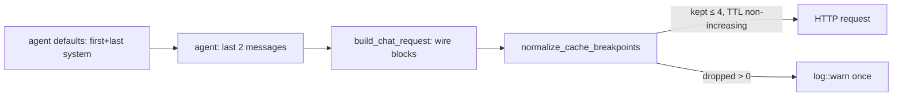

# Design

## Context

Cache hints are added in three layers, and none of them knows how many the others have added (see proposal.md - Why):

- `crates/agent/src/model_heuristics.rs` `ModelDefaults::apply_system_cache_defaults` adds `{"cache": {"ephemeral": {}}}` to every system section for `anthropic`, `codex` and OpenAI Responses. `crates/agent/src/session/provider_config.rs` calls it through `ModelDefaults::apply_to` on the merged provider config. That config already contains the agent's `system`, the dotagents parts (`crates/agent/src/dotagents/loader.rs` `compose_prompt`) and the delegation planning summary (`crates/agent/src/agent/session_actor.rs` `SetPlanningContext`).
- `crates/agent/src/agent/execution/transitions.rs` `apply_cache_breakpoints` hints the last two messages and keeps existing hints.
- `crates/providers/anthropic/src/lib.rs`:
  - `AnthropicSystemPrompt`'s `Deserialize` impl turns each system hint into `TextBlockParam.cache_control`, using `cache_control_from_hint` (`ttl_seconds > 300` becomes `1h`; otherwise `5m` or omitted).
  - `Anthropic::build_chat_request` sets the message hint on the last content block with `MessageContent::set_cache_control`, which does nothing on `RedactedThinking`.
  - `sanitize_system_prompt` and the OAuth billing header add unmarked blocks at the front for OAuth.
  - Tools (`AnthropicTool`) have no `cache_control` field.

Nothing counts the markers, so the request is sent with however many the hints produced.

## Goals / Non-Goals

**Goals:**
- Enforce the four-marker limit and the TTL ordering in one place that sees the final wire request, whoever the caller is (agent, CLI, remote, Python).
- Make the agent's default placement fit the budget, so the cap is only a safety net for explicit over-marking.

**Non-Goals:**
- No new public types or config, and no change to how `CacheHint` is represented.
- No marking of tool definitions.
- No caps for providers other than Anthropic.

## Decisions

### D1. Normalize on the built wire request, in the provider
After `build_chat_request` has built `sanitized_system` and `anthropic_messages`, and before `AnthropicCompleteRequest` is built, a private function `normalize_cache_breakpoints(system: Option<&mut AnthropicSystemPrompt>, messages: &mut [AnthropicMessage]) -> usize` runs on the final blocks.

- It collects every block whose `cache_control` is `Some`, giving the true wire count. Hints that placed no marker (redacted tail, empty content) are never `Some`, so they cost nothing.
- It applies the priority from the spec, clears the markers it drops, and fixes TTL ordering.
- It returns the number dropped. The caller logs one `log::warn!` when that is greater than zero.

Alternatives considered:
- **Count hints in the agent:** the agent cannot see OAuth blocks, native `cache_control`, or markers that are never placed. Callers that bypass the agent would still fail.
- **Budget during serialization, like opencode's `Cache.take`:** that is first come, first served, so system markers would use up the budget and the recent message markers would be dropped. This is the wrong trade-off for agent loops.

### D2. Priority order
Kept markers, in order:
1. last system;
2. last message;
3. second-to-last message;
4. first system;
5. other messages, newest first;
6. other system markers, last first.

Reasoning:
- The last system marker covers all of the tools and the whole system prompt.
- The message tail is where per-step reuse comes from.
- The first system marker only matters when later sections change between requests.
- The second-to-last message marker stays ahead of the first system marker because Anthropic only looks back about 20 blocks for a cache entry. A turn with many tool results can go past that window, and the previous tail marker covers it.

"First" and "last" refer to the marked system blocks, so unmarked OAuth blocks are ignored. Priority is a fixed rank over positions, so the outcome is deterministic.

### D3. TTL normalization runs after dropping
- Walk the kept markers from the end of the request to the start, tracking the longest lifetime seen so far. Rank: `1h` > `5m` = default (`None`).
- Raise any marker shorter than that maximum to it. Running after the drop means no lifetime is raised by a marker that ends up being removed.
- Raising rather than lowering keeps the longer lifetime the user asked for on the stable prefix. The cost is a 1h write price on the raised earlier markers. That is acceptable because those prefixes are the stable ones.

### D4. Agent defaults: first and last section only
- Change `apply_system_cache_defaults` so it only adds a default `cache` to indices `0` and `len-1`.
- Strings at other positions become plain `{"text": ...}` objects without `cache`, or stay strings. Either way they deserialize to `SystemPrompt` without a hint.
- Existing `cache` (including `null`) and `cache_control` keys are left alone at every position. That is the current escape hatch.
- The provider set (anthropic, codex, openai/responses) does not change.

### D5. Message hints unchanged
- `apply_cache_breakpoints` already matches the spec, so it stays as it is.
- Earlier hints from history or hooks are resolved by D1, so stripping them in the agent is unnecessary. Stripping would also discard intentional caller hints for providers without a cap.

## Risks / Trade-offs

- **[Risk] Users with three or more system sections lose the per-section boundary on middle sections.**
  - Mitigation: middle sections are still covered by the last section's prefix. Only reuse when a later section changes is affected.
  - Explicit `cache` hints restore it, and the change is documented and marked BREAKING.
- **[Risk] Silently dropping markers hides misconfiguration.**
  - Mitigation: a single warning per request, with the count.
- **[Risk] Raising a TTL changes billing (1h writes cost more).**
  - Mitigation: it only happens when the user already asked for 1h later in the request. Without the raise, the request would be rejected.
- **[Trade-off] Shared defaults also change Codex and Responses placement.**
  - Responses already uses one request-wide TTL, and Codex translation is disabled. Fewer boundaries there do not affect correctness.

## Migration Plan

No data migration. Rolling back means reverting both crates. Because `qmt-anthropic` is also a wasm plugin, both the native build and the `wasm32-wasip1` build need checking.
