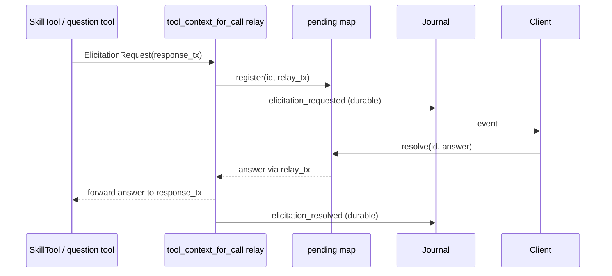

# Design

## Context

The 7.3 manual check of `support-mcp-skills` (qmtcode against mcpkit `mcpskills` v0.8.21, sessions `01a1d4e3-…` and `01a1d4e5-…`) showed how skill approval works today:

- **Approval.** `SkillTool::authorize` (`crates/agent/src/skills/tool.rs`) asks through `ToolContext::ask_question` with two options, "Allow" and "Deny". It keeps no memory of the answer.
  - `authorize_mcp` calls it for every MCP load and every `file` read, so one session produced five prompts.
  - Tool approval already has "Allow for this session". It is stored in `SessionRuntime::session_grants` (`crates/agent/src/agent/core.rs`) and decided in `decide_approval` / `prompt_user` (`crates/agent/src/agent/execution/tool_calls.rs`). That set is keyed by `ToolRef`, so skill IDs cannot use it.
- **File paths.** `SkillTool::call` runs `authorize_mcp` before `crate::skills::mcp::normalize_file_path`, in both the MCP branch and the fallback branch. Local skills also authorize before `read_local_file` normalizes. So `../secrets.env` prompted first and only then failed.
- **Binding.** `SkillTool` is bound per turn by `ExecutionContext::tool_set` (`crates/agent/src/agent/execution_context.rs`) through `SkillCatalog::bind` (`crates/agent/src/skills/catalog.rs`). It holds the catalog, the workspace, the session's `McpToolState` and the turn's `ToolConfig`. It has no per-session mutable state.
- **Questions.** Built-in questions and skill approvals go through the relay in `tool_context_for_call` (`tool_calls.rs`):
  - it registers the pending entry and emits durable `ElicitationRequested`;
  - the answer goes straight from the pending map to the waiting `AgentToolContext::ask_question` (`crates/agent/src/tools/context_impl.rs`) through a oneshot, so the relay never sees it.
  - MCP server elicitations follow the same pattern in `McpClientHandler::create_elicitation` (`crates/agent/src/elicitation.rs`).
  - Nothing journals the answer.
- **Log line.** `SkillCatalog::publish_refresh` logs `Skill registry refreshed for …: {count} skills available`. The count covers local skills only.

## Goals / Non-Goals

**Goals:**
- A remembered, per-session, per-skill-ID allow, consistent with the tool "Allow for this session" rules: no rejection memory, no cross-session effect, and configured deny wins.
- Reject invalid `file` paths before any prompt, without sending any request earlier than today.
- A durable outcome record for every announced form question.
- Accurate wording in the refresh log.

**Non-Goals:**
- Server-wide session grants. `"server.*" = "allow"` in config covers that.
- Persisting grants across sessions, or sharing them with delegates.
- Changing tool permission prompts or `PermissionGranted`.
- UI work. The dashboard renders the extra option from the schema.

## Decisions

### 1. Skill session grants live on the session runtime and are keyed by callable ID

- **Storage.** Add `skill_grants: Arc<ParkingMutex<HashSet<String>>>` to `SessionRuntime`. It starts empty in `SessionRuntime::new`, and the lock is never held across an `.await`, matching `session_grants`.
- **Binding.** `ExecutionContext::tool_set` passes a clone of the `Arc` through `SkillCatalog::bind` into `SkillTool::bind`.
  - Delegate and `.agents` target sessions have their own `SessionRuntime`, so grants never cross sessions.
  - Test helpers that bind without a session pass a fresh empty set.
- **Key.** The callable ID as called: `docs.guide` for MCP, `review` for local. Supporting-file reads authorize with the skill's ID, so a grant covers them.
- **Order in `SkillTool::authorize`:**
  1. `Deny` returns the permission error. Config wins, and a grant is never consulted.
  2. `Allow` passes.
  3. `Ask`, when the ID is in `skill_grants`, passes without a prompt.
  4. Otherwise it prompts with options "Allow", "Allow for this session" and "Deny".
     - "Allow" passes.
     - "Allow for this session" inserts the ID, then passes.
     - Any other answer is the existing denial.
- **Concurrency.** Concurrent prompts for the same ID stay independent. An answer of "Allow for this session" on one does not resolve the other; it only affects calls that check after it. This keeps "Skill approval requests are specific to one call".
- **Alternatives considered:**
  - *Reuse `session_grants: ToolSet`.* Rejected: it is keyed by `ToolRef`. Skill IDs are not tools, and putting them in the set would let a tool named like a skill ID match.
  - *Key by server (`docs.*`).* Rejected: the design treats each server skill as untrusted instructions, so one approval should not admit content the user has not seen. Config already offers the server-wide form.
  - *Use the permission interaction (`RequestPermissionRequest`) instead of a form question.* Rejected for now: it would change the prompt type that clients and tests already handle, and move skill approval into the tool-approval path. The form question with a third option is enough.

### 2. Path normalization moves before approval, behind a deny check

In `SkillTool::call`, when `file` is present:
1. Resolve which permission applies, using the same branch selection as today:
   - `check_mcp(server, skill)` when the ID's server part is a visible skill server;
   - otherwise `check(name)`.
2. If it resolves to `Deny`, return the permission error. This keeps "a denied skill always reports denial" and avoids revealing anything about denied skills.
3. Run `normalize_file_path`. On failure, return the `InvalidRequest` error unchanged.
4. Continue as today with the normalized path.
   - For MCP, `authorize_mcp`, then `load_mcp_file`. The manifest check, and so the unlisted-file rejection, still happens after approval.
   - For local skills, `authorize`, lookup, then `read_local_file` with the already-normalized path.

- **No new request.** Normalization is a pure string check, so nothing reaches the server earlier than today.
- **Unknown skill IDs.** An invalid path on an unknown skill ID now reports the path error instead of "not found". That reveals nothing, and resolving existence first could need a `skills/list` before approval, which the existing rule forbids.
- **Supersedes.** This replaces "Visibility and permissions are checked first" in `support-mcp-skills` design §5 for the path check only.

### 3. Refresh log names local skills

- `SkillCatalog::publish_refresh` logs `Skill registry refreshed for {}: {count} local skills available`.
- The initial discovery log in `SkillCatalog::from_config` is unchanged. Its wording ("search paths") is already local-only.

### 4. `ElicitationResolved` journals each announced form question's outcome

- **New variant** in `AgentEventKind` (`crates/agent/src/events.rs`):
  ```rust
  ElicitationResolved {
      elicitation_id: String,
      session_id: String,
      outcome: String,                 // "accepted" | "declined" | "cancelled"
      selection: Option<Vec<String>>,  // built-in questions only
  }
  ```
  - Kind name `elicitation_resolved`.
  - Durable through the default arm of `classify_durability`.
  - A `String` outcome keeps typeshare output simple; a serde enum is an acceptable alternative.
- **Built-in questions and skill approvals.** The relay in `tool_context_for_call` puts itself between the waiter and the pending map:
  - it registers the pending entry with its own oneshot sender;
  - a per-request task emits `ElicitationRequested`, waits for the answer, forwards it to the original `response_tx`, then emits `ElicitationResolved`;
  - `selection` is read from `content.selection` (a string or an array of strings), as `ask_question` does.
- **Unanswered questions.** If the relay's receiver errors because the entry was removed or dropped (`remove_pending_elicitations_for_tool`, or the waiter dropped), the outcome is `cancelled`. `cancel_pending_elicitations_for_session` sends `Cancel`, which also maps to `cancelled`.
- **Not announced, not resolved.** The cancellation-race branch that skips `ElicitationRequested` emits no resolution, so `elicitation_resolved` only ever follows its own `elicitation_requested`.
- **MCP server elicitations.** `McpClientHandler::create_elicitation` emits `ElicitationResolved` after `rx.await`, with `selection: None`, so form content is never recorded.
- **Privacy.** Built-in question answers already reach the model as tool results, which are journaled in `tool_call_end`. Recording the labels adds no new exposure. Skill approval labels are fixed strings.



- **Alternatives considered:**
  - *Emit from `resolve_in_map`.* Rejected: it does not see cancellations or dropped entries, and it has no event sink.
  - *Reuse `PermissionGranted`.* Rejected: it is boolean, permission-specific, and emitted ephemerally from `prompt_user`.

### Crates and builds

- **Package:** only `querymt-agent` changes. No `cfg(feature)` paths change.
- **Downstream:** `querymt-mobile-ffi` constructs `ElicitationRequested` but does not match exhaustively. `querymt-agent-py` has no direct use. Both need a rebuild check.
- **Other builds:** no effect on wasm32-wasip1 provider plugins. No new dependencies and no migration.

## Risks / Trade-offs

- **Older binaries cannot read journals with the new event.** `parse_journal_row` (`crates/agent/src/session/sqlite_storage/event_journal.rs`) turns an undecodable payload into an error, so an older binary fails to replay sessions containing `elicitation_resolved`.
  - The code has avoided this before by making `DelegateModelsChanged` ephemeral "to not break older journal loaders".
  - Here the event must be durable to be useful.
  - Mixed-version mesh nodes are already disallowed by the `session-interactions` requirement "Mesh nodes run a matching interaction contract". The remaining risk is a local downgrade.
  - Mitigation: call it out in the CHANGELOG. **Open question:** is a local downgrade a supported path? If it is, decide this before implementation: either make old readers skip unknown kinds first, in a separate release, or accept the break.
- **Public API break.** `AgentEventKind` is public and not `#[non_exhaustive]`, so an external exhaustive match breaks. Inside the workspace, the `cargo check` of downstream packages covers it.
- **Grant scope.** A per-ID grant keeps more prompts than a server-wide one. That is deliberate (Decision 1), and configuration covers the wider case.
- **Prompt wording.** The third option changes the approval card for every client. Clients that render `oneOf` generically (the dashboard, ACP elicitation) need no change.
