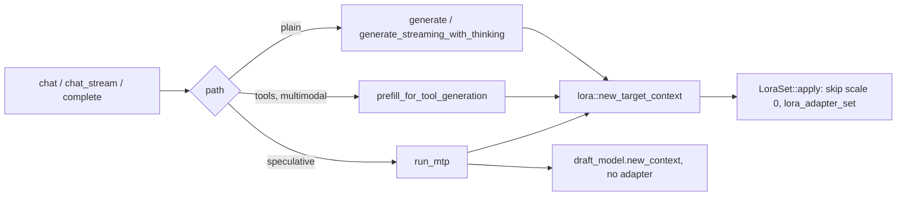

# Design

## Context

See proposal.md - Why. Behavior is in `specs/llama-cpp-lora-adapters/spec.md`. This document covers how the change is built on the existing provider code.

Existing code this builds on (all under `crates/providers/llama-cpp/src`, package `qmt-llama-cpp`):

- `config.rs` `LlamaCppConfig`: serde + schemars, `deny_unknown_fields`. Optional knobs are `Option<T>`; `system` uses `#[serde(default, skip_serializing_if = "Vec::is_empty")]`.
- `provider.rs` `load_models`: loads the target model and the optional MTP sidecar, then wraps each in `Arc<LlamaModel>` right after `LlamaModel::load_from_file`.
- `provider.rs` `ModelCacheKey`, `CachedModel`, `LlamaCppProvider::new` and `LlamaCppProvider::new_with_cache`: a single-slot model cache in `lib.rs` `LlamaCppFactory::model_cache`. Each provider wraps the cached model and carries its own config.
- `provider.rs` `LlamaCppProvider::resolve_model_path`: resolves local paths and Hugging Face refs (`querymt_provider_common::parse_model_ref`, `download_hf_file_sync`). `ModelRef::HfRepo` (no selector) is rejected.
- Per-request contexts are created in five places:
  - `generation.rs` `generate` (with or without backend samplers)
  - `generation.rs` `generate_streaming_with_thinking`
  - `tools/prefill.rs` `prefill_for_tool_generation` (multimodal and text branches)
  - `mtp.rs` `run_mtp` (target context and draft context)

  `tools/generation.rs` `generate_with_tools` and `tools/streaming.rs` `generate_streaming_with_tools` get their contexts from the prefill. The speculative paths call `run_mtp`.
- Tests: `test_vocab.rs` `HfFile`, `ensure_full_model` and `download_enabled`, plus the `QMT_RUN_LIVE_LLAMA_MTP` ignored-test pattern in `tools/sampler.rs` `speculative_decoding_respects_the_tool_grammar`.

Facts about `llama-cpp-2` 0.1.161, the pinned version (checked in the registry source and on upstream `main`; identical):

- `LlamaModel::lora_adapter_init(&mut self, path) -> Result<LlamaLoraAdapter, LlamaLoraAdapterInitError>`. It needs `&mut LlamaModel`. It only `debug_assert!`s that the path exists. A file that is not a LoRA adapter, or one that does not match the model, returns `NullResult` (llama.cpp catches the exception and returns null). It does not abort.
- `LlamaContext::lora_adapter_set(&mut self, &mut LlamaLoraAdapter, scale)` calls `llama_set_adapters_lora` with exactly one adapter. That call replaces the context's whole adapter set, so only one adapter can be active.
- `LlamaLoraAdapter` is `Send + Sync` and has no `Drop`; llama.cpp frees adapters with their model. The raw pointers (`LlamaContext::context`, `LlamaLoraAdapter::lora_adapter`) are `pub(crate)`, so calling `llama_cpp_sys_2` directly is not possible without a fork.

Affected builds: only `qmt-llama-cpp` with `native` (and `cuda`/`metal`/`rocm`/`vulkan`, which share the code path). The provider is native-only, so wasm32-wasip1, Python and mobile-ffi builds are not affected. No `cfg(feature)` path changes; the LoRA API is ungated in `llama-cpp-2`.

## Goals / Non-Goals

**Goals:**
- An adapter handle can never outlive the model it was created from, by construction rather than by convention.
- A single context-creation path for the target model, so later generation paths cannot forget the adapter.
- Invalid configuration is unrepresentable after parsing where possible (scale), and reported with typed errors otherwise.
- No `unsafe` code and no FFI declarations in the provider.

**Non-Goals:**
- Changing how the five sites build `LlamaContextParams` (only the context construction call moves).
- Keeping the old `LlamaCppConfig` struct-literal shape (flagged **BREAKING** in the proposal; per AGENTS.md no compatibility layer).

## Decisions

### 1. Config types: parse, don't validate

New items in `config.rs`. Rust rules followed: `api-parse-dont-validate`, `type-newtype-validated`, `serde-try-from-validate`, `api-non-exhaustive`, `api-builder-must-use`, `api-default-impl`, `api-common-traits`, `serde-default-compat`, `serde-skip-empty`, `serde-deny-unknown-fields`, `conv-tryfrom-fallible`, `api-from-not-into`, `const-fn`.

```rust
/// Strength of a LoRA adapter: any finite `f32`. `0` disables the adapter.
#[derive(Debug, Clone, Copy, PartialEq, Serialize, Deserialize)]
#[serde(try_from = "Option<f32>", into = "f32")]
pub struct LoraScale(f32);

impl LoraScale {
    /// # Errors
    /// Returns [`LoraScaleError`] when `value` is NaN or infinite.
    pub const fn new(value: f32) -> Result<Self, LoraScaleError> { /* is_finite check */ }
    #[must_use] pub const fn get(self) -> f32 { self.0 }
    #[must_use] pub const fn is_disabled(self) -> bool { self.0 == 0.0 }
}
impl Default for LoraScale { fn default() -> Self { Self(1.0) } }
impl TryFrom<f32> for LoraScale { /* = new */ }
impl TryFrom<Option<f32>> for LoraScale { /* None -> error naming null */ }
impl From<LoraScale> for f32 { /* get */ }
impl JsonSchema for LoraScale { /* {"type":"number","default":1.0} with description */ }

#[derive(Debug, Clone, Copy, PartialEq, thiserror::Error)]
#[error("invalid LoRA scale {value}: must be a finite number")]
pub struct LoraScaleError { value: f32 }        // `null` is rendered for the JSON case

#[derive(Debug, Clone, PartialEq, Serialize, Deserialize, JsonSchema)]
#[serde(deny_unknown_fields)]
#[non_exhaustive]
pub struct LoraAdapterConfig {
    /// Local GGUF path or Hugging Face `<repo>:<selector>`, resolved like `model`.
    pub path: String,
    #[serde(default)]
    pub scale: LoraScale,
}
impl LoraAdapterConfig {
    #[must_use] pub fn new(path: impl Into<String>) -> Self { /* scale: default */ }
    #[must_use] pub fn with_scale(mut self, scale: LoraScale) -> Self { /* … */ }
}

// LlamaCppConfig
#[serde(default, skip_serializing_if = "Vec::is_empty")]
pub lora: Vec<LoraAdapterConfig>,
```

- **Why `try_from = "Option<f32>"`:** provider config reaches `LlamaCppFactory::from_config` as JSON. `serde_json` has no NaN or infinity and turns a TOML `nan`/`inf` into `null`. Accepting `Option<f32>` lets `null` produce the same "must be a finite number" error instead of serde's generic "invalid type: null". A missing key still takes the default through `#[serde(default)]`. Direct TOML or Rust callers get the error from `LoraScale::new`.
- **Why the exact `== 0.0` in `is_disabled`** (deliberately not `num-float-compare`'s tolerance): `0` is a user-written sentinel, not a computed value, and `-0.0 == 0.0` holds.
- `LoraAdapterConfig` is `#[non_exhaustive]`, so callers outside the crate build it with `new`/`with_scale`, and fields such as a future `id` or `alora` can be added without another breaking change. `LlamaCppConfig` itself stays exhaustive, as today.
- Public items get `///` docs with intra-doc links and `# Errors` sections (`doc-all-public`, `doc-errors-section`, `doc-intra-links`). `LoraScale::new` gets a doctest that uses `?` (`doc-question-mark`, `test-doctest-examples`).
- `lib.rs` re-exports `LoraAdapterConfig`, `LoraScale` and `LoraScaleError` next to the existing `pub use config::{…}` (`proj-pub-use-reexport`).

Alternatives considered:
- Keep `scale: Option<f32>` and check it in the provider. Rejected: an invalid value would exist in memory, and every reader would have to repeat the check.
- `scale: f64`. Rejected: llama.cpp takes `float`, and `f64` would only add a lossy narrowing cast (`num-cast-try-from`).

### 2. Typed internal errors

A new `lora.rs` module holds a crate-private error enum (`err-thiserror-lib`, `err-custom-type`, `err-lowercase-msg`, `err-source-chain`, `proj-pub-crate-internal`). `thiserror` (workspace dependency, already compiled through `llama-cpp-2`) becomes a direct dependency.

```rust
#[derive(Debug, thiserror::Error)]
pub(crate) enum LoraError {
    #[error("`lora` lists {count} adapters, but only one LoRA adapter is supported")]
    TooMany { count: usize },
    #[error("`lora[{index}].path` {path:?} is not a valid model reference: {reason}")]
    InvalidRef { index: usize, path: String, reason: String },
    #[error("`lora[{index}].path` {path:?} does not exist")]
    NotFound { index: usize, path: PathBuf },
    #[error("failed to download `lora[{index}].path` {path:?}: {reason}")]
    Download { index: usize, path: String, reason: String },
    #[error("`lora[{index}].path` {path:?} could not be loaded onto this base model (usually not a LoRA adapter for it; otherwise llama.cpp ran out of memory)")]
    Incompatible { index: usize, path: PathBuf, #[source] source: LlamaLoraAdapterInitError },
    #[error("failed to apply `lora[{index}]` to the generation context")]
    Apply { index: usize, #[source] source: LlamaLoraAdapterSetError },
    /// Wiring bug (adapter not loaded, or wrong model); never user input.
    #[error("LoRA adapters do not match the generation model: {reason}")]
    Inconsistent { reason: &'static str },
}

impl From<LoraError> for LLMError { /* Apply, Download, Inconsistent -> ProviderError (retryable like a base-model download failure); others -> InvalidRequest */ }
```

`From<LoraError> for LLMError` lets the provider keep using `?` (`err-from-impl`, `err-question-mark`). The `#[source]` chain is flattened into the `LLMError` message (`LLMError::InvalidRequest(String)`) with `std::error::Error::source` iteration, so the llama.cpp detail is not lost. Errors are returned, not logged, so each one is reported once (`obs-error-chain`).

### 3. Adapter ownership: `LoraSet` keeps its model alive

```rust
pub(crate) struct LoadedLora {
    index: usize,
    path: PathBuf,
    adapter: Mutex<LlamaLoraAdapter>,
}

#[derive(Default)]
pub(crate) struct LoraSet {
    // Field order is drop order: adapters before the model (mem-drop-order).
    adapters: Box<[LoadedLora]>,
    model: Option<Arc<LlamaModel>>,
}
```

- **Sound lifetime by construction:** `LoraSet` holds a strong `Arc` to the model its adapters were created from. Freeing the model frees the adapters, so no clone of `Arc<LoraSet>` (stored in `CachedModel` and `LlamaCppProvider`, moved into streaming threads) can see a freed adapter. Adapters are declared first so they still drop first if `llama-cpp-2` ever adds a `Drop` that calls `llama_adapter_lora_free` (`mem-drop-order`, `own-arc-shared`).
- **`Mutex` only for the wrapper's `&mut`:** `lora_adapter_set` takes `&mut LlamaLoraAdapter` but only reads the pointer. The lock is held just for that call, in synchronous generation threads, never across `.await` (`own-mutex-interior`, `async-no-lock-await`). A poisoned lock is recovered with `PoisonError::into_inner`, as `new_with_cache` already does for the model cache: the adapter has no Rust-side invariant a panic could break. Nothing calls `unwrap()` (`err-no-unwrap-prod`).
- `adapters: Box<[LoadedLora]>`: the set is fixed after loading (`mem-boxed-slice`).
- `Default` is the empty set. Unit tests that use vocab-only models pass `&LoraSet::default()` (`api-default-impl`).
- A compile-time check `const _: () = { fn assert_send_sync<T: Send + Sync>() {} … };` guards that `LoraSet` stays shareable across the streaming threads (`const-block`, `unsafe-send-sync-manual`: no manual impls needed).
- `LoraSet::load(model: LlamaModel, paths: &[PathBuf]) -> Result<(Arc<LlamaModel>, LoraSet), LoraError>` is the only constructor: it creates the adapters while it still owns the model (`lora_adapter_init` needs `&mut`), wraps the model in an `Arc` and binds the set to that `Arc` in one step, so a set cannot be paired with another model by construction.
- `LoraSet::apply(&self, model: &Arc<LlamaModel>, ctx: &mut LlamaContext<'_>, cfg: &[LoraAdapterConfig]) -> Result<(), LoraError>` pairs each loaded adapter with the scale of the same index in `cfg`. The lengths are equal because the cache key contains the paths. It skips disabled adapters (`LoraScale::is_disabled`), so `scale = 0` runs exactly the base model, and it calls `lora_adapter_set` otherwise. A model mismatch, or a configured adapter that is not loaded, returns `LoraError::Inconsistent` in every build profile instead of silently generating with the base model.
- The scale choice is a pure helper, `fn active_scales(cfg: &[LoraAdapterConfig]) -> impl Iterator<Item = (usize, f32)> + '_`. It is unit-testable without a model and stays lazy (`perf-iter-lazy`).

Alternatives considered:
- Store adapters next to a bare `Arc<LlamaModel>` in `CachedModel` and rely on both being cloned together. Rejected: it is sound only by convention.
- Wrap the model and adapters in a new `BaseModel` type and replace `Arc<LlamaModel>` everywhere. Rejected: every `model.*` call in the crate would change for no behavioral gain (`anti-over-abstraction`).
- A local `extern "C"` shim for `llama_set_adapters_lora`. Rejected: it needs the context's raw pointer, which `llama-cpp-2` keeps `pub(crate)`.

### 4. Loading and caching

```mermaid
sequenceDiagram
    participant F as LlamaCppFactory::from_config
    participant P as LlamaCppProvider::new_with_cache
    participant L as lora::locate_lora_adapters
    participant M as load_models
    F->>P: LlamaCppConfig (lora scales already validated by serde)
    P->>L: cfg.lora
    L-->>P: LocatedAdapters or LoraError (count, ref, missing file); model refs checked; then download() -> Box<[PathBuf]>
    P->>P: resolve base model path, build ModelCacheKey { …, lora_paths }
    alt key matches cached model
        P-->>F: provider sharing cached model + Arc<LoraSet>
    else
        P->>M: paths
        M->>M: LlamaModel::load_from_file
        M->>M: LoraSet::load(model, paths): lora_adapter_init per path (NullResult -> Incompatible), then Arc::new(model)
        M-->>P: (model, mtp_model, Arc<LoraSet>)
        P->>P: store CachedModel { …, loras }
    end
```

- `lora::locate_lora_adapters(&[LoraAdapterConfig]) -> Result<LocatedAdapters, LoraError>` is the offline step; `LocatedAdapters::download(self) -> Result<Box<[PathBuf]>, LoraError>` is the network step. `LlamaCppProvider::resolve_lora_paths(&cfg)` runs both in `new` and `new_with_cache`, before `resolve_model_path`, in this order:
  1. Offline: count check, `parse_model_ref` for every entry (`HfRepo` gives `InvalidRef`) and local existence.
  2. Offline: the `model` and `speculative.model` references are parsed too (`check_model_ref`), so a bad base-model reference fails before any adapter is downloaded.
  3. Download Hugging Face entries with `download_hf_file_sync`. A `ModelRefError::Download` becomes `LoraError::Download` (retryable `ProviderError`); resolved paths that are not UTF-8 or contain a NUL byte give `InvalidRef`.

  Inputs are borrowed (`own-slice-over-vec`).
- `load_models` gets `lora_paths: &[PathBuf]`, loads the target model and calls `LoraSet::load(model, lora_paths)`, which initializes the adapters and moves the model into an `Arc`. Adapters go only to the target model, never to the MTP sidecar. Its return value becomes a small `LoadedModels { model, mtp_model, loras }` struct instead of a growing tuple.
- `ModelCacheKey` gains `lora_paths: Box<[String]>`. It stores lossy UTF-8 strings like `model_path`, plus a non-UTF-8 check: `lora_adapter_init` rejects non-UTF-8 paths, which then surfaces as `LoraError::InvalidRef`. Scales are not in the key. `CachedModel` gains `loras: Arc<LoraSet>`. `LlamaCppProvider` gains `pub(crate) loras: Arc<LoraSet>`.
- Logging uses the crate's `log` facade (the plugin forwards `log` to the host; `obs-library-facade`): one `info` line per loaded adapter with index and path. Paths are not secret (`obs-no-sensitive-data`).

### 5. One context-creation path for the target model

Generation entry points take a borrowed, `Copy` view instead of separate model arguments (`own-copy-small`, `own-borrow-over-clone`):

```rust
#[derive(Clone, Copy)]
pub(crate) struct Models<'a> {
    pub target: &'a Arc<LlamaModel>,
    pub draft: Option<&'a Arc<LlamaModel>>,
    pub loras: &'a LoraSet,
}
```

It replaces the `model` + `mtp_model` parameter pair of these functions:
- `generate`
- `generate_streaming_with_thinking`
- `generate_with_tools`
- `generate_streaming_with_tools`
- `prefill_for_tool_generation`
- `run_mtp` (in place of `model` + `draft_model`)

Each function takes `models: Models<'_>` and starts with `let model = models.target;`, so bodies barely change and argument counts drop by one. The `mm_ctx` + `bitmaps` pair of these functions is likewise one `MediaInputs<'_>` (`Copy`, `Default` = no media) everywhere, including `generate`, `generate_with_tools` and `prefill_for_tool_generation`.

A new helper in `lora.rs` becomes the only way to create a target context:

```rust
pub(crate) fn new_target_context<'m>(
    models: Models<'m>,
    backend: &LlamaBackend,
    params: LlamaContextParams,
    samplers: Option<…>,          // the backend-sampling branch in `generate`
    lora_cfg: &[LoraAdapterConfig],
) -> Result<LlamaContext<'m>, LLMError>
```

It calls `new_context` or `new_context_with_samplers`, then `models.loras.apply(…)`. The five target sites switch to it, and each keeps its own memory-estimate error message by mapping the context-creation error before the LoRA step. The MTP draft context in `run_mtp` keeps calling `draft_model.new_context` directly and gets no adapter. The target context gets its adapter before `MtpSpeculative::new` takes ownership of it.

Why a helper rather than a call after each `new_context`: a source-guard unit test can then assert that no file other than `lora.rs` (and the documented draft line in `mtp.rs`) calls any `.new_context*` constructor (including `new_context_with_ctx_other`). It lists the context-related `src` files by hand and also walks `src/` on disk, failing on any unlisted file that creates a context. That covers the multimodal and speculative paths, which need special models to test live.



### 6. Tests

Following `test-cfg-test-module`, `test-use-super`, `test-descriptive-names` and `test-arrange-act-assert`:
- Scenario tests are named after the scenario in snake_case and sit in the `#[cfg(test)] mod tests` of the module under test.
- Parse tests use `serde_json` (the production path) and `toml` (a new dev-dependency from the workspace, for `nan`/`inf` literals).
- Live tests go in `lora.rs` tests. They are `#[ignore]` and skip unless `QMT_RUN_LIVE_LLAMA_LORA=1`, mirroring `QMT_RUN_LIVE_LLAMA_MTP`.
- Fixtures are llama.cpp's own LoRA test pair from Hugging Face `ggml-org-dev/stories15M_MOE`: the base `stories15M_MOE-F16.gguf` and the adapter `moe_shakespeare15M.gguf`. They are pinned by revision as `HfFile` constants in `test_vocab.rs` and fetched with `ensure_full_model` (downloads still need `QMT_LLAMA_VOCAB_DOWNLOAD=1`).
- The base model has no chat template, so chat and tool tests set `chat_template` to a minimal Jinja template. Completion tests use the raw prompt `"Look in thy glass"`, where the adapter's Shakespearean vocabulary is known to appear (llama.cpp `tools/server/tests/unit/test_lora.py`).

## Risks / Trade-offs

- [One adapter only] → The config is a list, so lifting the limit is not breaking. The upstream PR (a follow-up listed in tasks.md, not part of this change) adds a slice-based setter, after which `LoraSet::apply` sets all adapters in one call and the `Mutex` goes away.
- [Two generation threads that share a provider serialize briefly on the adapter `Mutex`] → The lock covers one FFI call that copies pointers into the context. That is negligible next to decoding.
- [Bundled or sidecar MTP heads were not trained with the adapter, so draft acceptance drops] → Documented. The draft stays adapter-free by design, and correctness is unaffected because the target verifies every draft token.
- [aLoRA files are applied as plain LoRA (no invocation-token gating)] → Documented in the docs section, out of scope (proposal Non-goals).
- [The adapter's VRAM is not in the startup memory advisory] → Adapters are usually small next to the model. Documented as a known gap.
- [`ModelCacheKey` stores lossy strings] → Same as `model_path` today. Non-UTF-8 adapter paths are rejected before loading because `lora_adapter_init` requires `&str`.
- [The source-guard test is textual] → It matches `.new_context` in the listed `src` files via `include_str!` and scans the rest of `src/` at run time. It fails loudly and names the offending file, so a false positive costs one line to update.
- [The **BREAKING** `LlamaCppConfig` struct-literal change] → In-repo literals are updated (tests, examples, `messages.rs`, `multimodal.rs`, `placement.rs`, `provider.rs` tests). The CHANGELOG `Breaking` entry tells downstream users to add `lora: Vec::new()`.

## Migration Plan

Additive for config files: no `lora` key means no behavior change. Rust callers that build `LlamaCppConfig` with a struct literal add `lora: Vec::new()`. Rollback means removing the field and the module; no persisted state is involved.
