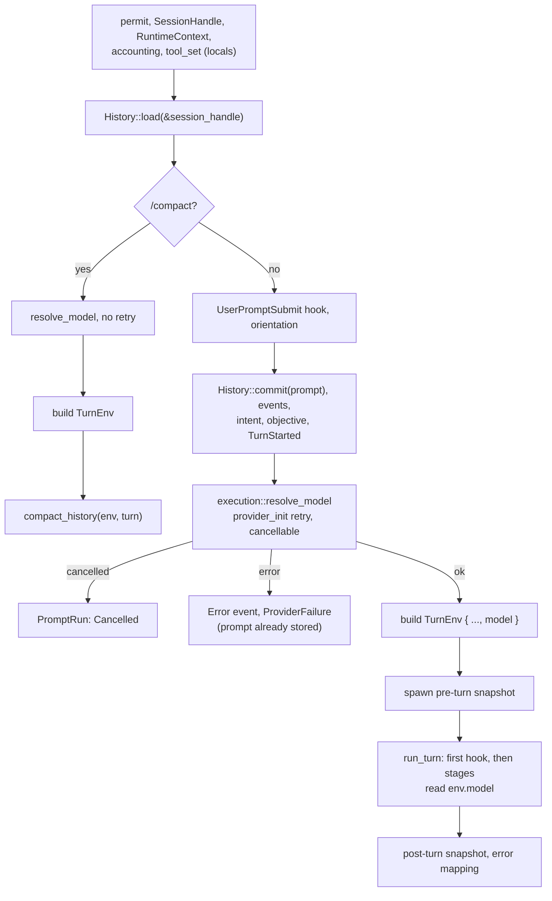
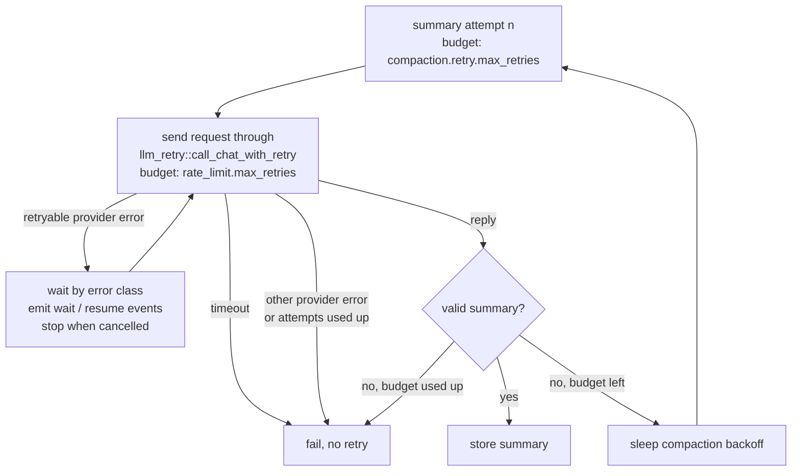

# Design

## Context

See proposal.md (Why). What shapes the approach, read from the code after `reduce-agent-harness-overhead` task 10.9 and updated after `restructure-agent-turn-state` landed (its `TurnEnv`, `Turn` and `Stage` replace `ExecutionContext` and `execute_cycle_state_machine`; the rows below say where the code is now):

- **Where capabilities are read during one model request** (`crates/agent-runtime/src` unless another crate is named):

  | Site | Why it reads |
  |---|---|
  | `agent/execution/transitions.rs` `transition_before_llm_call`, `let capabilities = provider.capabilities()` | `tool_updates` and the prompt-cache lifetime |
  | `transitions.rs` `transition_call_llm`, `provider.capabilities().streaming` | chooses the streaming path |
  | `agent/execution/stage.rs` `resolve_provider` then `SessionHandle::profile` | the profile is read from the handle in a second call after the provider was built; `profile` returns `ModelProfile::default()` if the provider failed |
  | `crates/querymt/src/adapters.rs` `LLMProviderFromHTTP::check_tool_changes` | refuses tool-change messages for a provider without `tool_updates`, on every `chat` and `chat_stream` |
  | `session/compaction.rs` `SessionCompaction::call_with_retry` | `streaming`, once for the span and once per attempt |
  | `delegation/summarizer.rs` (the `use_streaming` read) | `streaming` |

- **What a read costs.** For a native provider it is a field read or a match on the model id. For an Extism provider it is `crates/querymt/src/plugin/extism_impl/host/mod.rs` `ExtismProvider::plugin_capabilities`: lock the plugin mutex, clone the configuration JSON, call the plugin's `capabilities` export and deserialize the answer. `LLMProviderFromHTTP::capabilities` forwards to it. The configuration of an `ExtismProvider` is set when `ExtismFactory::from_config` builds it and never changes; `set_key_resolver` changes the credential, which the capabilities do not depend on.
- **Already done by `restructure-agent-turn-state` task 6.2** (found when this change was applied): `run_turn` resolves the provider once, before the first hook, under `llm_retry::call_with_retry(…, "provider_init", …)`; cancellation ends the run as `CycleOutcome::Cancelled`, any other error goes through `contextualize_llm_error(…, "provider initialization", …)`. The three per-step resolutions and `supported_overrides` are gone. What is left: the provider is held in `Run` (`stage.rs`) and the profile in `Turn::profile`, set by a second `SessionHandle::profile` call; the per-request code still reads `provider.capabilities()`; `/compact` (`session_actor.rs` `execute_prompt_inner`) sets `turn.profile` itself and `compact_history` calls `session_handle.provider()` again. That task kept the provider off `TurnEnv` on purpose: `TurnEnv` is built before the prompt is stored, and a provider failure must not move ahead of storing the user's prompt (test `provider_failure_at_run_start_is_reported_after_the_prompt_is_stored`).
- **The model is held in three places.** `Run.provider`, `Turn::profile` and the `SessionHandle` cache (`cached_llm_provider`, a `OnceCell`, one per handle, and a handle lives for one run). `Turn` is documented as what changes during a run and `Turn::profile` never does. Of the code that runs before `run_turn` (`/compact`, the `UserPromptSubmit` hook, `orientation_contexts`, storing the prompt, intent, objective), only `/compact` needs the model; the rest reads a `TurnEnv` for `session_id`, `cwd`, `llm_config`, `permission_mode` and `session_handle`, all of which `execute_prompt_inner` holds as locals.
- **What is fixed for a run and what is read live.** `TurnEnv` is for one run (one prompt, from its start to its end; every prompt builds a new one). The session's `llm_config` (provider, model, params), `tool_config` and the mode are captured when the run starts, so a change to them applies from the next run. `TurnEnv::runtime` is a handle to live session state: `runtime.mcp_tool_state` is an `ArcSwap` that a `tools/list_changed` notification replaces at any time, and `AgentConfig::collect_tools` loads it for every model request, so the MCP tools a run offers can change between two of its requests (the tool baseline and tool-change records exist for that).
- **Compaction's retry loop** is `session/compaction.rs` `SessionCompaction::call_with_retry`. It runs `0..=retry.max_retries` attempts with `tokio::time::sleep(initial_backoff_ms × backoff_multiplier^n)` between them, for every error alike, and treats a rejected summary (`summary_from_output` returns an error) as one more error. It stops early only for `is_mesh_timeout_error`, which matches any `LLMError::Transport { kind: Timeout }`. It does not look at `LLMError::is_retryable`, does not use `agent/execution/llm_retry.rs` `retry_delay_secs`, emits no `RateLimited` / `LlmRetryWait` event, takes no cancellation token and creates no `agent/utils.rs` `genai::RequestAttempts`.
- **The shared retry** is `llm_retry.rs` `call_with_retry_mode`: attempts up to `execution_policy.rate_limit.max_attempts()` (`max_retries.max(1)`), only for retryable errors, waiting `retry_delay_secs` through `wait_for_retry` (which emits the wait and resume events and returns `LLMError::Cancelled` when the token fires), and reporting each attempt through an optional `RequestAttempts`.
- **Accounting** differs between the two paths and must not be merged: a model request wraps each attempt in `querymt_agent_services::accounting::run_attempt`; compaction opens an attempt on its `DispatchLedger` and settles it as an output, a rejected output or an error after it has validated the summary.
- **Two callers of the compaction retry.** `SessionCompaction::process` is called by `agent/execution/maintenance.rs` `compact_history` (a run, or native `/compact`, with the user's instructions) and by `agent/handle/ext_worktree_ops.rs` (the handoff summary for a worktree switch). The second has no run and no cancellation token.
- **Related change.** `restructure-agent-turn-state` has landed: `TurnEnv` (read-only run inputs, `agent/execution/turn.rs`), `Turn`, `Run` and `Stage` (`agent/execution/stage.rs`). Its tasks 6.2 and 5.7 hand two things to this change: moving the model onto `TurnEnv` (D2) and taking the replay identity from the provider (D6).

## Goals / Non-Goals

**Goals:**

- One read of a plugin's capabilities per built provider.
- One place that resolves the provider and its profile for a run, with one retry wrapper, kept in one field of `TurnEnv`, and no state that means "not resolved yet" or "resolved, but the profile is empty".
- The replay identity of a stored reply comes from the provider that produced it, where the provider can say (D6).
- One retry implementation for provider errors, used by model requests and compaction requests.

**Non-Goals:**

- A capability cache above the provider (per configuration, per process). The provider is the natural owner of its own answer.
- Changing `llm_retry.rs` waits, limits or events. Compaction starts using them; they stay as they are.
- Changing how either path accounts for an attempt.
- Removing `SessionProvider::with_default_cache_hints` or its declaration cache (D5).

## Decisions

### D1. An Extism provider keeps its capabilities

`ExtismProvider` gets a `capabilities: std::sync::OnceLock<ChatCapabilities>` field, filled by `plugin_capabilities` on the first successful read. Both struct literals that build an `ExtismProvider` (`impl LLMProviderFactory for ExtismFactory` `from_config` and `impl HTTPLLMProviderFactory for ExtismFactory` `from_config`) start it empty.

- A read that fails (the plugin mutex is poisoned, or the `capabilities` export returns an error) returns `ChatCapabilities::NONE` as today and stores nothing, so a later read asks again. Storing `NONE` would turn one failed call into a provider that never streams.
- A plugin without a `capabilities` export gets its inferred answer (streaming when the four `chat_stream_parser_*` exports exist) stored like a declared one: it cannot change either.
- `OnceLock` and not a field filled in `from_config`: the build would then make a plugin call it does not make today, and a build that never asks would pay for it.

This alone removes the repeated Wasm calls, including the one in `LLMProviderFromHTTP::check_tool_changes` that the agent cannot avoid from above.

*Alternatives considered:*
- Cache in `LLMProviderFromHTTP`. Rejected: an Extism provider that does not go through the HTTP adapter (`supports_http_adapter_abi` false) would be left out.
- Cache in the agent, keyed by configuration. Rejected: `SessionProvider::declarations` is such a cache and its key was wrong once already (`reduce-agent-harness-overhead` task 10.9, fix 4).

### D2. The run's model is resolved once, and `TurnEnv` is built after it

```rust
/// The provider a run talks to and the facts about its model. Resolved once per run.
pub(crate) struct ResolvedModel {
    pub provider: Arc<dyn LLMProvider>,
    pub profile: Arc<ModelProfile>,   // capabilities, output caps, configured effort
}
```

- `SessionHandle::resolve_model(&self) -> SessionResult<ResolvedModel>` replaces `SessionHandle::profile`. It builds the provider (through the same `cached_llm_provider`) and the profile from the same `ProviderSnapshot`, and returns the error when the build fails. There is no default profile.
- `agent/execution/stage.rs` `resolve_provider` becomes `execution::resolve_model(config, session_handle, session_id, cancel)`: `resolve_model` under `llm_retry::call_with_retry(…, "provider_init", …)` racing the cancellation token, returning `Result<Option<ResolvedModel>, TurnError>` (`None` for cancelled, any other error through `contextualize_llm_error(…, "provider initialization", …)`). It takes the `LLMConfig` for the error text, not a `TurnEnv`.
- `TurnEnv` gets a plain `model: ResolvedModel` field and is built **after** the model is resolved. `Run::provider`, `Turn::profile` and `SessionHandle::profile` are deleted; the hook inputs borrow `&env.model.profile`; `prepare_model_request` and `transition_call_llm` read `env.model`. No hook can see an empty profile, because a `TurnEnv` cannot exist without one.
- `TurnEnv` is built by one constructor in `session_actor.rs`, called from the two places that hold a model (a run, and native `/compact`). The steps that run before the model is resolved use the locals `execute_prompt_inner` already holds (`session_handle`, `session_id`, `runtime`) and not a `TurnEnv`.
- **What is fixed for the run and what is live** (see "Context"): `model` is fixed. The offered tools are not and must not move onto it: `collect_tools` keeps loading the MCP snapshot for every request.

Order of `execute_prompt_inner` after the change (the prompt is still stored before a provider failure, as `restructure-agent-turn-state` requires):



Consequences, all deliberate:

- A run whose model cannot be resolved takes no pre-turn snapshot (today it takes one, and a post-turn one with an empty diff). Its client-visible events are the same: prompt received, user message stored, objective initialized, turn started, then the error.
- Native `/compact` with an unbuildable provider fails before the PreCompaction hook and the `CompactionStart` event, with the same provider failure. Today both are emitted and the compaction then fails. `/compact` does not retry, as today.
- The span `agent.execution.provider_init` (and its `agent.llm.call_with_retry` child with `operation = provider_init`) is a child of the prompt's span and no longer of `agent.execution.turn`.
- Run statistics (`turn.stats`) stay set up in `run_turn`: they are run state, not model.

**Why before `TurnEnv` and not in `Run`.** `restructure-agent-turn-state` kept the provider in `Run` so that nothing moves ahead of storing the prompt. That holds here too (the model is resolved after the prompt is stored), and it avoids the cost of `Run`: a model in two places that `/compact`, which has no `Run`, reaches by yet another path, and a profile copied into `Turn`. "What a run reads and never changes" is one type.

*Alternatives considered:*
- Keep the model in `Run` and `Turn::profile`. Rejected: three holders of one fact, and `/compact` keeps its own path.
- Resolve before `TurnEnv` at its current construction point. Rejected: a provider failure would precede storing the prompt, which `provider_failure_at_run_start_is_reported_after_the_prompt_is_stored` forbids.
- `TurnEnv<'a>` over a shared scope struct, or `Deref` to one. Rejected: it adds a lifetime and an indirection to every `env.x` read for a problem that building the value later solves, and `Deref` on a non-pointer type is an anti-pattern.
- Keep the lazy resolution and make `profile` return a `Result`. Rejected: every step would still need the retry wrapper, because any of them could be the first to succeed.
- Put the provider on the prepared request. Rejected: the provider is fixed for the run, not per request, and `PreparedModelRequest` is a public middleware type.

### D3. The run reads capabilities from the resolved model

Every read in the table of "Context" that happens inside a run uses `env.model.profile.capabilities`. `compact_history` takes the provider from `env.model.provider` and no longer calls `session_handle.provider()`. Two readers are outside a run's main provider and get their own single read:

- **Compaction** may use another provider (`[agent.execution.compaction]` `provider` / `model`). `SessionCompaction::process` reads `provider.capabilities().streaming` once, before its loop, and uses the value for the span and for every attempt.
- **The delegation summarizer** reads once per summary, as today. Nothing changes there.

`LLMProviderFromHTTP::check_tool_changes` keeps its read: it is the guard for callers that do not go through the agent, and D1 makes it cheap.

### D4. Compaction retries provider errors through the shared retry

`SessionCompaction::call_with_retry` becomes two nested loops with different owners:



- The inner loop is `llm_retry::call_chat_with_retry`, made `pub(crate)`, with a `RequestAttempts` created on the compaction's chat span. The closure it retries does one attempt: open the accounting attempt on the `DispatchLedger`, send (streaming or not), settle, and return `Ok(reply)` or `Err(provider error)`. A reply is `Ok` even when the summary will be rejected, so the shared retry never sees a rejected summary. Settling stays inside the closure, in the order it has today (settle before validation).
- A timeout is turned into a non-retried failure before the shared retry sees it: the closure's error is wrapped so that `is_mesh_timeout_error` errors skip the retry, by returning them through an outer `Result` (`Ok(Err(timeout))`). The name of that check says "mesh" but it matches every transport timeout; the behaviour is kept and the function is renamed `is_request_timeout`.
- The outer loop keeps `RetryConfig` (`crates/agent-core/src/config/execution.rs`) and its sleep. It becomes cancellable too: the sleep races the token.
- `process` (one method, with the former `process_with_instructions` folded in) takes a `CompactionDispatch` carrying the `&AgentConfig` and a `CancellationToken` in place of `&RetryConfig`. `compact_history` passes the run's token. The worktree handoff (`agent/handle/ext_worktree_ops.rs`) has no run and no token and passes a token nothing cancels, with `self.config`; its retry notices are emitted for the previous session it summarizes, as its accounting already is.
- Worst case, the number of requests of one compaction is `(compaction.retry.max_retries + 1) × rate_limit.max_attempts()`: 12 with the defaults, 4 today. Each extra request needs a retryable provider error to be followed by a rejected summary, or the reverse; the attempt limit of each loop is unchanged.

*Alternatives considered:*
- One loop with one budget (`rate_limit`) for both kinds of failure. Rejected: a rejected summary is not a provider failure, has no error class to take a wait from, and users have a documented budget for it.
- Keep compaction's loop and copy the waits into it. Rejected: that is the duplication this change removes; the attempt reporting was missed there once.
- Move the loop up into `compact_history`. Rejected: validation and accounting of a summary belong to `SessionCompaction`, and its tests drive `process` directly.

### D6. The replay identity comes from the provider that produced the reply

`SessionHandle::output_target` completes the identity a stored reply is replayed against (protocol, endpoint) from the latest stored output of the same provider and model, because the session store records no protocol or endpoint (`restructure-agent-turn-state` task 5.7). That is a gate on provider and model, and the provider re-checks provenance against its own configuration. The identity belongs to the provider:

- `ChatProvider::output_provenance(&self) -> Option<ChatOutputProvenance>`, default `None`, forwarded by the five wrappers (`ValidatedLLM`, `ToolEnabledProvider`, `LLMProviderFromHTTP`, `RemoteChatProvider`, `MeshChatProvider`), implemented by the OpenAI, xAI and Codex providers from the values they already stamp on their output (`responses_provider`, `responses_protocol`, `responses_endpoint`).
- `ResolvedModel` keeps the answer (read once at resolution), and `output_target` reads it from `env.model`.
- Extism and mesh providers report `None` until the plugin contract carries it. That contract change is out of scope here (and for `stabilize-native-plugin-abi`), so the history completion stays as their fallback.

*Alternative considered:* record the protocol and endpoint in the session store. Rejected: a schema change for a value the provider can state.

### D5. The system prompt stays in the provider configuration (recorded, not planned)

`SessionProvider::with_default_cache_hints` builds a provider from the configuration only to read its prompt-cache declaration, remembers the declaration per configuration (`SessionProvider::declarations`), and builds the provider a second time when the hints change the configuration. The cause is that the system prompt is a provider configuration key (`system`), so a hint on it must be written before the provider is built, and whether to write it depends on what the built provider declares.

Sending the system prompt with each request would remove the probe, the cache and the second build: the hint would be set when the request is built, from the resolved model of D2. It is not planned, for these reasons found in the code:

- Twelve provider crates type `system` in their own configuration (`Vec<String>` in `qmt-alibaba`, `qmt-deepseek`, `qmt-groq`, `qmt-mistral`, `qmt-moonshot`, `qmt-kimi-code`, `qmt-llama-cpp`; `Option<String>` in `qmt-google` and `qmt-ollama`; `Vec<querymt::params::SystemPrompt>` in `qmt-openai` and `qmt-codex`; `Option<AnthropicSystemPrompt>` in `qmt-anthropic`). Each would need a request-side input and a rule for which side wins.
- `querymt::chat::ChatCall` would gain a field that crosses the Extism boundary. A plugin built before the change ignores an unknown field, so it would send no system prompt at all, without an error. Avoiding that needs a capability flag, and the agent would keep the configuration path for every plugin that does not set it.
- With both paths alive, the probe, the cache and the second build all stay for old plugins. Nothing is deleted until plugins without the flag are no longer supported.
- The cost being removed is small and bounded: one extra constructor call per distinct configuration per process, for providers that end up with hints (`reduce-agent-harness-overhead` design "Risks").

Revisit when the provider request contract is broken for another reason (a contract version bump that already forces every plugin to be rebuilt), because the flag and the second path are then not needed.

## Risks / Trade-offs

- **[A run fails earlier when the provider cannot be built]** → Already the case since `restructure-agent-turn-state` 6.2: it fails with the same error, after the same retries, before the turn-start hooks instead of at the first request. Named in the CHANGELOG and in `docs/docs/agent/middleware.md` (this change writes the entry, which that change did not).
- **[Native `/compact` fails earlier when the provider cannot be built]** → Before the PreCompaction hook and the `CompactionStart` event, with the same provider failure. Nothing started, so nothing is left half-reported. Named in the CHANGELOG.
- **[A failed run takes no pre-turn snapshot]** → Undo has nothing to undo for a run that made no model request and ran no tool. The post-turn snapshot already skips a run without a pre-turn snapshot.
- **[Run-start tests cannot call `run_turn` without a model]** → `TestHarness` and `test_utils` fixtures resolve the model from the mock provider in one helper (`turn_parts`). The failure scenarios (cannot be built, transient failure, cancelled while resolving) are driven through `execution::resolve_model` and the session actor, and each keeps its scenario name. About ten tests that set `turn.profile = …` set `env.model.profile` instead.
- **[Moving tool state onto the model by mistake]** → D2 states that offered tools stay per request. A test that changes the MCP snapshot between two requests of one run keeps that guarded (task 2.4).
- **[A stored capability answer outlives a plugin reload]** → It lives in the `ExtismProvider`, and a provider is built per run handle, so a reloaded plugin is asked again by the next run.
- **[Compaction can now send up to 12 requests with the defaults]** → Only when retryable provider errors and rejected summaries alternate; D4 gives the arithmetic. Every attempt is in the cost accounting as today. Documented next to the two config sections.
- **[`compaction.retry` no longer limits provider errors]** → A user who set `max_retries = 0` to make compaction fail fast now gets provider retries from `rate_limit`. Marked as a behaviour change in the CHANGELOG and `docs/docs/agent/configuration.md`.
- **[Retry events during a compaction are new to clients]** → They are the events a model request already emits; the `querymt-desktop` follow-up in the proposal confirms they render.
- **[A non-retryable error used to be retried and sometimes succeeded]** → Only if the provider misclassifies a transient error. `LLMError::is_retryable` is what every model request relies on; a misclassification is fixed there.

## Migration Plan

1. Group 1: D1. Independent of the rest, no behaviour change. Done.
2. Group 2: D2 and D3. Behaviour changes: native `/compact` with an unbuildable provider, no snapshot for a failed run, the span's parent.
3. Group 3: D6, after group 2 (it stores the identity in `ResolvedModel`). Touches `querymt` and three provider crates.
4. Group 4: D4. Behaviour changes in what `compaction.retry` governs. Independent of groups 2 and 3.

Rollback is by reverting a group. Nothing is persisted and no contract changes.
