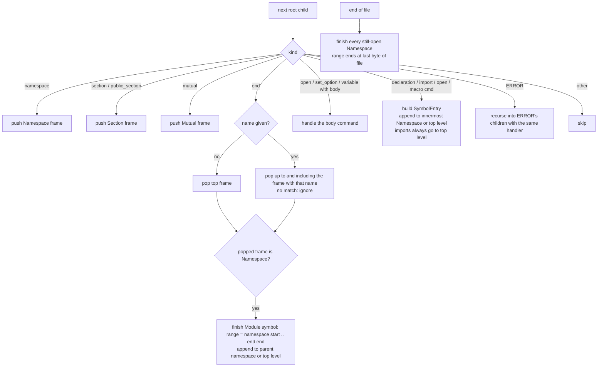

# Design

## Context

The outline and symbol pipeline is:

1. `index` tool (`crates/agent-services/src/tools/builtins/index.rs` `IndexTool`)
2. `outline_index::index_file`, which looks up the language with `get_language_for_extension` (`crates/agent-index/src/outline_index/common.rs`)
3. `extract_outline` (`outline_index/extractors/mod.rs`)
4. `SymbolIndex::from_source`, which calls the dispatcher `extract_symbols` (`symbol_index/extractors/mod.rs`)
5. a per-language tree-sitter extractor that returns `Vec<SymbolEntry>`
6. `symbols_to_sections` (`symbol_index/outline_projection.rs`)

Several consumers reuse `SymbolIndex`, and `get_language_for_extension` alone decides which files they can read:
- `get_symbol`, `get_function`, `replace_symbol`, `find_symbol_references`
- `crates/agent-knowledge/src/code.rs` `extract_code`

The Lean grammar shapes this design in two ways:

- **Dependency.** The workspace runs tree-sitter 0.26.13, which accepts grammar ABI versions 13–15. `tree-sitter` declares `links = "tree-sitter"`, so cargo allows only one runtime version in the dependency graph. That makes any grammar crate that depends on `tree-sitter` directly unusable unless it uses exactly 0.26. The `tree-sitter-kotlin` git pin in `crates/agent-index/Cargo.toml` exists for the same reason.
- **Flat scopes.** The grammar emits `namespace`, `section`, `mutual` and `end` as sibling commands under the root `module`, not as nested blocks. Upstream chose this because Lean and Mathlib files often leave namespaces unclosed. Nesting therefore has to be rebuilt in the extractor.

Two existing behaviours in `symbols_to_sections` matter here:
- A `Module` whose signature starts with `namespace ` goes to `namespaces`, sets `split_interface_enum_sections`, and copies its `Class`/`Interface`/`Enum` children into the top-level sections through `collect_namespace_members`. This is the C# and PHP behaviour.
- Routing depends only on symbol kind and signature prefix. The language is not passed in.

## Goals / Non-Goals

**Goals:**
- Meet the Lean requirements in `specs/index-tool/spec.md` with the same extractor shape as `kotlin.rs`.
- Keep outlines for every other language byte-identical. Every Lean-specific projection rule is keyed on the language, never on a signature that another language could produce.

**Non-Goals:**
- A new `SymbolKind`. Theorems remain `SymbolKind::Function`.
- Hoisting Lean namespace members into kind sections ("Option A"). It was rejected in favour of nesting; see D5.
- Resolving `open` scopes, `export` aliases, or `variable` binders into qualified names.

## Decisions

### D1: Grammar source is upstream `Julian/tree-sitter-lean`, pinned by git revision

`crates/agent-index/Cargo.toml` gets a crate-local dependency, matching every other grammar:
`tree-sitter-lean = { git = "https://github.com/Julian/tree-sitter-lean", rev = "fefc2eff9a83eeb72cda44646709e40e33e09175" }`.
It uses default features and has no feature gate. Its library is `bindings/rust/lib.rs`, which exports `pub const LANGUAGE: tree_sitter_language::LanguageFn`. Its build script compiles the committed `src/parser.c` and `src/scanner.c` with `cc`, at ABI 15, so the build needs no tree-sitter CLI.

Alternatives considered:
- **`tree-sitter-lean4` 0.3.0 on crates.io** (the wvhulle fork). It depends on `tree-sitter = "0.25"`, which conflicts with 0.26 through the `links` key, and its `language()` returns the 0.25 `Language` type. Rejected.
- **Fork wvhulle's crate onto `tree-sitter-language`.** It is a fork of the upstream grammar anyway, and upstream already ships the right binding and is more active. Rejected.
- **Vendor `parser.c` (49 MB) into this repository.** Rejected because of repository bloat.
- **`predictable-machines/lean4-tree-sitter`.** This is a Lean library that wraps tree-sitter for other languages, not a Lean grammar. Not applicable.

Effect on other builds:
- wasm32-wasip1 provider plugins don't depend on `querymt-agent-index`, so they are unaffected.
- The Python (`querymt-agent-py`) and `querymt-mobile-ffi` builds pick the grammar up through `querymt-agent` and pay the extra C compile time.
- The Nix build is covered by `cargoLock.allowBuiltinFetchGit = true` in `flake.nix`.
- Regenerate `querymt-workspace-hack` with `cargo hakari generate`.

### D2: Extractor walks root commands in order with a scope stack

The new module `crates/agent-index/src/symbol_index/extractors/lean.rs` exposes `pub fn extract(source) -> Result<Vec<SymbolEntry>, SymbolError>`, which `extract_symbols` dispatches to as `"lean"`.

It walks the named children of the root `module` node in source order and keeps a stack of open scopes. Each frame is one of:
- `Namespace { name, start node, children }`
- `Section { name }`
- `Mutual`

A recognised declaration is pushed into the children of the innermost open `Namespace` frame, or into the top-level list if no namespace is open. `Section` and `Mutual` frames never collect symbols, which makes them transparent.

Matching rules for `end`:
- **Named `end Foo`:** a frame keeps one scope per dotted component, as Lean does. The `end` name is split into components and matched against the trailing components of the innermost frames, so `end A.B` closes `namespace A.B` or `namespace A` + `namespace B`, and `end B` after `namespace A.B` closes only `B` and leaves `A` open (the frame keeps its single outline entry, fixed qualified name and signature `namespace A.B`). Frames above the match, such as unclosed sections, are closed implicitly. If nothing matches, the `end` is ignored so that a bad `end` cannot destroy the scope.
- **Unnamed `end`:** pops the top frame. That frame is usually `Mutual` or an anonymous `Section`.

`namespace A.B` creates a single frame named `A.B` with components `[A, B]`.

`public section` is an ordinary section: it pushes an anonymous `Section` frame so that a later `end` pops it rather than an enclosing namespace. If it is never closed, the frame is dropped at end of file.

`open`, `set_option` and `variable` may end in `in <command>`. The grammar nests that command under a `body` field, so the walker handles the body with the same handler. An `open … in` with a body emits no import, because it only scopes the one following command; the inner declaration keeps its own range, so `replace_symbol` leaves the prefix in place. A plain `open` is an import. Imports are always placed at top level even inside a namespace, so the `imports` section stays complete.

### D3: Node → SymbolEntry mapping

| Grammar node | Kind | `name` | Children |
|---|---|---|---|
| `import` | Import | full import text | – |
| `open`, `export` | Import | full command text, first line | – |
| `namespace` (closed by D2) | Module | `name` field | nested declarations and namespaces |
| `declaration` › `def` / `abbrev` / `opaque` | Function | `name` field | `where_decls` › `where_aux_def` → Method |
| `declaration` › `theorem` (both `theorem` and `lemma`) | Function | `name` field | `where_aux_def` → Method |
| `declaration` › `instance` | Impl | `name` field; for an anonymous instance, the text of the `type` term (e.g. `ToString Point`) | `where_struct` › `struct_field` → Method |
| `declaration` › `structure` starting with `structure` | Struct | `name` field | `field` → Field, `ctor` → Method |
| `declaration` › `structure` starting with `class` | Trait | `name` field | `field` → Method |
| `declaration` › `inductive` (also `class inductive`) | Enum | `name` field | `ctor_alt` → EnumVariant |
| `declaration` › `axiom` / `constant` | Const | `name` field | – |
| `declaration` › `example` | Test | `example` | – |
| `macro_cmd`, `syntax_cmd`, `notation_decl_cmd`, `macro_rules_cmd`, `elab_rules_cmd`, `declare_syntax_cat_cmd` | Macro | `name` field if present, else the first line | – |

Every other command is skipped: `variable`, `universe`, `set_option`, `check`/`eval`/`print`/`reduce`, `attribute_cmd`, `initialize`, `deriving_cmd` and the rest.

Notes on the mapping:
- **Struct vs Trait** is decided by the leading keyword token of the `structure` node, which is how `kotlin.rs` tells `class_declaration` variants apart.
- **The anonymous-instance type** is read with `children_by_field_name("type")`, skipping the `:` token. `_type_spec` is written as `field('type', seq(':', term))`, so the field label covers both nodes.
- **Node-kind check.** Node kinds and field names must be checked against the pinned revision's `src/node-types.json` before the extractor is finished. A throwaway parse-dump test is enough. This follows the previous language change.

**Confirmed against revision `fefc2ef` (parse dump of a fixture covering every construct above):**
- Root is `module`. Its named children are the commands in source order: `import`, `open`, `export`, `namespace`, `section`, `public_section`, `mutual`, `end`, `declaration`, `macro_cmd`, `syntax_cmd`, `notation_decl_cmd`, `macro_rules_cmd`, `declare_syntax_cat_cmd`, `variable`, `set_option`, `check`, and `ERROR`.
- `import` has field `name`; `open` has `namespace`; `export` has `namespace` and `only`. Their name fields are not used; the command text is.
- `namespace` and `section` have field `name`; `end` has an optional `name`. `mutual` and `public_section` have no fields. `public_section` is not closed by an `end`, so it opens no frame (as in the D2 flowchart).
- `declaration` wraps exactly one body node, preceded by optional `attributes` and `decl_modifiers` children. Body kinds: `def`, `abbrev`, `opaque`, `theorem`, `instance`, `structure`, `inductive`, `axiom`, `constant`, `example`. All have field `name` except `example` and an anonymous `instance`.
- **Mismatch 1:** `lemma` is parsed as a `theorem` node, so the node text, not the node kind, tells them apart. Both map to a function whose signature starts with `theorem` or `lemma`.
- **Mismatch 2:** `class` is a `structure` node too; the node's first token is `class` or `structure`. `class inductive` is an `inductive` node.
- `structure` children: `field` (fields `name`, `type`), `ctor` (field `name`, text `mk ::`). `inductive` children: `ctor_alt` (fields `name`, `type`).
- `def`/`theorem`/`abbrev`/… may carry `where_decls`, whose children are `where_aux_def` (fields `name`, `type`, `body`). `instance` may carry `where_struct`, whose children are `struct_field` (fields `name`, `value`). The anonymous instance has `type: app`, e.g. `ToString Point`.
- **Mismatch 3:** `macro_cmd`, `syntax_cmd` and `notation_decl_cmd` expose no `name` field in practice, so they use the first-line fallback. Only `declare_syntax_cat_cmd` has `name`.
- **ERROR:** a malformed region becomes an `ERROR` node. At the root it is a sibling of the surrounding commands (`def f … ⟧` gives a `declaration` followed by `ERROR "⟧"`; `def a := ) )` gives an `ERROR` holding only the bare identifier, so no `def` node and no symbol). Declarations after the region still parse normally. Where an error sits inside a tactic block, the parser may swallow following text (a `def` after an ill-formed `by` block was absorbed as application arguments). That loss cannot be recovered by the extractor and is accepted under D6.

### D4: Ranges, signatures and qualified names

- **Range.** A declaration's range comes from the outer `declaration` node, so it includes `attributes`, `_visibility_mods` and `decl_modifiers`. `replace_symbol` then never leaves an orphaned `@[simp]`. The digest is computed over the same slice.
  - A namespace's range runs from the `namespace` node to the end of its matching `end` node, or to the end of the source if it is never closed. Replacing a namespace therefore replaces the whole block.
- **Signature (outline label).** The source slice from the first non-`attributes` child of `declaration` up to the end of that line, trimmed. Modifiers stay in the label, giving labels such as `private theorem foo …` and `noncomputable def bar …`.
  - Other symbols use the first trimmed line of the node, as `kotlin.rs` `first_line` does.
  - A namespace's signature is `namespace <name>`.
- **Doc comments.** A `/-- … -/` doc comment is a separate node in the grammar and is not part of a declaration's range. `get_symbol` therefore omits it and `replace_symbol` leaves it in place.
  - Comments between `@[...]` and the declaration keyword are skipped when computing the label.
- **Qualified name.** The names of all enclosing `Namespace` frames and the declaration's own name, joined with `.`. A name starting with `_root_.` ignores the enclosing namespaces.
  - The name of an anonymous instance has its whitespace collapsed to single spaces. It is not Lean's generated name (`instToStringPoint`).
  - Lean dotted names are kept as written: `def Point.norm` inside `namespace Geometry` gets `name = "Point.norm"` and `qualified_name = "Geometry.Point.norm"`.
  - Children of declarations (fields, constructors, `where` helpers) use `<qualified parent>.<child>`.
  - `parent` is set to the parent's qualified name.
  - This differs from the `::` used in `kotlin.rs` `qualify`. Lean users and Lean error messages use `.`, and `SymbolEntry::matches_name` compares strings exactly, so `.` is what makes the "Lookup by qualified name" scenario work.

### D5: Projection takes the language, and Lean has its own routing

`symbols_to_sections(symbols, options)` becomes `symbols_to_sections(symbols, language, options)`. The only caller, `outline_index::extractors::extract_outline`, already has `language`.

When `language == "lean"`:
- **Namespaces.** A `Module` with a `namespace ` signature goes to `namespaces` with its children nested. The projection does not call `collect_namespace_members` and does not set `split_interface_enum_sections`.
  - Members are therefore not duplicated, which meets the "Declarations nest under namespace" scenario.
  - Top-level `Enum` (inductive) symbols merge into `types`, as they do for every language without namespaces, which meets the "Lean types and instances" scenario.
- **Theorems.** A top-level `Function` goes to a new `theorems` section when the first signature token that is not a Lean modifier is `theorem` or `lemma`. The modifiers skipped are `private`, `protected`, `noncomputable`, `partial`, `nonrec`, `unsafe`, `scoped`, `local`, `public` and `meta`.
  - The `theorems` section is pushed directly after `functions`.
  - Theorems inside namespaces stay as namespace children (Option B). Their labels already start with `theorem` or `lemma`.

Every other language follows the existing code path unchanged. The modifier list and the theorem rule live in a helper inside the `lean` branch, so a signature from another language can never reach them.

Alternatives considered:
- **Route by signature alone, without the language.** The theorem rule would be safe, since no other extractor emits signatures starting with `theorem`. Suppressing the namespace member hoisting would not be: it needs a signal that the namespace is Lean's, and no reliable one exists from kind and signature alone.
- **Emit Lean namespaces with a different signature prefix** (for example, routing them to `modules`). Labels would stop matching the source text. Rejected.
- **Option A, hoisting members into kind sections.** It loses the scope context that qualified names depend on, and it diverges from how other module-like containers are projected. The user chose B.

### D6: Tolerating unsupported syntax

The parser is never treated as having failed because of `ERROR` nodes. The walker in D2 recurses into `ERROR` children with the same handler, so declarations that the parser recovered inside an error region are still extracted. `MISSING` nodes are ignored.

A missing `name` field, as can happen on partially parsed declarations, produces no symbol rather than an `unknown` placeholder. This differs from `kotlin.rs`, which falls back to `"unknown"`. Placeholder names would add symbols that lookups by name cannot find.

### D7: Tool contract strings

In `crates/agent-services/src/tools/builtins/index.rs`:
- Add "Lean" to the description list in `IndexTool::definition`, after Swift.
- Add `lean` to the extension list in the `OutlineError::UnsupportedLanguage` message.

The archived change established that each newly supported extension appears in this message.

## Risks / Trade-offs

- **[Risk]** The 49 MB `parser.c` lengthens clean builds of `querymt-agent-index` and everything that depends on it (CI, Nix, Python, mobile).
  - **Mitigation:** Measure the build-time difference with `cargo build -p querymt-agent-index --timings` before and after, and record it in the PR. The user chose not to add a feature gate. Incremental builds are unaffected after the first compile.
- **[Risk]** The upstream repository is about 190 MB because `parser.c` has been regenerated many times. Cargo and Nix git fetches download its history, which affects cold CI caches.
  - **Mitigation:** Pin the revision. Follow up by asking upstream to publish on crates.io, where the packaged crate contains only `src/*`, and switch once it does.
- **[Risk]** The static grammar does not cover all of Lean: custom notation, Mathlib tactics, and multi-name structure fields.
  - **Mitigation:** D6 recovery, plus the "Partial parse still yields declarations" test. The outline is best-effort by design.
- **[Risk]** A future upstream regeneration renames node kinds.
  - **Mitigation:** The pinned revision and the per-kind extractor tests catch this when the pin is bumped.
- **[Trade-off]** Theorems inside namespaces don't appear in `theorems`, so in namespace-heavy files that section is mostly empty. This was accepted with Option B. Labels still identify theorems, and the `function` kind filter finds them in `get_symbol`.
- **[Trade-off]** With a `max_children_per_item` cap set, a large namespace shows only its first N members followed by `... (M more)`. The default is unlimited.

## Migration Plan

Additive. No configuration, data or wire migration. Rollback is a revert of the change. A `.lean` file then goes back to an "unsupported extension" error, and the knowledge store records it as path-only again on its next extraction.
