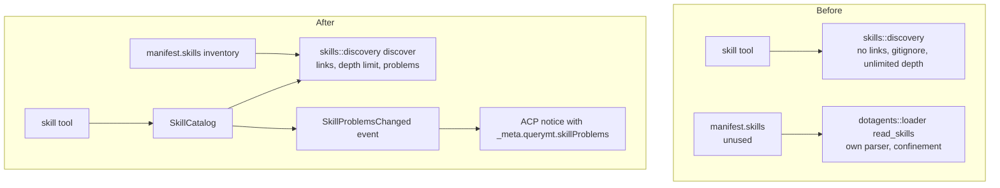
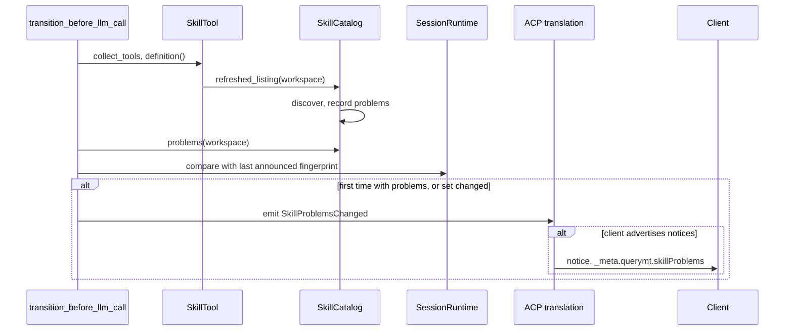

# Design

## Context

See `proposal.md` for motivation and `specs/` for the behavior contract.

Two modules in `querymt-agent-runtime` read `.agents/skills` today, and only one of them reaches the model.

- **The skill tool's reader.** `crates/agent-runtime/src/skills/discovery.rs` `discover_from_source` walks each source with `ignore::WalkBuilder`. The builder keeps its defaults, so links are not followed and ignore files apply. Project `.agents/skills` is walked without a depth limit; every other source uses `max_depth(2)`. A walk error on any entry (`let entry = entry?`) fails the whole source. Parse failures, duplicate spellings and duplicate IDs are logged and dropped. `crates/agent-runtime/src/skills/catalog.rs` `SkillCatalog` holds one `SkillRegistry` per workspace, refreshed on every `SkillTool::definition` call (`refreshed_listing`) and on a lookup miss (`refresh_registry_async`).
- **The `.agents` Protocol loader.** `crates/agent-runtime/src/dotagents/loader.rs` `read_skills` lists direct children of `<layer>/skills`, reads the file through `ConfinementPolicy` (`crates/agent-runtime/src/dotagents/confine.rs`), and parses it with `crates/agent-runtime/src/dotagents/parsers.rs` `parse_skill_document` into `DotagentsSkill`. `merge.rs` `merge_layers` puts the result in `DotagentsManifest.skills`. No non-test code reads that field.

The original `.agents` design (archived change `2026-09-28-add-dotagents-protocol-support`, design.md) planned a runtime overlay that would turn the manifest into skill inputs. Task 2.7 of that change extended the skill tool's reader instead, and the manifest row was left behind.

Other constraints that shape the approach:

- `SkillCatalog::from_config` runs a best-effort discovery (`SkillRegistry::load_from_sources`), and the first `definition()` call replaces the result with a strict one (`discover_all_strict`).
- `refresh_registry` and `refresh_registry_async` repeat the same ticket, source and error handling.
- The check "skills enabled and the tool list is empty or names `skill`" is written in `crates/agent/src/api/agent.rs` `AgentBuilder::build`, in `crates/agent-runtime/src/delegation/member.rs` `build_local_member`, and again as a validation in `crates/agent/src/api/agent.rs` `check_skill_tool`.
- `AgentEventKind` (`crates/agent-protocol-types/src/events.rs`) is typeshare-annotated and durable by default. `classify_durability` lists the live-only kinds, each with a rationale. A durable kind that an older journal loader does not know makes a stored session unreadable there (see the `TodoPlanRestored` rationale).
- ACP notices are produced in `crates/agent-runtime/src/acp/shared.rs` from `AgentEventKind::HookNotice` and `AgentEventKind::MiddlewareStopped`, behind `self.capabilities.notices`. QueryMT metadata sits under `_meta.querymt` (`QUERYMT_META_NAMESPACE`; key constants in `crates/agent-protocol-types/src/replay.rs`).

## Goals / Non-Goals

**Goals:**

- One function reads skill folders. The skill tool and the manifest both call it.
- Every skill that is found and not offered has a recorded reason.
- The result of a scan is a value (skills, problems, completeness), not a `Result` plus log lines.
- No new dependency and no change to the session DB.

**Non-Goals:**

- A cache or file watcher for skill refreshes (the archived `2026-09-18-hot-reload-skills` design deferred both; this change keeps that and adds the measurement it asked for).
- Moving skill types into `querymt-agent-core`.
- Reusing `ConfinementPolicy` for skills.
- Changing `crates/agent-runtime/src/skills/mcp.rs` or `remote.rs`.

## Decisions

### D1: `skills::discovery` is the only reader and returns a scan report

`discover_from_source` returns the skills and the problems of one source. `discover_all` and `discover_all_strict` are replaced by one `discover(sources, options)` that returns:

- `skills`: the merged, precedence-resolved, enabled skills;
- `problems`: `Vec<SkillProblem>` sorted by path;
- `unreadable_sources`: whether any selected source folder existed but could not be read.

`SkillProblem` (new, in `crates/agent-runtime/src/skills/types.rs`) has `path`, `source` (the source folder), `kind` and `message`. `SkillProblemKind` has the seven kinds the spec names. `options` carries `include_external` and `nested_depth`.

`merge_discovered` keeps its precedence rule. It records a `duplicate_id` problem only when the two competing skills have equal precedence (the first one met is kept). A higher-precedence skill overrides a lower one and a lower-precedence skill yields to a higher one, with no problem, whichever of them `discover` receives first.

A definition file is read only when it is a regular file of at most 1 MiB (`SKILL_DEFINITION_MAX_BYTES`), because discovery follows links and a link can name a pipe or a device. Anything else is an `invalid_definition` problem. A definition directly in a source folder is not a skill directory and is ignored. A source folder that is a link to a removed directory is a `broken_link` problem and offers no skills; it does not make the scan incomplete.

`crates/agent-runtime/src/skills/catalog.rs` `DiscoverFn` changes to return the report, so the existing test hook `with_discovery_fn` keeps working.

*Alternative: let the `.agents` loader be the reader and feed the skill tool from the manifest.* Rejected. The loader is off by default, is resolved once at build time, reads direct children only, parses four fields and rejects outside links. Fixing each of those turns it into the reader described here, and the skill tool would still need its own reader for the five folders outside `.agents`.

*Alternative: keep both readers and add link following to each.* Rejected because the two would still disagree on nesting, metadata and diagnostics.

### D2: Keep `ignore::WalkBuilder`, turn its filters off, follow links

The walk stays on the `ignore` crate, which `querymt-agent-runtime` already depends on (`crates/agent-runtime/Cargo.toml`), configured with `standard_filters(false)`, `hidden(false)`, `follow_links(true)` and `max_depth(Some(n))`.

- `n` is `nested_depth + 1` for a project `.agents/skills` source and `2` for every other source, as today. `is_recursive_project_agents_skills` keeps deciding which sources get the configured depth. A link counts as one level, like a directory.
- An error from the walker is mapped to a problem instead of being returned: at depth 0 it is `source_unreadable`; a loop reported by the walker is `link_loop`; an entry whose own link metadata exists but whose target does not is `broken_link`; anything else is `entry_unreadable`.
- A skill's `path` stays the path under the source folder, not the resolved target, so the same skill has the same path on every refresh and in every message.

The tests in tasks group 1 are the proof that the walker reports broken links and loops as per-entry errors. If the `ignore` crate turns out to stop the whole walk on one of them, the fallback is a small recursive `std::fs::read_dir` walk with a visited set of canonical directories; that needs no dependency either.

*Alternative: add `walkdir` directly.* Rejected: a new dependency for the same behavior.

### D3: Follow every link

Links are followed wherever they point. This is the repository owner's decision; the alternatives were following only into configured trusted roots, following only in global folders, and not following but warning.

It differs on purpose from `ConfinementPolicy`, whose rule exists because `.agents` entries can carry commands, credentials and recurring tasks. A skill is text. It reaches the model only when the model loads it, under the configured allow, ask or deny permission. Supporting files stay confined: `crates/agent-runtime/src/skills/tool.rs` `read_local_file` canonicalizes the skill directory and rejects a file that resolves outside it, so for a linked skill the boundary is the link target.

`SkillTool::format_sample_files` uses `DirEntry::file_type`, which does not follow links. It switches to the entry's resolved metadata so linked files and directories are listed.

### D4: A refresh fails only for an unreadable source folder

`SkillCatalog::publish_refresh` decides from the report:

- `unreadable_sources` is false: publish the skills.
- `unreadable_sources` is true and the workspace has a published set: keep that set and return the error, as today.
- `unreadable_sources` is true and the workspace has no published set: publish what was read.

The third case keeps what `SkillRegistry::load_from_sources` does at startup today, so removing the best-effort path (D6) changes nothing a user can see.

Problems are recorded in all three cases, so a failed refresh is visible to the client and not only in the log.

*Alternative: keep "any traversal error fails the refresh".* Rejected. With links followed, one dangling link would freeze the skill set of a workspace for as long as the link exists.

### D5: The catalog records the inventory and the problems per workspace

`SkillCatalog` gains a map from workspace to the last report's problems, updated under the same ticket rule as the registries, and two read accessors: the skills of a workspace as inventory entries, and its problems. Both are public and re-exported through `querymt_agent::skills`.

An inventory entry is built from a `Skill`: callable ID, name, description, source kind (from `SkillSource`), source folder, skill directory, and the canonical directory when the source folder itself or a path component between it and the skill directory is a symbolic link (links above the source folder, such as `/var` -> `/private/var`, do not count).

### D6: Startup uses the refresh path

`SkillCatalog::from_config` builds the catalog and calls `refresh_registry(project_root)` once, then logs the same "Skills system initialized" line. `SkillRegistry::load_from_sources` and `SkillRegistry::reload_from_sources` are removed. `SkillCatalog::from_parts` takes a `SkillRegistry` by value; today it takes an `Arc<Mutex<SkillRegistry>>` only to clone out of it.

### D7: One refresh body

`refresh_registry` and `refresh_registry_async` share a "begin" step (ticket, sources, options) and a "finish" step (log, record problems, publish). They differ only in running the scan inline or through `tokio::task::spawn_blocking`. `definition()` stays synchronous because `Tool::definition` is.

### D8: One function decides whether an agent gets the skill tool

A new `SkillCatalog::for_agent(skills: Option<&SkillsConfig>, tools: &[ToolSpec], project_root)` returns `Option<Arc<SkillCatalog>>`. `AgentBuilder::build` and `build_local_member` call it. `check_skill_tool` keeps producing its two error messages and uses the same "tool list names `skill`" predicate. `ToolSpec` lives in `crates/agent-runtime/src/config/tools.rs`, so the function sits in the runtime crate and the facade calls down.

### D9: The manifest row is filled from the reader

`crates/agent-runtime/src/dotagents/loader.rs` `DotagentsLoader::load` calls `skills::discovery::discover` for the resolved workspace after merging layers, and stores the inventory in `DotagentsManifest.skills` and the problems in `DotagentsManifest.diagnostics`.

- **Input.** `DotagentsLoadOptions` (`crates/agent-runtime/src/dotagents/options.rs`) gains the skill settings to scan with: enabled, `include_external`, configured paths and `nested_depth`. `AgentBuilder::build` and `AgentBuilder::preview_dotagents_manifest` set them from the builder's skills configuration before calling `resolve_for_builder`. Without them the defaults of `SkillsConfig` apply. The skill settings are passed only when `SkillCatalog::for_agent` (D8) would give the agent a catalog for the builder's skills configuration and tool list. With skills disabled, or with a tool list that does not name `skill`, the list is empty.
- **Sources.** The same list the catalog uses: `default_search_paths(workspace)` plus configured paths. The `.agents` layer switches and root overrides are not consulted (see Open Questions).
- **Type.** `DotagentsSkill` is replaced by an entry type with the fields of D5. The body, the `enabled` flag, the extension map and the fingerprint are dropped: the list now contains only offered skills, and the skill tool is the reader of bodies.
- **Diagnostics.** Each problem becomes `DotagentsDiagnostic::new(DotagentsSeverity::Warning, code, message)`. The message starts with the path. `source` stays `None`, because `DotagentsSource` requires a layer and most skill folders have none. Codes: `invalid_definition` maps to `ParseError`; `duplicate_definition` and `duplicate_id` to `DuplicateId`; `source_unreadable`, `entry_unreadable` and `broken_link` to `IoError`; `link_loop` to `Other`.
- **Removed.** `read_skills`, the `skills` field of `DotagentsLayerContent`, the skills branch of `merge_layers`, `parse_skill_document`, `DotagentsSkill`, and their re-exports in `crates/agent-runtime/src/dotagents/mod.rs`.

Severity is `Warning` because `DotagentsSeverity::Error` means "the affected singleton or activation cannot be applied safely", and a skipped skill does not make the rest unsafe. A consequence is that a malformed `skill.md`, which is an error diagnostic today, no longer fails a strict resolution.

A manifest that a caller supplies through `AgentBuilder::dotagents_manifest` is passed through unchanged, as today.

### D10: A live-only event carries the problems to the ACP layer

- **Event.** `AgentEventKind::SkillProblemsChanged { problems }` in `crates/agent-protocol-types/src/events.rs`, with a typeshare-annotated item type holding `path`, `source`, `kind` and `message` as strings. `classify_durability` returns `Durability::Ephemeral` for it, with the rationale that the catalog is authoritative and an unknown durable kind would break older journal loaders. `AgentEventKind::tag` gets `skill_problems_changed`, and the `one_value_per_variant` test gets a value.
- **Emission.** `crates/agent-runtime/src/agent/execution/transitions.rs` `transition_before_llm_call`, right after `config.collect_tools(...)`, which is where `SkillTool::definition` has just refreshed the catalog. It runs only when the agent has a catalog and the collected tools include `skill`.
- **Change detection.** `SessionRuntime` (`crates/agent-runtime/src/agent/core.rs`) gains a field next to `skill_grants` holding the fingerprint of the problem list last announced, or nothing. An event is emitted when the current fingerprint differs, except that an empty list is not announced to a session that was never told about a problem.
- **Translation.** A new arm in `crates/agent-runtime/src/acp/shared.rs` next to the `HookNotice` and `MiddlewareStopped` arms, behind `self.capabilities.notices`. It builds `Notice::new(severity, title).description(text).meta(meta)`, where `meta` is the `querymt` namespace object with the key `skillProblems`. The key constant goes next to the other keys in `crates/agent-protocol-types/src/replay.rs`.
- **Clearing.** When the list becomes empty after an announcement, an `info` notice with an empty array is sent. Without it a client that renders the list could never clear it.

*Alternative: emit `HookNotice`.* Rejected: it is durable, so it would be journaled and replayed, and it carries only a string.

*Alternative: an extension method `_querymt/skills/list`.* Not chosen by the repository owner for this change. It can be added later on top of the D5 accessors without touching this design.

### D11: `nested_depth` is a validated integer

`crates/agent-runtime/src/config/extensions.rs` `SkillsConfig` gains `nested_depth: u8` with a default function returning `4`, a JSON schema range of 1 to 16, and a check that rejects other values with an error naming the key. `#[serde(deny_unknown_fields)]` is already set. `SkillsConfig::default` and the documented example in `docs/docs/agent/configuration.md` (parsed by the `documented_skills_configuration_parses` test) are updated together.

### D12: Measure the refresh, do not cache it

The refresh records its wall time and the number of entries visited as fields on the `agent.tools.collect` span that `transition_before_llm_call` already opens, and at debug level in the log. Task 5.2 runs the measurement against this repository's own skill folders, including the linked `.agents/skills/querymt-dev`, and writes the numbers into `tasks.md`.

A shortcut for unchanged folders is not built here. With links followed, a correct shortcut has to notice changes inside link targets, so the modification time of the source folder is not enough.

## Risks / Trade-offs

- [A cloned repository can link a skill to any directory the user can read] → Skill text reaches the model only on a `skill` call and under the configured permission; `read_local_file` keeps supporting files inside the link target; the manifest records each link target so a preview shows where a skill comes from.
- [A directory that is unreadable for a moment drops its skills until the next refresh] → It is recorded and announced as a problem. The next model request refreshes again.
- [A link to a large tree is walked on every refresh, and ignore files no longer prune it] → `nested_depth` bounds the walk, other sources stay at one level, and D12 gives the numbers to decide on a shortcut.
- [A skill folder that was hidden on purpose through `.gitignore` is now offered] → Marked breaking in `CHANGELOG.md`; `enabled: false` in the skill's frontmatter or a permission rule hides it.
- [Layouts deeper than four levels under a project `.agents/skills` stop being found] → Marked breaking; `nested_depth` can be raised to 16. Skills beyond the depth are not reported, because finding them would need the deeper walk.
- [Each delegated child session announces the same problems once] → Bounded to one notice per session and problem set. If it is noisy in practice, a follow-up restricts announcements to sessions without a parent.
- [The notice is push-only: a client that connects later, or does not advertise notices, sees nothing] → Accepted for this change. The fingerprint lives in `SessionRuntime`, so a session loaded into a new runtime is told again on its next model request.
- [The manifest is a build-time snapshot while the skill tool refreshes] → The row equals the tool's listing at resolution time, which is what the spec requires. Live state comes from the D5 accessors.
- [Clients built from older generated types receive an unknown event kind] → The event is live-only, so no stored session is affected. The `querymt-desktop` follow-up is named in the proposal.
- [Strict `.agents` resolution accepts a malformed skill file that failed it before] → Marked breaking in `CHANGELOG.md`.

## Migration Plan

No data migration. Existing configuration files load unchanged.

1. Land groups 1 to 5 of `tasks.md` in order; each group compiles and passes on its own.
2. `CHANGELOG.md`, Unreleased: the four breaking entries (ignore files, depth limit, manifest skill type, skill problems as warnings) and the additions (linked skills, `nested_depth`, the notice).
3. Rollback is a revert of the change. Nothing is persisted in a new shape.

## Open Questions

- Should the `.agents` Protocol switch (`dotagents.enabled`), the layer switches and the root overrides apply to skill discovery? The repository owner deferred this. Until it is decided, skill discovery keeps reading `~/.agents/skills` and `<workspace>/.agents/skills` whatever those settings say, which is today's behavior and what the specs in this change describe.
- Should a pull method such as `_querymt/skills/list` be added so a client can ask for the inventory and the problems? It would build on the D5 accessors.
- Is a refresh shortcut needed? Decide from the numbers that task 5.2 records.
