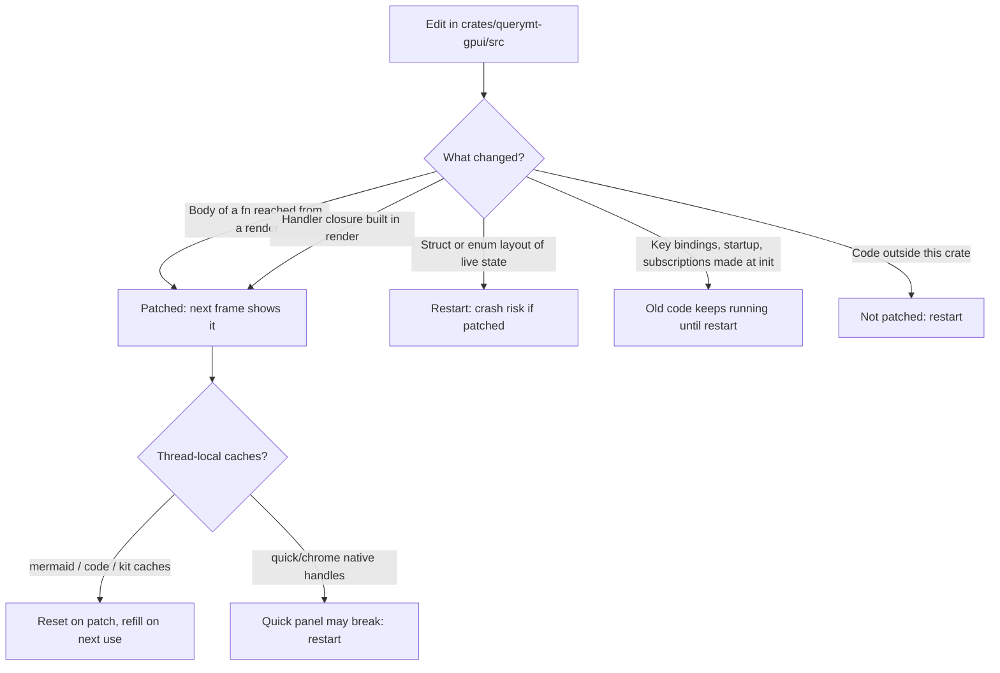

# Design

## Context

See proposal.md (Why) for motivation. What exists today:

- **gpui-kit 0.11.0** depends on GPUI as `gpui = { package = "gpui-pre", version = "=0.3.14" }` with default features, and does not expose a `hot-reload` feature.
- **gpui-pre 0.3.14:**
  - `Cargo.toml`: `hot-reload = ["dep:async-tungstenite", "dep:dioxus-cli-config", "dep:dioxus-devtools-types", "dep:smol", "dep:subsecond"]`. These dependencies are gated to macOS, Linux, Windows and iOS targets.
  - `build.rs` emits `cfg(gpui_hot_reload)` only when the feature is on, `CARGO_CFG_DEBUG_ASSERTIONS` is set, and the target OS is one of those four.
  - `src/view.rs` `render_view`: under `gpui_hot_reload`, every view and component render goes through `subsecond::HotFn::current(render_view_impl::<V>).call(...)`.
  - `src/app.rs` `Application::run` (and `run_embedded`) calls `hot_reload::init(cx)` before the launch callback.
  - `src/hot_reload.rs` `init`:
    - reads the dev-server address from `dioxus_cli_config`, and logs a warning and does nothing if the app was not started by `dx`;
    - connects to the devtools websocket;
    - applies `subsecond::apply_patch` between foreground updates, then calls `cx.refresh_windows()`.
- **subsecond 0.7.10:**
  - patches only the tip crate (the one holding `main.rs`);
  - is enabled only with `debug_assertions`;
  - resets thread-locals in the tip crate on each patch;
  - does not support struct layout changes (the old instance stays alive and the program crashes);
  - patches arrive from `dx serve` with hot-patching enabled. The docs spell the flag `--hotpatch`; gpui-pre's warning spells it `--hot-patch`.
- **`querymt-gpui`** (`crates/querymt-gpui/Cargo.toml`) is a single `[[bin]]` crate (`src/main.rs`) with no library. Its native entry is `main` → `run(gpui_kit::application()…)`, so `Application::run` is reached and `hot_reload::init` runs.
- **Thread-locals in the crate:**
  - `src/ui/mermaid.rs`, `src/ui/code.rs` and `src/ui/kit.rs` hold caches;
  - `src/quick/chrome` holds native panel handles.
- **Build environment:**
  - `[profile.dev]` in the root `Cargo.toml` sets `debug = "line-tables-only"` and `split-debuginfo = "unpacked"`;
  - the developer machine sets `RUSTC_WRAPPER=sccache`;
  - `querymt-gpui` is in `.config/hakari.toml` `traversal-excludes`.

## Goals / Non-Goals

**Goals:**

- `scripts/hot-patch.sh` starts the app under `dx serve` with hot-patching, and an edit to a render function in `src/ui/**` shows up in the running window without a restart.
- Default, CI, release and wasm builds stay byte-for-byte unaffected by the feature being available.
- Measured patch latency and a documented list of what patches and what needs a restart.

**Non-Goals:**

- Making struct changes patchable, or adding app-level `subsecond::call` boundaries.
- Tuning compile times beyond what the dev profile and dx already do. If latency is poor, the measurements feed a later change.

## Decisions

### D1. An optional direct dependency on `gpui-pre` turns on `hot-reload`

```toml
[target.'cfg(not(target_family = "wasm"))'.dependencies]
gpui-pre = { version = "=0.3.14", optional = true, features = ["hot-reload"] }

[features]
hot-patch = ["dep:gpui-pre"]
```

- **How it works:** Cargo unifies features per package, so enabling `hot-patch` adds `hot-reload` to the same `gpui-pre` that gpui-kit builds. No source change in this crate refers to `gpui_pre`; the dependency exists only to carry the feature.
- **Pinned with `=`, like gpui-kit:** a gpui-kit bump that moves GPUI fails `cargo check --features hot-patch` with a version conflict, instead of silently building two GPUIs. The pin is bumped together with gpui-kit; the knowledge doc says so.
- **Default features:** the dependency keeps gpui-pre's default features (gpui-kit uses them too), so enabling `hot-patch` adds only `hot-reload`.
- **Target gate:** `cfg(not(target_family = "wasm"))` keeps wasm builds free of it; gpui-pre also target-gates the hot-reload dependencies.
- **Rejected: asking gpui-kit upstream for a `hot-reload` feature.** That is better long term, but out of our control. D1 can be swapped for it later, and the swap is recorded as a follow-up.
- **Rejected: always on in debug builds.** It would add websocket and devtools dependencies to every `cargo t-gpui` and `cargo run`, and log a warning on every normal debug start.

### D2. The run script calls the Dioxus CLI by full path and pins its version

`crates/querymt-gpui/scripts/hot-patch.sh`, matching the existing scripts layout (`scripts/package`, `scripts/release`):

1. Resolve the CLI:
   - use `$QMT_DX` if set, otherwise `$CARGO_HOME/bin/dx` (default `~/.cargo/bin/dx`);
   - never a bare `dx`, because Deno's `dx` (`/opt/homebrew/bin/dx` here) can come first on `PATH`.
2. Check the version:
   - `"$dx" --version` must report `0.7.10`, the version of gpui-pre's `subsecond`, `dioxus-cli-config` and `dioxus-devtools-types`;
   - otherwise print `cargo binstall dioxus-cli@0.7.10` (or `cargo install dioxus-cli@0.7.10 --locked`) and exit 1.
3. Run from the repository root:

   ```bash
   "$dx" serve --hot-patch -p querymt-gpui --features hot-patch -- "$@"
   ```

   - Arguments after the script name go to the app (`--agent host:port`, `--page sessions`), the same as `cargo r-gpui`.
   - The exact flag spelling (`--hot-patch` or `--hotpatch`) and how app arguments are passed are checked against `dx serve --help` 0.7.10 and fixed in the script before it is committed.

- **Why a script and not docs only:** the version check and full path are easy to get wrong, and the resulting failures are confusing. The patch websocket silently fails to match on a build-id or protocol mismatch.
- **Rejected: a cargo alias.** `dx` is not a cargo subcommand.
- **Rejected: a Nix package for dioxus-cli.** That is out of scope (proposal Non-goals). It can follow if the feature is kept.

### D3. Build settings: the default dev profile first, a faster one only if measured

The first run uses `[profile.dev]` unchanged.

- If patches take more than about 5 s, or the debug app is too slow to use, task 3.3 tries a dependency-optimised profile:
  - a named profile `dev-hot` (`inherits = "dev"`, with `[profile.dev-hot.package."*"] opt-level = 2`);
  - passed to dx if `dx serve` accepts a profile flag.
- That profile is added only if it measurably helps, and only if dx accepts it.

On `sccache`:

- dx wraps the linker for hot-patching, and `RUSTC_WRAPPER=sccache` wraps `rustc`. Both are expected to coexist, but that is unverified.
- If the first `dx serve` build or the first patch fails, retry with `RUSTC_WRAPPER=` unset for that command. If that fixes it, the script unsets it for `dx`.

### D4. What is expected to patch, and what restarts



The tasks check each branch with one edit and record the result; the knowledge doc publishes the resulting table.

### D5. No code changes in the app for this change

The app needs no Rust changes: `main` already goes through `Application::run`, and every view renders through GPUI's patched `render_view`.

- If `dx` does not pass the dev-server address through the environment `dioxus_cli_config` reads, that is a dx/gpui-pre mismatch. It is recorded as a blocker, not worked around in app code.

## Risks / Trade-offs

- **[`dx serve` cannot build or run a non-Dioxus binary in a workspace]** (package selection, platform detection) → Try `--package`/`--bin` and `--platform desktop`. If dx still refuses, record the exact error, stop, and report no-go. No app-side workaround.
- **[Patch latency is too high for a 76k-line crate]** (subsecond recompiles the whole tip crate) → Measure it (task 3.2). Try D3's profile. If it is still above about 10 s for a one-line render change, record no-go; the feature can stay in as opt-in or be removed (decided with the user).
- **[Crashes after a struct change]** → Documented as "restart after changing a struct". Not mitigated.
- **[The quick panel or native window chrome breaks after a patch]** (thread-local native handles in `src/quick/chrome`) → Record it; the doc says to restart for quick-panel work.
- **[The version pin drifts when gpui-kit is bumped]** → `cargo check -p querymt-gpui --features hot-patch` fails on a conflict, and the knowledge doc says to bump both. The CLI version in the script must follow gpui-pre's `subsecond` version.
- **[`Cargo.lock` churn]** Adding the optional dependency adds roughly a handful of packages to the lockfile even with the feature off. Accepted; the hakari check is unaffected (`traversal-excludes`).
- **[Trade-off: the feature is not exercised in CI]** A gpui-kit bump can break `--features hot-patch` unnoticed until someone runs it. Accepted for a developer-only feature; the knowledge doc lists the check command.

## Open Questions

These are answered by running the tasks and recorded in tasks.md; none changes this plan:

- Exact `dx serve` flags for this workspace (`--hot-patch` or `--hotpatch`, package selection, passing app arguments).
- First build time and per-patch latency under the default dev profile.
- Whether `sccache` has to be disabled for `dx serve`.
