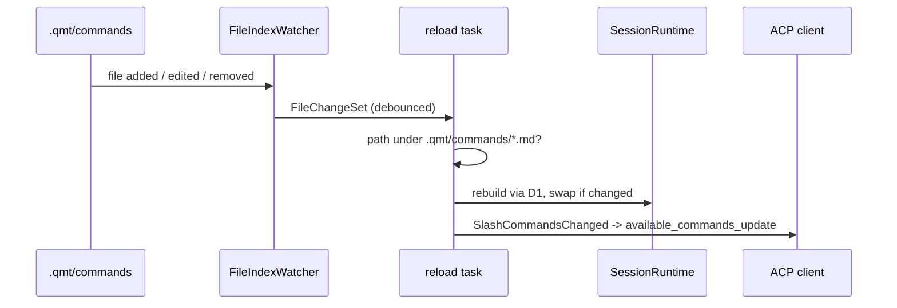

# Design

## Context

See proposal.md for the motivation. Paths are under `crates/`.

- **The startup registry.** `agent/src/api/agent.rs` builds it once, from `search_paths(cwd, include_global, include_project, paths)` with the builder's `cwd`, and stores it as `AgentConfig.slash_command_registry`. It also keeps the discovery config as `AgentConfig.slash_commands_config`, which is `Some` only when discovery is enabled.
- **A session's registry.** `agent-runtime/src/agent/core.rs` `SessionRuntime.slash_registry` is a `OnceCell`; `effective_slash_registry(startup)` returns it when set and the startup registry otherwise. The expansion (`session_actor.rs`, the steer check and the prompt path) and the live catalog (`GetSessionSlashRegistry`) both read it, so a live session's catalog and expansion cannot diverge.
- **Who sets it.** Only `session_materializer.rs` `materialize_session_actor`, and only inside the block for a session bound to a managed workspace (`workspace_service` present, the cwd inside a registered checkout). That block calls `SlashCommandRegistry::registry_for_workspace(config, &repo.checkout.root)`.
- **An idle session.** `agent/handle/core.rs` `session_user_registry` falls back to `workspace_catalog_registry`, which returns `None` unless a workspace service exists and the session is managed (or its stored cwd is inside a registered checkout). `None` means the startup registry.
- **The decision being replaced.** The comment on `SessionRuntime.slash_registry` and the test `managed_sessions_expand_and_advertise_their_own_checkout_commands` (`agent/src/runtime_tests/handle/worktree_slash_commands.rs`) state that legacy local sessions keep the agent-level registry. That was a deliberate part of the worktree feature (kept the existing behaviour for sessions it did not touch); it was never a requirement of a spec. `git-worktree-workspaces` only requires the isolated case.
- **Read once.** `SessionRuntime.slash_registry` is a `OnceCell`, and `AgentConfig.slash_command_registry` is a plain value. Nothing re-reads command files after they are set. The catalog reaches clients only in the session/new, load, resume and fork responses (`acp/shared.rs` `available_commands_session_update`).
- **Existing watchers.**
  - `agent-index/src/file_index.rs` `FileIndexWatcher` watches a root with `notify`, debounces, honours `.gitignore`, and broadcasts batches of changed paths (`subscribe_changes`).
  - A live session with a cwd already gets one for `resolve_workspace_root(cwd)` through `get_or_create_workspace_with_timeout` (`session_materializer.rs`, "initialize workspace index"). The workspace manager shares one per root.
  - `agent-knowledge/src/registry.rs` `spawn_change_hints` subscribes to it and reacts to changes; this change copies that pattern.
  - `FileIndexWatcher::with_config(root, config)` also runs standalone.
- **Ephemeral events.** `agent-protocol-types/src/events.rs` `classify_durability` marks kinds such as `SkillProblemsChanged` ephemeral: fanned out live to subscribers, never journaled. The ACP translator (`acp/shared.rs` `translate_live_event`) maps live kinds to session updates.
- **Project root rule.** `registry_for_workspace` takes a root; for managed sessions that root is `resolve_repository(cwd).checkout.root`, the root of the Git working tree containing the session's cwd. `resolve_repository` fails for a directory that is not in a Git repository.

## Goals / Non-Goals

**Goals:**
- Every local session sees the project commands of its own folder, advertised and expanded from the same registry.
- One function decides a session's registry; the materializer, the idle catalog and a reload all call it.
- A change to a file in `~/.qmt/commands` or a session's `<root>/.qmt/commands` reaches expansion and the clients' command list without a restart or reopen.
- No new watcher implementation: reuse `FileIndexWatcher`.

**Non-Goals:**
- See proposal.md.

## Decisions

### D1. One function builds a session's registry from its cwd

- `SlashCommandRegistry::registry_for_session_cwd(config, cwd) -> Self` in `slash_commands/registry.rs`:
  - project root = `resolve_repository(cwd).checkout.root`, or `cwd` itself when that fails (not a Git repository, bare repository, unreadable);
  - then `registry_for_workspace(config, &root)`.
- Rule for the root, and why:
  - **Git root, then cwd.** A session started in `crates/foo` of a repository finds the repository's `.qmt/commands`, as it does inside a managed worktree. A directory outside Git has no better root than itself.
  - **No upward search beyond the Git root.** A non-Git cwd does not climb to a parent that happens to hold `.qmt/commands`; that would make a command in `~/.qmt/commands`-like folders above the project apply by accident.
- Alternative considered: the cwd only, with no Git lookup. Rejected: a session in a subfolder would see no project commands, and managed sessions would follow a different rule from the rest.
- Alternative considered: the nearest ancestor that contains a `.qmt/commands` directory. Rejected: the result changes when someone creates the directory in a parent, and managed sessions would still follow another rule.

### D2. The materializer calls it for every local session

- In `materialize_session_actor`, after the managed-workspace block: when `slash_registry` is still `None`, `slash_commands_config` is `Some` and enabled, and `cwd` is `Some`, set `slash_registry` to the function's result. It is stored in the replaceable slot of D7, and the session's project root is kept with it for D6.
- The managed branch keeps its own call (its root comes from the same `resolve_repository`, so the result is equal); it may be folded into the shared call, but its tests must stay green either way.
- A session without a cwd, or an agent whose discovery is off or unconfigured, still has no session registry, so it keeps `effective_slash_registry`'s startup fallback.
- Rewrite the doc comment on `SessionRuntime.slash_registry`: unset only when the session has no cwd or discovery is unconfigured.

### D3. The idle catalog uses the same rule

- `workspace_catalog_registry` becomes `session_catalog_registry`:
  - `None` when `slash_commands_config` is absent or disabled (unchanged);
  - a managed session (a binding from the workspace service) uses its `effective_cwd` (unchanged);
  - otherwise the session's stored cwd, from the history store, through D1. It no longer needs a workspace service or a registered checkout.
  - `None` when the session has no stored cwd.
- A live session's catalog is unchanged: it asks the actor.
- The result is the same registry the actor builds at materialization, because both call D1 with the same cwd.

### D4. What stays the same

- `SlashCommandsConfig` and its keys.
- Which sources `search_paths` adds, their priorities (configured over project over global) and the scripts policy.
- The startup registry: it still serves a session with no cwd, and it is still logged at startup ("Discovered slash commands").
- The catalog's shape and the invocation record (`add-slash-command-records`).

### D5. Cost

- Materialization does one Git discovery (already done for the mutation gate a few lines later) and a few directory reads. The idle catalog does the same on every request that needs it, as it already does for managed sessions. No cache: the cost is small and a cache would serve stale commands.
- A reload (D7) happens only for a change batch that touches a commands folder. A prompt does no extra reads.

### D6. Watching: reuse `FileIndexWatcher`

- **Project folder.** After materialization, when the session has a slash registry from D1/D2, spawn a task that:
  - gets the workspace handle for the session's **project root** (D1, not `resolve_workspace_root(cwd)`) through `get_or_create_workspace_with_timeout`. When both roots are equal this is the handle the index initialization already uses; when the session sits in a sub-package (its own `Cargo.toml`), it is a second, shared index at the Git root;
  - subscribes to `file_watcher.subscribe_changes()` and keeps only batches with a path under `<root>/.qmt/commands/` ending in `.md` (a `RecvError::Lagged` counts as a match, as in `spawn_change_hints`);
  - on a match, reloads the session (D7);
  - ends when the channel closes or the session runtime is dropped (it holds a `Weak` to the runtime).
- **Global folder.** `api/agent.rs`, when discovery is on and `include_global` is set, starts one `FileIndexWatcher::with_config(~/.qmt/commands, …)` for the agent's lifetime, with `respect_gitignore: false` and no ignore patterns. It does not create the folder: `notify` cannot watch a missing path, so a folder created later is picked up on the next agent start. On a matching batch it reloads the agent-level registry and every live local session of that handle (D7).
- **Configured paths** are not watched (proposal, Non-goals).
- Alternative considered: a dedicated `notify` watcher per commands folder, as `profiles.rs` `start_profile_watcher` does. Rejected: it duplicates the debounce and lifecycle code `FileIndexWatcher` already has, and the project index is usually already running.
- Alternative considered: re-reading the folders on every prompt. Rejected: the client's command list would still be stale, which is what D8 fixes.

### D7. Replaceable registries

- `SessionRuntime.slash_registry` becomes `ArcSwapOption<SlashCommandRegistry>` (`arc-swap` is already a dependency of agent-runtime). `effective_slash_registry` returns an `Arc` instead of a reference. The prompt path and the steer check load it once at their start, so a turn never sees a half-updated set.
- The agent-level registry becomes `ArcSwap<SlashCommandRegistry>` on `AgentConfig`, so sessions without a cwd follow global edits.
- **Reload of a session:** rebuild through D1 (or `registry_for_workspace` for a managed checkout) from the stored project root, store the result (so an edited template body is used by the next prompt), compare the advertised command list with the one the session's clients last heard of, and announce (D8) only when it differs.
- **Reload of the agent level:** rebuild the startup registry with the startup cwd, store it, then reload every live local session.

### D8. Pushing the new catalog

- New ephemeral event `AgentEventKind::SlashCommandsChanged { commands: serde_json::Value }` in `agent-protocol-types`, classified `Durability::Ephemeral` and added to the per-variant tests. `commands` holds the catalog's `available_commands` array, exactly what `slash_command_catalog` builds (user commands with descriptors plus the built-ins), so built-ins are never lost on a reload.
- The reload of D7 builds the catalog with `slash_command_catalog(session_id)` and emits the event on the session's event sink.
- `acp/shared.rs` `translate_live_event` maps it to `SessionUpdate::AvailableCommandsUpdate` with those commands. It is a live-only update: never journaled or replayed, and a client that connects later gets the catalog from its load or resume response, as today.
- Alternative considered: an event with no payload, and the translator asking the handle. Rejected: the translator is synchronous and has no handle.

## Risks / Trade-offs

- **The behaviour change for sessions outside a managed worktree.** A command that exists only in the startup directory disappears from sessions started elsewhere; a project command that shadowed a global one now shadows it only in its own folder. → Accepted: it is the bug. CHANGELOG lists it as a behaviour change.
- **A repository's commands are offered as soon as a session opens in it.** A cloned repository can define `.qmt/commands/review.md`, which outranks the user's global `review`. → Not new: managed sessions and the startup directory already work this way. The command runs only when the user types it, scripts are off by default (`scripts.enabled`), and the app can show the expanded prompt (`slash-command-transcript`). A trust prompt is a non-goal; if wanted, it is a separate change that applies to all project commands.
- **A gitignored `.qmt/commands` is not reloaded live.** The workspace index drops ignored paths. → Accepted; such a folder is read at the next open, load or resume. Documented.
- **A second index for sub-package sessions.** A session whose cwd has its own root marker below the Git root indexes both. → Accepted; the index is shared per root and limited by `max_files`.
- **`~/.qmt/commands` created after start is not watched.** → It is read at the next agent start; documented. The folder usually exists.
- **Delay.** The watcher's debounce (200 ms) plus the rebuild. → Fine for a human editing a file.
- **Reload while a turn runs.** → The running turn keeps the registry it loaded; the next prompt uses the new one.
- **The old test asserts the replaced behaviour.** → Task 1.1 changes its first half to the new behaviour; the managed half stays.

## Migration Plan

1. Land the change. No stored data changes.
2. Rollback: revert it. Sessions outside managed worktrees return to the startup registry, and command files are read once again.
3. A client that does not know the new event kind ignores it; an ACP client gets an ordinary `available_commands_update`.
