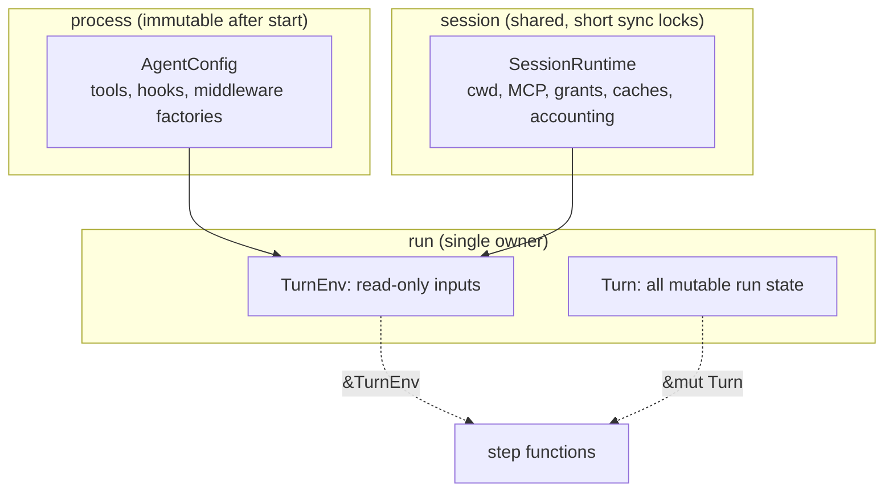
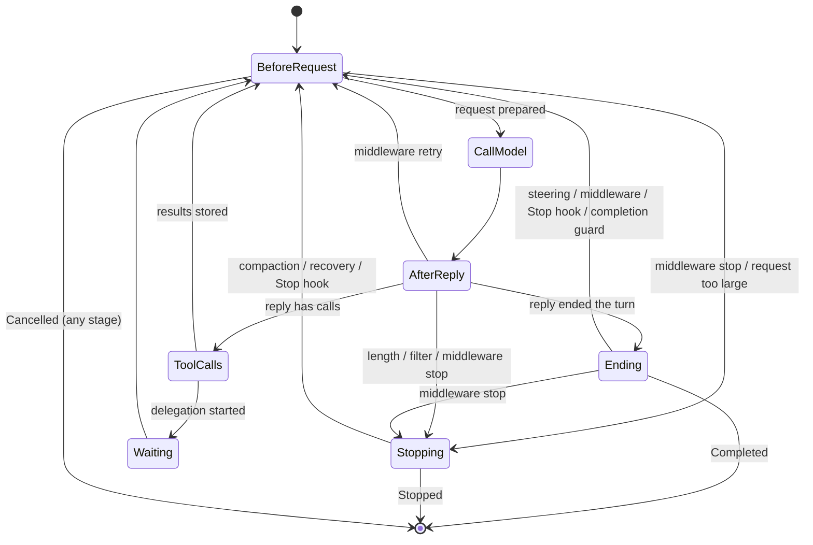

# Design

## Context

See proposal.md (Why). What shapes the approach:

- **Where one run's state lives today** (all under `crates/agent-runtime/src`):

  | Place | Lifetime | Mutated through |
  |---|---|---|
  | `middleware/state.rs` `ExecutionState`, `ConversationContext` | one step | rebuilt immutably per step |
  | `agent/execution/mod.rs` `execute_cycle_state_machine`, eight `let mut` counters | run | loop locals |
  | `agent/execution_context.rs` `ExecutionContext` | run | `&mut`, plus two `tokio::sync::Mutex`, one `std::sync::Mutex`, a `OnceCell` and a `OnceLock` |
  | `agent/core.rs` `SessionRuntime` (`turn_snapshot`, `pre_turn_snapshot_task`, `turn_diffs`) | session, holding run data | `parking_lot::Mutex` |
  | fields of `middleware/*.rs` driver structs | process, shared by all sessions (`agent/agent_config.rs` `AgentConfig::create_driver` clones the same `Arc`s) | mutexes and an `AtomicBool` |
  | `agent/session_actor.rs` `SessionActor` (`prompt_running`, `active_run`, `turn_state`) | session | `&mut self` |

- **`MiddlewareDriver::reset` has no production caller.** `middleware/driver.rs` `CompositeDriver::reset` is called only from `middleware/driver_tests.rs`. Every driver that relies on it for per-run state is wrong after its first run: `middleware/dedup_check.rs` `DedupCheckMiddleware` (`already_reviewed_this_turn`, `last_context`), `middleware/context.rs` `ContextMiddleware` (`warned_sessions`, `last_model`), `middleware/tasks.rs` `DuplicateToolCallMiddleware` (`last_check`, one entry per session, never removed).
- **Copies of the history per model request.** Each of these deep-copies every message: `agent/execution/tool_history.rs` `resolve`, `agent/execution/transitions.rs` `apply_cache_breakpoints` (its own comment: "Clones the whole history"), `transitions.rs` `transition_after_llm`, `agent/execution/tool_calls.rs` `store_all_tool_results`. That is four per tool step. `agent/execution/mod.rs` `store_pending_notices` and `apply_pending_steering` and `agent/execution/wait.rs` add one each when they run. `ConversationContext::queue_notice` and the `with_*` methods also copy the context struct. `querymt::chat::ChatMessage` owns its payload, so each copy is deep.
- **Two writers for history.** Every transition calls `ExecutionContext::add_message` and then patches a copied `Vec<ChatMessage>`. After steering before a tool batch the two orders differ on purpose (`tool_calls.rs` `store_all_tool_results`, the `result_index` insert). `execute_cycle_state_machine` then reloads the history from the store in its `Complete` arm.
- **The run holds its history in the provider's message type.** `ConversationContext::messages` is `Arc<[querymt::chat::ChatMessage]>`, the type a provider is sent, while the store holds `querymt_agent_core::model::AgentMessage`. Anything only the harness needs must then either be squeezed into a `ChatMessage` or be kept in a field beside the messages and refreshed by hand:
  - A notice's source is lost in a `ChatMessage`, so the most recent mode notice is read from the stored messages at load and carried as `ConversationContext::stored_mode_notice`. The tool baseline has no chat form, so it is carried as `ConversationContext::tool_baseline`. Both are set at three sites (`agent/execution/mod.rs` turn start and `Complete` arm, `agent/execution/maintenance.rs` `run_ai_compaction`) through `ConversationContext::with_stored_state`, and `agent/execution/tool_history.rs` `store_baseline` must edit the run's messages by hand to match what a reload would give.
  - Before `reduce-agent-harness-overhead` task 10.9 the baseline was carried inside `querymt`'s `ToolChange` (`baseline`, `origin`), and five consumers of messages each needed a guard against it. The fields are gone; the cause is not.
  - Four token estimates count different parts of the same history: `maintenance.rs` `compact_history` (inline, counts `Steering`, not `Reasoning` or `Compaction`), `session/compaction.rs` `SessionCompaction::estimate_messages_tokens` and its copy `delegation/summarizer.rs` `estimate_history_tokens` (count `Reasoning` and `Compaction`, not `Steering`), and `querymt_agent_services::session::pruning::estimate_chat_tokens` (the only one that counts tool-change definitions, which carry whole JSON schemas). The first three read stored messages, the last reads provider messages.
  - The message for a compaction request is projected by its own code (`session/compaction.rs` `build_compaction_messages_with_instructions`), with its own filter for tool records.
  - `session/provider.rs` `SessionHandle::view_of` already projects stored messages for a target and reads the baseline and the mode notice in the same pass. It is used at load, not as the one place a request is built.
- **One enum, three jobs.** `ExecutionState::Complete` and `Stopped` both lead back to `BeforeLlmCall`. `execute_cycle_state_machine` needs `unreachable!`, a `std::mem::replace(&mut state, ExecutionState::Cancelled)` placeholder, five `other => other` arms, and maps a middleware `Cancelled` back to `ProcessingToolCalls`.
- **Dead middleware.** Five public types do nothing a user can reach or need:
  - `middleware/delegation_guard.rs` `DelegationGuardMiddleware` (231 lines). Delegation does not go through it: `agent/execution/tool_calls.rs` handles the `delegate` tool result, records the delegation with `RuntimeContext::record_delegation` and emits `DelegationRequested`; `delegation/core.rs` `DelegationOrchestrator` claims it once and runs it under a semaphore; the parent waits in `agent/execution/wait.rs`. The guard is not built by `middleware/presets.rs`, `middleware/assembly.rs` or `middleware/factory.rs`, and `git log -S` finds no commit in which code outside its own file constructs it. It reads the stored history in `on_after_llm`, which runs before `transition_after_llm` stores the reply, so the last stored message is never the assistant message it looks for. It is the only producer of `StopType::DelegationBlocked` and the only reader of `Delegation::retry_count`.
  - `middleware/tasks.rs` `DuplicateToolCallMiddleware` (122 lines). Also built by no preset, assembly or factory. It calls `SessionStore::get_history` on every step although the history is in memory.
  - `middleware/limits.rs` `MaxStepsMiddleware`, `TurnLimitMiddleware`, `PriceLimitMiddleware` (255 lines). `LimitsMiddleware` in the same file enforces all three limits and is what every production site builds; the three are referenced only by `middleware/driver_tests.rs` and the re-export. Each check reads the same stat with the same comparison, message and stop type as its counterpart in `LimitsMiddleware`. `PriceLimitMiddleware` has already drifted behind it: it accepts negative and non-finite rates (`LimitsMiddleware::try_new` rejects them), has no cache rates and cannot use catalog prices.
- **Two run launch sequences.** `SessionActor::launch_prompt` and `impl Message<ScheduledPrompt> for SessionActor` both set `prompt_running`, advance `turn_state`, create an `ActiveRun` and spawn a phase forwarder. Only the first emits `AgentEventKind::RunStarted`. `prompt_running` is written in three places and never read.
- **Test volume.** `ExecutionState::` appears 386 times in the crate, 80 of them in `transitions.rs` (7,944 lines, about two thirds tests). `test_utils/drivers.rs` holds eleven test drivers that the `test-support` feature exports.
- **Compile cost.** `middleware/middleware_driver.rs` exists as its own file because moving the `dyn` trait's span costs about a minute of rebuild in the crates above.
- **Related change.** `reduce-agent-harness-overhead` (in progress) edits the same loop. Its group 1 already replaced fragments with stored notices and `ConversationContext::with_history`; this design builds on that state of the code.

## Goals / Non-Goals

**Goals:**

- Every piece of run state has exactly one owner whose lifetime is the run. Nothing run-scoped is reachable from another session or a later run.
- Run state contains no lock, atomic or cell. Exclusive access is expressed by `&mut`, shared access by `&`.
- A run can only end through a value of the outcome type, and a loop arm sees only the positions it handles.
- Appending to history copies nothing that is already there. Preparing a model request copies the messages once.
- The run's history is the stored messages. What a provider is sent is produced from them in one place, and nothing read from the history is kept in a field beside it.
- Middleware cannot return a transition its hook does not allow.
- The code follows the rust-skills rules listed in D10.
- Fewer non-test lines than before, measured as in D12.

**Non-Goals:**

- Restructuring the inside of the model-call step (`transitions.rs` `transition_call_llm`, streaming and retries) or of tool execution (`tool_calls.rs` `execute_prepared_tool_call`). Their signatures change; their logic does not.
- A generic state-monad, effect or free-monad abstraction (D2).
- Changing `querymt::chat::ChatMessage` or any provider-facing type.

## Decisions

### D1. Three lifetimes, three owners



`ExecutionContext` is split by mutability into `TurnEnv` (never changes during the run) and `Turn` (everything that does). New module `agent/execution/turn.rs`.

| Today | Becomes |
|---|---|
| `ExecutionContext` `session_id`, `turn_id`, `turn_mode`, `execution_origin`, `tool_config`, `cancellation_token`, `session_handle`, `runtime`, `knowledge_store`, `repository_knowledge`, `event_sink`, `workspace_query_bridge`, `steering`, `phase_reporter`, `cycle_accounting`, `tool_set` | `TurnEnv` fields. `cycle_accounting` and `tool_set` are built before the run starts and stored directly, so the `OnceCell` and `OnceLock` go. |
| `ExecutionContext` `state` (`RuntimeContext`), `run_objective`, `compaction_summaries` | `Turn` fields. |
| `ExecutionContext` `suspended_delegations`, `suspended_recovery` (`tokio::sync::Mutex`; used only in `agent/execution/wait.rs`) | plain `Turn` fields. |
| `ExecutionContext` `delivery_budget` (`std::sync::Mutex`; used in `agent/repository_delivery.rs` and `maintenance.rs`, both sequential) | plain `Turn` field. |
| `ExecutionContext` `budget_warnings` (`querymt_agent_services::accounting::BudgetWarnings`, a `Mutex<HashSet>`) | plain `Turn` field; `BudgetWarnings::take_new` takes `&mut self`. This is the one `querymt-agent-services` change. |
| eight counters in `execute_cycle_state_machine` | `Turn.budgets: TurnBudgets`. |
| `ConversationContext` `messages`, `stats`, `pending_notices`, `request_overrides`, `last_applied`, `profile` | `Turn` fields (`History`, `AgentStats`, `Vec<PendingNotice>`, …). `request_objective` is computed while a request is prepared and is not state. |
| `ConversationContext` `stored_mode_notice`, `tool_baseline`, and `with_stored_state` | not fields: read from `History` when asked (D3). |
| `SessionRuntime` `turn_snapshot`, `pre_turn_snapshot_task` | `Turn.snapshot: PreTurnSnapshot`, an enum `None`, `Pending(JoinHandle<…>)`, `Ready(TurnSnapshot)`. |
| `SessionRuntime` `turn_diffs` | `Turn.changed_paths: DiffPaths`. |
| per-run fields of middleware structs | fields of the per-run middleware instance (D4), owned by `Turn.middleware`. |

What stays on `SessionRuntime`: `session_grants`, `skill_grants`, `tool_validator_cache`, `last_snapshot_tree`, `cache_prefix`, `mcp_tool_state`, `accounting` and the rest. They are session-scoped caches or grants that concurrent tool calls of one batch read and write, each behind a short synchronous lock that is never held across `.await`. That is the correct use of a lock; run state was not.

`TurnEnv` is built with a struct literal at its one production site (`session_actor.rs` `execute_prompt_inner`), so a missing field is a compile error. Today `ExecutionContext::new(…)` plus eleven `with_*` methods lets a caller forget the cancellation token or the mode and get a silent default. Tests use one fixture function in `test_utils`.

*Alternative considered:* keep `ExecutionContext` and only move the counters into it. Rejected: it leaves read-only and mutable state behind one `&mut`, so parallel tool calls keep needing interior mutability for the mutable part.

### D2. The loop: a position that is moved, a state that is borrowed

```rust
pub(crate) async fn run_turn(env: &TurnEnv<'_>, turn: &mut Turn) -> Result<CycleOutcome, TurnError> {
    let mut stage = Stage::first(env, turn).await?;
    loop {
        stage = match stage.advance(env, turn).await? {
            ControlFlow::Continue(next) => next,
            ControlFlow::Break(outcome) => return Ok(outcome),
        };
    }
}
```

- `Stage` is the loop position and owns the data of that position: `BeforeRequest`, `CallModel(Box<PreparedRequest>)`, `AfterReply(Box<LlmResponse>)`, `ToolCalls { calls, results }`, `Waiting(WaitCondition)`, `Ending`, `Stopping(Stop)`. It is moved into `advance` and a new one is returned, so `Arc<LlmResponse>`, `Arc<[ToolCall]>`, `Arc<PreparedModelRequest>` and the `ref` bindings that work around a moved `state` go away.
- `PreparedRequest` holds what one request needs: the projected messages, the request's tool list, the tools the model can call (`offered_tools`, added by `reduce-agent-harness-overhead` task 10.9) and the options already reduced to what the provider honours. The provider is not per request: it is resolved once for the run and is a field of `TurnEnv` (`unify-model-call-path` "D2"). The `CallModel` arm resolves no provider and filters no options. Today `transitions.rs` `transition_call_llm` resolves the provider again in two places, each with its own retry wrapper, and filters the options a second time on its non-streaming path (`session/provider.rs` `supported_overrides`). Resolving the provider once per run and removing the second filter are tasks of `unify-model-call-path`; if that change has not landed when group 6 starts, task 6.2 does both.
- `CycleOutcome` (`Completed`, `Cancelled`, `Stopped { … }`, existing type in `agent/execution/mod.rs`) is the only way out. `Cancelled` is not a `Stage`, so there is no placeholder value and no `unreachable!`.
- `Ending` holds what the `Complete` arm does today (drain steering, turn-end middleware, Stop hook, task-completion guard, pruning). `Stopping` holds the `Stopped` arm (automatic compaction, stop recovery, token-limit Stop hook, publication). Each is one function that returns `ControlFlow`.
- Cancellation is checked at the top of each iteration except in `ToolCalls`, which must store one result per pending call first, as today.



**Why `&mut Turn` and not a turn that each step consumes and returns.** The review sketch had `step(turn) -> (turn, stage)`. In Rust that loses the turn when a step returns `Err`, and the caller still needs it: `execute_prompt_inner` takes the post-turn snapshot and classifies the error from the run's state after a failure. `&mut Turn` is the same thing as `S -> (S, A)` with the borrow checker enforcing that there is one writer, and it leaves the value with its owner on every path. The position, which nobody needs after an error, is the part that is consumed.

**Why no monad type.** The property asked for is "operations compose on one value and end in a terminal state". `Stage::advance` returning `Result<ControlFlow<CycleOutcome, Stage>, TurnError>` is that composition, using `?` for the error effect and `ControlFlow` for the terminal one. A generic `Session<T>` with `and_then` would need boxed async closures over borrowed state, would hide the stage names from tracing spans, and cannot express a tool wave, which borrows the state shared (D6). Rule `anti-over-abstraction`.

*Alternatives considered:* a state-machine crate (D8); typestate with one type per stage. Rejected: the stage is chosen at run time by the model's reply, so the types would be erased into an enum again at every loop iteration.

### D3. History is the stored messages, with one writer and one projection

```rust
pub(crate) struct History { messages: Vec<AgentMessage> }   // field private

impl History {
    pub(crate) fn as_slice(&self) -> &[AgentMessage];
    /// Stores `messages` in order, then appends them. The only way to grow a history.
    pub(crate) async fn commit(&mut self, session: &SessionHandle, messages: Vec<AgentMessage>) -> Result<(), TurnError>;
    /// Compaction and load only: the effective history as the store returns it.
    pub(crate) fn replace(&mut self, messages: Vec<AgentMessage>);

    // Read from the messages when asked; nothing is cached beside them.
    pub(crate) fn tool_baseline(&self) -> Option<ToolBaselineRef<'_>>;
    pub(crate) fn last_mode_notice(&self) -> Option<&str>;
    pub(crate) fn user_turns(&self) -> usize;
}

/// What one model request is built from. The only place a stored message becomes a provider message.
pub(crate) fn project_request(history: &[AgentMessage], target: &RequestTarget<'_>) -> Result<ProjectedRequest, PromptContentError>;

pub(crate) struct RequestTarget<'a> {
    output: Option<&'a OutputTarget>,   // provider, protocol, model, endpoint: decides native replay
    max_prompt_bytes: Option<usize>,
    tool_changes: bool,                 // the provider declares `tool_updates`
}

pub(crate) struct ProjectedRequest {
    messages: Vec<ChatMessage>,
    /// Indexes in `messages` of conversation content (not tool changes), for the cache hints.
    hintable: Vec<usize>,
    /// `Some` when a baseline is in effect and the provider takes tool changes.
    baseline_tools: Option<Vec<Tool>>,
}
```

- `Turn` owns the `History`. Readers borrow `&[AgentMessage]` (rules `own-borrow-over-clone`, `own-slice-over-vec`). `ToolBaselineRef` is the borrowed pair `{ tools: &[Tool], origin: &str }` of the stored part. No `Arc<[ChatMessage]>` remains, and the run keeps no `Vec<ChatMessage>` between requests.
- **Why the stored type.** `AgentMessage` already says what each part is: a notice with its source, a tool baseline, a tool change, a steering message, a compaction summary. A `ChatMessage` says only what a provider is sent. Holding the stored type means the baseline and the mode notice are found by looking (two scans from the end of the history, a few microseconds at the sizes in "Measurement"), not kept in fields that three sites must refresh, and that what the run holds equals what a load returns because it is the same value.
- `commit` writes to the store first and pushes only after the write succeeded (spec `run-history-consistency` / "A message that cannot be stored is not sent"). It replaces every `add_message` followed by `to_vec()` and push: `transition_after_llm`, `store_all_tool_results`, `store_pending_notices`, the steering half of `apply_pending_steering`, `tool_history.rs` `store_baseline` and `store_change`, `wait.rs` and compaction. `SessionHandle::add_message` becomes `pub(crate)` with `History::commit` as its only non-test caller in the run loop.
- `SessionStore` has no batch insert, so `commit` calls `SessionHandle::add_message` once per message, in order. A failure part way leaves the earlier messages stored and the run failed, as today.
- **Append only.** The one in-memory insert (`store_all_tool_results`, `result_index`) goes away because the stored order changes instead: when steering is drained before a tool batch, the skipped results and the steering messages are committed in one call, results first. `apply_pending_steering` is split into draining the inbox and committing what was drained, so the tool-call stage can order the two. Storing a new baseline no longer edits the run's messages: the projection leaves out the tool changes before it.
- **One projection per request, which is the one copy.** `project_request` reads the borrowed history once and builds the `Vec<ChatMessage>` the provider is sent. It is the only place that decides: a notice becomes user text; a baseline becomes the request's tool list and never a message; a tool change after the baseline in effect becomes a message when `tool_changes` is set and is left out otherwise; a tool change before that baseline is left out; provider-native output is replayed only to the target it came from; prompt content is cut at `max_prompt_bytes`. The result moves through the context hook, gets its two cache hints in place at `hintable` positions, and the tail is pushed. `tool_history.rs` keeps `diff`, `offered` and the decision when to store a record; its `is_tool_change` and `without_tool_changes` go, as do `SessionHandle::project_history`, the one-to-one zips in `session/provider.rs` `user_turns` and `agent/utils.rs` `compaction_summaries`, and `apply_cache_breakpoints`' own skip of tool-change messages. The provider API takes a contiguous `&[ChatMessage]` and the hook may rewrite messages, so one copy is the floor without changing `querymt`.
- **The assistant reply needs no second form.** Today `transition_after_llm` keeps the provider's reply as the in-run message because `AgentMessage::to_chat_message` with no target strips native state. `project_request` is given the target, so the stored reply projects to the native form for the provider that produced it. That the two are equal is exactly spec `run-history-consistency` / "Request after a reply with provider reasoning matches a reload" (task 2.1). If that test fails on the current code, the difference already costs a cache rewrite on every reload and is fixed in the projection, not worked around with a second form.
- **Compaction asks for the same projection.** The compaction request is `project_request` with `tool_changes = false` and no output target (as today: `to_chat_message_with_max_prompt_bytes`), followed by the compaction prompt. `build_compaction_messages_with_instructions` keeps only the prompt.
- **One token estimate.** A history's size is `estimate_chat_tokens` of its projection plus, when a baseline is in effect, its tool list. The compaction-start figure, the before and after figures of a compaction and the delegation summarizer use it; the three estimates over stored parts are deleted. **Behaviour change** (numbers only): `compaction_start`, `compaction_end` and the post-compaction `context_tokens` are computed by the estimate the request budget already uses, so they change for histories with steering, reasoning or tool changes.
- **The reload at completion** (`Complete` arm, `SessionHandle::history_view`) is removed only if the consistency tests of spec `run-history-consistency` pass for every scenario. If one fails for a reason other than the steering order, the reload stays and the divergence is recorded in tasks.md.

*Alternatives considered:*
- **Keep `Vec<ChatMessage>` as the run's history** (this design before its amendment), with a `Stored` pair for messages whose chat form differs from the stored one. Rejected: it keeps two representations of one history in the run, which is why a baseline needed a field, a mode notice needed a field, the assistant reply needed a special case and four estimates disagree.
- **Keep both forms per message** (`AgentMessage` plus its projected `ChatMessage`, filled once at load or commit). The request copy is then a clone of the second, as cheap as today's. Not the starting point because it doubles the history in memory and adds an invalidation rule; it is the fallback if the benchmark shows projection cost (see "Measurement").
- A persistent vector (`imbl::Vector`): O(1) clone, but the provider needs a contiguous slice, so every request would copy anyway, and with one owner nothing needs a cheap clone.
- `Vec<Arc<ChatMessage>>`: makes the request copy a pointer copy, but changes the provider-facing slice type in `querymt` and every provider.
- Wrapping `ChatMessage`'s private payload in an `Arc` inside `querymt`: removes the last copy without an API change. Left as a follow-up decided by the benchmark (Open Questions), because it touches the crate every provider and the Extism boundary depend on.

**Measurement.** A criterion bench `turn_step` in `crates/agent/benches` (criterion is already a dev-dependency there) drives tool steps over a seeded history of 400 and 1,600 messages with the mock provider, before and after. `reduce-agent-harness-overhead` task 1.16 measured one hashing pass over 400 messages at 0.39 ms in release, so the expected gain is allocation churn in the low milliseconds per step, not model latency. The bench records the real number (rules `perf-profile-first`, `anti-premature-optimize`); the ownership change is made for correctness of the single-writer rule either way.

Projecting is more work per message than cloning: `AgentMessage::to_chat_message_with_output_target` renders prompt blocks and validates attachment content each time. The bench therefore includes a history with image attachments (task 2.3). If projecting 1,600 messages costs more than the four to seven clones it replaces, the per-message projection is kept next to the stored message (second alternative above); the decision and the numbers are recorded in task 5.5.

### D4. Middleware: agent-scoped factory, run-scoped instance, typed verdicts

```rust
/// Agent-scoped. Holds configuration and shared services only.
pub trait Middleware: Send + Sync {
    fn name(&self) -> &'static str;
    fn begin_turn(&self, turn: &TurnInfo<'_>) -> Box<dyn TurnMiddleware>;
    fn bind_agent(&self, registry: &Arc<ToolRegistry>, events: &Arc<EventSink>) {}
    fn limits(&self) -> Option<SessionLimits> { None }
    fn budget_pricing(&self) -> Option<ModelPricing> { None }
}

/// One per run. All run state of a middleware lives in `self`.
#[async_trait]
pub trait TurnMiddleware: Send {
    async fn on_turn_start(&mut self, cx: &mut HookCx<'_>) -> Result<StepVerdict> { Ok(StepVerdict::Proceed) }
    async fn on_step_start(&mut self, cx: &mut HookCx<'_>) -> Result<StepVerdict> { Ok(StepVerdict::Proceed) }
    async fn on_after_llm(&mut self, cx: &mut HookCx<'_>, reply: &LlmResponse) -> Result<ReplyVerdict> { Ok(ReplyVerdict::Proceed) }
    async fn on_prepared_tool_calls(&mut self, cx: &mut HookCx<'_>, batch: &PreparedBatch<'_>) -> Result<Vec<PreparedCallVerdict>> { /* all Proceed */ }
    async fn on_turn_end(&mut self, cx: &mut HookCx<'_>) -> Result<EndVerdict> { Ok(EndVerdict::Finish) }
    async fn on_stopped(&mut self, cx: &mut HookCx<'_>, stop: &Stop) -> Result<StopVerdict> { Ok(StopVerdict::Pass) }
}
```

| Hook | Verdict | Loop effect |
|---|---|---|
| `on_turn_start`, `on_step_start` | `StepVerdict`: `Proceed`, `Stop(Stop)` | `Stop` moves to `Stopping` |
| `on_after_llm` | `ReplyVerdict`: `Proceed`, `Stop(Stop)`, `Retry` | `Retry` discards the reply, folds its usage into the stats and returns to `BeforeRequest` |
| `on_turn_end` | `EndVerdict`: `Finish`, `Continue`, `Stop(Stop)` | `Continue` returns to `BeforeRequest` |
| `on_stopped` | `StopVerdict`: `Pass`, `Recover` | `Recover` returns to `BeforeRequest` |

- `HookCx` borrows the run. Reads: `session_id`, `history() -> &[AgentMessage]` (the stored messages, D3; in group 4, before `History` exists, it returns the `&[ChatMessage]` the run holds then), `stats`, `provider`, `model`, `profile`, `mode`, `last_applied`, `request_overrides`, `last_mode_notice`, `changed_paths`, `cwd`, `runtime`. Writes, which every hook may use: `queue_notice(source, content)` and `set_request_overrides(options)`. Both write to `Turn` through the exclusive borrow, so their order is the middleware order.
- A verdict names only what the hook may decide (rules `type-enum-states`, `api-typestate`), so "any state from any hook" and the pass-through arms in every driver disappear. Verdict enums and `Stop` are `#[must_use]` and `#[non_exhaustive]`.
- `CompositeDriver` keeps its name and holds `Vec<Arc<dyn Middleware>>`. `begin_turn` returns the run's `Vec<Box<dyn TurnMiddleware>>`. One private `run` function folds a hook over the instances and stops at the first verdict that is not `Proceed`/`Finish`/`Pass`, racing each call against the cancellation token as `run_phase` does today. The twelve `run_*` and `run_*_cancellable` wrappers (`driver.rs`, 185 lines) become six thin methods.
- `on_processing_tool_calls` is removed: only test drivers implement it. `reset` is removed: a new run gets new instances. `MiddlewareFactory::create` returns `Arc<dyn Middleware>`.
- `on_turn_start` is kept although no built-in will implement it after the port (today's three implementations are a no-op in `AgentModeMiddleware` and two cleanups of per-session maps that no longer exist). `begin_turn` does not replace it: it is synchronous and infallible, so it cannot await, stop the run or queue a notice. The first `on_step_start` does not replace it either: it runs after the loop has reconciled suspended delegations, applied pending steering and refreshed costs (`agent/execution/mod.rs` `execute_cycle_state_machine`, `BeforeLlmCall` arm), and a middleware would need its own flag to act once per run. The hook costs one defaulted method and one `CompositeDriver` method, and reuses `StepVerdict`.
- The traits stay `dyn`: the list is heterogeneous and users add their own. Native `async fn` in traits is not dyn-compatible, so `async_trait` stays for `TurnMiddleware` (a deliberate exception to rule `async-fn-in-trait`). The trait definitions stay in `middleware/middleware_driver.rs`, changed once.
- **Dropped hooks.** A hook future is dropped when the run is cancelled. A hook must leave `self` usable at every `.await`, which is trivially true when the run ends (rule `async-cancel-safety`); the trait docs say so.
- **State across runs.** A middleware that needs it reads the stored history through `HookCx` (as the mode reminder already does through `stored_mode_notice`) or its own configuration. None of the built-ins needs more.

Deleted, not ported (see Context "Dead middleware"): `DelegationGuardMiddleware`, `DuplicateToolCallMiddleware`, `MaxStepsMiddleware`, `TurnLimitMiddleware`, `PriceLimitMiddleware`, with their tests (`middleware/delegation_guard.rs` and `middleware/tasks.rs` whole, `middleware/specialized.rs`, the two `test_delegation_guard_*` tests in `agent/delegation_loop_tests.rs`). The eight tests in `middleware/driver_tests.rs` that build the three limit types are kept and pointed at `LimitsMiddleware`: the tests inside `limits.rs` cover only the step limit, so the four price-cap tests and the turn-limit test are the only coverage of those checks. `StopType::DelegationBlocked`, `NoticeSource::DuplicateToolCall` and `Delegation::retry_count` stay: they are serialized or stored.

Porting the rest:

| Type | Run state today | After |
|---|---|---|
| `LimitsMiddleware` | `last_model` (debug log only) | stateless; the log line goes |
| `ContextMiddleware` | `warned_sessions`, `last_model` | `warned: bool` on the instance |
| `AgentModeMiddleware` | none | unchanged logic |
| `OutputLimitRecoveryMiddleware` | `turns: Mutex<HashMap<session, TurnState>>` | its `TurnState` becomes the instance; `on_turn_start` cleanup goes |
| `ParallelEditGuard` | `pending: Mutex<HashMap<session, note>>` | queues the notice directly in `on_prepared_tool_calls`; stateless |
| `DedupCheckMiddleware` | `already_reviewed_this_turn`, `last_context`, unused `pending_results` | `reviewed: bool` on the instance; reads `cx.changed_paths()` and `cx.history()` |

*Alternatives considered:*
- Keep shared drivers and key every map by session (as `OutputLimitRecoveryMiddleware` does). Rejected: it needs a cleanup hook that every author must remember, which is how `reset` went wrong.
- One `Verdict` enum for all hooks. Rejected: it would again allow `Retry` from `on_turn_end`.
- Return notices and overrides inside the verdict. Rejected: "queue a notice and proceed" is the common case and would need a payload on every variant of five enums.
- `tower::Service` layers. Rejected: six hooks with different inputs are not one request/response call.

### D5. Typed run errors

`TurnError` (`thiserror`, crate-internal) replaces `anyhow::anyhow!("Middleware error: {}", e)` and similar string wrapping, which drops the source chain (rules `err-thiserror-lib`, `err-source-chain`, `err-lowercase-msg`):

- `Provider(#[source] LLMError)`, `Middleware { name: &'static str, #[source] source: MiddlewareError }`, `Store { what: &'static str, #[source] source: SessionError }`, `History(#[source] SessionError)`, `Hook(#[source] …)`, `Other(#[from] anyhow::Error)`.
- `session_actor.rs` `provider_failure_from_execution_error` becomes a match on `TurnError::Provider`. Leaf helpers that still return `anyhow::Error` go through `Other`; its conversion keeps today's search of the chain for an `LLMError`, so the `AgentError::ProviderFailure` a caller receives does not change. The existing tests of that function guard this.

### D6. Tool waves borrow the run shared

`transitions.rs` `transition_processing_tool_calls` already runs a wave of calls concurrently over `&ExecutionContext`. After the split a wave gets `&TurnEnv` and `&Turn`. `tool_calls.rs` `execute_prepared_tool_call` reads only `state.store` and `state.active_task` from the run-owned part, so no lock is needed. What a tool produces for the run comes back in its `ToolResult` (`snapshot_part`, `hook_contexts`) and is folded into `Turn` after `join_all` returns: changed paths are merged into `Turn.changed_paths` where `store_all_tool_results` merges into `SessionRuntime::turn_diffs` today. Session-scoped caches written during a wave stay on `SessionRuntime` (D1).

### D7. Session actor: one run slot, one way to start a run

- `enum RunSlot { Idle, Running(ActiveRun) }` replaces `prompt_running`, `active_run: Option<ActiveRun>` and `TurnState`. The generation counter stays on the actor; the cancellation token is `ActiveRun::cancellation`. `SessionActor::on_stop` and `impl Message<Cancel>` cancel the running slot's token.
- `SessionActor::start_run(origin, request, completion)` is the only place that fills the slot. It emits `RunStarted` with the origin's label, then `QueuedInputStarted` for a queued input, spawns the one phase forwarder and the execution task. `launch_prompt` and the `ScheduledPrompt` handler call it. How the result is delivered stays origin-specific (`completion`): an interactive run holds the reply until its last event is delivered; a scheduled run emits `ScheduledExecutionCompleted` or `ScheduledExecutionFailed`.
- The run's origin is `ExecutionOrigin` (`Interactive`, `Scheduled { … }`); its wire label comes from one place (`label()`). `add-background-commands` (split out of `reduce-agent-harness-overhead`, not yet proposed) adds its `background_command` origin here.
- Phase reporting: `tokio::sync::watch<RunSignal>` (`phase` plus a revision counter that `report_runtime_change` bumps) replaces the unbounded `mpsc` channel (rules `async-watch-latest`, `async-bounded-channel`). The actor publishes the phase it reads when it handles `RunPhaseChanged`, so intermediate values already coalesce when messages queue; `watch` makes that explicit.

### D8. Dependencies

Most of the line count comes out by deleting duplication (D4 wrappers, D1 `with_*` methods, D7 launch copy, pass-through arms), not from a crate. Considered:

| Crate | Decision | Reason |
|---|---|---|
| `strum` 0.28 (`derive`) | **Add**, workspace dependency, used by `querymt-agent-runtime` only | Already compiled for the agent (`agent-client-protocol-schema` depends on it). `IntoStaticStr`/`Display` replace the hand-written `name()` matches on the stage and hook enums and turn four stringly-typed parameters into enums: steering boundary (`"before_model_request"` …), context-hook trigger, run origin, Stop-hook reason. About 40 lines, and rule `type-no-stringly`. |
| `thiserror`, `tokio` (`watch`), `tokio-util`, `futures-util`, `async-trait` | already direct dependencies | used as described in D4, D5, D7 |
| `criterion` 0.8 | already a dev-dependency of `querymt-agent` | the bench lives there |
| `bon` (in `Cargo.lock` through `hf-hub` only) | Reject | `TurnEnv` is built at one site; a struct literal already makes every field required. A builder macro would add compile time to the agent crates for nothing. |
| `imbl`, `im`, `rpds` | Reject | D3 |
| `statig`, `rust-fsm` | Reject | transitions are async, borrow the environment and carry owned data; a `match` on an enum is the same length without a macro DSL (rule `macro-prefer-functions`) |
| `tower` | Reject | D4 |
| `enum_dispatch` | Reject | middleware is user-extensible, so it must be `dyn` |
| `trait-variant` | Reject | does not make async traits dyn-compatible |
| `derive_more` | Reject | `strum` and `thiserror` cover the derives needed; `is_variant` would be a new feature of a shared crate |
| `smallvec` for queued notices | Reject | at most a few notices per step; no measurement asks for it |
| `tokio_util::task::AbortOnDropHandle` for the pre-turn snapshot task | Reject for now | aborting `SnapshotBackend::track` part way is not known to be safe |
| `insta` for request-shape tests | Not in this change | could shorten the request assertions in `transitions.rs`, but adds snapshot files and a dev-dependency; propose separately |

After adding `strum`, `cargo hakari generate` updates `crates/workspace-hack`. No dependency of a provider crate changes, so the `wasm32-wasip1` provider builds are unaffected; one provider build is checked in the final group anyway. `querymt-agent-py` and `querymt-mobile-ffi` get a build check because the facade's middleware exports change.

### D9. Module layout

`agent/execution/transitions.rs` is not reorganised as a whole. New code goes into `agent/execution/turn.rs` (`TurnEnv`, `Turn`, `TurnBudgets`, `History`), `agent/execution/stage.rs` (`Stage`, `advance`) and `agent/execution/error.rs`. Step functions keep their files and get new signatures. Items are `pub(crate)` or `pub(super)`; `History`'s vector and `Turn`'s budget counters are private to their module (rules `proj-pub-crate-internal`, `proj-pub-super-parent`).

### D10. rust-skills rules applied

| Rule | Where |
|---|---|
| `own-borrow-over-clone`, `anti-clone-excessive`, `own-slice-over-vec` | D3: history borrowed as `&[ChatMessage]`; D4: `HookCx` instead of owned state |
| `own-arc-shared` | `Arc` only for values shared across tasks (`SteeringInbox`, `SessionRuntime`); not for step data |
| `own-mutex-interior`, `async-no-lock-await`, `anti-lock-across-await` | D1: no lock in `Turn`; `DedupCheckMiddleware::last_context.lock().await` goes |
| `conc-atomic-ordering` | the `SeqCst` `AtomicBool` in `DedupCheckMiddleware` becomes a `bool` |
| `mem-take-replace`, `mem-box-large-variant`, `mem-assert-type-size` | D2: `Stage` moved by value, large variants boxed, a `const` assertion bounds `size_of::<Stage>()` |
| `mem-with-capacity`, `perf-extend-batch` | D3: `commit` reserves and extends; the request vector is allocated once with its final capacity |
| `type-enum-states`, `api-typestate`, `pat-exhaustive-enum` | D2, D4: no `other => other`, no `_ =>` over `Stage` or verdicts |
| `type-no-stringly`, `anti-stringly-typed` | D8: boundary, trigger, origin and Stop-hook reason enums |
| `err-thiserror-lib`, `err-source-chain`, `err-context-chain`, `err-lowercase-msg`, `err-expect-bugs-only` | D5; `expect` only on invariants such as "prepared call executes once" |
| `api-must-use`, `api-non-exhaustive`, `api-common-traits` | D4 verdicts and `Stop` |
| `trait-dyn-vs-generic`, `trait-object-safety`, `trait-default-methods` | D4 |
| `async-cancellation-token`, `async-cancel-safety`, `async-join-parallel`, `async-watch-latest`, `async-bounded-channel` | D2, D4, D6, D7 |
| `num-overflow-explicit`, `num-cast-try-from` | `TurnBudgets` uses `saturating_add`; touched `as` casts on durations and counts become `try_from` with a saturating fallback |
| `obs-tracing-over-log`, `obs-structured-fields`, `obs-instrument-spans` | new and ported code logs through `tracing` with fields; spans keep their current names |
| `name-no-get-prefix` | `Middleware::limits` replaces `get_limits` |
| `doc-all-public`, `doc-errors-section` | the public middleware API |
| `test-descriptive-names`, `test-arrange-act-assert`, `test-criterion-bench` | scenario-named tests; the `turn_step` bench |
| `perf-profile-first`, `anti-premature-optimize`, `anti-over-abstraction`, `macro-prefer-functions` | D2, D3, D8 |

Deliberate exceptions: `async-fn-in-trait` (D4) and `api-builder-pattern` (D1: a struct literal is stricter for a crate-internal type with one construction site).

### D11. Test migration

- Defect tests are written first against today's code and must fail (tasks group 1). They are the regression suite for the restructuring.
- Before a type is removed, a fixture replaces its hand construction: `TurnEnv`/`Turn` fixtures in `test_utils`, and a `stage` helper for tests that start the loop at a given position. Tests are ported file by file; a test is deleted only when the behaviour it covered no longer exists (`reset`, `on_processing_tool_calls`, a middleware returning `Complete`), and tasks.md lists each such deletion.
- The eleven drivers in `test_utils/drivers.rs` (551 lines, each used by one or two test files) are replaced by one `ScriptedMiddleware`: per hook, a queue of verdicts to return and a log of the calls it received. Typed verdicts make that enough: "stop", "always stop", "complete", "count", "record", "inject a notice" and "fail" are each one constructor call. It is exported through `test-support` like the drivers it replaces.

### D12. Line budget

The count is non-test lines: every line of the files below except inline `#[cfg(test)] mod … { … }` blocks, with `*_tests.rs` files left out. The script is at the top of tasks.md. Scope: `crates/agent-runtime/src/middleware/*.rs`, `agent/execution/*.rs`, `agent/execution_context.rs`, `agent/session_actor.rs`. Baseline when this was written: 16,968, plus 551 lines in `test_utils/drivers.rs`.

Where lines come out, measured unless marked as an estimate:

| Source | Lines |
|---|---|
| five deleted middleware types | 608 |
| `CompositeDriver` `run_*` wrappers folded into one function | about 125 (estimate) |
| `ExecutionContext` `with_*` methods | 78 |
| second run launch sequence, `prompt_running`, second phase forwarder | about 40 (estimate) |
| pass-through arms, `reset` bodies, entry and exit `trace!` lines in each middleware | not counted in advance |
| `ConversationContext` copy-on-write methods (`with_*`, `queue_notice`, `inject_message`) in `middleware/state.rs` | not counted in advance |
| test drivers (551 lines, counted separately) | about 450 (estimate) |

Where lines go in: `turn.rs`, `stage.rs`, `error.rs`, the verdict enums and `HookCx`. Most of `turn.rs` and `stage.rs` is code moved from `execution_context.rs`, `agent/execution/mod.rs` and `middleware/state.rs`.

Rule: the count is recorded before the work and after every group from 3 on. A group may raise it (group 3 adds `Turn` before group 5 removes `ConversationContext`), but the change is not complete while it is at or above the baseline. If it is, the response is to find what was added, not to shorten code by packing lines. No number below the baseline is promised: the 608 measured lines are the only part known in advance.

Test lines are recorded with `wc -l` and not bounded. The change adds one test per spec scenario and removes hand-built states through fixtures; which effect is larger is not known until it is done.

## Risks / Trade-offs

- **[Large mechanical change in a crate with 2,500 tests]** → Groups are ordered so that each one compiles and passes on its own: defects, state split, middleware contract, history, stage split, actor. The public break is confined to the middleware group.
- **[Collision with `reduce-agent-harness-overhead`]** → Group 1 is independent. Later groups start after its group 3. Its background commands moved to a separate change, `add-background-commands`, which is to be implemented on `start_run` (D7). Its task 7.2 removes a line this change would otherwise move.
- **[Middleware users break]** → No shim (AGENTS.md). The CHANGELOG entry and `docs/docs/agent/middleware.md` carry a before/after example.
- **[Activating behaviour that never ran]** → The duplicate-code review and the scheduled `run_started` start doing what they were written to do. Each is a named CHANGELOG item; the review is opt-in (`type = "dedup_check"`) and can be turned off with `enabled = false`.
- **[A Rust API user relies on a deleted type]** → `DuplicateToolCallMiddleware` is the one of the five that works when added by hand. Its removal and the other four are a named BREAKING CHANGELOG item that points to `LimitsMiddleware` for the three limit types and says the other two have no replacement.
- **[Nothing bounds repeated delegation of a failing task]** → That is already the case, because the guard does not fire; step, turn and price limits bound the run. A check in the `delegate` tool is named as a non-goal in the proposal.
- **[Stored order of skipped results changes]** → Sessions stored with the old order must still load; a test loads a history in the old order and prepares a request.
- **[A hidden reader of run fields on `SessionRuntime`]** → The three fields are removed, not deprecated, so a reader fails to compile. They are public fields; the removal is listed as breaking.
- **[Phase updates coalesce with `watch`]** → A test that expects every phase in sequence would fail. Task 6.6 checks for such tests before switching.
- **[Rebuild cost while iterating on the `dyn` trait]** → The trait file is changed in one task; ports of the built-ins follow.
- **[The benchmark shows no gain]** → Recorded as such. D1 to D4 stand on correctness; only the follow-up in Open Questions depends on the number.

## Migration Plan

1. Group 1: defect fixes on the current structure, each with a failing test first. Releasable alone.
2. Group 2: baseline consistency tests and the benchmark.
3. Group 3: `TurnEnv`/`Turn`, budgets, run fields off `SessionRuntime`. No behaviour change.
4. Group 4: middleware contract. **BREAKING** release note.
5. Group 5: `History` of stored messages, single commit, one request projection, one token estimate, stored order. It changes the type `HookCx::history` returns, so groups 4 and 5 ship in the same release and the hook API breaks once.
6. Group 6: `Stage`, `TurnError`, enums; then the actor.

Rollback is by reverting a group. Nothing is persisted in a new format: the only stored difference is message order after steering before a tool batch, and the new order (results directly after their calls) is the one every build already stores in the common case.

## Open Questions

- Should `ChatMessage`'s payload be shared (`Arc`) inside `querymt` to remove the last per-request copy? Decide from the `turn_step` numbers; a separate change either way.
