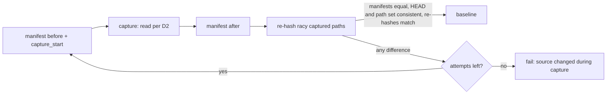

# Design

## Context

See proposal.md (Why) for the trace and the numbers. The code paths involved:

- **Delegation startup.** `crates/agent-runtime/src/delegation/core.rs`:
  - The orchestrator's event loop runs `handle_envelope` under a root span `delegation.orchestrator.handle_event`.
  - `handle_envelope` claims the delegation and spawns a task with `in_current_span`, so the task's spans nest under that handler span. The task first waits for `start_rx`, then for the `max_parallel` semaphore, then calls `execute_delegation_unboxed` (the `delegation.execute` span, an `#[instrument]` on that function).
  - `execute_delegation_inner_unboxed` resolves the parent's LLM config, session and cwd. It then calls `WorkspaceService::allocate_for_delegation_checked` and the `delegation_start` hook. The first span on this path is `delegation.create_session`.
- **Allocation.** `crates/agent-services/src/worktree/service.rs` `allocate_for_delegation_checked`:
  1. takes the batch lock (`worktree/lock.rs` `with_lock_file`, polling `try_lock` every 25 ms);
  2. calls `capture_batch_baseline` under the parent's `CheckoutMutationGate` (`worktree/gate.rs`, also a `with_lock_file` lock);
  3. calls `WorktreeAllocator::allocate_with` (`worktree/allocate.rs`). That mints the `WorkspaceId`, persists the intent, and runs `provision` under `with_admin_lock`.
- **Capture.** `worktree/capture.rs` `capture_working_state_validated` runs `source_manifest` before and after `capture_working_state`, and `source_manifest` is itself a full `capture_working_state` plus `index_manifest`.
  - `GixRepoOps::capture_working_state` (`worktree/repo_ops.rs`) seeds a private index from HEAD (no stat data).
  - `classify_and_reconcile` then runs a gix status pass for untracked and ignored files but ignores its `Modification` items. It calls `write_blob_from_disk` for every tracked path. That writes raw bytes (no clean filters, mode from disk metadata) through `Repository::write_blob_stream`, which compresses into a temporary loose object before learning the object exists.
- **Snapshots.** `crates/agent-services/src/snapshot/git/capture.rs` `GitSnapshotBackend::create_snapshot`:
  - Reuses its own stat cache.
  - Writes small files with `write_blob`, which hashes first and skips existing objects. Files of 16 MiB or more go through `write_stream_blob`, which writes straight into the store's own loose `objects/` directory. Trees are written with `write_object`, the commit with `repo.commit`.
  - Restore streams large blobs only when they are stored loose (`snapshot/git/restore.rs`). Anything else is loaded into memory.
  - Snapshot GC (`snapshot/git/gc.rs`) walks every kept snapshot tree with `find_tree` and deletes unreachable loose objects in the store's own `objects/`.
  - The store is a bare repository per worktree path (`snapshot/git/mod.rs` `open_or_init`).
  - The pre-turn snapshot is started in `crates/agent-runtime/src/agent/session_actor.rs` (the `config.snapshot_backend` block before the turn).
- **Baseline refs.** `refs/qmt/baselines/<workspace-id>` is created during provisioning (`allocate.rs`, `baseline_ref_for`). `worktree/lifecycle.rs` `remove` retains it even when the workspace is removed. Baseline content therefore stays reachable in the source repository indefinitely. The `WorkspaceRecord.baseline` (`Option<Baseline>`, field `baseline_commit`) names it.
- **Linked worktrees share objects.** A managed workspace is a linked worktree of the source repository. Anything a delegate stages, commits or stashes in it is written to the source's common object directory, where nothing pins it once the workspace branch is gone.

## Goals / Non-Goals

**Goals:**
- Every millisecond between claim and first prompt is attributed to a named span (spec: "No unattributed startup time").
- On a repository the size of querymt with a clean or lightly dirty checkout, allocation (capture plus provisioning, excluding checkout I/O) drops from about 3.4 s to under 1 s. The first snapshot of a fresh delegate workspace writes no baseline blob below the large-file threshold.
- No change to what a baseline contains (raw working bytes and on-disk modes), to the capture's consistency checks, or to undo semantics.

**Non-Goals:**
- Making `add_worktree` checkout faster.
- Changing the snapshot racy window or stat-cache format.
- Deduplicating snapshot files of 16 MiB or more against the source.
- Instrumenting non-delegation worktree commands beyond what they inherit from the shared spans in `worktree/`.

## Decisions

### D1. Instrument first, then optimise, measuring with the same spans

Add `tracing` spans in two crates. Use `info_span!` and `Instrument` like the existing `delegation.*` and `snapshot.git.track` spans. Record fields with `Span::record` when they become known.

| Span | Parent | Where | Fields |
|---|---|---|---|
| `delegation.claim` | `delegation.orchestrator.handle_event` | `handle_envelope`, profile binding lookup and `claim_delegation` | `attempts` |
| `delegation.queue_wait` | `delegation.orchestrator.handle_event` | spawned task, from before `start_rx.await` until `max_parallel.acquire_owned()` returns | — |
| `delegation.admission` | `delegation.execute` | `execute_delegation_unboxed`, `admission` block | `authority` |
| `delegation.resolve_parent` | `delegation.execute` | LLM config, `get_session`, `resolve_session_cwd`, `get_workspace_by_session` | `bound` |
| `delegation.allocate_workspace` | `delegation.execute` | around `allocate_for_delegation_checked` / `begin_delegation_handoff` | `workspace_id`, `handoff` |
| `delegation.start_hook` | `delegation.execute` | `run_delegation_start` | `contexts` |
| `worktree.lock.wait` | caller | `lock.rs` `with_lock_file`, acquisition only | `lock` (batch/admin/gate), `checkout` (gate only, canonical checkout root), `polls` |
| `worktree.capture` | caller | `capture_working_state_validated` | `attempts`, `files_read`, `bytes_read`, `objects_written`, `reused_index_entries`, `racy_rehashed` |
| `worktree.capture.manifest` | `worktree.capture` | each before/after manifest | `paths` |
| `worktree.provision` | caller | `WorktreeAllocator::provision` | `workspace_id` |
| `worktree.checkout` | `worktree.provision` | `add_worktree` | `files` |

`delegation.queue_wait` and `delegation.execute` are siblings under the handler span: the semaphore is acquired before `execute_delegation_unboxed` is entered, so the wait cannot be a child of `delegation.execute`. Starting `queue_wait` before `start_rx.await` covers the hand-off from `handle_envelope` to the task as well. The lock-wait span's duration is the wait time, so it carries no separate `wait_ms` field.

`delegation.create_session`, `delegation.summarize` and `delegation.inject_planning_context` already exist. `delegation.summarize` also gets its unset `summary_bytes`/`strategy` fields recorded and an `outcome` field (`injected`, `rejected`, `timeout`, `skipped`), since that is how the discarded summaries went unnoticed.

The capture counters come from a new `CaptureStats` value, not from new fields on `CapturedWorkingState` (see D2, "Stats without an API break").

Spans do not propagate into blocking threads. A span opened around `spawn_blocking` work (for example `worktree.checkout`, or the capture counters) must be passed into the closure explicitly: clone the `Span` and record on it, or enter it inside the closure.

The gap test (spec scenario "No unattributed startup time") runs with an in-memory span exporter. `delegation_loop_tests.rs` already collects spans this way. It measures the interval from the end of `delegation.claim` to the start of `remote.session_ref.prompt` and sums the time not covered by any descendant of the handler span other than `delegation.execute`. `delegation.execute` spans the whole execution, so counting it would hide uninstrumented work inside it. It runs in a serial nextest test group (configured in `.config/nextest.toml`), so scheduler noise from parallel tests does not eat the 50 ms budget.

*Alternative:* log lines with timings. Rejected: the reporting gap was invisible precisely because only logs existed, and otelite and other OTLP tools work with spans.

### D2. Capture compares stat data with the real index itself

`classify_and_reconcile` stops using the gix status pass for tracked files. gix status skips index entries flagged `SKIP_WORKTREE`, `ASSUME_VALID` or `FSMONITOR_VALID` (gix-status `index_as_worktree/function.rs`), compares content through the clean-filter pipeline, and hashes same-size dirty files that the capture would then read again. None of that fits a capture that must store raw working bytes and read each file once (apart from the large-file write below).

Instead:

- Untracked and ignored files come from `Repository::dirwalk` with the options the status pass uses today (untracked `Files`, ignored emitted as `Matching`, so ignored directories are not descended). The dirwalk must emit untracked files as `Files` regardless of `status.showUntrackedFiles`. Today `open_repo_for_status` plus the status platform's `.untracked_files(Files)` guarantee this. Set the emission explicitly on the dirwalk options rather than relying on config-derived defaults.
- The real index is opened once. Its `timestamp()` and the repository's `stat_options()` drive the reuse rule.
- For each stage-0 path in the union of HEAD and real-index paths, in order:
  1. **absent from disk:** a deletion, excluded as today;
  2. **the real-index entry has `SKIP_WORKTREE`, `ASSUME_VALID`, `FSMONITOR_VALID` or `INTENT_TO_ADD`:** read. Git's `ie_match_stat` treats intent-to-add entries as always changed. Git records no stat data for them, so reuse would be rare, but reading them matches Git and costs nothing;
  3. **the path's effective attributes or config imply a content conversion** (`text`, `eol`, `ident`, `working-tree-encoding`, or `core.autocrlf`/`core.eol` applying through `text=auto` or unset `text`): read. Resolve this with the attribute stack, as `find_external_filter` does;
  4. **present in the real index, the entry's kind (regular file vs symbolic link, from the index mode) equals the kind on disk from `symlink_metadata`, `entry.stat.matches(Stat::from_fs(md), opts)` and not `entry.stat.is_racy(index.timestamp(), opts)`, **and the size of the entry's blob equals the file's size on disk:** reuse the entry's object id without opening the file. The object exists, since the index refers to it. gix status checks the mode before stat data for the same reason. The blob size comes from the object header only (`Repository::find_header`), never from reading content, so it is not a file read in the capture counters. A failed header lookup, or an object that is not a blob, means the file is read. The size condition exists because a blob staged under earlier conversion settings (for example `core.autocrlf=true`, LF in the index, CRLF on disk) keeps matching stat data after the setting is turned off, and rule 3 then sees no conversion; reuse would put LF bytes in a baseline that must equal a full raw read;
  5. **otherwise** (stat differs, racily clean, or not in the real index): read.
- The entry mode always comes from `symlink_metadata` of the file, as today, never from the real index. That keeps `core.fileMode=false` and `core.symlinks=false` checkouts producing the same baseline as a full read. The index mode only supplies the kind check in rule 4. An executable-bit difference alone does not prevent reuse, because the mode always comes from disk.
- Non-ignored untracked files are read.

The reuse rule is a pure function of (entry, metadata, index timestamp, stat options, flags, conversion flag, blob-size-matches flag) so it can be unit-tested. The caller does the header lookup, and only for entries that passed every other rule.

Reading uses a hash-first write. Small files go through `write_blob` (bytes in memory, existence check before compressing). This mirrors `snapshot/git/capture.rs` `write_file_blob`. Large files (at or above the threshold) are hashed first, then written:

1. read the file once, streaming, to compute the blob id without writing;
2. check whether the repository holds that id;
3. only if it is missing, read the file a second time and stream-write it.

The tree records the id the write returns. If it differs from the hashed id, the file changed between the reads, and the attempt is treated as a change detected during capture (D3).

So baseline capture writes no content the repository holds, without exception. A large file the repository does not yet hold is read twice. The 16 MiB threshold lives in `snapshot/git/mod.rs` `Limits::stream_bytes` (a crate-private field in another module), so `worktree/` gets its own named constant, documented as matching it. The constant is overridable through a crate-private constructor/option on `GixRepoOps` for tests.

**Baseline semantics are unchanged.** The baseline still holds raw working bytes and on-disk modes. Index reuse is only allowed where the index blob is byte-identical to the raw file (no conversion, no skip or intent-to-add flag, same kind, stat-clean, not racy, blob header size equal to the file size). Paths with an external filter are still rejected after reconciliation, as today (`reject_external_filter_paths`). The baseline therefore equals the one built by reading every candidate file raw, which is what today's code does.

**Stats without an API break.** `CapturedWorkingState` is `pub` with all-`pub` fields and is re-exported through `querymt_agent::worktree::*`, so it gains no fields. A new `pub struct CaptureStats { files_read, bytes_read, objects_written, reused_index_entries }` is returned by a new provided method `RepositoryOps::capture_working_state_with_stats(&self, checkout, commit_message) -> WorktreeResult<(CapturedWorkingState, CaptureStats)>`. Its default calls `capture_working_state` and returns zero stats, so existing implementors (test mocks) keep compiling. `GixRepoOps` overrides it, and `capture_working_state_validated` calls it.

`objects_written` cannot be read from gix: `write_blob` and `write_object` do not report whether they wrote. So every capture write computes the id, checks `objects.exists`, and only then writes, counting the write. This covers blobs, trees and the commit. The baseline commit carries the capture time, so a capture of a dirty checkout usually writes one new commit even when every blob and tree exists.

*Why the real index and not the snapshot stat cache:* the index's objects live in the source repository the baseline is written to. Snapshot-store blobs do not, and copying them would cost the I/O we are removing. The index also covers tracked dotfiles and tracked ignored files, which the snapshot scope leaves out.

*Alternative:* keep the gix status pass and act on its `Modification` items. Rejected: it reads same-size edits twice, emits `NeedsUpdate` for content it already proved equal, silently skips flagged entries, and compares filtered content against a raw-bytes baseline.

### D3. Validation compares stat fingerprints instead of re-capturing

`source_manifest` becomes `(HEAD id, index manifest, path fingerprints)`:

- The path set is the tracked union plus the non-ignored untracked files found by the same ignore-aware `dirwalk` as D2. It is never a plain directory walk, which would descend into ignored directories such as `target/` and could not tell ignored from untracked files.
- Each fingerprint is `(path, size, mtime_ns, mode)`, plus `ctime` and `ino` on platforms whose std metadata exposes them (Unix). Elsewhere it falls back to `(path, size, mtime_ns, mode, file attributes)`. Like Git, `ctime` is only compared when the repository's `stat_options()` trust it (`core.trustctime`), and nanoseconds only when they enable them.

Attempt flow:

An attempt is accepted when all of these hold:

- the before and after manifests are equal;
- `captured.source_head` equals the manifest HEAD;
- the set of paths in the captured tree equals the manifest's path set minus paths absent from disk (this replaces today's `captured.tree == before.tree`, which needs a second full capture);
- every **racy captured path** re-hashes to the captured id. A captured path is racy when its after-manifest mtime is at or after `capture_start − 2 s`, the snapshot store's racy window. Re-hashing computes the blob id without writing it;
- every large file written in the attempt was written with the id its first read hashed (D2).

This detects an edit to an already dirty file (the case the current comment in `source_manifest` guards against), because its fingerprint changes. The racy re-hash closes the remaining hole: a same-size rewrite that lands after the file was read but in the same timestamp tick as its previous write leaves every fingerprint field equal except possibly `ctime`, and the re-hash sees the new content. Only files modified in the last couple of seconds qualify, usually none or a handful. The re-hash and the second read of a large file the repository does not yet hold (D2) are the only second reads of a file in an attempt, and the spec allows exactly those exceptions.

*Alternative:* keep content-based manifests but run them on the selective capture. Rejected: it is still three reads of every changed file, and two more status passes, for no guarantee beyond the racy re-hash.

### D4. Managed workspace snapshot stores read the source object database, but only trust the baseline

- Add a provided method `SnapshotBackend::link_object_source(&self, worktree: &Path, objects_dir: &Path, baseline_commit: &str) -> SnapshotResult<()>`, a no-op by default.
- `GitSnapshotBackend` implements it:
  - opens or creates the worktree's store;
  - reads the source's object format from `extensions.objectFormat` in its config (default `sha1`) without opening the source through gix. On a mismatch with the store it logs at debug level and returns without linking;
  - under the store's exclusive `SnapshotLock`, ensures `objects/info/alternates` lists `objects_dir` exactly once, writing a temporary file and renaming it into place;
  - records `baseline_commit` in a `qmt-baseline` file in the store, written the same way.
- The runtime calls it when it creates a session runtime whose cwd comes from a managed `WorkspaceBinding` whose record has a baseline (`session_materializer.rs` `PreallocatedWorkspace`, and the top-level and fork isolated paths that bind a workspace), and when it loads or resumes a bound session (`session_materializer.rs` `prepare_load_session_inner` and `prepare_resume_session`). It passes `record.repository.common_dir/objects` and `record.baseline.baseline_commit`, before any snapshot is taken.
- Unbound sessions never call it (spec scenario "Unmanaged checkout keeps a self-contained store").
- Relinking a store to a different baseline commit (the same workspace path linked again with another `baseline_commit`) rewrites `qmt-baseline`, so the store trusts only the new baseline from then on. Earlier snapshots stay restorable: each workspace's baseline ref (`refs/qmt/baselines/<id>`) is retained, so the objects of the earlier baseline stay reachable through the alternate. Today a workspace has exactly one baseline, so relinking to a different commit does not happen in practice.

**Only baseline objects are deduplicated.** With an alternate in place, gix's `write_blob`/`write_object` existence check would also skip content the source holds for any other reason: blobs the delegate staged or committed in its linked worktree, a parent's `git add` later reset, objects of a branch about to be deleted. Nothing pins those. After the workspace branch is deleted and the source is pruned, snapshots that relied on them could not be restored, and snapshot GC's `mark_tree` would fail with `NotFound` for the whole store. So:

- Every object write in `snapshot/git` goes through a new crate-private `ObjectSink`: the blob write in `write_file_blob`, the streaming write in `write_stream_blob`, the tree write in `capture.rs` and the commit write.
- For an unlinked store the sink behaves exactly as today.
- For a linked store, the sink computes the object id first. It skips the write only if the id is in the store's own loose `objects/` or in the **baseline set**: every tree and blob id reachable from the `qmt-baseline` commit's tree, collected on first use and cached in memory per (store git dir, baseline commit), since a baseline commit is immutable. It is built by walking trees without loading blobs. Otherwise the sink writes the object into the store's own loose `objects/` directly, bypassing the alternates-aware existence check.
- The stat-cache reuse path in `create_snapshot` (`snapshot/git/capture.rs`, currently `repo.has_object(oid)`) checks presence through the sink (`ObjectSink::contains`: the store's own loose `objects/` or the baseline set), never through `has_object`, which follows alternates. Otherwise a cached id whose loose copy snapshot GC removed would be reused while only the source holds it, which is the exact risk this decision closes. For files at or above the threshold, `contains` accepts only the store's own loose `objects/`, so a large baseline file is written again rather than restored from a packed source object.
- Files of 16 MiB or more (`>= Limits::stream_bytes`) keep the streaming writer and are always written into the store, as today. The rule is by size, not by call site: `capture_from_copy` re-reads of small files follow the normal sink rule. That keeps the existing guarantee that restoring a large file streams it from a loose object instead of loading a packed source object into memory.
- The snapshot commit is written by the sink as a commit object, and HEAD is then updated with a separate ref edit, because `repo.commit` writes through the alternates-aware path.

With the link in place, the first `create_snapshot` still reads and hashes the fresh checkout, because its files are inside the racy window and not in the stat cache. But every baseline blob below the threshold, and every unchanged baseline subtree, is found in the baseline set and not written. Only edited content, committed workspace content and large files land in the store.

*Why this is safe:* every object the store reads through the alternate is reachable from `refs/qmt/baselines/<id>`, which is never deleted. Snapshot GC only deletes loose objects inside the store's own `objects/`, and its `mark_tree` walk only follows pinned objects through the alternate.

*Alternatives:*
- Trust any object the alternate holds. Rejected: see above, it loses committed delegate content after a prune.
- Pin snapshot objects with refs in the source repository. Rejected: it adds refs to the user's repository that need their own cleanup.
- Seed the stat cache from checkout output. Rejected: every entry is racily clean right after checkout, so the next snapshot would re-read everything anyway, and it changes the stat-cache contract.
- Start the first snapshot in the background during provisioning. Rejected: with the planning summary off, the delegate's turn starts right after provisioning, so it gains nothing.
- Auto-detect managed checkouts in `open_or_init` from the branch name. Rejected as brittle (handoff, user renames).

### D5. Blocking filesystem work leaves the async workers

- `with_lock_file` runs `create_dir_all` and the lock-file `open` inside `spawn_blocking`. `try_lock` never blocks, so it stays on the async task. The 25 ms poll sleeps stay async.
- `CheckoutMutationGate::new` (canonicalize), `resolve_repository` and `relative_cwd` in `allocate_for_delegation_checked` run in one `spawn_blocking` call.
- The parent gate construction in the runtime (`delegation/core.rs`, `CheckoutMutationGate::new` for the parent record, before `allocate_for_delegation_checked`) also moves off the async workers. Non-delegation call sites in `service.rs` stay out of scope.

These are small (milliseconds), but they run on Tokio workers shared with every session's streaming. The lock-wait span (D1) records poll counts, so contention becomes visible either way.

## Risks / Trade-offs

- **[Risk] A capture reuses an index entry whose stat matches but whose content changed** (same size, same mtime tick, same inode and ctime) → reuse requires the entry not to be racily clean against the index timestamp, and D3 re-hashes captured paths modified within 2 s of the capture. A hostile writer preserving all stat fields is outside the existing spec ("not a transactional snapshot against arbitrary hostile writers").
- **[Risk] Index flags hide edits** (`--assume-unchanged`, skip-worktree without sparse checkout, fsmonitor-valid) → flagged entries are always read (D2 rule 2).
- **[Risk] Content conversions make index blobs differ from working bytes** (autocrlf, `eol`, `ident`, `working-tree-encoding`) → such paths are always read (D2 rule 3), so the baseline keeps raw bytes.
- **[Risk] Index blob normalised under earlier settings** → reuse requires the blob's header size to equal the file size (D2 rule 4); only a size-preserving conversion could slip through.
- **[Risk] The source repository is moved or deleted while a workspace snapshot store links to it** → Removing the source repository already breaks the managed workspace (its `.git` file points there). Snapshot reads through a missing alternate fail with the existing "object not found" error naming the snapshot, as for a pruned snapshot.
- **[Risk] Content a delegate commits in its workspace is later pruned from the source** → the sink writes every non-baseline object into the store itself (D4), so undo and GC never depend on it.
- **[Risk] A write site in `snapshot/git` bypasses `ObjectSink`** → that object kind would silently reintroduce the previous risk. The same holds for presence checks: a stray `has_object` follows alternates. The implementing task checks that `write_blob`, `write_object`, `commit`, loose-store writes, `has_object` and `exists` appear only inside the sink.
- **[Risk] The source repository uses SHA-256** → D4 skips linking on format mismatch (spec scenario "Source repository with a different object format").
- **[Trade-off] Alternates make the store depend on another repository** → It stays readable by `git`, which honours `objects/info/alternates`. The dependency is limited to managed workspaces and to baseline objects, which already depend on the source's common directory.
- **[Trade-off] Repositories with `core.autocrlf=true` (Git for Windows default) or `text` attributes on most files** → every converted file is read (D2 rule 3), so they see little capture speed-up. Correctness over speed.
- **[Trade-off] Large baseline files are still copied into the store** → kept deliberately for streaming restore. Most repositories hold few tracked files of 16 MiB or more.
- **[Risk] Span volume** → About 10 extra spans per isolated delegation, with no per-file spans.

## Migration Plan

- No data migration.
- Existing snapshot stores of managed workspaces get the alternate and `qmt-baseline` the next time a session in that workspace is created, loaded or resumed. Stores created before that keep their already-written objects, which remain valid.
- Rollback is reverting the change. An `alternates` file left behind is harmless: every object a linked store relies on through it is pinned by a baseline ref, the store's own objects are unaffected, and alternates only add read sources.

## Open Questions

- The exact numbers in the Goals depend on disk and page cache. The task that adds the gap test also records before/after timings on the querymt checkout in the PR description.
- If startup is still dominated by `add_worktree` after D2–D4 (about 0.7 s measured), the follow-up is copy-on-write materialisation, not sparse checkout. The baseline is the parent's raw working bytes, so the delegate's files can be cloned from the parent checkout (`clonefile` on APFS, `FICLONE` on btrfs/XFS) instead of being decompressed from objects, with a fallback to a normal checkout and D3 fingerprints guarding the clone. Sparse checkout is rejected for this: delegates build and search the whole tree, and capture, snapshots and result acceptance treat absent tracked paths as deletions (`add_worktree` fails closed on sparse checkouts for that reason).
