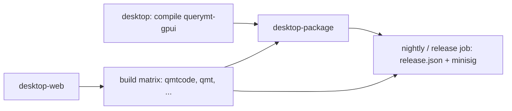
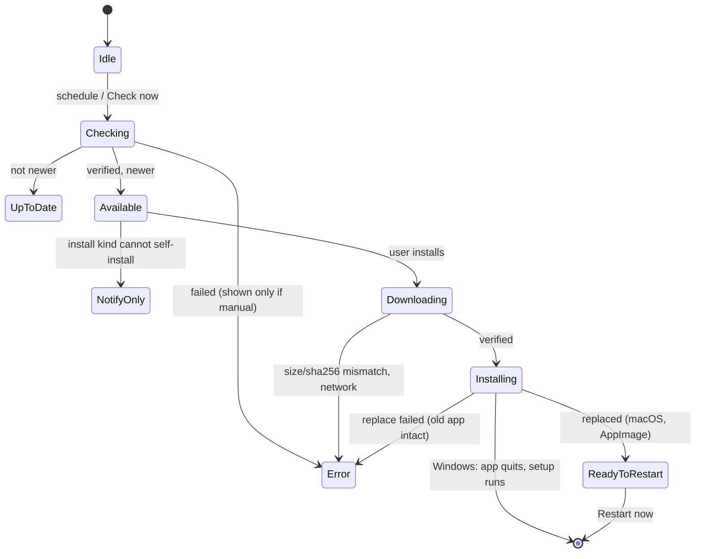

# Design

## Context

See proposal.md (Why) for motivation. Starting state:

- **Release CI** (`.github/workflows/build.yml`):
  - `desktop-web` builds the wasm UI.
  - `build` is a 30-leg matrix (qmt, qmtcode, qmacp, qmcp × platforms). It `needs: desktop-web` because qmtcode embeds the UI.
  - `desktop` compiles `querymt-gpui` with profile `release-gpui` and packages it in the same job, in parallel with `build`.
  - Each qmtcode leg uploads artifact `qmtcode-<target>`, which holds an archive, not a bare binary:
    - Unix: `qmtcode-<version_name>-<target>.tar.gz` with a top-level directory `qmtcode-<version_name>-<target>/`.
    - Windows: `qmtcode-<version_name>-<target>.zip` with `qmtcode.exe` at the archive root.
  - `nightly.yml` and `release.yml` download all `qm*-*` artifacts and write `release.json` with `scripts/release/write-release-json.sh` (`version`, `channel`, `commit`, `published_at`).
  - The nightly release is deleted and recreated on every run. Asset names use `nightly` as version name (`QueryMT-Desktop-nightly-…`).
- **Packaging** (`crates/querymt-gpui/scripts/package/{macos,linux,windows}.sh`, `packaging/windows/installer.nsi`, `packaging/nfpm.yaml`):
  - macOS: builds `QueryMT.app` (`com.querymt.gpui`) and ad-hoc signs the bundle (`codesign --force --sign -`, then `--verify`). Also writes `QueryMT.app.tar.gz` and a dmg.
  - Linux: nfpm packages the whole `${PKGROOT}/usr/` tree as deb `querymt-gpui`.
  - Windows: NSIS installs per user to `$LOCALAPPDATA\Programs\QueryMT GPUI`, with uninstall key `…\Uninstall\querymt-gpui`.
- **App:**
  - `crates/querymt-gpui/src/store.rs` `seed_configs` adds `local-qmtcode` (`qmtcode --acp`) when a PATH dir contains a file named `qmtcode`. That never matches on Windows.
  - `AgentsStore::new` merges seeds into saved configs on every start. `AgentsStore::delete_config` records nothing.
  - `AgentsStore::reset_app_data` resets `Prefs` and re-seeds.
  - State is `Persisted { configs, prefs }` at `dirs::config_dir()/querymt-gpui/state.json` (`state_path`).
  - `src/transport.rs` `native::spawn_process` runs `Command::new(program)` with no lookup of its own and no Windows creation flags. It reports `Inbound::Note("Started … (pid N).")`.
  - `src/util.rs` `APP_VERSION` comes from `build.rs` `set_build_version`: `QMT_VERSION` without the `v`, else `CARGO_PKG_VERSION`.
  - Single instance: `src/quick/instance.rs` (`forward`, `listen`, `Listening`, whose drop frees the socket). It is only active when the quick panel is enabled (`main.rs` `main`, `quick/mod.rs` `QuickHost`).
  - Settings: `src/ui/settings.rs` `render_settings` (General: Advanced, Danger zone, Setup).
- **Prior art:** the Tauri app's `querymt-desktop/src-tauri/src/updates.rs`. Its pure decision functions are the model here: `evaluate`, `verify_manifest`, `detect_install_kind`, preferences and scheduling. Its key and feed are not reused.

## Goals / Non-Goals

**Goals:**

- Every piece of update policy (what to offer, from where, how to verify, which install kind) is a pure function with unit tests. The GPUI glue only wires it to the network, the file system and the UI.
- Trust rests on one committed public key and one signature per release, not on GitHub alone.
- If an update is interrupted at any point, the installed app still works.

**Non-Goals (design level):**

- No generic plugin or updater framework. One module serves this app.
- No shared code with the Tauri updater: it is being retired.
- No changes to `release.json` consumers beyond adding fields.

## Decisions

### D1. CI: compile and package as separate jobs

`desktop` keeps compiling in parallel with `build`, and uploads `querymt-gpui[.exe]` as `desktop-bin-<target>`. A new `desktop-package` job (`needs: [desktop, build]`) downloads that binary and `qmtcode-<qmtcode_target>`, unpacks the qmtcode archive, runs the packaging script with `QMTCODE_BINARY`, checks the result (D3), runs `collect-bundles.sh` and uploads `qmt-desktop-<target>`.

The matrix maps each target to its qmtcode target:

| Desktop target | qmtcode target |
|---|---|
| `aarch64-apple-darwin`, `x86_64-apple-darwin` | same |
| `x86_64-pc-windows-msvc` | same |
| `x86_64-unknown-linux-gnu` | `x86_64-unknown-linux-musl` |
| `aarch64-unknown-linux-gnu` | `aarch64-unknown-linux-musl` |

`desktop-bin-*` does not match `qm*-*`, so it is never published.



- **Why:** the app compile (fat LTO) is the long step. Here it overlaps with desktop-web plus qmtcode instead of following them.
- **Alternative rejected:** `desktop` with `needs: build`. Simpler, but the critical path becomes desktop-web, then qmtcode, then the app compile.
- **Cost of waiting on `build`:** `desktop-package` waits for the whole matrix, FreeBSD included. Publishing already needs every leg (`release` and `nightly` `needs: build` on the reusable workflow), so this adds no new failure mode.

### D2. Packaging layout

Each script takes `QMTCODE_BINARY`. When it is unset: error if `CI` is set, otherwise a warning and no qmtcode in the bundle.

- **macOS** (`macos.sh`):
  - Bundle is `QueryMT Desktop.app`; `CFBundleExecutable` stays `querymt-gpui`. `CFBundleIdentifier` is `com.querymt.desktop`; `CFBundleName` and `CFBundleDisplayName` are `QueryMT Desktop`.
  - qmtcode is copied to `Contents/MacOS/qmtcode` and ad-hoc signed first (`codesign --force --sign - --timestamp=none`), then the bundle is signed as today. A bundle signature does not cover an unsigned helper in `Contents/MacOS`, so `codesign --verify --strict` would fail without the first step.
  - The update archive becomes `QueryMT Desktop.app.tar.gz`. `collect-bundles.sh` already globs `*.app.tar.gz`.
- **Linux** (`linux.sh`):
  - qmtcode goes to `usr/lib/querymt-gpui/qmtcode` in both the AppDir and `PKGROOT`. `nfpm.yaml` already packages the whole tree.
  - `nfpm.yaml`: `name: querymt-desktop`, plus `replaces`, `conflicts` and `provides` for `querymt-gpui`.
  - The `.desktop` file gets `Name=QueryMT Desktop`. Its file name, `Exec` and icon names stay `querymt-gpui`.
- **Windows** (`windows.sh`, `installer.nsi`):
  - New required define `QMTCODE_EXE`, installed as `$INSTDIR\qmtcode.exe` and deleted by the uninstaller.
  - `APP_NAME` is "QueryMT Desktop"; install directory `$LOCALAPPDATA\Programs\QueryMT Desktop`.
  - Uninstall key `…\Uninstall\QueryMTDesktopGpui`. It is distinct from the name the Tauri NSIS installer uses (product name "QueryMT Desktop"), so neither uninstaller removes the other before the retirement change.
  - On install, an existing `…\Uninstall\querymt-gpui` entry is uninstalled silently: its `UninstallString` runs with `/S _?=<InstallLocation>`, then its directory is removed.
  - Silent update mode (D11) is added.
- **Nix** (`flake.nix`):
  - The qmtcode package moves into the `let` block as `qmtcode`, so `querymtGpui` can refer to it.
  - `querymtGpui`'s `postInstall` creates the symlink `$out/lib/querymt-gpui/qmtcode -> ${qmtcode}/bin/qmtcode` on every platform. The wrapped binary lives in `$out/bin`, so the app's `../lib/querymt-gpui` lookup (D4) finds it.
  - **Alternative rejected:** a PATH prefix in the wrapper. There is no wrapper on Darwin today (`postFixup` is Linux-only), and a PATH entry would leak into every process the app starts.

### D3. Installer content checks in CI

`desktop-package` runs a new script, `crates/querymt-gpui/scripts/release/check-bundles.sh`, on the produced bundles:

- **macOS:**
  - `test -x` on `Contents/MacOS/qmtcode`;
  - `codesign --verify --strict` on the bundle;
  - `Contents/MacOS/qmtcode --version` must equal the release version. Run only when the runner architecture matches; the macOS legs run on arm64.
- **deb:** `dpkg-deb -c` must list `./usr/lib/querymt-gpui/qmtcode`, and `dpkg-deb -f … Package` must be `querymt-desktop`.
- **AppImage:** `--appimage-extract` into a temp dir, then `test -x squashfs-root/usr/lib/querymt-gpui/qmtcode` and run `--version`.
- **Windows:** `7z l` on the setup exe must list `qmtcode.exe`.

The script reads bundle paths and the expected version from arguments, so `test-release-scripts.sh` can test its pass and fail paths with fake bundles. The fakes are directories and file lists; the platform tools are only called in CI.

### D4. Resolution of a bare `qmtcode`

New module `crates/querymt-gpui/src/local_agent.rs` (native only) holds pure functions over injected inputs:

- `bundled_qmtcode(exe: &Path) -> Option<PathBuf>`. Candidates, in order: `exe.parent()/qmtcode{EXE_SUFFIX}`, then `exe.parent()/../lib/querymt-gpui/qmtcode{EXE_SUFFIX}`. The first one that is a file wins.
- `find_on_path(path_var: &OsStr) -> Option<PathBuf>`. Uses `split_paths` with `qmtcode{EXE_SUFFIX}`, which fixes the Windows seeding bug.
- `resolve_program(program, exe, path_var) -> Resolved { path, source }`, where `source` is `Bundled`, `Path` or `AsWritten`. Only a program equal to `qmtcode` (or `qmtcode.exe` on Windows) is resolved; everything else is `AsWritten` and handled by `Command` as before. When a bare `qmtcode` resolves to nothing, the result is an error: "qmtcode was not found (not bundled with the app and not on PATH)".

The production callers pass `std::env::current_exe()` and `std::env::var_os("PATH")`. Tests pass temp dirs, so they never change the process environment.

`current_exe()` gives these paths:

| Install | Path |
|---|---|
| macOS | `…/QueryMT Desktop.app/Contents/MacOS/querymt-gpui` |
| AppImage | `/tmp/.mount_*/usr/bin/querymt-gpui` |
| deb | `/usr/bin/querymt-gpui` |
| Nix | `$out/bin/.querymt-gpui-wrapped` |

The two candidates cover all of them.

`transport.rs` `native::spawn_process` calls `resolve_program` before `Command::new`, and the start note becomes "Started bundled qmtcode `<path>` (pid N)", "Started PATH qmtcode …" or "Started `<command line>` (pid N)". On Windows it sets `creation_flags(CREATE_NO_WINDOW)` (`0x0800_0000`), as `quick/chrome/windows.rs` already does.

**Order (bundled, then PATH):** the bundled copy matches the app's version. A user who wants another copy writes its path, and an explicit path is never replaced. This mirrors the Tauri `sidecar::resolve_program`.

### D5. Seeding and dismissal

- `seed_configs` seeds `local-qmtcode` when `bundled_qmtcode(current_exe)` or `find_on_path(PATH)` finds a copy.
- `Prefs` gains `#[serde(default)] dismissed_seeds: Vec<String>`. `AgentsStore::new` skips seeds whose id is in it, and only `local-qmtcode` is ever added there.
- `delete_config` pushes the id when it is `local-qmtcode`.
- `reset_app_data` already replaces `Prefs` with its default, which clears the list.
- `--agent`/`QMT_AGENT` seeds are never dismissed (spec: "Requested agent returns after deletion").
- **Alternative rejected:** seeding only on first run. Existing users would never get the bundled agent.

### D6. Build channel and versions

`build.rs` `set_build_version` also emits `QMT_UPDATE_CHANNEL`:

| `QMT_VERSION` | `QMT_UPDATE_CHANNEL` |
|---|---|
| unset or empty | `dev` |
| has a `nightly` pre-release | `nightly` |
| anything else | `stable` |

`dev` disables all update requests. Nix builds do not set `QMT_VERSION`, so they are `dev`. Deb builds do set it, but are notify-only through their install kind (D9).

Versions are compared with `semver::Version`. Nightly versions (`X.Y.Z-nightly.<timestamp>`) sort above the stable they follow and below the next stable (`scripts/release/nightly-version.sh`), so "strictly greater" also covers switching channel.

### D7. Signed manifest

`write-release-json.sh` gains optional arguments `<desktop-assets-dir> <version-name>`.

- When given, it adds `desktop_updates` with one entry per platform key: `{ "file", "size", "sha256" }`. Keys and files:

  | Key | File |
  |---|---|
  | `darwin-aarch64` | `QueryMT-Desktop-<vn>-macos-aarch64.app.tar.gz` |
  | `darwin-x86_64` | `QueryMT-Desktop-<vn>-macos-x86_64.app.tar.gz` |
  | `windows-x86_64` | `QueryMT-Desktop-<vn>-windows-x64-setup.exe` |
  | `linux-x86_64` | `QueryMT-Desktop-<vn>-linux-x86_64.AppImage` |
  | `linux-aarch64` | `QueryMT-Desktop-<vn>-linux-aarch64.AppImage` |

- The script fails if any file is missing.
- `nightly.yml` and `release.yml` then sign with the minisign CLI (Ubuntu package `minisign`):

  ```
  minisign -S -s <keyfile> -m release.json -x release.json.minisig -t "version:<v> channel:<c>"
  ```

- The key comes from secret `QMT_UPDATE_SIGNING_KEY`, a password-less minisign secret key written to a `0600` temp file and deleted afterwards. A missing secret fails the run.
- Signing runs before the draft upload, so the signature and the manifest are published together.

The `add-agent-session-core` change also extends this script, with an optional fifth argument for `session_core_wasm`. Whichever lands second switches both to named flags (`--desktop-dir`, `--version-name`, `--session-core-archive`). The fields readers use today stay as they are.

The public key is committed as `crates/querymt-gpui/packaging/update-key.pub` and embedded with `include_str!`.

**Verification in the app** (`update::verify`):

1. Decode the key and the `.minisig` with `minisign-verify` and verify the exact downloaded `release.json` bytes.
2. Only then parse the JSON and the trusted comment.
3. Require the comment's `version:` and `channel:` to equal the manifest's `version` and `channel`.
4. Require the channel to be the selected channel.
5. Only the verified struct is passed on.

Why minisign: it is small, well-audited and already used by the Tauri app. `minisign-verify` has no dependencies.

The feed URLs are fixed constants:

- Stable: `https://github.com/querymt/querymt/releases/latest/download/release.json` (plus `.minisig`). GitHub's `latest` skips pre-releases, so it always points at the newest stable.
- Nightly: `https://github.com/querymt/querymt/releases/download/nightly/release.json`.
- Asset URL: `…/releases/download/<tag>/<file>`, where `<tag>` is `v<version>` for stable and `nightly` for nightly.

### D8. Update module and state machine

New module `crates/querymt-gpui/src/update/`, `cfg(not(target_family = "wasm"))`:

- `mod.rs`, pure functions: channel, `evaluate(running, verified) -> Verdict`, `detect_install_kind(probe)`, scheduling (`check_due`), `is_suppressed(manual, skipped, offered)`.
- `verify.rs`: manifest and signature verification, and the asset size and SHA-256 check.
- `fetch.rs`: a `ureq` 3 agent with rustls, a 30 s timeout for the manifest and 15 min for the download, and proxy settings from the environment.
- `install/{macos,windows,appimage}.rs`: one installer per install kind.

It runs on GPUI's background executor, and blocking I/O runs only there. `store/updates.rs` (next to `store/sidebar.rs` and `store/devtools.rs`) holds `UpdateState`, starts the scheduler from `AgentsStore::new`, and exposes `check_updates(manual)`, `install_update()`, `restart_to_update()` and `skip_version()`.



`Prefs` gains `#[serde(default)] updates: UpdatePrefs` with fields:

- `channel: Option<Channel>` (None means the build channel);
- `auto_check: bool`, defaulting to true;
- `skipped_version: Option<String>`;
- `last_check: Option<u64>`.

`dev` builds construct no scheduler.

### D9. Install kinds

`detect_install_kind(InstallProbe { os, exe, appimage_env, writable })`:

- **macOS:** `MacApp` when `exe` contains `.app/Contents/MacOS/`, the path does not contain `/AppTranslocation/`, and the bundle's parent directory is writable. Otherwise `NotifyOnly`.
- **Windows:** `Nsis` when the `QueryMTDesktopGpui` uninstall key's `InstallLocation` equals `exe.parent()`. Otherwise `NotifyOnly`.
- **Linux:** `AppImage` when `APPIMAGE` is set and its directory is writable. Otherwise `NotifyOnly`. This covers deb (`/usr`), Nix (`/nix/store`) and everything else.

`NotifyOnly` shows the version and the release page link (`…/releases/tag/v<version>` or `…/releases/tag/nightly`).

### D10. Installing on macOS and AppImage

Both replace files with renames on the same file system, so every step can be undone.

**macOS:**

1. Download to `<parent>/.QueryMT Desktop.app.update-<pid>.tar.gz`.
2. Verify size and SHA-256.
3. Unpack with `tar` + `flate2` into `<parent>/.update-<pid>/`. Reject entries with absolute paths or `..`.
4. Check that `QueryMT Desktop.app/Contents/Info.plist` and the executable exist, and run `codesign --verify --strict`.
5. Stop local process agents.
6. Rename the current bundle to `.QueryMT Desktop.app.old-<pid>`, then rename the new one into place.
7. If the second rename fails, rename the old bundle back.
8. Delete the old bundle and the temp files.

The running process keeps its mapped executable, so it is unaffected until restart.

**AppImage:**

1. Download to `<dir>/.<name>.update-<pid>`.
2. Verify size and SHA-256, then `chmod 755`.
3. Stop agents, then `rename` over `$APPIMAGE`. This is atomic, and the running image stays mounted from the old inode.

**Restart** (`restart_to_update`):

1. Stop agents.
2. Drop `QuickHost`'s `Listening`, which frees the single-instance socket so the new process does not forward to the old one.
3. Spawn the new app detached: `open -n "<bundle>"` on macOS, `$APPIMAGE` for AppImage.
4. `cx.quit()`.

### D11. Installing on Windows

The running exe and `qmtcode.exe` are locked, so the setup exe does the replacement:

1. Download it to `%TEMP%\QueryMT-Desktop-update-<version>.exe` and verify it.
2. Stop agents and drop the instance listener.
3. Spawn the setup with `/S /UPDATE /D=<install dir>`. `/D` must be the last argument, without quotes, as NSIS requires.
4. Quit.

`installer.nsi`, when `/UPDATE` is given:

- waits up to 30 s for `querymt-gpui.exe` to be deletable (a retry loop around `Delete`), and aborts with an error message box if it never is;
- installs silently;
- runs `$INSTDIR\querymt-gpui.exe` with `Exec` at the end.

The installer is per user, so there is no UAC prompt. A failed install leaves the previous files, because NSIS writes file by file. The NSIS `File` overwrite only happens after the lock check passes, which keeps partial-overwrite risk low; see Risks.

### D12. UI

Settings › General gets an **Updates** card above Advanced:

- version (`APP_VERSION`) and channel (segment bar: Stable / Nightly);
- the "Check automatically" switch;
- "Check now" with the last check time;
- the state line from `UpdateState`;
- the actions for the current state: Install, Skip this version, Restart now, or Open release page.

The main window sidebar shows one compact "Update available" item when the state is `Available` (unless the version is skipped) or `ReadyToRestart`. It opens the Updates card.

Dev builds show "Updates are not available for this build" with no controls. The layout follows the gpui-kit design guides (read them before implementing).

### D13. Dependencies

All are crate-local to `querymt-gpui` under `[target.'cfg(not(target_family = "wasm"))'.dependencies]`. querymt-gpui is excluded from hakari, so workspace-hack does not change.

| Crate | Features | Notes |
|---|---|---|
| `ureq = "3"` | `default-features = false`, `rustls` | Already a build-dependency. Check that it pulls `ring`, as the rustls already linked for tungstenite does, and not `aws-lc-rs`. |
| `minisign-verify` | none | New. Pure Rust, no dependencies. |
| `semver = "1"` | default | In Cargo.lock. |
| `sha2 = "0.10"` | default | In Cargo.lock. |
| `tar = "0.4"` | default | macOS only. In Cargo.lock. |
| `flate2 = "1"` | default | macOS only. In Cargo.lock. |

No provider crate or wasm32-wasip1 build is affected. The wasm32-unknown-unknown build of querymt-gpui compiles none of these.

## Risks / Trade-offs

- **The signing key leaks or is lost.** Every installed app trusts one key.
  - Mitigation: keep an offline backup of the key. A rotation ships an app with a new embedded key, signed with the old key one last time, as the Tauri app documents.
- **Nightly is replaced mid-update** (manifest from run N, asset from run N+1).
  - Mitigation: the SHA-256 check rejects the asset (spec scenario "Nightly replaced during download"). A 404 is a quiet failure, and the next check sees the new nightly.
- **Ad-hoc signatures change with every build,** so macOS may ask again for permissions such as Accessibility (used by the quick panel's global shortcut) after an update.
  - Mitigation: none until Developer ID signing. Documented in the release notes.
- **Gatekeeper and quarantine.** An update downloaded by the app (not a browser) carries no quarantine attribute, so the new bundle starts without a prompt.
  - Verified manually on the first nightly with this change (task 9.3).
- **Windows: files locked by a lingering `qmtcode.exe`.**
  - Mitigation: agents are stopped first, qmtcode exits when its stdin closes, and the installer waits 30 s before giving up with the old version intact.
- **Bigger installers** (qmtcode is around 255 MB in a local unstripped build).
  - Mitigation: verify `strip` in the qmtcode release profile when implementing; the dmg, AppImage and NSIS formats compress.
- **Dual install with the Tauri app.**
  - macOS: same bundle name and identifier, so a drag install replaces the Tauri app. This is the intended takeover; Tauri data in `~/Library/Application Support/com.querymt.desktop` is left alone.
  - Windows: separate directory and uninstall key, so both show as "QueryMT Desktop" until the retirement change.
  - Accepted for now; the retirement change resolves it.
- **`ureq` blocking calls on the GPUI background executor** take one of its threads for up to 15 minutes during a download.
  - Mitigation: run downloads on a dedicated `std::thread` and send progress over an async channel, as `transport.rs` does for agents.

## Migration Plan

1. Land packaging, identity and qmtcode bundling (task groups 1–4). The next nightly publishes "QueryMT Desktop" installers with qmtcode. Users of earlier GPUI test builds install once by hand:
   - deb and Windows replace the old install automatically;
   - on macOS, delete `QueryMT.app`.
2. Create the minisign key pair and add the secret before landing the signing tasks (group 5). Until the secret exists the nightly fails, so add it first.
3. Land the updater (groups 6–8). Builds from this point update themselves. Earlier builds have no updater and are updated by hand once.
4. **Rollback:** if a release is bad, publish a newer one. The updater never downgrades, so reverting means a higher version number. Without the signing secret, releases fail but already installed apps keep working.

## Open Questions

- **Name of the Tauri deb package.** If it is also `querymt-desktop`, apt sees the GPUI deb as an upgrade because its version is higher. That is the intended takeover. If not, both packages coexist until the retirement change. Either way, nothing in this change depends on it.
