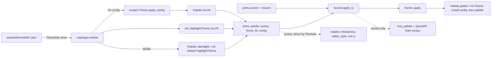

# Design

## Context

All work is in `crates/querymt-gpui`. See proposal.md for motivation and
specs/desktop-themes/spec.md for behaviour.

How colour reaches the screen today:

- `src/theme.rs`: `Palette` (a `Copy` global) holds the app's tokens.
  `apply(dark, accent, cx)` builds `Palette::dark()` / `light()`, applies an
  accent preset unless it is empty or `orange`, calls `Theme::change` (which
  reloads the kit's registered theme config of that mode: the default one
  unless `Theme.dark_theme` / `light_theme` was replaced), copies the palette
  onto the kit theme and calls `highlight::install`.
- Syntax colours come from `Theme::global(cx).highlight_theme`, read by
  `highlight::install` (the global `TextViewDefaults` fence highlighter),
  `session_view.rs` `RenderCtx::syntax` (tool output, diffs) and
  `kit.rs` `editor_style` (code inputs). The app uses no kit `Input` or
  `diff` component that reads the global on its own.
- `highlight.rs` maps syntect scopes to the kit's highlight names
  (`comment`, `keyword`, `string`, …) and resolves them through a
  `HighlightStyleResolver` such as `HighlightTheme`.
- The quick panel paints with `quick/hud.rs` `hud_palette(user, glass)`,
  handed to its `SessionPane` as its own palette. Its syntax colours still
  come from the global kit theme.
- Prefs live in `Persisted { configs, prefs }` as JSON. A value that fails to
  deserialise makes `load_persisted` return `None`, losing the whole state.
  Older state is migrated in `startup_state`, keyed on a version
  (`prefs.onboarding.version`).
- The app, the kit `Theme`, `Rc` and every GPUI entity live on the main
  thread; the app already calls `theme::apply` and renders only from there.

The kit's theme format (gpui-kit 0.11, `theme/schema.rs`):

- A file is a `ThemeSet { name, author, url, themes: Vec<ThemeConfig> }`;
  each `ThemeConfig` has `name`, `mode`, optional font/radius fields,
  `colors: ThemeConfigColors` (`background`, `foreground`, `border`,
  `muted.foreground`, `secondary.*`, `popover.*`, `primary.*`,
  `input.border`, `base.red` / `yellow` / `green` / …), `shadow`, and an
  optional `highlight: HighlightThemeStyle` (`editor.*`, status colours,
  `syntax` keyed by the same highlight names `highlight.rs` emits). A
  syntax name a theme omits falls back to its dotted prefix
  (`comment.doc` -> `comment`) in the kit's syntax-colour lookup; only a
  name with no prefix match resolves to no style. All fields are `pub`.
- `Theme::apply_config(&mut self, &Rc<ThemeConfig>)` (public) resolves every
  missing colour from the kit's own fallbacks (for example `sidebar` from
  `background` blended with `border`, `input` from `border`, `popover` from
  `background`), parses `linear-gradient(...)` values to their first stop
  for plain colours, copies the config's font, radius and `shadow` fields
  when set (nothing sets them back, so a field one theme set stays until
  another sets it), installs the config's `highlight` as a new
  `highlight_theme` (it clones the style), and sets `mode`. `Theme` derefs
  to `ThemeColor`, whose fields are public. `Theme::default()` is public, so
  a scratch `Theme` resolves a config without touching the global.
- `Theme::update(cx, edit)` runs `edit`, then, if `mode` changed or a
  config was replaced, may reload the registered config of the mode. A
  mode change that comes with a *different* `Rc` config has already loaded
  it and is not reloaded; a mode change with the *same* `Rc` is reloaded,
  and a reload runs `apply_config` again over whatever `edit` wrote
  (`gpui-component` `theme/mod.rs`, `edit`: `installed_by_edit`). D7 relies
  on this.
- The kit's repository ships 21 theme files in `themes/` (36 themes, 172,276
  bytes; last changed in commit `d2e6bba2fcab8c605e983327207682a397c98060`).
  They are not in the crates.io package. Only Aurora Light sets
  `sidebar.background`; none sets a font or radius. Six set `shadow: false`,
  a real field. Seven set no `popover.background` (it falls back to the page
  colour) and four no `input.border` (Tokyo Night, macOS Classic Light and
  Dark, Mellifluous Light: it falls back to `border`). Aurora Light's
  `primary.background` is a gradient and some of its status colours are
  Tailwind names (`red-600`). The kit's default configs set no font or
  radius.

## Goals / Non-Goals

**Goals:**

- One function turns a catalogue entry into everything a theme sets: the
  `Palette` and the `HighlightTheme`. Nothing else knows where colours come
  from.
- A theme is resolved once. Applying it clones pointers and copies `Copy`
  values; it never clones a theme config or a syntax style, and reading the
  saved choice never clones the preferences.
- Whoever holds a `Palette` can get its syntax colours, so the quick panel's
  own palette brings its own syntax colours with it.
- QueryMT Dark and Light stay what they are now, apart from one deliberate
  change: the button label on a picked accent preset follows the 3:1 rule
  (D6).
- The kit does the parsing and fallbacks; the app only maps kit colours to
  its tokens.
- Values the code has to tell apart are types, not strings: a theme is a
  `ThemeId`, an accent an `Accent`, the saved-preferences version an
  `AppearanceVersion`. Strings exist only in the saved file.

**Non-Goals:**

- Contrast adjustment of a theme's own colours, or contrast tests of them.
  The only contrast rule is the label colour on a picked accent preset.
- Editing, generating or validating theme files beyond "parses and resolves".

## Decisions

### D1. Vendored kit theme files and a catalogue

Copy the 21 files from `longbridge/gpui-kit` at commit `d2e6bba2…` into
`assets/themes/kit/`, unmodified, with `assets/themes/kit/NOTICE.md`
naming the source URL and commit, the kit's Apache-2.0 licence, and each
family's `author` and `url` as given in the file. Embed them with
`include_str!`.

`src/theme.rs` becomes a `src/theme/` module: `mod.rs` (`Palette`, `apply`),
`catalogue.rs` (this decision, D4, D5) and `accent.rs` (D6).

The catalogue is a `thread_local!` built on first use, not a `static`: its
entries hold `Rc<ThemeConfig>`, which the kit's `Theme` wants and which is
not `Sync`, and everything that reads it runs on the main thread
(`own-rc-single-thread`, `conc-thread-local`). It parses each file with the
kit's `ThemeSet` once and builds one `Entry` per theme, once:

```rust
struct Entry {
    key: SharedString,              // "catppuccin-mocha"; "qmt-dark"
    label: SharedString,            // "Catppuccin Mocha"; "QueryMT Dark"
    dark: bool,
    config: Option<Rc<ThemeConfig>>,// None for the built-ins: the kit's default
    palette: Palette,               // D4, with `theme` already set
    own_accent: Option<Preset>,     // Some(orange) for the built-ins, else None
    syntax: Arc<HighlightTheme>,    // D5
    fence: Arc<FenceHighlighter>,   // D2
}
```

`apply` then only clones an `Rc`, an `Arc` and a `Copy` `Palette`. A
`static LazyLock<Vec<Arc<ThemeConfig>>>` that `apply` copies into an `Rc` each
time was rejected: it copies a config of about 100 colour fields on every
mode switch, accent click and OS appearance change (`own-borrow-over-clone`).

The list holds the two built-in entries first, then every kit theme sorted
case-insensitively by label within its appearance (`to_lowercase`, as the
kit's own registry sorts; a byte-order sort would put "macOS Classic Dark"
after Twilight, against the spec's order). `key` is the theme name in
kebab-case (`catppuccin-mocha`, `macos-classic-dark`); `qmt-dark` and
`qmt-light` are the built-ins. `dark` is the config's `mode`.

`ThemeId` is a `Copy` newtype over the entry's index (`type-newtype-ids`),
valid for the process only and never saved (the file holds `key`).
`ThemeId::QMT_DARK` / `QMT_LIGHT` are the built-ins; `ThemeId::resolve(saved:
&str, dark: bool) -> ThemeId` finds the key and falls back to the built-in
theme of `dark` when it is empty, unknown or of the other appearance, so
"wrong appearance" is handled once, here, and nowhere else
(`api-parse-dont-validate`). `ThemeId::of_appearance(dark) -> Vec<ThemeId>`
lists a select's rows; `key()`, `label()`, `dark()` and `accent()` (the
entry's palette accent: the theme's own) read an entry.

At load, these are cleared from each config so the app keeps its own:
`font.size`, `font.family`, `mono_font.family`, `mono_font.size`, `radius`,
`radius.lg`, `window.radius` and `shadow` (spec: Fonts and sizes stay the
app's). `shadow` matters: six themes set it to `false`, and `apply_config`
would copy it onto the kit theme with nothing to set it back. The config's
`highlight` is taken out (`Option::take`) into the entry's `syntax` (D5), so
installing the config copies no syntax style.

Alternatives: fetch themes at run time (rejected: no network dependency
for a setting, and the web build has no file system); keep the two-face
editor themes (rejected in exploration: they define only background,
foreground and syntax, so every app colour had to be guessed).

### D2. `Palette` carries its theme id

`Palette` gains `theme: ThemeId`. `theme::syntax(&Palette) ->
Arc<HighlightTheme>` returns the entry's `syntax` (an `Arc` clone), so the
per-frame lookup in `RenderCtx` copies a pointer. `hud_palette` sets `theme`
to QueryMT Dark, whatever the user palette is.

The entry also holds `fence: Arc<FenceHighlighter>`, with `type
FenceHighlighter = dyn Fn(&CodeBlock) -> Vec<(Range<usize>, HighlightStyle)> +
Send + Sync`, reached through `highlight::fence_highlighter(&Palette)`. It
has to be one `Arc` per theme, not a closure built per call: the kit reuses
a code block's highlights only while the highlighter is the same `Arc`
(`gpui-base` `text/node.rs` compares with `Arc::ptr_eq`), and `md.rs`
`styled` runs every frame, so a fresh closure per frame would re-parse every
fence every frame. `TextView::code_block_highlighter(closure)` always makes a
new `Arc`; the only setter taking an existing one is
`TextView::shared_code_block_highlighter`, which the kit marks
`#[doc(hidden)]` and uses itself for its own highlighter. We use it: the kit
is pinned (0.11) and a test fails if fences are highlighted again on a second
render. If a later kit removes it, the replacement is a task of that upgrade.

Every reader switches from the kit global to the palette's theme:
`RenderCtx::syntax` and `kit::editor_style` use `theme::syntax(&p)`, and
`md.rs` `styled` sets `shared_code_block_highlighter(fence_highlighter(&p))`
(the view already receives `p`). The kit global still gets the shown theme's
`highlight_theme` (the same `Arc`, D7), for kit components the app does not
style itself.

Alternative: a separate syntax override next to `SessionPane::palette`.
Rejected: every place that already threads a `Palette` would need a second
value, and forgetting one silently brings back today's quick-panel bug.

### D3. Built-in themes keep today's path

`qmt-dark` / `qmt-light` resolve to `Palette::dark()` / `light()` and the
kit's default highlight themes (`HighlightTheme::default_dark()` /
`default_light()`), exactly as now; their own accent is QueryMT's orange
(the values already in `Palette::dark()` / `light()`), and their entries
have `own_accent = Some(orange)`.

They also have to reset the kit side. `Theme::change` reloads
`Theme.dark_theme` / `light_theme`, so after a bundled theme was applied the
kit would load that theme's config again, leaving every kit token the app
does not overwrite (chart, info, tab, table, scrollbar, title bar…), the
kit's `highlight_theme` and the global fence highlighter on the old theme.
So `apply` always installs the config of the theme it shows (D7): the
bundled config for a kit theme, the registry's default config
(`ThemeRegistry::global(cx).default_dark_theme()` / `default_light_theme()`)
for a built-in one. Test: apply Tokyo Night, then QueryMT Dark, and compare
the whole kit `Theme` with a fresh QueryMT Dark apply.

### D4. Kit theme -> `Palette`

Built once per entry, at catalogue load: resolve the config on a scratch
`Theme::default()` with `apply_config`, then read its `ThemeColor` fields.
Colours with alpha are composited over `background` first so every surface
token is opaque. The `muted` midpoint is the per-channel sRGB average of the
two opaque colours.

| Token | From the resolved kit theme |
|---|---|
| `bg` | `background` |
| `surface` | `sidebar` (the kit's fallback when the theme sets none) |
| `popover` | `popover` |
| `card` | `secondary` |
| `card_hover` | `secondary_hover` |
| `border` | `border` |
| `border_strong` | `input` (`input.border`) |
| `text` | `foreground` |
| `muted`, `status_muted` | midpoint of `foreground` and `muted_foreground` |
| `dim` | `muted_foreground` |
| `danger` / `warn` / `success` | `red` / `yellow` / `green` (`base.*`) |
| `running` | `yellow` |
| `chip` | `foreground` at 7 % alpha |
| `accent` / `accent_hover` / `on_accent` | `primary` / `primary_hover` / `primary_foreground` |
| `accent_dim` | `primary` at 16 % (dark) / 12 % (light), as presets do |

The kit has two text tiers and the app three; the theme's muted foreground
is its faintest text, so it becomes `dim`, and `muted` sits between.

Two fallbacks make some surfaces look like the page: seven themes set no
`popover.background` (menus take the page colour) and four set no
`input.border` (`border_strong` equals `border`). Both are the kit's own
look and are accepted (see Risks).

`apply` writes the kit's `popover` from `Palette::popover`. Today it writes
`p.surface` (`theme.rs:206`), which is the same value on the built-in
themes but not on a bundled theme, where the app's menus would take the
theme's popover colour and the kit's popovers the sidebar colour.

Alternative: read `ThemeConfigColors` strings directly. Rejected: the kit's
fallbacks and gradient handling would have to be reimplemented.

### D5. Kit theme -> `HighlightTheme`

The entry's `syntax` is `Arc::new(HighlightTheme { name, appearance: mode,
style })` with the `style` taken from the config's `highlight`, as the kit
builds it in `apply_config`. A highlight name a theme leaves out first falls
back to its dotted prefix (`comment.doc` -> `comment`); a name with no match
resolves to no style, so the text colour (`fg`) shows. A config without a
`highlight` block uses the built-in syntax theme of its appearance (none of
the 36 lacks one; tested). The built-ins use `HighlightTheme::default_dark()`
/ `default_light()`.

### D6. Accent: theme by default, preset as override

An accent is a type, not a string:

```rust
enum Accent { Theme, Preset(Preset) }   // Copy; Preset indexes ACCENTS
```

`Accent::parse(&str)` reads the saved `prefs.accent`: `""` and an id no
longer in `ACCENTS` are `Theme`, a known id a `Preset` (an unknown id used
to mean orange; it now means the theme's own accent, which on the built-ins
is orange, so nothing changes there). `Accent::id()` gives the string to
save. `Accent::ORANGE` is the preset the built-in themes' own accent equals.

One rule applies to every theme: `Accent::apply_to(base: Palette,
own_accent: Option<Preset>) -> Palette`.

- `Theme`, or a preset equal to the theme's own accent: `base`, unchanged.
  So Orange on QueryMT Dark and Light is exactly the theme's own accent,
  including its hand-picked hover and tint, with no orange special case and
  no float comparison (`own_accent` is a `Preset`, compared as a value, not
  a colour).
- Any other preset: `accent` is the preset's fill for the appearance,
  `accent_hover` its lightness step (+0.08 dark, -0.08 light), `accent_dim`
  its tint (16 % dark, 12 % light), and `on_accent` the label colour below.
  Everything else is `base`.

**Label colour (3:1).** The theme's own label (`base.on_accent`) is kept if
its contrast with the new fill is at least 3:1; otherwise it is black or
white, whichever contrasts more. Contrast is the WCAG relative-luminance
ratio, implemented once in `accent.rs` (`contrast(a, b) -> f32`, checked
against black on white = 21), and the threshold is a named constant
`MIN_LABEL_CONTRAST = 3.0` (3:1 is the WCAG non-text and large-text
minimum). A theme's *own* accent and label are never adjusted: themes are
shown as authored, including QueryMT Light's own Orange with a white label
at 2.8:1.

What this does, measured on the files at `d2e6bba`:

- QueryMT Dark (label `#1b1b1b`): at least 6.2:1 on every preset, so
  nothing changes.
- QueryMT Light (white label): Blue 3.7, Red 3.8, Pink 3.5, Purple 4.0 and
  Slate 4.8 keep white; Teal (2.5), Green (2.3) and Amber (1.9) become black.
  This is the one deliberate change to the built-in looks; Orange is the
  theme's own accent and stays as it is.
- Bundled themes: 152 of the 324 theme and preset pairs fall below 3:1 and
  get black or white. The 12 dark themes with a light label (Adventure,
  Adventure Time, Alduin, Asciinema, Fahrenheit, Flexoki Dark, Hybrid Dark,
  macOS Classic Dark, Mellifluous Dark, Molokai Dark, Solarized Dark,
  Spaceduck) fail on every preset; all 11 light themes fail on Teal, Green,
  Amber and Orange; the other 13 dark themes keep their own label on every
  preset.

The old code treated `""` and `orange` alike everywhere; now Orange on a
bundled theme means orange. A saved `orange` from before themes is read as
`""` once (D8), so existing users do not get orange forced onto the themes
they pick.

The Accent color row gets a "Theme" swatch first, selected when the accent
is `Accent::Theme`. It is painted with `ThemeId::accent()` of the shown
theme (D1), never from the `Palette` global: with a preset picked, that
holds the preset. `hud_palette` keeps taking only `user.accent`, so the
panel follows whichever accent is in use.

Alternative: keep today's preset logic for the built-ins and a separate
black-or-white rule for bundled themes. Rejected: two rules, and the old
orange special case (`accent != "orange"`) copied into the code and into the
test that checks it.

### D7. `apply` takes an `Appearance`

```rust
struct Appearance { theme: ThemeId, accent: Accent }   // Copy
fn apply(appearance: Appearance, cx: &mut App)
```

`Appearance::builtin(dark)` is the built-in theme with the theme accent.
`dark` is not a parameter: it is `appearance.theme.dark()`. The ~50 test call
sites change mechanically: `apply(true, "orange", cx)` becomes
`apply(Appearance::builtin(true), cx)` and `apply(false, "orange", cx)`
`apply(Appearance::builtin(false), cx)` (the built-in theme's own accent is
orange, so what the tests see is unchanged).

Steps, in this order:

1. Resolve the `Palette`: the entry's, through `Accent::apply_to` (pure, so
   tested without a window), and `cx.set_global` it.
2. Make sure the kit `Theme` global exists (the first call goes through
   `Theme::change(mode, None, cx)` as today, which creates it).
3. Install the config of the theme in a `Theme::update` of its own:
   `t.apply_config(&config)`, with `config` the entry's `Rc` (a clone of
   the pointer) or, for a built-in, the registry's default config.
4. In a second `Theme::update`: the fonts, radii, the palette over the kit
   tokens as today (with `popover` from `Palette::popover`, D4), and
   `t.highlight_theme = entry.syntax.clone()` so the kit holds the entry's
   `Arc`, not a copy.
5. `highlight::install(cx)`.

Steps 3 and 4 must be two updates. With stable `Rc` configs (D1), going
dark -> light -> dark on the same bundled theme gives a mode change with the
*same* config pointer, which the kit treats as "not installed by the edit"
and reloads over whatever the closure wrote after `apply_config`: a single
update with the palette writes after `apply_config` would silently lose
them. Test: switch dark, light, dark on one bundled theme and check the kit
colours equal a fresh apply.

Alternative: keep `apply(dark, accent)` and add `apply_theme`. Rejected: two
entry points that both set the global theme.

### D8. Prefs keys, lenient loading and a version marker

`Prefs` gains `theme_dark: String` and `theme_light: String`, both
`#[serde(default, deserialize_with = "lenient_string")]`: a non-string value
becomes `""` instead of failing the whole state load. An unknown saved id is
kept, so a downgrade and upgrade keeps the choice. `accent` keeps its type
and default. Three methods keep the strings out of the UI code:
`Prefs::theme_id(dark) -> ThemeId` (`ThemeId::resolve` of the saved key),
`Prefs::accent_choice() -> Accent` (`Accent::parse`) and
`Prefs::appearance(dark) -> Appearance`. The caller decides `dark`
(`QMT_THEME`, the URL parameter, `prefs.dark`, the window appearance).

`Prefs` also gains `appearance_version: AppearanceVersion`, a newtype over
`u32` whose `Default` is `CURRENT` (1) and whose serde default for an
*absent* key is `legacy()` (0); a present but invalid value is read as
`CURRENT`, so garbage never triggers the rewrite below. `Prefs::default()`
(a fresh install, and `reset_with_seeds`) is therefore `CURRENT` and the
rewrite cannot run on it.

The migration sits in `startup_state`, next to the onboarding one, and is
tested there as a pure function: if `appearance_version < CURRENT`, then
an `accent` of `"orange"` becomes `""` (it was the default the Accent row
saved when Orange was shown selected, not a choice of orange everywhere),
and the version becomes `CURRENT`. Every save by this version writes
`CURRENT`, so an Orange picked afterwards stays orange, after a restart and
after "reset app data".

Alternative: `Option<String>` theme keys, with "both unset" as the legacy
marker. Rejected: `None` would mean two things (no choice and old file), a
reset or one invalid key would bring the rule back and erase a picked
Orange, and it needs a dummy `Some("")` written just to record the
migration.

### D9. Settings -> Appearance

Below the System / Light / Dark cards, a settings card with two rows,
"Dark theme" and "Light theme", each with the app's existing pill select
(the trigger and menu used for the provider authentication method in
`settings.rs`). Menu rows show four swatches (background, foreground,
accent, string colour) and the label, the selected row marked; the dark
menu (26 rows) scrolls. Picking writes the pref and calls `apply_theme`,
which only changes the window when the picked appearance is shown.
`theme_preview` / `theme_mock` build their palettes from the chosen
`ThemeId`s and the `Accent` instead of `Palette::dark()` / `light()`
(`Accent::apply_to` on the entry's palette).

The select marks, and its trigger shows, the theme actually in use: the
saved key resolved by `ThemeId::resolve`. An unknown or wrong-appearance
saved key therefore shows QueryMT Dark / Light as selected, while the saved
value is kept until the user picks (spec: The theme choice is saved).

`appearance_controls` and `QmtApp::apply_theme` read the preferences through
the three methods of D8 and copy out only `Copy` values (`prefs.dark`, two
`ThemeId`s, an `Accent`). They no longer call `prefs.clone()` on every
render and apply, which today clones the maps and vectors of the whole
`Prefs` (`settings.rs:753`, `ui/mod.rs:648`) (`anti-clone-excessive`); other
call sites are not touched.

`appearance_controls` is shared by Settings and the first-run setup
screen (`settings.rs:967`, `setup.rs:327`), so both get the two selects and
the Theme swatch. That is intended: the theme is worth choosing on first
run. Tests cover Settings; setup is checked in the visual review (task
5.2).

### D10. Film scenes

`film/scene.rs` `Scene` gains `#[serde(default)] color_theme: String`
(a catalogue key, empty = built-in), resolved with `ThemeId::resolve` and
passed with `Accent::parse(&scene.accent)` to `theme::apply`. The scene's
`accent` default changes from `"orange"` to `""` (`default_accent`): it is the
theme's own accent, which on the built-in themes is the orange it was, and on
a bundled theme is that theme's, instead of orange forced over it. The two
existing scenes write `accent = "orange"` and have no `color_theme`, so they
render as before. `film/mod.rs` (lines 197 and 219) reads both.



## Risks / Trade-offs

- [Some themes are hard to read or have odd accents: Fahrenheit's accent is
  `#720202` on black, Solarized Light's is grey, Catppuccin Mocha's muted
  text is faint] -> accepted: themes are shown as authored, the defaults stay
  the built-in themes, and a preset accent can override.
- [The 3:1 label rule changes the button label of QueryMT Light on Teal,
  Green and Amber (white -> black), the one change to a built-in look] ->
  deliberate (white is 1.9 to 2.5:1 on those fills); in the spec, the
  changelog and the visual review.
- [The kit's fallback `sidebar` is close to `background`, so the sidebar
  barely stands out on themes that set no sidebar colour] -> accepted as the
  kit's own look; the screenshot review (task 5.2) checks that every theme
  still separates the sidebar with its border.
- [Licence of individual theme families] -> the files are Apache-2.0 in
  the kit's repository and name their upstream; task 1.1 checks each
  upstream licence permits redistribution and drops any family that does
  not, updating the spec's lists in the same change.
- [Kit schema drift: a later kit version renames keys] -> the vendored files
  are pinned; a test parses each with the kit version in use and checks it
  resolves to its own background, foreground and primary rather than the
  kit defaults.
- [Seven themes set no popover colour and four no `input.border`, so menus
  match the page and input borders match the other borders] -> accepted as
  the kit's own fallbacks; the visual review (task 5.2) looks at a menu and
  an input on each theme.
- [Code is painted on `card` (the theme's `secondary`), not on the theme's
  `editor.background`, which its syntax colours were chosen for] -> accepted
  for now; the visual review checks every theme's fences and diffs read
  acceptably, and a mismatch found there is a follow-up, not a per-theme
  patch.
- [The quick panel lightens whatever accent the main window uses
  (`hud_palette`), and some theme accents are extreme: Solarized Light's is
  grey, Aurora Light's near black] -> the review checks the panel with those
  themes; the lightening floor already exists for dark accents.
- [`shared_code_block_highlighter` is a `#[doc(hidden)]` kit method] ->
  the kit is pinned and uses it itself; the cache test fails if it stops
  sharing (D2).
- [Building the catalogue on first use parses 21 files and resolves 36
  themes on the main thread] -> once per process, at the first `apply`
  during start-up; task 5.3 records the start-up time before and after, and
  an entry's palette can become lazy if it shows.
- [`ThemeId` is an index into a per-process list] -> it is never saved or
  sent: the file holds the key, and `ThemeId::resolve` turns it back.
- [Web build grows] -> 172,276 bytes of JSON in the wasm, about 18 KB
  gzipped on the wire; measured in task 5.3.
- [The global `TextViewDefaults` highlighter and the per-view one disagree]
  -> every app `TextView` goes through `md.rs` `styled`, which sets the
  per-view highlighter; the global keeps the main window's theme.

## Migration Plan

Missing theme keys load as `""` (the built-in themes). An empty accent shows
the same orange on the built-in themes as before. One value is rewritten,
once, on the first load by this version: a file without an
`appearance_version` whose `accent` is `"orange"` loads with an empty accent
(D8), which looks the same until a bundled theme is picked; the version is
then saved with the next save. Rollback is a revert; older versions ignore
the three new keys and treat an empty accent as orange, as they always did.
