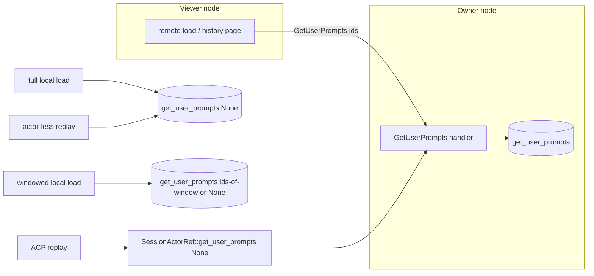

# Design

## Context

See proposal.md - Why. Requirements are in `specs/session-prompt-records/spec.md`.

Today all prompt records come from one projection over the full message history:

- `crates/agent/src/session/load_snapshot.rs` `user_prompt_records` turns `&[AgentMessage]` into records (position = index in the history). `filter_prompt_records` then keeps the requested ids.
- These callers read the full history to get those records:
  - `crates/agent/src/agent/session_actor.rs`: the `impl Message<GetUserPrompts> for SessionActor` handler, which answers a peer's prompt request on the owner.
  - `crates/agent/src/session/load_snapshot.rs` `load_session_snapshot_windowed` (full load) and `windowed_snapshot` (windowed load). The windowed load keeps `record.timestamp >= first_event.timestamp`, comparing second-resolution timestamps.
  - `crates/agent/src/acp/stdio.rs` `stored_user_prompt_blocks`, fed by `replay_loaded_session` (via `SessionActorRef::get_history`) and `actorless_replay_sources` (via `history_store().get_history`).
- `crates/agent/src/session/sqlite_storage/session_store.rs` `impl SessionStore for SqliteStorage` `get_history` works like this:
  - It reads messages `ORDER BY created_at`, which leaves the order of same-second messages undefined.
  - It reads all parts `WHERE message_id IN (…) ORDER BY sort_order`, which needs a temporary B-tree over every part of the session (checked with `EXPLAIN QUERY PLAN`).
  - It decodes every `content_json` into `MessagePart`, so any undecodable part fails the whole read.
- `message_parts.part_type` is written from `MessagePart::type_name()`. Prompt and steering parts are stored as `prompt` / `steering`; checked against a real `sessions.db`: 9,330 / 119 rows, all matching their JSON tag.
- Existing indexes: `idx_messages_session(session_id)` and `idx_message_parts_message(message_id, sort_order)`.
- Remote callers need no change. `crates/agent/src/agent/remote/actor_ref.rs` `SessionActorRef::get_user_prompts` already sends `GetUserPrompts` and falls back to `GetHistory` for owners that predate it. `crates/agent/src/agent/handle/model_registry.rs` `remote_prompt_records_for` already selects by `prompt_message_ids(events)`.

## Goals / Non-Goals

**Goals:**
- One store-level read for prompt records. It touches only `prompt`/`steering` part rows, plus a sort of the session's message ids and timestamps to compute positions.
- Every prompt-record producer uses it: the owner handler, both snapshot builders and ACP replay.
- Positions stay identical to today's: index in the full history, with ties now broken by `id`.

**Non-Goals:**
- No schema migration and no new index. The ordering pass sorts only `(id, created_at)` of one session's messages: about 1,400 rows for the largest local session, measured at under 1 ms.
- The remote load flow, its deadlines and the mesh messages stay as they are.
- `SessionActorRef::get_history` and other full-history users (undo, compaction, forks, middleware) stay unchanged.

## Decisions

### 1. `SessionStore::get_user_prompts` with a default implementation

Add this method to `crates/agent/src/session/store.rs` `SessionStore`:

```rust
async fn get_user_prompts(
    &self,
    session_id: &str,
    message_ids: Option<&[String]>,
) -> SessionResult<Vec<UserPromptRecord>> {
    let history = self.get_history(session_id).await?;
    Ok(filter_prompt_records(user_prompt_records(&history), message_ids))
}
```

- **Why a default:** stores that don't override it keep today's semantics. Every `SessionStore` implementor and `MockSessionStore` keeps compiling: mockall uses the trait default for methods not declared in `mock!`.
- **Existing tests keep working:** load-snapshot tests that set `expect_get_history` (`snapshot_history_failure_is_propagated`, `bookmarked_unattached_session_tolerates_missing_history`) still pass, because the default implementation calls `get_history`.
- **Alternative considered:** a SQLite-only free function called from callers via downcast. Rejected because it leaks storage type into callers and skips mocks.

### 2. SQLite override: one indexed query, decode only prompt parts

```sql
WITH ordered AS (
  SELECT id, ROW_NUMBER() OVER (ORDER BY created_at, id) - 1 AS ord
  FROM messages WHERE session_id = ?1)
SELECT m.public_id, o.ord, m.created_at, p.content_json
FROM ordered o
JOIN messages m ON m.id = o.id
JOIN message_parts p ON p.id = (
  SELECT id FROM message_parts
  WHERE message_id = m.id AND part_type IN ('prompt','steering')
  ORDER BY sort_order LIMIT 1)
WHERE ?2 IS NULL OR m.public_id IN (SELECT value FROM json_each(?2))
ORDER BY o.ord;
```

- **Binding:** `?1` is the internal session id from `resolve_session_internal_id`, which keeps `SessionNotFound` behaviour. `?2` is `NULL` or a JSON array of ids. One parameter means no host-parameter limit and no dynamic SQL.
- **Decoding:** each `content_json` is decoded to `MessagePart`, and the blocks are taken from `Prompt { blocks }` or `Steering { blocks, .. }`.
- **Why the correlated `LIMIT 1`:** it matches "first prompt/steering part" in `user_prompt_records`.
- **Why `ROW_NUMBER` over `(created_at, id)`:** it gives exactly the index `get_history` produces once its message order gains `, id` (decision 3).
- **Measured:** on a copy of the five largest local sessions, the query matched `user_prompt_records(get_history)` for all 93 records. Plan: covering scan of the session's messages, then rowid / index probes; about 1 ms for 20 ids.
- **Requirements:** window functions need SQLite ≥ 3.25 and `json_each` needs ≥ 3.38. rusqlite is built with `bundled` (libsqlite3-sys 0.39), and the local system SQLite is 3.54.
- **Undecodable prompt part:** keeps today's behaviour and fails the request with the decode error. The spec only protects against undecodable *other* content.
- **Alternatives considered:**
  - Filtering by `part_type` in Rust after loading every part. It still reads every part's text, which is the cost being removed.
  - A per-row correlated `count(*)` for positions instead of a window function. It avoids the sort but costs O(n) per returned row; no better at this size.

### 3. `get_history` ordering and plan

- **Message order:** change `ORDER BY created_at ASC` to `ORDER BY created_at, id`. This defines same-second order, and it matches how `delete_messages_after` already treats `id` as insertion order.
- **Parts order:** change the parts query to `ORDER BY message_id, sort_order`. The per-message order the map builds is the same as before, and SQLite now walks `idx_message_parts_message` without a temp B-tree (checked with `EXPLAIN QUERY PLAN`).
- **No other behaviour change:** grouping by message stays as is.

### 4. Callers



- **Owner handler:** `GetUserPrompts` returns `history_store().get_user_prompts(&self.session_id, msg.message_ids.as_deref())`.
- **Full load** (`load_session_snapshot_windowed`, no window): `get_user_prompts(session_id, None)`. The existing `SessionNotFound` tolerance for journal-backed sessions stays.
- **Windowed load** (`windowed_snapshot`):
  - When `read.history.complete`, it passes `None` (every prompt, as today).
  - Otherwise it passes `Some(prompt_message_ids(&audit.events))`. This replaces the timestamp filter and fixes the same-second over-inclusion.
  - Remote windowed loads are unaffected in practice: they have no local rows (`SessionNotFound` → empty), and `build_remote_attach_snapshot_with_budget` merges the owner's records for the window ids.
- **ACP replay** (`acp/stdio.rs`):
  - `stored_user_prompt_blocks` takes `Vec<UserPromptRecord>` instead of `Vec<AgentMessage>`.
  - `replay_loaded_session` calls `session_ref.get_user_prompts(None)`. For a remote session this sends `GetUserPrompts` (with the existing `GetHistory` fallback for old owners) instead of transferring the full history.
  - `actorless_replay_sources` calls `history_store().get_user_prompts(session_id, None)`.
  - The `session.history.load` spans around these calls are kept.

### 5. Telemetry

- **Spans:** `get_history` and the SQLite `get_user_prompts` each run inside an `info_span!` (`session_store.get_history` / `session_store.get_user_prompts`) with `session.id`, `rows = Empty` and `bytes = Empty`.
- **Counts:** the blocking closure returns them (parts read and summed `content_json` length; for prompts, rows returned), and the async side records them on the span after `run_blocking` completes. Recording from the async side avoids depending on span propagation into `spawn_blocking` threads.
- **Default implementation:** only the SQLite override records `session_store.get_user_prompts`; the default implementation is covered by the `get_history` span.
- **Tests:** a small test `tracing_subscriber::Layer` captures span names and recorded fields (`tracing-subscriber` is already a dev-dependency). Tests use `tracing::subscriber::set_default` on a current-thread runtime.

### Affected code and builds

- **Crate:** only `querymt-agent`. The modules involved are `session/store.rs`, `session/sqlite_storage/session_store.rs`, `session/load_snapshot.rs`, `agent/session_actor.rs` and `acp/stdio.rs`.
- **Features:** none of these paths are behind `cfg(feature = …)`. The remote tests that exercise the owner handler over the mesh are `cfg(all(test, feature = "remote"))`.
- **Downstream builds:** no new dependencies. wasm32-wasip1 provider plugins, Python bindings and mobile-ffi are unaffected beyond recompiling against the additive trait method.

## Risks / Trade-offs

- **[Remote speed-up depends on the owner's version]** → Peers send the same `GetUserPrompts` message, so the owner answers fast only once it runs this version. Mixed versions keep working, and the rollout note is in the proposal.
- **[The NAS's 12 s is not yet explained]** → The proposal's evidence shows the time was spent inside the full-history read, and the targeted query reads only index entries plus prompt rows. A plan regression on the NAS would show up in the new spans. Re-measuring after deploy is in Workflow follow-up.
- **[Timing scenario flakiness]** → The 250 ms bound is far above the measured ~1 ms on a 1,000-message session. The test asserts the bound on the production query, not on a mock.
- **[Position semantics drift between `get_history` and `get_user_prompts`]** → Both now use `(created_at, id)`. `same_second_messages_keep_insertion_order` asserts that positions equal indexes in `get_history`.
- **[Stores relying on the default implementation stay slow]** → Only SQLite is a production store, so this is acceptable.

## Migration Plan

- **No schema change and no data migration.** Ship as part of a normal agent release.
- **Rollback:** reverting the commit restores the old reads. Nothing persisted changes shape.
