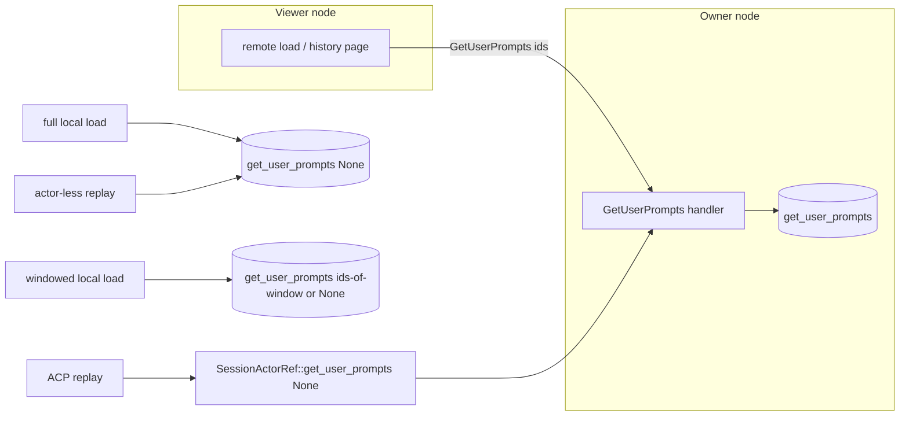

# Design

## Context

See proposal.md - Why. Requirements are in `specs/session-prompt-records/spec.md`.

The agent is split into layered packages (core → sqlite → services → runtime → facade; see AGENTS.md). The code involved:

- **Projection (runtime):** `crates/agent-runtime/src/session/load_snapshot.rs` holds `UserPromptRecord` (typeshare), `user_prompt_records` (turns `&[AgentMessage]` into records; position = index in the history) and `filter_prompt_records` (keeps the requested ids). Both functions are `pub(crate)`.
- **Callers that read the full history to get those records (all runtime):**
  - `agent/session_actor.rs` `impl Message<GetUserPrompts> for SessionActor`, which answers a peer's prompt request on the owner.
  - `session/load_snapshot.rs` `load_session_snapshot_windowed` (full load, around line 216) and `windowed_snapshot` (around line 334). The windowed load keeps `record.timestamp >= first_event.timestamp`, comparing second-resolution timestamps.
  - `acp/stdio.rs` `stored_user_prompt_blocks`, fed by `replay_loaded_session` (via `SessionActorRef::get_history`) and `actorless_replay_sources` (via `history_store().get_history`).
  - `agent/remote/actor_ref.rs` `SessionActorRef::get_user_prompts` projects locally only in its fallback for owners that predate `GetUserPrompts`.
- **Store trait (core):** `crates/agent-core/src/session/session_store.rs` defines `SessionStore`. It is a `dyn` trait in its own file (AGENTS.md: do not add code to that file or above the trait). `get_effective_history` is already a default method that calls a pure core function over `get_history`.
- **SQLite store:** `crates/agent-sqlite/src/session/sqlite_storage/session_store.rs` `get_history`:
  - reads messages `ORDER BY created_at`, which leaves the order of same-second messages undefined;
  - reads all parts `WHERE message_id IN (…) ORDER BY sort_order`, which needs a temporary B-tree over every part of the session (checked with `EXPLAIN QUERY PLAN`);
  - decodes every `content_json` into `MessagePart`, so any undecodable part fails the whole read.
- **Schema** (`crates/agent-sqlite/src/session/schema.rs` `init_schema`; migrations in `sqlite_storage/migrations.rs`, latest `0036_revert_restore_failed`):
  - Message indexes: `idx_messages_public_id` (unique) and `idx_messages_session(session_id)`.
  - Part index: `idx_message_parts_message(message_id, sort_order)`.
  - `message_parts.part_type` is written from `MessagePart::type_name()`. Prompt and steering parts are stored as `prompt` / `steering`.
  - Migration `0001_initial_reset` calls `init_schema`, so a fresh install runs `init_schema` and then every later migration.
  - `legacy_baseline_upgrade_matches_fresh_install` (sqlite `tests.rs`) requires a migrated 0001 baseline to equal a fresh install.
- **Connection:** `SqliteStorage::connect_with_options` (`sqlite_storage/mod.rs`) opens one connection per store. It sets `foreign_keys`, and only when migrating, WAL and `synchronous=NORMAL` (`configure_journal_durability`, which skips `:memory:`). Page cache and memory mapping are at SQLite's defaults: `cache_size` -2000 (about 8 MB), `mmap_size` 0.
- **Remote callers need no change.** `SessionActorRef::get_user_prompts` already sends `GetUserPrompts` (registered as `"querymt::GetUserPrompts"`) and falls back to `GetHistory`. `agent/handle/model_registry.rs` `remote_prompt_records_for` already selects by `prompt_message_ids(events)`.

### Measurements on the local `sessions.db`

Measured on the 3.6 GB local `sessions.db`, read-only, plus an online backup copy in `/tmp` for the migration.

- **Table sizes:**
  - `messages`: 268k rows.
  - `message_parts`: 483k rows, 1.26 GB. `tool_result` is 805 MB, `output` 250 MB and `prompt` 32 MB (9,452 rows); `steering` has 125 rows.
  - `event_journal`: 1.43M rows, 1.14 GB.
- **Assumptions checked, all hold:**
  - every prompt and steering row's `part_type` matches its JSON tag;
  - no message has more than one prompt or steering part;
  - there are no orphan rows.
- **Same-second messages are common:** 93,084 `(session_id, created_at)` groups hold more than one message.
- **Largest session (2,350 messages, 3,593 parts, 12 MB), warm cache:**

  | Read | Plan | Time |
  |---|---|---|
  | messages `ORDER BY created_at, id`, before | temp B-tree | 0.3-1.1 ms |
  | parts, current `ORDER BY sort_order` | temp B-tree | 33 ms |
  | parts, `ORDER BY message_id, sort_order` | no temp B-tree | 8-9 ms |
  | prompt query (decision 3), all 43 prompts, before indexes | temp B-tree for `ROW_NUMBER`; reads every part row to test `part_type` | 2.8-4.6 ms |
  | prompt query, with the decision 4 indexes | covering index scan, prompt index probes | 1.0-1.2 ms |

  All times are SQL only. The current Rust path also JSON-decodes all 12 MB.
- **Indexes (decision 4):** building both and dropping `idx_messages_session` on the copy took 0.22 s, and the file grew by about 4.4 MB.
- **Read cache (decision 5):** with a warm OS cache, a 64 MiB page cache and 256 MiB mmap made no measurable difference locally. They target cold reads on slower storage such as the NAS; the expected effect there is unmeasured.
- **The NAS's 12 s is not reproduced locally.** The leading hypothesis is cold random I/O: each session's parts are scattered through the 1.26 GB table, read through an 8 MB page cache without mmap. The spans in decision 6 will confirm or refute it.

## Goals / Non-Goals

**Goals:**
- One store-level read for prompt records. It touches only `prompt`/`steering` part rows plus an index scan of the session's message ids and timestamps to compute positions.
- Every prompt-record producer uses it: the owner handler, both snapshot builders and ACP replay.
- Positions stay identical to today's: index in the full history, with ties now broken by `id`.
- Indexes that remove the temporary sorts and the per-part `part_type` row reads from both history and prompt reads.
- A larger page cache and memory mapping for file-backed session databases.

**Non-Goals:**
- The remote load flow, its deadlines and the mesh messages stay as they are.
- `SessionActorRef::get_history` and other full-history users (undo, compaction, forks, middleware) stay unchanged.
- No connection pool or separate read connection, and no configurable cache sizes.
- No table changes: tool-result content stays in `message_parts`, and the event journal is untouched.

## Decisions

### 1. Prompt record type and projection move to core

`UserPromptRecord`, `user_prompt_records` and `filter_prompt_records` move unchanged (same derives, serde and typeshare attributes) from `crates/agent-runtime/src/session/load_snapshot.rs` to a new file `crates/agent-core/src/session/prompt_records.rs`, declared as `pub mod prompt_records` in `agent-core/src/session/mod.rs`.

- **Why it must move:** the trait method in decision 2 lives in core, below runtime, so its return type and its default implementation have to be nameable in core. agent-sqlite's tests also compare against `user_prompt_records(&get_history(..))`, and agent-sqlite cannot depend on runtime.
- **Precedent:** the split moved `StreamCursor`/`observe_cursor` out of the same file into core (`agent-core/src/stream_cursor.rs`, re-exported by `load_snapshot.rs`). Core already returns typeshare wire types from storage traits (`ViewStore` → `AuditView`).
- **Dependencies:** `ContentBlock` (`querymt_agent_core::protocol`), `AgentMessage` and `MessagePart` are already in core, and core already depends on `typeshare`, `serde` and `time`. No new dependencies.
- **Paths:**
  - `load_snapshot.rs` re-exports `pub use querymt_agent_core::session::prompt_records::UserPromptRecord;` and `pub(crate) use …::{filter_prompt_records, user_prompt_records};`. Every existing `crate::session::load_snapshot::…` path (session actor, actor ref, model registry, ext_session_history) keeps compiling, and the facade path `querymt_agent::session::load_snapshot::UserPromptRecord` keeps working.
  - The two functions become `pub` in core; they are `pub(crate)` today.
  - `prompt_message_ids` and `merge_prompt_records` stay in runtime; only runtime uses them.
- **Wire:** the mesh reply is matched by the registered message name and the serde shape, not the Rust path, so moving the type changes nothing on the wire. typeshare emits the type once, now from core; the generated TypeScript is unchanged apart from its position in `types.ts` (checked by diff in the tasks).
- **Alternative considered:** a lower-level store type (for example a `StoredPrompt` with the same fields) mapped by runtime. Rejected:
  - it duplicates the four fields;
  - the projection would still have to move to core for the trait default;
  - the old-owner fallback in `actor_ref.rs` would need a second mapping.

  Its only gain, keeping wire-only edits out of core, saves a few seconds of rebuild.

### 2. `SessionStore::get_user_prompts` with a default implementation

Add this method to `SessionStore` in `crates/agent-core/src/session/session_store.rs`, next to `get_effective_history`, using fully qualified paths so the file's imports above the trait don't change:

```rust
async fn get_user_prompts(
    &self,
    session_id: &str,
    message_ids: Option<&[String]>,
) -> SessionResult<Vec<crate::session::prompt_records::UserPromptRecord>> {
    let history = self.get_history(session_id).await?;
    Ok(crate::session::prompt_records::filter_prompt_records(
        crate::session::prompt_records::user_prompt_records(&history),
        message_ids,
    ))
}
```

- **Why a default:** stores that don't override it keep today's semantics.
  - `MockSessionStore` (`agent-core/src/test_support.rs`) keeps compiling: mockall uses the trait default for methods not declared in `mock!`.
  - Load-snapshot tests that only set `expect_get_history` (`snapshot_history_failure_is_propagated`, `bookmarked_unattached_session_tolerates_missing_history`) keep passing, because the default calls `get_history`.
- **Why `SessionStore`, not `ViewStore`:** every caller already goes through `history_store()` (an `Arc<dyn SessionStore>`), and the default needs `get_history`.
- **Alternative considered:** a SQLite-only free function reached by downcast. Rejected because it leaks the storage type into callers and skips mocks.

### 3. SQLite `get_user_prompts`: one indexed query, decode only prompt parts

```sql
WITH ordered AS (
  SELECT id, ROW_NUMBER() OVER (ORDER BY created_at, id) - 1 AS ord
  FROM messages WHERE session_id = ?1)
SELECT m.public_id, o.ord, m.created_at, p.content_json
FROM ordered o
JOIN messages m ON m.id = o.id
JOIN message_parts p ON p.id = (
  SELECT id FROM message_parts
  WHERE message_id = m.id AND part_type IN ('prompt', 'steering')
  ORDER BY sort_order LIMIT 1)
WHERE ?2 IS NULL OR m.public_id IN (SELECT value FROM json_each(?2))
ORDER BY o.ord;
```

- **Binding:**
  - `?1` is the internal session id from `resolve_session_internal_id`, which keeps the `SessionNotFound` behaviour.
  - `?2` is `NULL` or a JSON array of ids (`serde_json::to_string`). One parameter means no host-parameter limit and no dynamic SQL.
- **Decoding:** each `content_json` is decoded to `MessagePart`, and the blocks are taken from `Prompt { blocks }` or `Steering { blocks, .. }`.
- **Why the correlated `LIMIT 1`:** it matches "first prompt/steering part" in `user_prompt_records`.
- **Why `ROW_NUMBER` over `(created_at, id)`:** it gives exactly the index `get_history` produces once its message order gains `, id` (decision 3a).
- **Partial index match:** the `part_type IN ('prompt', 'steering')` term must stay textually identical to the predicate of `idx_message_parts_prompt` (decision 4) for SQLite to use the index. The same rule already applies to `idx_event_journal_run_lifecycle`. The SQL is kept in a `const` so a plan test can check it, following `last_unfinished_run_query_uses_run_lifecycle_index`.
- **Plan with the decision 4 indexes:**
  - messages: `SEARCH … USING COVERING INDEX idx_messages_session_order`, so the window function needs no sort;
  - prompt parts: `SEARCH message_parts USING INDEX idx_message_parts_prompt`;
  - one final small sort of the returned rows by `ord`.
- **Measured:**
  - on copies of the five largest local sessions, the query matched `user_prompt_records(get_history)` for all 93 records;
  - 1.0-1.2 ms for 43 prompts with the indexes.
- **Requirements:** window functions need SQLite ≥ 3.25, `json_each` needs ≥ 3.38 and partial indexes ≥ 3.8. rusqlite 0.41 is built with `bundled` (libsqlite3-sys 0.39).
- **Undecodable prompt part:** keeps today's behaviour and fails the request with the decode error. The spec only protects against undecodable *other* content.
- **Alternatives considered:**
  - Filtering by `part_type` in Rust after loading every part. It still reads every part's text, which is the cost being removed.
  - A per-row correlated `count(*)` for positions instead of a window function. It costs O(n) per returned row; no better at this size.

### 3a. `get_history` ordering and plan

- **Message order:** `ORDER BY created_at ASC` becomes `ORDER BY created_at, id`. This defines same-second order, and it matches how `delete_messages_after` already treats `id` as insertion order (`id >= ?`).
- **Parts order:** `ORDER BY sort_order` becomes `ORDER BY message_id, sort_order`. Each message gets its parts in the same order as before, and SQLite walks `idx_message_parts_message` without a temporary B-tree.
- **Plan with decision 4:** messages come from `idx_messages_session_order` with no sort (`rowid` is the index's implicit last column, so `created_at, id` is index order).
- **No other behaviour change:** grouping by message and the decode of every part stay as they are; `get_history` still fails on an undecodable part.

### 4. Indexes: migration `0037_session_message_read_indexes`

```sql
CREATE INDEX IF NOT EXISTS idx_messages_session_order
    ON messages(session_id, created_at);
CREATE INDEX IF NOT EXISTS idx_message_parts_prompt
    ON message_parts(message_id, sort_order)
    WHERE part_type IN ('prompt', 'steering');
DROP INDEX IF EXISTS idx_messages_session;
```

- **`idx_messages_session_order`** serves history order for both reads. Its `session_id` prefix also serves every query that used `idx_messages_session`; for example `delete_messages_after` (`session_id = ? AND id >= ?`) and per-session counts plan onto it. That index is therefore dropped rather than kept as a redundant write cost.
- **`idx_message_parts_prompt`** holds about 9.6k entries locally (2% of parts). It lets the correlated subquery find a message's first prompt or steering part from the index alone, instead of opening each of the message's part rows to test `part_type`. On a cold NAS those row reads are random reads in the 1.26 GB table.
- **Fresh and upgraded databases agree:**
  - `init_schema` gets the same two `CREATE INDEX` statements and no longer creates `idx_messages_session`. A fresh install runs `init_schema` (through 0001) and then 0037, whose `IF NOT EXISTS` / `IF EXISTS` statements are then no-ops.
  - A legacy database gets the indexes from 0037.
  - `legacy_baseline_upgrade_matches_fresh_install` checks that the two agree, with `KNOWN_BENIGN_DRIFT` left empty.
- **Released migrations stay frozen.** The migration inlines its DDL instead of sharing a constant with `init_schema`, as `0035_knowledge_junction_tables` does.
- **Cost:** 0.22 s and about 4.4 MB on the 3.6 GB local database, run once on start. Each message insert writes one index entry, the same count as before because one index replaces another; each prompt or steering part writes one more.
- **Older binaries:** `apply_migrations` iterates its own migration list, so an older binary ignores the unknown `0037` row. Its queries plan onto the new `messages` index. Nothing recreates `idx_messages_session`, which is harmless.
- **Alternatives considered:**
  - `messages(session_id, created_at, id)`: the same as the chosen index, because `id` is the rowid.
  - Keeping `idx_messages_session`: a redundant index with write cost and no read benefit.
  - A `(message_id, part_type, sort_order)` full index: about 50 times larger, and a full index still holds entries for tool results.

### 5. Read cache: `cache_size` and `mmap_size`

A new helper in `sqlite_storage/mod.rs` sets the read cache:

```rust
/// 64 MiB page cache (negative = KiB) and up to 256 MiB memory-mapped reads.
const SESSION_DB_CACHE_KIB: i64 = 65_536;
const SESSION_DB_MMAP_BYTES: i64 = 268_435_456;

fn configure_read_cache(conn: &Connection, path: &Path) -> Result<(), rusqlite::Error>
```

- **Which connections:** `connect_with_options` calls it right after `foreign_keys`, for both `migrate = true` and `false`, so read-only tools (`replay_session`, `export_sft`) benefit too. It skips `:memory:` and empty paths, like `configure_journal_durability`.
- **How:** `PRAGMA cache_size = -65536` sets a 64 MiB per-connection cache. The cache is allocated as pages are read, so a small database never uses it all. `PRAGMA mmap_size = 268435456` lets SQLite read the first 256 MiB of the file through memory mapping, which avoids a copy per page and shares pages with the OS cache.
- **Errors:** `cache_size` cannot fail on a valid connection. `mmap_size` is capped silently by the build's `SQLITE_MAX_MMAP_SIZE`, and if mmap is unavailable it stays 0 and SQLite falls back to normal reads. A failed pragma returns the error, consistent with `foreign_keys`.
- **Why fixed constants:** there is one connection per store, and 64 MiB covers the hot set of several large sessions (the largest local session is 12 MB of parts). 256 MiB bounds mapped address space and resident pages on memory-constrained hosts such as the NAS, while still covering the most-read start of the file. A setting can be added later if needed (proposal non-goal).
- **Not measured locally:** with a warm OS cache there was no difference. The effect on the NAS is checked through the spans after deploy (Workflow follow-up).
- **Alternatives considered:**
  - A larger mmap (the whole file): costs address space on a 3.6 GB file for no proven gain.
  - Leaving defaults: the 8 MB cache cannot hold one large session's parts, so repeated loads go back to disk.

### 6. Callers



- **Owner handler** (`agent-runtime/src/agent/session_actor.rs`): `GetUserPrompts` returns `history_store().get_user_prompts(&self.session_id, msg.message_ids.as_deref())`, errors mapped to `AgentError::Internal` as today.
- **Full load** (`load_session_snapshot_windowed`, no window): `get_user_prompts(session_id, None)`. The existing `SessionNotFound` tolerance for journal-backed sessions stays.
- **Windowed load** (`windowed_snapshot`):
  - When `read.history.complete`, it passes `None` (every prompt, as today).
  - Otherwise it passes `Some(&prompt_message_ids(&audit.events))`. This replaces the timestamp filter and fixes the same-second over-inclusion.
  - Remote windowed loads are unaffected in practice: they have no local rows (`SessionNotFound` → empty), and `build_remote_attach_snapshot_with_budget` merges the owner's records for the window ids.
- **ACP replay** (`agent-runtime/src/acp/stdio.rs`):
  - `stored_user_prompt_blocks` takes `Vec<UserPromptRecord>` instead of `Vec<AgentMessage>`.
  - `replay_loaded_session` calls `session_ref.get_user_prompts(None)`. For a remote session this sends `GetUserPrompts` (with the existing `GetHistory` fallback for old owners) instead of transferring the full history.
  - `actorless_replay_sources` calls `history_store().get_user_prompts(session_id, None)`.
  - The `session.history.load` spans around these calls are kept.

### 7. Telemetry

- **Spans:** the SQLite `get_history` and `get_user_prompts` each run inside an `info_span!` (`session_store.get_history` / `session_store.get_user_prompts`) with `session.id`, `rows = Empty` and `bytes = Empty`. agent-sqlite already depends on `tracing` and uses `#[tracing::instrument]` in `view_store.rs`.
- **Counts:** the blocking closure returns them, and the async side records them on the span after `run_blocking` completes. Recording from the async side avoids depending on span propagation into `spawn_blocking` threads.
  - for history: parts read and the summed `content_json` length;
  - for prompts: rows returned and the summed prompt `content_json` length.
- **Default implementation:** only the SQLite override records `session_store.get_user_prompts`; the default implementation is covered by the `get_history` span.
- **Tests:** a small test `tracing_subscriber::Layer` captures span names and recorded fields, using `tracing::subscriber::set_default` on a current-thread runtime. agent-sqlite gains `tracing-subscriber = "0.3"` as a dev-dependency (runtime already has it); run `cargo hakari generate` / `verify` afterwards.

### Affected code and builds

| Package | Files | What changes |
|---|---|---|
| `querymt-agent-core` | `session/prompt_records.rs` (new), `session/mod.rs`, `session/session_store.rs` | moved type and projection; trait method |
| `querymt-agent-sqlite` | `sqlite_storage/session_store.rs`, `sqlite_storage/mod.rs`, `sqlite_storage/migrations.rs`, `session/schema.rs`, `sqlite_storage/tests.rs`, `Cargo.toml` | query, ordering, spans, migration, cache, tests |
| `querymt-agent-runtime` | `session/load_snapshot.rs`, `agent/session_actor.rs`, `acp/stdio.rs`, `agent/remote/test_helpers.rs` | callers, re-exports, a test fixture field |
| `querymt-agent` | `src/runtime_tests/remote_session_actor_ref.rs` | mesh tests only |

- **Features:** none of these paths are behind `cfg(feature = …)`. The mesh tests are `cfg(all(test, feature = "remote"))` in the facade.
- **Rebuild cost:** editing core (`session_store.rs`, a `dyn` trait file) rebuilds every layer above, about 15-19 s per edit (AGENTS.md); do the core work first and in one step.
- **Downstream builds:** no new runtime dependencies. wasm32-wasip1 provider plugins don't depend on the agent crates. Python bindings and mobile-ffi only recompile against the additive trait method.

## Risks / Trade-offs

- **[Remote speed-up depends on the owner's version]** → Peers send the same `GetUserPrompts` message, so the owner answers fast only once it runs this version. Mixed versions keep working, and the rollout note is in the proposal.
- **[The NAS's 12 s is not yet explained]** → The proposal's evidence shows the time was spent inside the full-history read. The targeted query reads only index entries plus prompt rows, and the cache settings target cold reads. A remaining slow load would show up in the new spans. Re-measuring after deploy is in Workflow follow-up.
- **[Partial index silently unused]** → If the query's `part_type` predicate drifts from the index predicate, SQLite falls back to `idx_message_parts_message` and reads each part row; results stay correct, only slower. `session_message_reads_use_indexes` plans the production `const`s against the migrated schema.
- **[Memory mapping and I/O errors]** → With mmap, an I/O error on the database file (for example a failing disk, or a database on a network share) raises a signal instead of an error return. This is SQLite's documented trade-off. The session database lives on local storage by default (`~/.qmt/sessions.db`); deployments that put it on a network filesystem should not, regardless of this change (WAL already requires shared memory). The limit is 256 MiB, not the whole file.
- **[Memory use]** → Up to 64 MiB of page cache per file-backed store, allocated only as pages are read. A node usually opens one store; quorum and tests may open more, mostly `:memory:` (skipped).
- **[Migration on large databases]** → Index builds scan `messages` and `message_parts` once: 0.22 s on 3.6 GB locally, likely a few seconds on the NAS. It runs inside start-up like earlier index migrations (0032).
- **[typeshare output moves]** → Emitting `UserPromptRecord` from core may reorder `types.ts`. The diff is checked in the tasks; a content change would be a bug in the move.
- **[Timing scenario flakiness]** → The 250 ms bound is far above the measured ~1 ms. The test asserts the bound on the production query, not on a mock.
- **[Position semantics drift between `get_history` and `get_user_prompts`]** → Both use `(created_at, id)`. `same_second_messages_keep_insertion_order` asserts that positions equal indexes in `get_history`.
- **[Stores relying on the default implementation stay slow]** → Only SQLite is a production store, so this is acceptable.

## Migration Plan

- **Schema:** `0037_session_message_read_indexes` adds two indexes and drops one, automatically on start. No data changes.
- **Release:** ship as part of a normal agent release; CHANGELOG notes the migration and the cache settings under `### Behavior changes`.
- **Rollback:**
  - Reverting the commit restores the old reads and connection settings.
  - A database already migrated keeps the new indexes and lacks `idx_messages_session`. Older binaries work with that: their `session_id` lookups use the new index, and nothing requires the dropped one.
  - To restore the old index set exactly, run the inverse DDL by hand (`CREATE INDEX idx_messages_session ON messages(session_id)`, drop the two new indexes, delete the `0037` row from `schema_migrations`).
