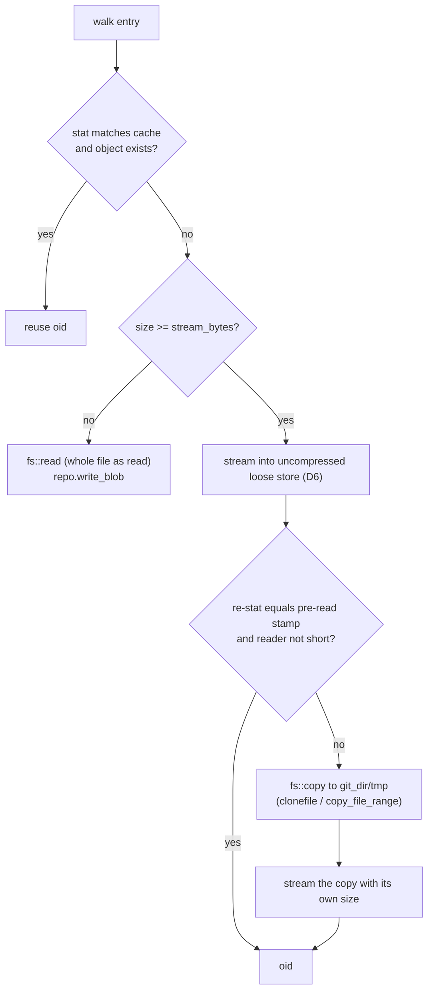
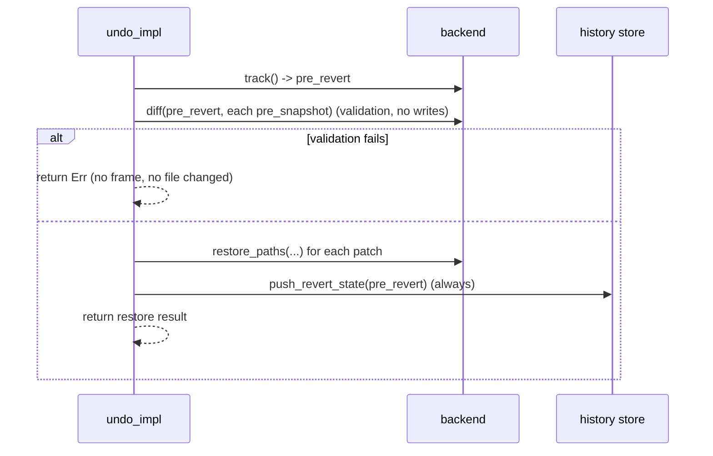

# Design

## Context

See proposal.md for the motivation. The scenarios referenced here are in `specs/workspace-snapshots/spec.md`.

All of this code lives in `querymt-agent`. No `cfg(feature)` gates it, and it is not built for wasm32-wasip1, Python or mobile-ffi beyond the normal `querymt-agent` dependency.

Current code this change builds on:

- **Snapshot backend:** `crates/agent/src/snapshot/git.rs` (2.2k lines).
  - `GitSnapshotBackend::create_snapshot` is a single pass:
    1. Walk with `ignore::WalkBuilder` (dot-dirs pruned, `require_git` left at its default `true`, `git_exclude(false)`).
    2. Check the stat cache (`StatCache`, `FileStamp`, `RACY_WINDOW_NS`).
    3. Write blobs with `write_file_blob` / `write_stream_blob` and `ExactReader`.
    4. Build the tree with `build_tree_from_entries`.
    5. Commit with HEAD as parent.
  - `max_file_bytes` and `SKIPPED_TRAILER` / `skipped_paths` add the coverage holes.
  - `diff_commits` calls `diff_tree_to_tree(.., None)`. With `None`, gix uses its configuration, which turns on rename tracking (gix `src/diff.rs` `Options::from_configuration`).
  - `checkout_paths`:
    - clones each blob into memory (`object.data.clone()`);
    - writes it with `fs::write`, so no atomicity and no mode;
    - ignores `remove_file` errors.
  - `restore_tree_recursive` ignores every write error.
  - `gc` only counts commits.
  - `diff`, `restore_paths`, `restore` and `gc` build a fresh `GitSnapshotBackend::new()` and ignore `self`. They see the test-only `snapshot_base_override` only through a `#[cfg(test)]` copy.
- **Trait and errors:** `crates/agent/src/snapshot/backend.rs` defines `SnapshotBackend`, `SnapshotError` (string variants only), `GcConfig` and `GcResult`.
- **Undo/redo:** `crates/agent/src/agent/undo.rs` has `undo_impl` (track → validate every patch with `diff` → restore patches → push frame) and `redo_impl`.
- **Turn snapshots:** `crates/agent/src/agent/session_actor.rs` `execute_prompt_inner` handles the post-turn snapshot and `let _ = backend.gc(..)`.
- **Config:** `crates/agent/src/config/execution.rs` has `SnapshotBackendConfig`. `crates/agent/src/agent/agent_config_builder.rs` has `with_snapshot_from_execution`, and `snapshot_gc_config` is never set from config. `crates/agent/src/api/quorum.rs` builds `GitSnapshotBackend::new().with_max_file_bytes(..)` for the planner and delegates.

The rust-skills rules applied below are cited by id.

## Goals / Non-Goals

**Goals:**
- Every file in scope is captured. The capture cost of a changed file stays close to the cost of hashing it.
- No restore path can drop an error.
- Garbage collection is off by default. Without `max_snapshots`/`max_age_days`, undo and redo never fail because a snapshot was deleted. With them, GC really deletes, and undo/redo past the window fail without changing files.
- Keep the store a plain git object database, so `git` can inspect it and existing stores keep working.

**Non-Goals:**
- A side store for large files (`clonefile`).
- Parallel hashing.
- Symlink capture.
- Serialized `track` calls.

See the proposal's Non-goals section for the reasons.

## Decisions

### D1. Split `snapshot/git.rs` into a module directory

`snapshot/git/` gets:

- `mod.rs`: the backend type, the `SnapshotBackend` impl, open/init and locking;
- `capture.rs`: walk, stat cache, blob writes, tree;
- `restore.rs`: diff, checkout, atomic writes;
- `gc.rs`: retention, sweep and the store-size gauge;
- `tests.rs`.

The first step is a pure move (proj-mod-by-feature, proj-pub-crate-internal). Each later decision then touches one file.

### D2. The backend carries its configuration; all trait methods use `self`

`GitSnapshotBackend { snapshot_base: Option<PathBuf>, limits: Limits }`:

- `with_snapshot_base` becomes a public, `#[must_use]` builder (api-builder-must-use). The `#[cfg(test)]` field and the four copied `new()`/override blocks go away.
- Every trait method clones `self` into its `spawn_blocking` closure (async-spawn-blocking). The clone is a `PathBuf` plus a few `u64`.
- `Limits { stream_bytes: u64 = 16 MiB, large_warn_bytes: u64 = 64 MiB, store_warn_bytes: u64 = 5 GiB, store_measure_every_bytes: u64 = 64 MiB }` is `pub(crate)` with `Default`, set through `pub(crate) fn with_limits`. Tests can then exercise the threshold logic with KiB-sized files. One real 17 MiB test still covers the default `stream_bytes` threshold.

Alternative: keep the constants and write 64 MiB fixtures in tests. Rejected, because a dozen such files make the test suite slow.

### D3. `SnapshotError::Io` keeps the source and the path

Add `#[error("{op} {path}: {source}")] Io { op: &'static str, path: PathBuf, #[source] source: std::io::Error }` (err-source-chain, err-custom-type).

- New code builds it through `fn io_err(op, path) -> impl FnOnce(io::Error) -> SnapshotError`.
- `UndoError::from(SnapshotError)` still stores `to_string()`. The message therefore names the path, which the undo/redo failure scenarios assert, and the serializable `UndoError` does not change.
- `op` is a fixed set of strings ("write", "delete", "read", ...) and doesn't allocate.

### D4. Capture: no size cap, racing files are copied, type-safe outcomes



- **Remove the cap.** Delete `max_file_bytes`, `with_max_file_bytes`, `DEFAULT_MAX_FILE_BYTES`, `SKIPPED_TRAILER`, `skipped_paths`, the `skipped` map, its warnings, and the filters in `diff_commits` / `checkout_paths`. A snapshot is complete when it is the tree plus the ignore rules.
- **One outcome type.** `write_file_blob` returns `CaptureOutcome { Stored(ObjectId), Changed }` (type-enum-states) instead of `Option<ObjectId>`. Only the stream path can return `Changed`. That covers the case where `ExactReader` saw a short read, or a re-stat after the read differs from the pre-read `FileStamp`, which also catches growth. In that case the file is captured from a point-in-time copy.
  - `std::fs::copy` already clones on APFS (`fclonefileat`) and uses `copy_file_range` on Linux, so no `unsafe` FFI is needed.
  - The copy lives in a `tempfile::TempDir` under the snapshot git dir and is removed on drop (test-fixture-raii applies equally to production temp files).
  - Small files are read whole by `fs::read` and need no recheck. They are captured exactly as read.
- **Keep the stat cache and its `RACY_WINDOW_NS` rule.** They implement "Unchanged files are not read again".
- **Stats.** `SnapshotStats` drops `skipped_large_files` / `skipped_unstable_files` and gains:
  - `copied_files` (racing files captured from a copy);
  - `newly_large_files`;
  - `reused: bool`.

  The `snapshot.git.track` span records them as structured fields (obs-structured-fields).

### D5. Scope: honour the ignore files, including outside git

`WalkBuilder` settings:

- `.hidden(false)` (dot entries are still pruned by `filter_entry`);
- `.ignore(true)`;
- `.git_ignore(true)`;
- `.git_exclude(true)`;
- `.git_global(false)`;
- `.require_git(false)`.

`require_git(false)` is the fix for "Gitignore applies outside a git repository".

This is a correctness fix only. The reported slowness happened in a git repository whose `.gitignore` was already honoured. There, the cost came from:

- re-reading and SHA-1 hashing every non-ignored file on every snapshot (fixed by the stat cache);
- deflating large non-ignored files (fixed by D6);
- writing a commit on every track (fixed by D7). `git_exclude(true)` adds `.git/info/exclude`, which the `ignore` crate resolves for linked worktrees through `commondir`.

No new ignore-file name is added. `.ignore` is documented as the opt-out.

Alternatives considered:

- Add a `snapshot.exclude` glob key. Rejected: `.ignore` already does this per directory and is understood by ripgrep and fd.
- Have `.gitignore` apply only inside repositories. Rejected: in non-git workspaces, undo would keep reverting build output.

### D6. Large blobs are written uncompressed and read back streaming

- **Write.** `capture.rs` opens a second loose store on the same directory:

  ```rust
  gix::odb::loose::Store::at_opts(
      git_dir.join("objects"),
      repo.object_hash(),
      gix::odb::loose::Options {
          compression: gix::zlib::Compression::NONE,
          alloc_limit_bytes: None,
      },
  )
  ```

  Blobs of at least `stream_bytes` go through its `write_stream`. The result is a valid zlib stream of stored blocks, so `git`, gix and older querymt builds read it unchanged. Measured here: deflate level 1 runs at about 73 MB/s on incompressible data, and level 0 is effectively a copy.
- **No extra read for existing objects.** On a stat-cache miss, the large blob is written in one pass instead of hashing first and then checking whether it exists. That pass costs one read plus one write. Hashing first would cost two reads whenever the object is new, which is the common case on a miss.
- **Restore.**
  1. Read the object size with `repo.find_header(id)`.
  2. If it is at least `stream_bytes` and the loose file exists, open `objects/xx/yyyy…`.
  3. Wrap the file in `flate2::read::ZlibDecoder<BufReader<File>>` (perf-io-buffering).
  4. Read and check the `blob <size>\0` header with `gix::objs::decode::loose_header`.
  5. `io::copy` the body into the restore temp file (D8) through a `gix::hash::hasher` tee.
  6. Compare the final hash with the id before persisting. A mismatch is an error and leaves no file behind.

  Smaller blobs and packed objects use `repo.find_object` and write `&object.data` as a borrowed slice (own-borrow-over-clone). This also removes today's `object.data.clone()`.
- **Dependencies.** `flate2` (`default-features = false, features = ["rust_backend"]`) moves from build-dependency/dev-dependency to a crate-local normal dependency. It is already in the lockfile, with no new feature gating, and provider crates are unaffected.

Alternatives considered:

- `gix::zlib::stream::inflate::read`. Rejected: it is a lower-level fill-buffer API.
- Packing large blobs. Rejected: packs need an index rewrite on each write.

### D7. An unchanged workspace reuses HEAD

After `build_tree_from_entries`, if `repo.head_commit()?.tree_id() == tree_id`, return the HEAD id and set `stats.reused = true`. No commit is written.

- `session_actor` already compares `pre_snapshot_id != post_snapshot_id`, so read-only turns now skip the diff entirely.
- Before this change, every `track` wrote a commit, so the store grew even during read-only turns.

### D8. Diffs report both paths of a move

`diff_commits` passes `Some(gix::diff::Options::default())`. Its `rewrites` field is `None`, so a move appears as a deletion plus an addition, and both locations are collected. The paths go into a `BTreeSet<PathBuf>` (coll-set-membership) for sorted, deduplicated output.

Undo already restores paths present in the target and deletes paths missing from it. Moves therefore round-trip with no undo change. This also stops gix from loading blob contents for similarity checks.

### D9. Atomic restore with permissions, and every error propagated

`restore.rs` gets `fn write_entry(worktree, rel, blob_source, executable) -> SnapshotResult<()>`, used by both `checkout_paths` and `checkout_all`:

1. `create_dir_all(parent)`. On error, `Io { op: "create directory" }`.
2. `tempfile::NamedTempFile::new_in(parent)`, created with mode 0600.
3. Write the blob to it, streamed or from the slice (D6).
4. Compute the mode.
   - If the target exists: its current mode with the `0o111` bits cleared, then, when executable, `| ((mode & 0o444) >> 2)` (git's rule).
   - Otherwise `0o644` or `0o755`.
   - `#[cfg(unix)]` only; elsewhere nothing changes.
5. `set_permissions`, then `persist(target)`. `persist` is a single `rename`, so readers see the old file or the new one, never a partial write.

`NamedTempFile` deletes itself on drop, so every early return leaves no temporary file behind.

Deletions use `match fs::remove_file { Err(e) if e.kind() == NotFound => Ok(()), r => r.map_err(io_err("delete", ..)) }`. Every `let _ = fs::…` in restore is removed (anti-empty-catch). `tempfile` becomes a crate-local normal dependency; it is already in the lockfile through gix.

### D10. A failed undo still records how to get back

In `undo_impl`:

1. `pre_revert_snapshot` is taken.
2. All patches are validated, which is unchanged. If validation fails, no file has been touched and no frame is pushed.
3. The restore loop is collected into `let restore_result: Result<(), UndoError> = async { … }.await`.
4. The redo frame is pushed **whether or not restore succeeded**.
5. `restore_result` is returned, so undo returns the error.

A partially failed undo can therefore always be redone back to the state before the undo.

`redo_impl` already pops its frame only after `restore_paths` succeeds, so failed redos keep the frame. Tests pin that behaviour.



### D11. Retention configuration is typed, off by default and wired through

- **Typed config.** `SnapshotBackendConfig.max_snapshots: Option<NonZeroUsize>` and `max_age_days: Option<NonZeroU64>`, both defaulting to `None` (num-nonzero, api-parse-dont-validate).
  - `None` for both means no GC.
  - serde rejects `0` for these types, and the error names the key.
  - TOML negatives fail the unsigned parse.
  - schemars 1.x emits `minimum: 1`.
  - JSON `null` deserializes to `None`.
  - The old defaults (100, 30) never had an effect, because `snapshot_gc_config` was never set from config and `gc` never deleted. Unset is therefore no behaviour change.
- **Conversion.** `impl From<&SnapshotBackendConfig> for GcConfig` (api-from-not-into) keeps `GcConfig`'s plain public fields. `GcConfig::default()` becomes `{ None, None }`, with `fn is_enabled(&self) -> bool` (name-is-has-bool).
- **Wiring.** `with_snapshot_from_execution` also sets `snapshot_gc_config`. It already runs for single agents, quorum planners and delegates. The quorum's extra `GitSnapshotBackend::new()` construction just loses its `.with_max_file_bytes(..)`.
- **Call site.** `session_actor` `execute_prompt_inner` calls `gc` only when `config.snapshot_gc_config.is_enabled()`, and replaces `let _ = backend.gc(..)` with a `warn!` on error, carrying the error as a field (anti-empty-catch, obs-error-chain). `gc` itself also returns `{ removed_count: 0, remaining_count }` without touching the store when both limits are `None`, so other callers get the same guarantee.

### D12. Opt-in GC prunes by window and sweeps unreachable loose objects

`gc.rs` gets `fn collect_garbage(repo, cfg: &GcConfig, now: SystemTime, lock: &SnapshotLock) -> SnapshotResult<GcResult>`. The trait method passes `SystemTime::now()`, and tests inject `now` (for example, 31 days later).

1. **Disabled.** If `!cfg.is_enabled()`, count commits and return. Nothing is deleted.
2. **Walk the commits.** `list_commits` walks first parents from HEAD. It already stops at a missing commit, so the chain ends at the last sweep.
3. **Choose what to keep.** Keep HEAD, then commits newer than `now - max_age_days`, up to `max_snapshots` in total. The rest are pruned. `GcResult { removed_count, remaining_count, deleted_objects }`.
4. **Decide whether to sweep.** Only if `pruned.len() >= 10` (amortizes the cost) and `lock.try_exclusive()` succeeds.
5. **Mark.** Build a `gix::hashtable::HashSet<ObjectId>` of every commit, tree and blob reachable from the **kept commits' trees and ids only**. Parent links are ignored, which makes pruned commits unreachable without rewriting any commit id. Session history stores those ids, so they must not change.
6. **Delete.** First delete the pruned commit objects, so an interrupted sweep never leaves a reachable commit with missing blobs. Then iterate `gix::odb::loose::Store::iter()` and delete every object not in the set. Errors other than `NotFound` are returned as `Io`.

Packed objects are never deleted. querymt never packs, but a user's `git gc` could.

`SnapshotLock` is `fs::File::lock_shared` / `try_lock` on `<git_dir>/qmt-snapshot.lock` (std file locks, stable; the toolchain is 1.99):

- `track`, `restore_paths` and `restore` hold a shared lock for their whole blocking body.
- The sweep needs the exclusive lock and skips when it is busy.

This rules out deleting a blob that an in-flight `track` wrote but has not committed yet, across processes too. The lock is taken whether or not GC is enabled, so the code path is the same in both modes; an uncontended shared `flock` costs microseconds.

**Undo and redo past the window.** `undo_impl` validates every patch with `diff(pre_revert, pre_snapshot)` before restoring anything, and `redo_impl` runs `diff(current, revert_snapshot)` before restoring and pops its frame only after success. A pruned commit fails `diff` with `NotFound`, so both fail before any file changes and redo keeps its frame. No code change is needed for this; tests pin it.

Alternatives considered:

- GC on by default (100 snapshots / 30 days). Rejected: the store is per workspace path, so all sessions and delegates in a repo share the budget, and undo to an early turn or a resumed old session would fail without the user having asked for it.
- Rewrite kept commits without parents. Rejected: it changes ids.
- Shell out to `git gc --prune`. Rejected: it needs the git CLI, and the agent deliberately uses pure gix.
- An mtime grace period instead of a lock. Rejected: it makes deletion timing-dependent and hard to test.
- Deleting only snapshots that no session references, by pinning them. Deferred to a follow-up (proposal Non-goals). It would make enabled GC safe for live sessions.

**Store-size gauge.** With GC off by default the store only grows, so the agent reports when it gets large. A process-global `static STORE_GAUGES: LazyLock<Mutex<HashMap<PathBuf, StoreGauge>>>` is keyed by snapshot git dir, where `StoreGauge { measured_bytes: u64, pending_bytes: u64, warned: bool }`. The mutex is only held inside the blocking `track` body, never across `.await` (async-no-lock-await).

At the end of each `track`:

1. Skip if `warned`.
2. Add `stats.bytes_hashed` to `pending_bytes`.
3. Measure when there is no measurement yet in this process, or when `pending_bytes >= store_measure_every_bytes`. Measuring sums `metadata().len()` over the files under `<git_dir>/objects` and resets `pending_bytes`.
4. If `measured_bytes >= store_warn_bytes`, set `warned` and log once: `tracing::warn!(store = %git_dir.display(), size_bytes, "…add large paths to .ignore or set max_snapshots/max_age_days")`.

Content that was read is never smaller than what it adds to disk (compressed or stored blocks plus a small header). The warning therefore comes at most `store_measure_every_bytes` of captured content after the store crosses the limit, and never before, because only real measurements trigger it. The full walk runs at most once per 64 MiB captured, plus once per process per workspace.

Alternative: walk `objects/` after every snapshot. Rejected, because the cost grows with the object count on every changed turn, which is the slowness this change fixes.

### D13. Large-file warnings come from the previous snapshot

For each captured file of at least `large_warn_bytes`:

1. Look the path up in HEAD's tree.
2. If HEAD has no entry for it, or that entry's object header size (`repo.find_header`) is below the threshold, the file is newly large.

The stat cache can't decide this, because racily-clean files are not cached. HEAD lookups only happen for large files, so they cost nothing for normal trees.

A pure `fn large_file_warnings(newly: &[(String, u64)]) -> (Vec<…>, usize)` produces at most 10 named entries plus the remainder count, and is unit-tested. The snapshot emits them with `tracing::warn!(path = %p, size_bytes = s, "…add it to .ignore to leave it out of undo")`.

### D14. Benchmark before optimizing further

`crates/agent/benches/snapshot_track.rs` is a criterion bench (anti-premature-optimize, perf-black-box-bench) that uses the now-public `with_snapshot_base`. Groups:

- 2 000 small files, cold;
- 2 000 small files, warm (unchanged);
- one 256 MiB random file, new;
- the same file, unchanged.

Numbers before and after are recorded in tasks.md. Parallel hashing and a reflink side store wait for these numbers.

## Risks / Trade-offs

- **Uncompressed large blobs take more disk.**
  - Model weights and archives don't compress anyway, so the cost is small for them.
  - Large text logs grow.
  - Users can `.ignore` heavy paths, and the large-file and store-size warnings tell them about the cost.
- **By default the snapshot store only grows.** GC is off unless configured, so a large file that changes every turn adds its full size each time. Mitigations: the 64 MiB file warning, the 5 GiB store warning, `.ignore`, and opting into `max_snapshots`/`max_age_days`.
- **Enabled GC can block undo.** The budget is shared by every session and delegate in the workspace, so with `max_snapshots = 20` a busy repo can prune a live session's early turns. Undo/redo then fail before changing files, and redo keeps its frame. This is documented next to the keys. Pinning referenced snapshots is the follow-up that removes this.
- **Pruned parents leave dangling links.** `git log`/`fsck` in the snapshot store stop at the pruning boundary with a missing-object note. `cat-file`, gix and our own walks are unaffected. This is an internal store.
- **Race between undo's validation and its restore.** A concurrent GC from another session could prune between the two steps. Restore then fails with `NotFound`, and with D10 a redo frame still exists. Accepted: the window is small, only exists with GC enabled, and the result is recoverable.
- **The ignore scope can move.** Editing `.gitignore`/`.ignore` mid-session moves paths in or out of scope. A path that leaves scope looks deleted in the next diff, and undo could recreate it. This is pre-existing behaviour and is documented.
- **Snapshot stores from unreleased `fix/snapshot` builds.** Commits there may lack large files. Undo across such a commit treats the file as added and could delete it. Only development builds wrote those stores. Mitigation: a CHANGELOG/dev note to clear `~/Library/Caches/querymt/snapshots` (or `$XDG_CACHE_HOME/querymt/snapshots`) after updating a `fix/snapshot` build. Per AGENTS.md, there is no compatibility shim.
- **Permission tests need a non-root user.** Tests that rely on read-only directories skip themselves when `libc::geteuid() == 0` (`#[cfg(unix)]`).

## Migration Plan

- **Existing stores.** No migration step is needed. Compressed and uncompressed loose objects coexist, and the stat-cache format is unchanged. With GC enabled, the first run that prunes 10 or more snapshots also sweeps garbage left by earlier builds.
- **Config.** `max_file_bytes` was never released, so no migration. `max_snapshots = 0` or `max_age_days = 0` now fails to load. The CHANGELOG entry says to remove the key or use JSON `null`. Configs that set other values keep loading, and **start deleting old snapshots** (before, the values were ignored). The CHANGELOG entry calls this out.
- **Rollback.** Reverting the change leaves a store that older builds can read: plain git objects, with possibly dangling parents that `list_commits` already tolerates.
