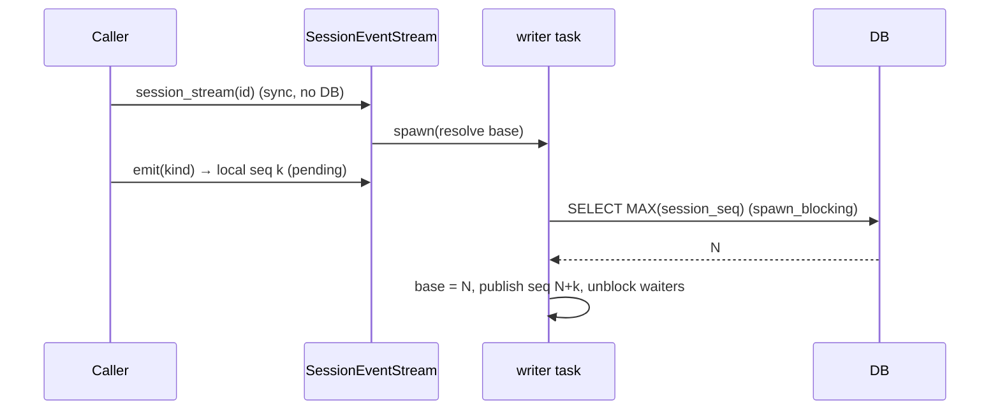

# Design

## Context

See proposal.md for the motivation. This section covers only the current code the design builds on.

- **Storage connection.** It is a `std::sync::Mutex<rusqlite::Connection>` shared through `Arc` by `crates/agent/src/session/sqlite_storage/mod.rs` `SqliteStorage::run_blocking_session` and by eight repository copies of `run_blocking`: `session/repo_{intent,delegation,session,task,progress,schedule,artifact,decision}.rs`. Each copy does `spawn_blocking(|| conn.lock().unwrap() …)` and maps the `JoinError` to `SessionError::Other(format!("Task execution failed: …"))`. `event_journal.rs` has more inline copies. The same `Arc<Mutex<Connection>>` type also appears in `knowledge/sqlite.rs`, `dotagents/{tasks,automation}.rs` and `worktree/{lifecycle,allocate,repo_workspace}.rs`.
- **Synchronous journal read.** `event_sink.rs` `EventSink::session_stream` is synchronous and calls `EventJournal::max_session_seq_blocking` (`session/projection.rs`, implemented in `event_journal.rs`). That locks the connection on the caller's thread, and the caller is an async worker. There are about 94 synchronous call sites, through `AgentConfig::emit_event`, delegation and the session actor.
- **Error types.**
  - `session/error.rs` `SessionError` has no `#[non_exhaustive]`.
  - `From<rusqlite::Error>` stringifies the error (`DatabaseError(String)`).
  - `From<SessionError> for LLMError` maps to `ProviderError(String)`. `LLMError` lives in `querymt` and has no generic source-carrying variant.
- **Run and turn ids.**
  - `TurnId` and `SnapshotId` come from f780076.
  - Run identity is also kept as `String` in `agent/turn_control.rs` (`ActiveRun`, `SteeringInbox`, `SubmitInputResult`, `TurnControlError`), `agent/messages.rs`, `agent/objective.rs`, `agent/remote/actor_ref.rs` and `events.rs` (`RunStarted`/`RunCompleted` …).
  - `ExecutionContext::turn_id_string` returns `""` when `turn_id` is `None`. It has 16 callers, all building hook requests or events.
- **Event kind tags.** `AgentEventKind` (`events.rs`) is `#[serde(tag = "type", content = "data", rename_all = "snake_case")]` and `#[typeshare]`. `event_journal.rs` `insert_event` gets `kind_tag` by serializing to `serde_json::Value`.
- **Todo storage.** `tools/builtins/todo.rs` keeps todos in `static TODO_STORAGE: Lazy<Arc<Mutex<HashMap<String, Vec<TodoItem>>>>>`.
- **Session delete.** `api/sessions.rs` `Sessions::delete` is the single delete path. It already does best-effort cleanup through `AgentConfig::remove_run_lease_file`.

## Goals / Non-Goals

**Goals**
- Fix each review finding at its single owning point rather than at every call site.
- Keep every wire string, stored JSON shape, event tag and DB row byte-identical.

**Non-Goals**
- New dependencies. `parking_lot` is already a dependency; no `strum`.
- Changing `querymt`'s `LLMError`. That would be a cross-crate API change and is out of scope.
- `SessionId` newtypes (see proposal Non-goals).

## Decisions

### D1. `parking_lot::Mutex` for every SQLite connection

Replace `std::sync::Mutex<Connection>` with `parking_lot::Mutex<Connection>` in all modules listed in Context. `lock()` then returns the guard directly, with no poisoning, and `.lock().unwrap()` disappears.

A panic inside a SQL closure is still caught by `spawn_blocking`, which returns a `JoinError`, so only that call fails (spec: "A failed storage operation does not disable the store").

*Can a panic leave the connection in a bad state?* rusqlite rolls back an open `Transaction` on drop during unwinding, and the connection itself stays valid. The workspace does not set `panic = "abort"`.

*Alternative considered:* keep std `Mutex` and use `lock().unwrap_or_else(PoisonError::into_inner)`. That has the same effect but needs more code at about 111 sites and keeps a footgun for new code. Rejected.

### D2. One blocking-DB helper with typed join errors

Add `session/sqlite_storage/blocking.rs` with `pub(crate) async fn with_conn<F, R>(conn: &Arc<Mutex<Connection>>, f: F) -> SessionResult<R>` and a sibling that takes a closure returning `rusqlite::Result`.

- All nine `run_blocking` copies and the inline `spawn_blocking` blocks in `event_journal.rs` call it.
- `SessionError` gains `#[error("storage task failed")] TaskFailed(#[from] tokio::task::JoinError)`. The helper uses it.
- At the same time, `DatabaseError(String)` becomes `Database(#[from] rusqlite::Error)` so the source survives. The about 48 `DatabaseError(format!…)` constructions that are not real rusqlite errors become `Other` or more specific variants.
- `#[non_exhaustive]` is added to `SessionError` now, because the enum's shape is breaking anyway.

*Alternative considered:* a `SessionStorage` trait object with a connection-pool abstraction. That is overkill; only one connection exists.

### D3. Source-preserving conversion to `LLMError`

`LLMError` stores only strings. `From<SessionError> for LLMError` keeps its variant mapping but formats with the full source chain: `{err}` followed by `: {source}` for each source. The spec scenario "Storage error converted for a provider caller keeps its source" is satisfied through a `SessionError` that callers can still inspect before converting.

Internal agent code that today converts early to `LLMError` and then inspects it keeps `SessionError` until the boundary. This applies only where the code currently branches on message text; tasks list the sites.

*Alternative considered:* add `LLMError::Other(Box<dyn Error + Send + Sync>)` in `querymt`. Rejected as a cross-crate change; recorded as a follow-up.

### D4. Async journal base for new event streams

`EventSink::session_stream` stays synchronous; changing 94 callers is not worth it. The stream is created with an *unresolved base*. Its writer task, which is already a spawned task in `session_event_stream.rs`, resolves the base first with `journal.max_session_seq(session_id).await`, which goes through D2's helper.

`emit` assigns `session_seq` synchronously today, so numbering becomes relative:

- `emit` keeps returning immediately.
- Callers that need the absolute `session_seq` synchronously (`emit_ephemeral_seq`) await a `watch` of the resolved base. Those call sites are already async or can move into the actor. If the audit finds any truly synchronous caller, that caller resolves through `tokio::task::block_in_place`, which is allowed on the multi-thread runtime. Tasks enumerate the callers.
- The `retired_tips` fallback stays and is applied as `max(retired_tip, N)` when the base resolves.

*Alternative considered:* make `session_stream` async. That is correct but changes about 94 call sites across delegation, scheduler and actor code. Rejected for this change.

*Alternative considered:* `block_in_place` around the existing read. It panics on current-thread runtimes, which tests and mobile-ffi use. Rejected.

### D5. One run id: `TurnId` end to end

`TurnId` is the run's id. In internal types, rename nothing on the wire but change field types:

- `ActiveRun.run_id: TurnId`, `SteeringInbox::new(TurnId)`.
- Internal messages in `agent/messages.rs`, `agent/objective.rs` and `TurnControlError::{RunMismatch, RunClosing}`.

Boundary types that are `#[typeshare]` or wire payloads keep `String` fields and are filled with `turn_id.to_string()` at construction: `events.rs` run events, `SubmitInputResult` and hook `*CommandInput`. Incoming `expected_run_id` strings (ACP steering, `remote/actor_ref.rs`) are parsed with `TurnId::from_stored` and compared as `TurnId`. A non-UUID expected id then never matches, which is the same as today's behaviour for an unknown id.

`ExecutionContext::turn_id_string` is removed. Hook and event builders take `TurnId`. `ExecutionContext` always belongs to a run: `ExecutionContext::new` takes the run's `TurnId`, the field is private and read through `turn_id() -> TurnId`, and `with_turn_id` is removed. Work that looks like it is outside a run (native `/compact` in `session_actor.rs`, maintenance compaction in `agent/execution/maintenance.rs`) still executes inside a prompt run, so it uses that run's id. Making the id a constructor argument turns a forgotten id into a compile error, so no fallback that mints ids is needed. Delegation hooks in `delegation/core.rs` have no execution context and still mint a fresh `TurnId` per hook; correlating them with the parent run is out of scope here.

`impl Default for TurnId` is removed; clippy's `new_without_default` is allowed on the impl with a comment explaining why.

### D6. `AgentEventKind::tag() -> &'static str`

A hand-written exhaustive `match` in `events.rs` (no `strum`), plus a unit test that, for one constructed value of every variant, checks `serde_json::to_value(&kind)["type"] == kind.tag()`. Making the match exhaustive forces new variants to be added.

- `event_journal.rs` `insert_event` uses `event.kind.tag()`.
- Rust-side literals (`"run_started"` and similar in `event_journal.rs`, `session_store.rs`) use `const` tags built from the same names, exposed as `AgentEventKind::RUN_STARTED_TAG` and so on, or compare against `tag()`.
- SQL literals in `migrations.rs` stay as they are because they are released migrations. Literals in non-migration queries (`view_store.rs`, `event_journal.rs`) are built with `format!` from the consts once at startup, or bound as parameters where the SQL allows it.

The forked-session filter in `session_store.rs` deserializes `payload_json` into `AgentEventKind` and matches on `PromptReceived { message_id, .. } | AssistantMessageStored { message_id, .. }`. The 6-tuple row becomes a named `JournalRow` struct.

### D7. Enums at typed boundaries, unchanged wire strings

- **Todos:** `TodoStatus { Pending, InProgress, Completed, Cancelled }` and `TodoPriority { High, Medium, Low }`, both `#[serde(rename_all = "snake_case")]`. Deserializing an unknown value fails, which gives the invalid-request error the spec requires. Counting uses a `match`.
- **Schedules:** `ScheduleInfo.state: ScheduleState`. Add `#[typeshare]` to `session/domain_schedule.rs` `ScheduleState`.
- **Pending input:** `PendingInputSummary.delivery: InputDelivery { Steer, Queue }` and `state: PendingInputState { Accepted, Queued }`, both `#[typeshare]`, serialized as `camelCase`. The values are single words, so the output is identical.
- **ATIF export:** a private enum `AttemptState`, which is `Serialize` only where it is emitted.
- **`get_symbol`:** a private `ContextMode` enum with a `FromStr`. An unknown value already fails schema validation, so behaviour does not change.

### D8. Per-session todo store owned by `AgentConfig`

Add `tools/builtins/todo.rs` `TodoStore` (`parking_lot::Mutex<HashMap<String, Vec<TodoItem>>>`).

- It is owned as `Arc<TodoStore>` by `AgentConfig`.
- It is exposed to tools through a new `ToolContext::todo_store() -> Option<Arc<TodoStore>>`, implemented by `AgentToolContext`.
- `Sessions::delete` calls `config.todo_store.remove(session_id)` next to `remove_run_lease_file`.
- If a tool context has no store (test or verification contexts), the tools return a `ToolError` saying todos are unavailable, instead of silently using a global.
- The static is deleted.

*Alternative considered:* store todos in `SessionRuntime`. Runtimes are rebuilt when actors restart, so todos would vanish mid-session. Today they survive actor restarts, and this change keeps that.

*Alternative considered:* persist todos in SQLite. That would be a behaviour change and needs a migration. Deferred.

### D9. Typed errors at the remaining boundaries

| Site | New error type |
|---|---|
| `index/workspace_actor.rs` `Rebuild` reply | `IndexError` (new, `thiserror`, in `index/`) |
| `index/workspace_manager_actor.rs` `GetOrCreate` reply | `IndexError` |
| `index/function_index/core.rs` `FunctionIndex::build` | `IndexError` |
| `index/search.rs` | `IndexError::{Regex, Search}` |
| `agent/remote/node_manager.rs` `AdmissionRequest` reply | new serializable `AdmissionRejection` enum (`Serialize`/`Deserialize`, `thiserror`). The reply crosses the mesh through kameo remote messaging (`remote_node_msg_impl!`, `"querymt::AdmissionRequest"`), so it must be serializable. The client side maps it into the existing `remote/admission.rs` `AdmissionError::Rejected`. Feature `remote`. **Wire note:** this changes the msgpack shape of the admission reply's error arm, so mixed-version meshes see a decode error instead of the rejection text. |
| `delegation/core.rs` `claim_delegation` | `SessionError`, retried only when `SessionError::is_transient()`, i.e. `rusqlite::ErrorCode::{DatabaseBusy, DatabaseLocked}` |
| `hooks/engine.rs` `HookEngine::new`, `run_stop` | `HookError` (new, `thiserror`): `Config(HookConfigError)`, `Spawn(io::Error)`, `Timeout`, `Output(serde_json::Error)`, … The variants come from the existing `anyhow!` sites. |
| `hooks/config.rs` `HooksConfig::validate` | `HookConfigError` |

Internal `anyhow` usage inside hooks that never crosses a `pub` boundary may stay. Remaining `Result<_, String>` validators (`config/execution.rs` `validate`, `worktree/session_options.rs`) are feeding `serde::de::Error::custom`, where a `String` is the idiomatic input. They are left as is.

### D10. Delete `tasks::run_verification` and `extract_verification_commands`

These are removed along with their tests. `TaskWatcher` in the same module stays. Delegation's separate `run_verification: bool` config (`delegation/core.rs`) uses `verification/service.rs` and is not affected.

## Risks / Trade-offs

- **[D4 relative numbering]** Events emitted before the base resolves are published slightly later than today, but before any later event, so ordering holds. → Mitigation: the stream's existing ordered-publish invariant tests in `session_event_stream.rs`, plus a new test with a slow journal.
- **[D1 continuing after a panic]** A panic mid-write could leave partial non-transactional writes behind. → Most writes are already inside transactions. The same partial state is possible today before poisoning, so this is no regression.
- **[D5 hook `turn_id` guarantee]** Hook scripts that treated `""` as "no turn" now see a UUID. → Documented as BREAKING in CHANGELOG and `docs/docs/agent/hooks.md`.
- **[Public API breakage]** Embedders matching on `SessionError`, or using `anyhow` from hooks, break. → Called out in CHANGELOG. `#[non_exhaustive]` prevents a repeat.
- **[Large diff]** The change spans about 40 files. → Tasks are grouped so each group compiles and tests on its own, and the groups land as separate commits.

## Migration Plan

- No DB migration or config change.
- Each task group is independently revertible.
- Downstream builds to check: `querymt-agent-py`, `querymt-mobile-ffi`.
- querymt-desktop regenerates typeshare for the narrowed `ScheduleInfo.state` and `PendingInputSummary` fields.

