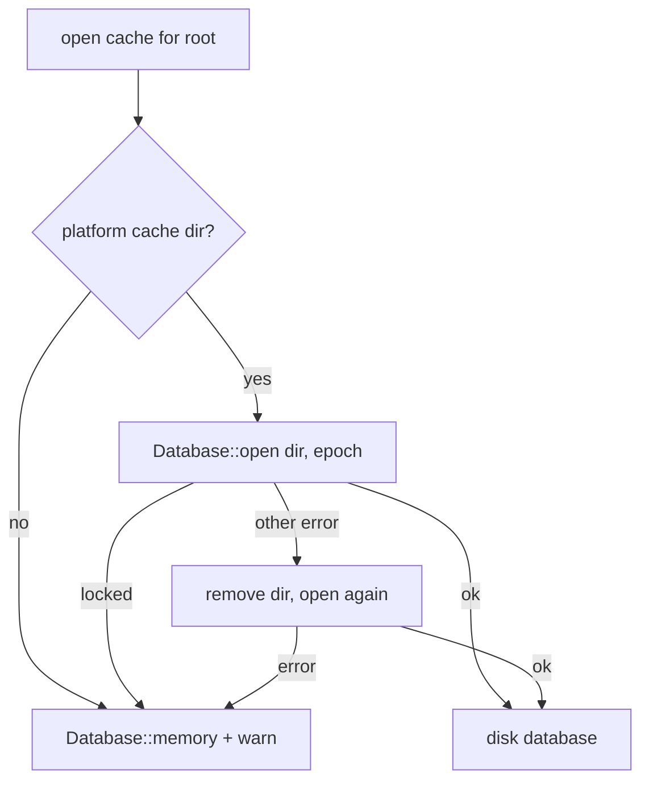
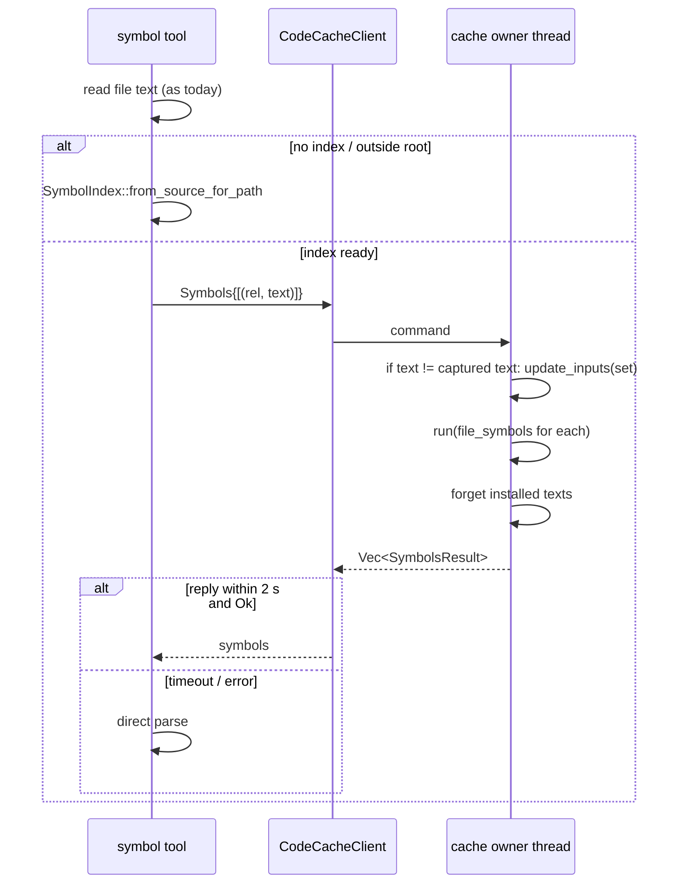

# Design

## Context

See proposal.md (Why) for motivation and `specs/code-index-cache/spec.md` for the required behaviour.

Current code this change builds on:

- `crates/agent-index/src/workspace_manager_actor.rs`:
  - `WorkspaceIndexManagerActor` keeps one `WorkspaceIndexActor` per root.
  - It has TTL/LRU pruning (`prune_indexes`) and a 30 s `GET_OR_CREATE_REPLY_TIMEOUT`.
  - `WorkspaceIndexManagerConfig { max_indexes, idle_ttl }` is built with `Default` in `crates/agent-runtime/src/agent/agent_config_builder.rs`.
- `crates/agent-index/src/workspace_actor.rs` `WorkspaceIndexActor`:
  - `create` calls `FunctionIndex::build`.
  - `ApplyChanges` re-reads and re-indexes watcher changes file by file.
  - `GetStats` returns `WorkspaceIndexStats`.
  - `Rebuild` rebuilds from scratch.
- `crates/agent-index/src/function_index/core.rs` `FunctionIndex::build_sync`:
  - It collects files with `collect_source_files`, reads them in parallel, and indexes per language in a dedicated rayon pool with 64 MB stacks.
  - The comment there explains why: tree-sitter recursion overflows 8 MB on deep C/C++ headers.
  - Per-file entry points are `index_file_with_language` and `index_typescript_file` in `function_index/indexing.rs`.
- `crates/agent-index/src/function_index/types.rs`:
  - `IndexedFunctionEntry.fingerprint: similarity_core::AstFingerprint` holds `HashMap<&'static str, u32>`. It is neither serialisable nor `PartialEq`, and it is only computed for TypeScript/JavaScript.
  - `FunctionIndexConfig::cache_path` is unused.
- `crates/agent-index/src/symbol_index/mod.rs` `SymbolIndex::from_source_for_path` is the shared extraction behind:
  - `crates/agent-services/src/tools/builtins/{get_symbol,get_function,replace_symbol,find_references}.rs`;
  - the outline in `index.rs`, which uses `outline_index::index_file` → `extract_outline` → `symbol_index::outline_projection::symbols_to_sections`.
- `SymbolEntry` and `SymbolDigest` (`symbol_index/types.rs`) contain `querymt_agent_core::hash::RapidHash`.
- Runtime wiring:
  - `crates/agent-runtime/src/agent/session_materializer.rs` creates the workspace handle in the background and stores it in `runtime.workspace_handle: Arc<OnceCell<WorkspaceHandle>>` (`agent/core.rs`).
  - `crates/agent-runtime/src/agent/execution_context.rs` `tool_context` builds the `AgentToolContext` (`crates/agent-services/src/tools/context_impl.rs`), which today has no access to the index.

Ajika constraints (0.2.1; book chapters "Keeping results across restarts", "Acquiring inputs on demand", "Parallel work, errors, and cancellation"):

- **Exclusive owner.** `Database::run` and `update_inputs` take `&mut Database`, and the API is synchronous. One process may open a storage directory; a second open fails on the directory lock.
- **Operations.** Each `run` is one operation. Queries inside it share values; at the end, eligible work is checkpointed (by default before `run` returns) and the working set is released.
- **Errors.** A query error fails the whole operation and abandons its pending checkpoint. Expected domain failures must be returned as successful data.
- **Parallelism.** `Db::parallel_map` uses `std::thread::scope` workers with the default thread stack. The book warns against substituting a work-stealing pool for query fan-out.
- **Services.** Services (`db.services()`) are untracked. Anything that affects an answer must be an input.
- **Persisted values.** They need `PartialEq` plus wincode `SchemaRead`/`SchemaWrite`.
- **Epoch.** The epoch passed to `open` must change when query semantics or encodings change. Ajika discards the cache rather than migrating it.
- **Toolchain.** Ajika pins Rust 1.100; the workspace's stable toolchain is 1.100.0.

## Goals / Non-Goals

**Goals:**

- Persist per-file symbols and function entries and reuse them after a restart.
- Make every symbol tool use the same symbols query, with output equal to direct parsing.
- Keep RAM use roughly at today's level: file text is not held after an operation.

**Non-Goals:**

- Changing duplicate-search scoring.
- Making `find_similar` disk-resident.
- Sharing results with `querymt-agent-knowledge`.
- Any config key.

## Decisions

### D1. One cache owner thread per workspace

**Decision.**

- A new module, `crates/agent-index/src/code_cache/`, owns the `ajika::Database` on a dedicated `std::thread` named `qmt-code-cache`.
- Commands arrive on a `std::sync::mpsc` channel; replies go back on `tokio::sync::oneshot`.
- `CodeCacheClient` is a clonable sender. It is stored in `WorkspaceHandle` (new field `code_cache: CodeCacheClient`) and in `WorkspaceIndexActor`.
- Commands:
  - `IndexAll { files }`: initial build and `Rebuild`.
  - `Apply { changed: Vec<(rel, Arc<str>)>, removed }`: watcher change sets.
  - `Symbols { files: Vec<(rel, Arc<str>)> }`: tool lookups, batched.
  - `Stats`.
  - `Collect`: retention; used by tests and on shutdown.
- The thread exits when the last client drops. Before exiting it calls `collect`.

**Why.** Ajika is synchronous and needs `&mut Database`. A kameo actor would block a tokio worker during long runs, and `spawn_blocking` cannot hold `&mut` across calls. One thread per workspace serialises indexing and lookups, which the spec allows. A lookup queued behind a cold build is covered by the tool deadline (D6).

**Alternatives considered:**

- A `Mutex<Database>` used from `spawn_blocking`. It ties up blocking-pool threads while waiting and makes cancellation awkward.
- A single process-wide thread for all workspaces. One workspace's build would block another workspace's lookups.

### D2. Inputs, keys and queries

```rust
#[ajika::input(key = String)]               // workspace-relative path, '/' separators
struct SourceFile { #[input(arc, initialize = read_source)] text: String, readable: bool }

#[ajika::input(key = ())]
struct IndexSettings { min_function_lines: u32, max_file_bytes: u64 }

#[ajika::query] fn file_symbols(db, path: String) -> Result<SymbolsResult>
#[ajika::query] fn file_functions(db, path: String) -> Result<FunctionsResult>
#[ajika::query] fn all_functions(db, paths: Vec<String>) -> Result<Vec<Arc<FunctionsResult>>>
```

(Implementation note: `all_functions` is a plain function, `functions_for`, that fans out `file_functions` with `db.parallel_map`. Storing it as a query would persist one record repeating every file's functions and rewrite it for any single file change. The per-file results are what is stored and reused.)

(The declaration follows the Ajika book's `#[input(arc)] text: String` form. Task 1.2 pinned the exact syntax: `#[input(arc, initialize = read_text)] text: String` and `#[input(initialize = read_readable)] readable: bool`, where an initializer is `fn(&Key, &dyn InputInit) -> ajika::Result<T>` and reads state with `cx.state::<WorkspaceRoot>()?`.)

- **Keys.**
  - Keys are relative paths, so moving a workspace keeps its keys and the cache directory (D5) keeps roots apart.
  - A file outside the root never reaches the cache; the tool falls back to direct parsing.
  - The language comes from the key's extension, so it needs no input.
- **Settings are an input.** `FunctionIndexConfig.min_function_lines` and `max_file_bytes` change answers, so they are inputs, not services.
- **Errors as data.** `SymbolsResult` is `Ok(symbols) | Unsupported | ParseFailed(String)`. `FunctionsResult` is `Vec<entry>`, empty for skipped, oversized, unsupported or failed files. Non-UTF-8 and unreadable files are captured as an empty-text marker (`text = ""`, plus a `readable: bool` field). As a result:
  - only cancellation or storage errors fail an operation;
  - a broken file is a stored result like any other (spec: *One broken file among valid files*);
  - catching a child error inside `all_functions` is not needed. The book says that would not save the operation anyway.
- **Initializer.** `read_source` reads `root.join(path)` from `Inputs::with_state(WorkspaceRoot)`. Restart validation therefore captures fresh text lazily, only for files that queries request. The host installs text explicitly when it already has it: watcher batches and tool lookups.
- **Removals.** A removed file is forgotten with `update.forget(SourceFile::TEXT, path)` and dropped from the next `all_functions` key list. Its stored records age out through retention.

### D3. Fan-out and the 64 MB stack

`all_functions` fans out with `db.parallel_map(&paths, |db, p| file_functions(db, p.clone()))`. Ajika's scoped workers have default-sized stacks, so the leaf parse inside `file_functions` and `file_symbols` does not run on them. It runs on a process-wide rayon pool with 64 MB stacks, the same builder as `build_sync`, via `PARSE_POOL.install(|| parse(...))`.

**Why this is safe.** The parse closure is a leaf: it never calls a query or touches `Db`. So the book's warning, about a pool suspending a query owner beneath a task that waits for it, does not apply. The Ajika worker simply blocks until its leaf parse returns.

Parallelism is `DatabaseOptions::parallelism(available_parallelism)`.

**Alternatives considered:**

- Setting `RUST_MIN_STACK`: process-global and fragile.
- `parallelism(1)` on a 64 MB owner thread: a sequential cold build, a large regression.

### D4. Persisted value types are private mirrors

The public types `SymbolEntry`, `SymbolKind`, `SymbolDigest` and `IndexedFunctionEntry` are not changed. `code_cache/values.rs` defines private mirrors that derive `PartialEq`, `wincode::SchemaRead` and `SchemaWrite`, with lossless `From` conversions both ways. `RapidHash` is stored as its `u64` through `RapidHash::as_u64` and a new `RapidHash::from_u64` in `querymt-agent-core`, so agent-core gains no dependency.

The function mirror drops `AstFingerprint`. When results are loaded into the in-memory `FunctionIndex` (`FunctionIndex::from_entries`, new), the TypeScript fingerprint is recomputed from `body_text` with `AstFingerprint::from_source`, just as `index_typescript_file` does. This is deterministic, so duplicate detection is unchanged. It costs an oxc parse per TS function at load; that is not counted as a parsed file (spec counts per-file extractions).

**Alternatives considered:**

- Deriving wincode on the public types. That leaks Ajika/wincode into agent-core and every type consumer.
- Forking `similarity-core` to make `AstFingerprint` serialisable. It is a larger change, deferred until the cost is measured.

### D5. Storage, epoch, retention and fallback

New public types in `querymt-agent-index`:

```rust
pub enum CodeIndexStorage { Default, Directory(PathBuf), Memory }
pub struct CodeIndexCacheOptions { storage: CodeIndexStorage, max_bytes: u64, max_entries: u64, max_idle: Duration, schema_version: u32 }
```

- `WorkspaceIndexManagerConfig` gains `cache: CodeIndexCacheOptions`, with `Default` set to the spec's limits.
- `Directory(base)` resolves the same way as `Default`, as `<base>/<hash>`, so tests can use a temp dir.
- **Location.** `Default` uses `dirs::cache_dir()/querymt/code-index/<{:016x} of RapidHash(canonical root)>`. This matches `GitSnapshotBackend::snapshot_dir` in `crates/agent-services/src/snapshot/git/mod.rs`. If there is no platform cache dir (some mobile targets), the cache uses memory.
- **Epoch.** `format!("qmt-code-index/{}/{}", env!("CARGO_PKG_VERSION"), schema_version)`. `CODE_CACHE_SCHEMA_VERSION` starts at 1 and must be bumped with extractor changes.
  - The package version is included because extractor semantics are not otherwise versioned. A release rebuilds every cache once, which is cheap compared to serving stale symbols.
  - Tests set `schema_version` to exercise *Schema version change rebuilds the cache*.
- **Retention.** `Retention { max_entries, max_bytes, max_idle }` with the spec's 200,000 entries, 256 MiB and 30 days. `max_physical_bytes` is 512 MiB, so physical files are reclaimed close to the logical budget.
- **Checkpoints.** The default: written before `run` returns. This keeps a crash from losing a build.
- **Open failure:**
  1. If `Database::open` returns a lock or busy error, use `Database::memory`, log a warning and continue.
  2. On any other open error, remove the directory, retry once, then fall back to memory.

  Pinned in task 1.2 against 0.2.1: a second `Database::open` on a held directory returns `ErrorKind::Persistence(e)` with `e.kind() == PersistenceErrorKind::InUse`. Only `InUse` selects the memory fallback without removing the directory; every other open error takes step 2.



### D6. Operation boundaries and the tool path

One `run` is one natural unit of work:

| Work | Operation |
|---|---|
| Initial build, `Rebuild` | one `IndexAll` |
| Watcher change set | one `Apply` |
| Tool call | one `Symbols` per batch |

`find_symbol_references` on a directory batches 256 files per request. It keeps walk order and the existing `max_results` truncation, so output is identical. The owner thread never keeps an operation open between commands, which follows the book's guidance on peak memory.

**RAM.** After each `run` the host forgets the text of every file it installed in that operation (`forget(SourceFile::TEXT, path)`). File text is not held between operations. A later validation re-acquires it through `read_source`, and equal text validates without executing.

Tool flow:



**Why tools supply text.** The spec requires symbols for the text the tool read. Supplying it closes the window where the watcher has not yet reported an edit.

**Before setting text, the owner compares it with the captured value.** This means equal text never creates a new input revision. Task 1.2 verified that Ajika already tolerates identical sets: an equal `set_text` leaves `executed == 0` and `validated == 0`, so it preserves validity. The comparison is kept regardless, because it also avoids a needless input write per lookup.

Plumbing:

- `ToolContext::workspace_index(&self) -> Option<CodeCacheClient>`, default `None`.
- `AgentToolContext::with_workspace_index`.
- `ExecutionContext::tool_context` fills it from `runtime.workspace_handle.get()`.
- `index.rs` reads the file and checks `max_file_bytes` as `index_file` does. It then gets symbols from the cache or directly and calls `symbols_to_sections`. A new `outline_index::index_symbols` exposes that projection with `extract_outline`'s error mapping.

### D7. Statistics

`file_symbols` and `file_functions` increment a shared `AtomicU64` in the untracked services (`db.services()`) each time their body runs. Counting real executions is the use the book explicitly allows for services. After each `run`, the owner computes:

- `parsed_files += executions this run`;
- `reused_files += requested per-file results − executions`.

`WorkspaceIndexStats` gains both fields, filled from the `Stats` command.

### D8. Function index assembly

`WorkspaceIndexActor::create` and `Rebuild`:

1. Collect paths (`collect_source_files`).
2. Send `IndexAll`.
3. Build `FunctionIndex::from_entries(root, config, results)`.

`ApplyChanges`:

1. Read the changed files.
2. Send `Apply`.
3. Replace or remove the per-file entries in the in-memory index (`FunctionIndex::set_file_entries` / `remove_file`).

`update_file` and `remove_file` (`UpdateFile`, `RemoveFile`) go through the same path. `FunctionIndex::build` / `build_sync` remain for direct users and tests, but `build_sync`'s per-language bodies are folded into one `index_file_entries(path, source, config)`. The query and the eager build therefore share one extraction function.

## Risks / Trade-offs

- **[Ajika is 0.2, and its API and format can change]** → Pin `ajika = "=0.2.1"`. The cache is disposable and the epoch includes the package version. Upgrades are explicit changes.
- **[Assumed Ajika behaviours]** The design relies on three behaviours not yet verified against the API: a second owner fails with a distinguishable lock error; `forget` followed by re-acquiring equal text validates without executing; setting equal text is a no-op. → Task 1.2 pins each one with a test before any integration. If one fails, its decision is revised (the D6 comparison already covers the third).
- **[Duplicate dependency versions]** redb 3/4, zstd 0.13/0.14 and lz4_flex 0.13/0.14 increase build time and binary size. → Accepted. Hakari keeps the features unified, and size is reported in task 6.
- **[A cold build queues tool lookups]** → The 2 s tool deadline falls back to direct parsing, so tools are never slower than today by more than the deadline. Lookups are small operations behind at most one build.
- **[Fsync per operation]** Tool lookups that compute new results write a checkpoint. → Lookups of unchanged files write nothing. If measurements show cost, `defer_checkpoints` plus `collect` on idle and shutdown is a follow-up.
- **[TS fingerprint recompute on load]** → Bounded by the number of TS functions. It is measured in task 6. Serialising the fingerprint is a follow-up.
- **[Several processes on one workspace]** Only the first process persists; the others use memory. → Logged once per workspace. Acceptable for now (proposal Non-goals).

## Migration Plan

- No session DB or config migration. The first start after upgrade builds the cache cold, which costs the same as today.
- Rollback means reverting. Old versions ignore the cache directory, and users may delete `querymt/code-index/` at any time.

## Open Questions

- Resolved in task 6.1: keep eager checkpoints. A tool lookup that computes a new result took about 4.3 ms on average including the fsync, and unchanged lookups took 0.04 ms and write nothing. `defer_checkpoints` would only add a risk of losing results on a crash. A cold build costs about 0.15 s more than the uncached build (0.42 s vs 0.26 s on this repository) to write the cache once; warm starts take 0.045 s.
