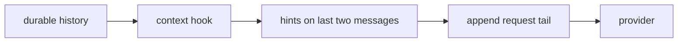
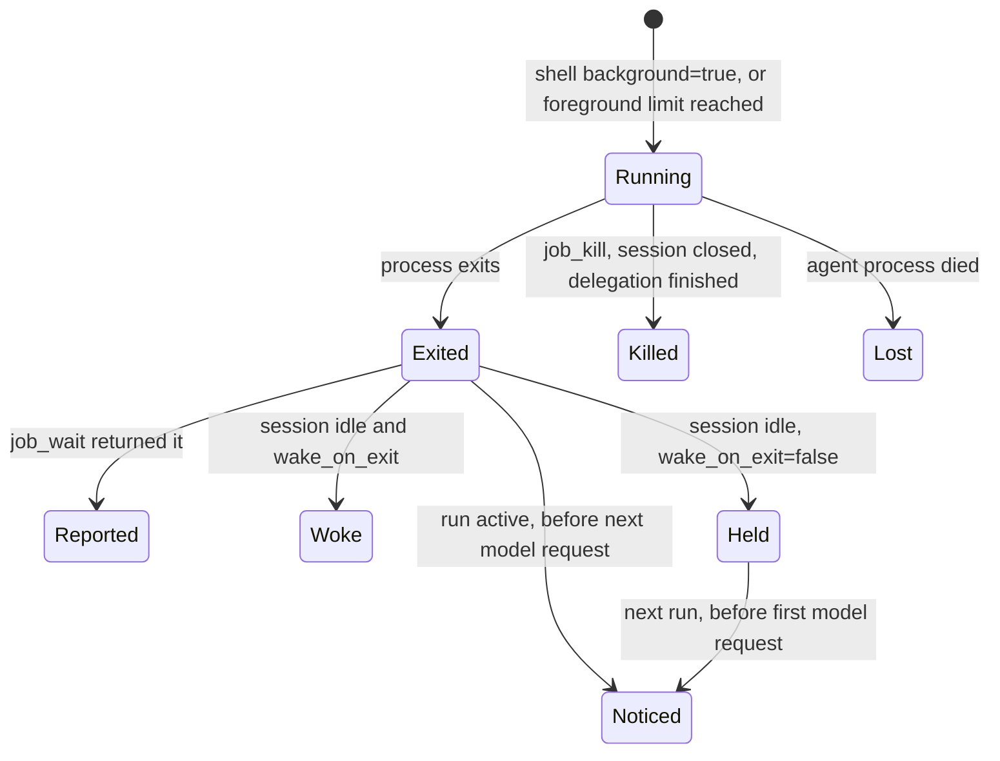

# Design

## Context

See proposal.md for motivation and measurements. The current state that shapes the approach:

- **Request assembly.** `ConversationContext::request_messages` (`crates/agent-runtime/src/middleware/state.rs:286`) combines stored history with "fragments": text rebuilt for every request under the keys `run_objective`, `agent_mode` and `output_limit_recovery`. When the last message carries tool results, the fragments are appended to that message as extra parts. Otherwise they are inserted before the latest user message, or appended after a trailing assistant message.
- **Notices.** Other harness text is appended to the in-memory message list with `ConversationContext::inject_message` and never stored: Stop-hook continuations and the task-completion reminder (`crates/agent-runtime/src/agent/execution/mod.rs:832`, `:858`, `:982`), the duplicate tool-call warning (`middleware/tasks.rs:90`), the duplicate-code review (`middleware/dedup_check.rs:773`), the parallel-edit note (`middleware/parallel_edit_guard.rs`) and the context-usage warning (`middleware/context.rs:229`). The next turn loads history from the store, so its first request lacks them. This is read from the call sites; no test shows it yet.
- **Run objective.** `RunObjective::render` (`crates/agent-runtime/src/agent/objective.rs:167`) produces the prompt verbatim, later steering and clarification answers, the active task's deliverable and criteria, a progress-review paragraph at step 7 and every 4 steps after, and one closing sentence. The prompt and steering are stored messages already, clarification answers are tool results, and compaction carries the last three prompts verbatim (`crates/agent-runtime/src/session/compaction.rs:61`).
- **Tool order.** Built-in tool definitions are listed from a `HashMap` (`crates/agent-services/src/tools/registry.rs:33`), and an MCP refresh re-appends that server's tools (`crates/agent-runtime/src/agent/core.rs:129`).
- **Hints.** `apply_cache_breakpoints` (`crates/agent-runtime/src/agent/execution/transitions.rs:271`) marks the last two messages of that combined list, for every provider. The Anthropic adapter puts the marker on the last block of a marked message (`crates/providers/anthropic/src/request.rs:266`), which after a tool batch is the fragment text. On the next request the fragment has moved to a newer message, so the content before that marker no longer matches.
- **Context hooks.** `run_context` (`crates/agent-runtime/src/hooks/engine.rs:905`) receives the combined list, may replace it, and may add request-only `additional_context`. Hints are computed after the hook.
- **System hints.** `crates/agent-services/src/model_heuristics.rs:157` adds default system hints when the provider name is `anthropic` or `codex`, or `openai` with `api_mode = "responses"`. This happens on the parameter JSON, before a provider instance exists.
- **Capabilities.** `ChatCapabilities` (`crates/querymt/src/chat/mod.rs:839`) is `Copy`, has two fields (`streaming`, `options`) and is read from a built provider. Extism plugins return it as JSON from a `capabilities` export; missing fields default.
- **Shell.** `crates/agent-services/src/tools/builtins/shell.rs` waits on `wait_with_output` with no time limit, so it returns only when every holder of the output pipes has exited. Nothing in the tool layer can outlive a tool call.
- **Waiting.** The execution loop already has a waiting state for delegations (`crates/agent-runtime/src/agent/execution/wait.rs`) and already injects content at the model-request boundary (`apply_pending_steering`, `reconcile_suspended_delegations`). Queued inputs can already start a run on an idle session.

Constraints: no session DB migration; no compatibility layers (AGENTS.md); the Extism contract versions stay as they are; `querymt` and provider crates must build for `wasm32-wasip1`.

## Goals / Non-Goals

**Goals:**

- A request's durable messages are byte-identical to the same messages in the previous request, for every provider.
- No tool call blocks a run for longer than the default cache lifetime.
- Each group in proposal.md can be implemented, tested and released on its own.

**Non-Goals:**

- Changing the session DB schema or how history is pruned. History gains new part kinds (D19, D21) and the compaction summary gains task criteria (D20); nothing else about storage changes.
- Removing the run objective bookkeeping or its events. Only sending it changes (D20).
- A general job scheduler. Background commands are shell processes owned by one session and one agent process.
- Provider-specific cache tuning beyond what a provider declares.

## Decisions

### D1. A request is durable history followed by a request tail

The context produces two lists instead of one: the durable messages, exactly as stored, and a request tail. Fragments are removed. What they carried is either stored as a notice (D19) or, for the run objective, sent in the tail only when enabled (D20). The tail is at most one user message: the run objective when `run_objective = true`, followed by any `additional_context` from context hooks. With the default configuration and no context hook, a request has no tail. Assembly order:

- The context hook receives the durable messages only, which include stored notices. Its replacement, if any, becomes the durable list for this request. Its `additional_context` goes into the tail.
- Hints are applied to the last two messages of the durable list. The tail never gets a default hint.
- The tail is not stored and is rebuilt for every request.
- A tail is still needed for `additional_context`: a hook may return different text for every request, and storing it would put hook output into history for good.

Why a separate trailing message: it is the only position where changing or removing the text cannot alter anything before it. It also keeps message-level hints working with the existing adapters, because the last block of a hinted message is now durable content.

This design produces adjacent user messages: a prompt followed by the tail or by a stored notice, and a tool-result message followed by a notice. Not every provider accepts them. The history merge (`merge_consecutive_tool_result_messages`, `crates/agent-core/src/history.rs`) only joins runs of tool-result messages, so it does not cover these sequences. llama-cpp renders each user message as its own template message (`crates/providers/llama-cpp/src/messages.rs`), and chat templates that require alternating roles reject two in a row. Requirement: every provider adapter SHALL either accept adjacent user messages or merge them before rendering. Which one each adapter does is decided per adapter; llama-cpp is unverified (task 1.20).

Alternatives considered:

- **Keep merging into the tool-result message, but put the marker before the fragment.** Needs part-level hints in `querymt` and in every adapter, and the merged message still differs between requests for providers that cache by prefix without markers (OpenAI automatic caching, llama.cpp slot reuse).
- **Put the objective in the system prompt.** Any objective change, and every progress-review toggle, would rewrite the whole cache.
- **Send the objective and the reminders last on every request** (this design before its revision). Smallest change, but the reply is then produced after a message that is absent from the next request. Anthropic documents that reasoning blocks sent back are checked against what preceded them. Today's merging should already fail that check and the journal shows no such error in 14 days, so whether it applies to our traffic is unconfirmed. Independently of that, the objective repeats the prompt in over 90% of runs.
- **Let the hook keep seeing the combined list.** After a replacement the boundary between durable and request-scoped messages cannot be recovered.

Behaviour changes that follow, marked **BREAKING** in the proposal: requests carry no run objective unless `run_objective = true`, reminders and guidance are stored once instead of repeated, and context hooks see durable history only.

### D2. Providers declare prompt-cache support; the agent probes it before the final build

`ChatCapabilities` gains `prompt_cache` with `explicit_breakpoints: bool` and `ttl_secs` (ascending list, at most four entries). `ChatCapabilities` stays `Copy`: the list is a small fixed-capacity inline value that serializes as a JSON array. Declarations:

| Provider | `explicit_breakpoints` | `ttl_secs` |
|---|---|---|
| `qmt-anthropic` | true | `[300, 3600]` |
| `qmt-openai`, Responses, model supports breakpoints | true | `[1800]` |
| `qmt-openai`, otherwise | false | `[]` |
| `qmt-codex` | as its Responses backend supports | as above |
| all others | false (default) | `[]` |

System hints are part of the configuration a provider is built from, so the declaration is needed before the final build. The agent builds the provider once without default hints, reads its capabilities, and if `explicit_breakpoints` is true and a default hint is due, builds it again with the hinted system prompt. The declaration is cached in the process per provider configuration, so the extra build happens once per distinct configuration, and never for providers that declare nothing (which includes every local-model provider).

Alternatives considered:

- **A capabilities method on `LLMProviderFactory`.** One build instead of two, but it changes a trait that native plugin libraries implement, while `stabilize-native-plugin-abi` is in flight.
- **Add default system hints for every provider and let unsupporting providers ignore them.** Cannot map a configured lifetime to what the provider offers, and OpenAI Responses rejects any lifetime other than 1800.

The name list in `model_heuristics.rs` is removed. The Extism capabilities JSON gains an optional field; an older plugin omits it and is treated as declaring nothing, which is the plugin-side **BREAKING** change in the proposal.

### D3. The agent maps configured lifetimes; the default stays the provider default

For default hints the agent picks, from the declared `ttl_secs`, the shortest lifetime that is at least the configured value, else the longest. Adapters keep their own translation for explicit hints.

`ttl_secs` defaults to 0 (provider default) because a longer lifetime is not free. At Anthropic's published multipliers (cache write 1.25x for 5 minutes and 2x for 1 hour, cache read 0.1x), a 1-hour write costs 0.75x more per written token, and an avoided expiry saves about 1.15x per token of context. On the 14-day sample, 492 requests rewrote 92.9M tokens after a 5 to 60 minute pause; a 1-hour lifetime would have saved about 107M token-equivalents there. Against that, every other cache write would have cost more: about 161M extra on the 308M tokens written today, so a global 1-hour lifetime would have lost. After D1 removes the repeated and excess writes (about 86M), the extra cost falls to about 97M, which is roughly break-even. The result depends on how often a user pauses for 5 to 60 minutes, so the default is revisited with `prefix_change` and `idle_secs` data (D4).

`background_ttl_secs` defaults to 3600 because a running background command predicts exactly that kind of pause.

### D4. Each request records why its prefix changed

The session keeps a fingerprint of its previous main request: provider and model, the existing tools hash, a hash of the resolved system prompt, the number of durable messages `n`, and a hash of those `n` messages serialized without hints. For the next request the agent hashes its first `n` durable messages and compares, reporting the first difference in the order `model`, `tools`, `system`, `history`. The fingerprint lives in session runtime state, so the first request after a load reports `first_request`.

The same comparison is the test oracle for "Durable history is sent unchanged between requests".

This adds one serialization pass over the history per request. The task that adds it measures the pass on a 200k-token history and, if it is not negligible next to request preparation (106 ms average today), keeps a per-message hash instead of re-serializing.

### D5. No keep-alive requests

Re-reading the cache every few minutes during a wait would keep it warm without a longer lifetime. At about 135k tokens of context each ping costs about 13.5k token-equivalents, so a 40-minute wait costs about 108k against about 155k for one rewrite. That is a small saving for extra background traffic and a new failure mode (pings racing a resumed run). A longer lifetime while background work runs (D3) gets the same result with no extra requests.

### D6. Background commands live in a process-wide registry keyed by session

A command that outlives its tool call needs an owner that outlives the call and the run. The registry is owned by the agent process and keyed by session id. `shell`, `job_wait` and `job_kill` reach it through the tool context, the same way the todo tools reach their store, so `querymt-agent-services` defines the registry type and `querymt-agent-runtime` holds the instance.

It is not stored on the session actor, because an idle actor can be unloaded (`release_managed_owner_lease`, `crates/agent-runtime/src/agent/handle/session_lifecycle.rs:100`) and that must not stop a running command. The first implementation task confirms which unload paths exist and that none of them drops the registry entry.

Every `shell` command, foreground or background, is started the same way: stdout and stderr stay piped, and two reader tasks copy each chunk into a bounded in-memory buffer (first and last part, see D9) and append it to one output file in the session's existing overflow directory, named by job id. Consequences:

- Moving a foreground command to the background is only a change of owner: the call returns, the readers and the child handle stay in the registry. Nothing is restarted and no output is lost.
- A foreground call waits for the child's exit, then gives the readers up to 1 second to reach end of stream. With no lingering holder they finish at once; with a detached child holding the pipe the call returns anyway.
- Memory use is bounded. Today `wait_with_output` buffers everything.

Alternative considered: redirect the child's output straight to the file, with no pipes. The command could then survive an agent restart, but stdout and stderr could no longer be reported separately in a foreground result, and re-adopting processes after a restart is out of scope. Commands die with the agent process and are recorded as `lost`.

### D7. Exit delivery reuses the two boundaries that already exist

- **Run active.** Before each model request the loop already reconciles suspended delegations and applies pending steering (`crates/agent-runtime/src/agent/execution/mod.rs:511`). Undelivered exits are drained at the same point and stored as one notice with source `background_command` (D19). It is durable, not part of the request tail (D1), so it stays in the cached prefix.
- **Session idle.** The registry tells the session that a command exited. If no run is active and `wake_on_exit` is set, a run starts with the exit notices as input. Scheduled runs are the precedent for a run that no user prompt started (`ExecutionOrigin::Scheduled`, `crates/agent-runtime/src/agent/session_actor.rs:2562`); a new origin is added and `run_started.origin` reports `background_command`.
- **Race at the end of a run.** An exit can arrive after the run's last model request. When a run completes, the session checks for undelivered exits with `wake_on_exit` and starts a wake-up run if there are any.

There is no new waiting state. A model that has nothing else to do either calls `job_wait` (at most 240 s per call) or ends its turn and is woken.

Waiting for something that is not a local child process (a training run on another host, a file appearing) is expressed as a background command that exits when the condition holds, for example an `ssh` loop that polls and then prints the result. The tool description says so. This replaces the `sleep 3000; check` pattern with one call and one wake-up.

Alternatives considered:

- **Callback through `qmacp`.** The model would append something like `; qmacp prompt "$QMT_SESSION_ID" done` to its command. This needs the ACP WebSocket server (`qmtcode --acp-ws`), which stdio, embedded, Python and mobile hosts do not run. The model would have to write it correctly every time. The callback would arrive as a user prompt, the exit code and output would not be captured unless scripted, and a turn that is still running would be steered rather than notified. It stays possible: `QMT_SESSION_ID` is exported for scripts that want it, at no cost.
- **A `sleep`/timer tool.** Solves waiting, but not output capture or exit status, and the model would still poll.
- **Suspend the run until the command exits.** Keeps one run open for hours and holds its run lease. Ending the run and waking later reuses what queued inputs and schedules already do.

### D8. The foreground limit is 240 seconds

The limit has to be shorter than the shortest default cache lifetime (300 s) with room for the following request. In the window, 279 `shell` spans ran 5 minutes or longer and 1,205 ran between 1 and 5 minutes; how many of the latter exceed 240 s was not measured. A build that takes longer than the limit is moved, and the model continues with `job_wait` or ends its turn. `job_wait` is capped at 240 s for the same reason.

When every `max_background` slot is taken at the limit, the command stays in the foreground until it exits or a slot frees, then moves without a restart. This keeps the concurrency bound, at the cost that a hung command blocks as it does today while the slots are busy. Exempting moved commands from the bound, or killing them at the limit, were rejected: the first breaks `max_background`, the second loses work.

The hung `ssh … nohup` calls (up to 13.4 h) are a different case from a detached local child: the `ssh` process itself stays alive until the remote command closes its output. The return-on-exit behaviour in D6 does not help there. The foreground limit does.

### D9. `shell` bounds its own output

Today every tool result is cut by one shared step that keeps the head (`crates/agent-runtime/src/agent/execution/tool_calls.rs:793`). For `shell` the result is a JSON string with `exit_code`, `stdout` and `stderr`, so a head cut drops `stderr` and leaves invalid JSON. `shell` instead bounds each stream while reading it (D6), keeping the first and last part with at least half of the budget for the last part, and names the output file from D6 as the place to read the rest. Its results then stay under the shared limit and are not cut a second time. Other tools keep head truncation.

### D10. Dedicated-tool hints are a syntactic check

The check is deliberately narrow: the command is one invocation of a listed program and contains no pipe, redirection, command separator or substitution. It cannot say whether a pipeline could have been a `search_text` call, and it does not try. About 4,000 commands in the window start with `grep`, `sed`, `cat` or `ls`; how many of them pass this check was not measured, so the effect is unknown until it ships. The hint is one line appended to the result and costs a few tokens when it fires.

### D11. Missing end events after cancellation: cause not yet known

39 `shell` starts in the window have no end event, 27 of them followed by a cancellation. Another 22 cancelled `shell` calls did get an end event reporting "Cancelled by user". So one cancellation path emits the event and another does not; which one was not established from the logs. The task starts by reproducing it (likely candidates: the tool future being dropped instead of observing the cancellation token, or a call that was still waiting on a batch barrier). The requirement is the invariant, checked at run completion: every start has exactly one end.

### D12. Retry wait depends on who reported the failure

`retry_delay_secs` (`crates/agent-runtime/src/agent/execution/llm_retry.rs:92`) uses one base wait, `default_wait_secs = 60`, for every retryable error without a provider hint. In the window the first retry waited 50 to 72 s and the second 98 to 134 s, and 18 of the 33 retries followed a failure the provider never answered (network timeout 7, body decoding 6, dial failure 2, timeout 2, send error 1).

The base wait is chosen by error class:

| Class | Errors | Base wait |
|---|---|---|
| Transport | `LLMError::Transport` (except `ProtocolMismatch`, which is not retried), `HttpError`, `IoError` | `transport_wait_secs` (2) |
| Provider | `RateLimited`, `HttpStatus` 429/5xx, retryable `ProviderResponseError`, `PluginError` | provider hint, else `default_wait_secs` (60) |

Backoff multiplier, jitter, `max_wait_secs` and the shared attempt budget are unchanged. `PluginError` stays in the provider class because its cause is unknown.

### D13. The initial output cap reads the reasoning effort

`ModelDefaults::output_caps` (`crates/agent-services/src/model_heuristics.rs:85`) is called while the provider configuration is resolved (`crates/agent-runtime/src/session/provider_config.rs:124`), where `reasoning_effort` is already in the configuration. It uses 64,000 instead of 32,000 when the effort is `high` or `max`. The ceiling and the escalation rule do not change.

Evidence: 15 of 16 escalations were at `high` or `max`, and the largest retried reply was 55,242 tokens (output plus reasoning). A higher cap has no direct cost; it only reduces the output room check, which is already clamped to the context window.

### D14. Journal content

- **Progress records.** The two `record_progress` call sites (`crates/agent-runtime/src/agent/execution/tool_calls.rs:446` for tool calls, `transitions.rs:1648` for model responses) are removed. They write a `progress_entries` row and a `progress_recorded` event each. Load snapshots already send an empty `progress_entries` list, so no client receives them through a load. The `ProgressKind` values and the event kind stay, because other callers and existing journals use them.
- **Snapshot events.** `snapshot_start` and `snapshot_end` are classified as ephemeral in `classify_durability` (`crates/agent-core/src/events.rs:1382`). Undo reads `TurnSnapshotStart`/`TurnSnapshotPatch` message parts, not these events; the remaining readers are an example and a benchmark.
- **`provider_changed` on load.** The materializer emits it on every load (`crates/agent-runtime/src/agent/session_materializer.rs:1609`). It will emit only when the selection differs from the session's most recent one. The task picks the cheapest source for "most recent" (the whole-session state a load already computes is the first candidate).

No code is added to read old journals: the event kinds remain defined, so existing sessions deserialize as before.

### D15. Notifications follow the pins pattern

`emit_session_pins_changed_notification` (`crates/agent-runtime/src/control/notifications.rs:45`) broadcasts to every connection and to the bridge. `lifecycleChanged` and `sessions/changed` use the same path. The lifecycle update needs to know whether anything changed; the store call for pins already returns that flag, and the lifecycle call gets the same.

Lifecycle requests for a session owned by a node that is not connected: 73 calls in the window took 10 s, the remote request timeout, and 67 of them failed. The likely cause is asking an unreachable owner, but the logs do not show where the 10 s is spent (owner lookup or the request itself). The task first confirms this with a test against an offline peer, then checks `is_peer_alive` before asking.

`session/list`: the per-session message aggregate takes 6 ms on the current 3.7 GB database, and the span reports 17.8 ms busy time against 213 ms waiting, with no child spans. This change adds spans around the store reads and the runtime observation of the listed sessions, and specifies no behaviour change until the cause is known.

### D16. Telemetry

- **Actor dispatch spans** come from kameo (`kameo::actor::kind`, info level). The default trace filter already prepends `iroh=warn` unless the user names that target (`telemetry_trace_filter`, `crates/querymt-utils/src/telemetry.rs:380`); `kameo=warn` is added the same way.
- **Bookkeeping spans** change from `info_span!` to `debug_span!` at their eleven sites.
- **Attempts.** One model request span covers all attempts of that request (35 of 39 retry waits in the window are children of a `chat` span). So the span gets the final attempt count as `gen_ai.request.attempt` and one event per attempt. This is what otelite appears to read, judging by strings in its binary (an integer cast of that attribute, and a filter on events of that name); its source was not read. The task verifies against `otelite retries` with a forced retry.
- **`otelite cache`** returns nothing although `otelite usage` reports our cache tokens from the same spans. The cause is unknown. One task investigates; a fix on our side is added only if we are emitting something non-standard.

### D17. The plugin registry remembers failed loads

`PluginRegistry::load_all_plugins` and `get` (`crates/querymt/src/plugin/host/mod.rs:203`, `:401`) retry every provider that is not loaded. Two configured providers point at build outputs that do not exist, so each model listing and each authentication status read fails them again (231 and 184 logged errors per provider). The load span is not marked as failed.

The registry keeps, per provider, the error and a fingerprint of the cause: for a local path, whether the file exists and its size and modification time; for a registry or URL source, the time of the attempt. Both entry points skip a provider whose fingerprint is unchanged (local) or younger than 300 s (remote), and `get` returns the stored error. `querymt/refreshModels` clears the record, so it retries every failed provider regardless of fingerprint or age. A replacement file with the same size and modification time (for example `cp -p` or a build with fixed timestamps) is not detected; the refresh is the manual retry for that case. The load function records its error on the span.

### D18. Unknown tools and `~`

- **Unknown tool.** Dispatch reports "is not allowed" for every name the session's tool configuration does not allow (`tool_calls.rs:982`), which includes names that exist nowhere. A name that resolves to no built-in or MCP tool and was not offered in the request gets the "does not exist" error instead, with up to three suggestions from the offered names (containment first, so `mcp_todowrite` finds `todowrite`, then edit distance).
- **Tilde.** `ToolContext::resolve_path` (`crates/agent-services/src/tools/tool_context.rs:70`) joins relative paths to the working directory. It expands a leading `~` or `~/` first, reusing `expand_tilde` from `worktree/storage_root.rs`. Tools compute file access for scheduling and approval separately from `resolve_path`; the task covers those sites so both agree on the expanded path.

### D19. Harness notices are stored messages

A notice is text the harness sends the model on its own behalf. It becomes a new stored part kind, `notice`, with a `source` and the text, held in a user-role message and sent to the model as that text. Sources: `agent_mode`, `output_limit`, `progress_review`, `stop_hook`, `task_completion`, `duplicate_tool_call`, `duplicate_code`, `parallel_edit`, `context_usage` (the context-usage warning of `ContextMiddleware`), and `background_command` for the exit notices of D7.

- **Storing.** Middleware and the loop queue a notice on the context instead of calling `inject_message`. The loop stores queued notices before the model request, at the point where steering is applied (`apply_pending_steering`), after any tool results. Middleware needs no store access, and a cancelled run stores nothing it did not send.
- **Mode reminders.** Before each request the loop finds the most recent `agent_mode` notice in the effective history and compares it with the session mode at that moment. It stores the reminder when the mode has one and the last notice is for another mode or missing. It stores a leave notice when the mode has no reminder and the last notice is a reminder. Checking at request time, not at switch time, means the roughly 970 switches in 14 days that cycle build, plan, review and back without a request store nothing, and a reminder lost to compaction or undo is stored again.
- **Output-limit guidance** is stored once per continuation and stays. The current rule removes it after the next complete reply, which rewrites the message before it.
- **Progress review** is stored when it is due, with the closing completion sentence, whether or not the objective is sent.

Part rows hold `part_type` and JSON, so this needs no migration. `inject_message` is removed so that an unstored notice cannot be added again.

Alternatives considered:

- **Reuse the `hook_context` part.** It is keyed by hook event and handler, which most notices do not have.
- **Store at mode-switch time**, as opencode v2.3.2 does. Stores reminders for modes that never send a request, and still needs the request-time check to repair after compaction.

### D20. The run objective is opt-in

`[agent.execution] run_objective` (boolean, default `false`) decides whether the rendered objective is sent. The objective is still built, amended by steering and clarification answers, and reported through `objective_initialized`, `objective_updated` and `objective_checkpoint`, so the event stream does not change.

- **Off.** No request carries it. Steering is already a stored message and a clarification answer is already a tool result, so the model sees both in order.
- **On.** The text goes in the request tail (D1), without the progress-review paragraph, which is a stored notice (D19).
- **Task criteria.** The one thing the objective restated that compaction can lose is the active task's deliverable and acceptance criteria. Compaction appends them to its summary next to the verbatim prompts.

Why a flag and not removal: nothing measures what the restatement does on long runs, so it stays available for comparison. The decision to delete it or change the default is taken from that comparison (Open Questions).

### D21. Tool changes become markers where the provider supports them

Today any change to the offered tools changes the head of the request, which invalidates every cache entry. For a provider that declares `tool_updates` in its chat capabilities:

- **Baseline.** At the first request after a session starts, after a compaction and after a model switch, the offered tools are stored in history as a `tool_baseline` part. It is not sent as a message; it is the request's leading tool list until the next baseline. All three points rewrite the cache anyway.
- **Marker.** Before each request the agent folds the baseline with the stored markers and compares the result with the tools offered now. A difference is stored as a `tool_change` part (definitions added or redefined, names removed), after any tool results, and sent to the provider as a tool-change message. Additions are in name order.
- **Other providers** get the current list in the request, as today, and no parts are stored. Baseline and tool-change parts stored under an earlier model stay in history and are left out of their requests, not translated. A tool-change part before the most recent baseline is never sent. Leaving them out after a model switch is the one exception to the unchanged-history rule (D1); that request reports `prefix_change = "model"` anyway.

`querymt` gains the capability flag and a tool-change message kind. The agent sends that kind only to providers that declare the flag, so a plugin built before this change never receives one. `prefix_change` (D4) hashes the leading list, so a change sent as a marker reports `none`.

Anthropic sends a marker as a system-role entry in `messages` holding `tool_addition` and `tool_removal` blocks, with the beta header `inline-tools-2026-09-15`. This shape is taken from opencode v2.3.2 (`packages/ai/src/protocols/anthropic-messages.ts`), not from Anthropic's documentation, and opencode's own tree has no caller that produces a marker. The group's first task confirms the shape, the supporting models and the header against the documentation and corrects the delta spec before any code.

Alternatives considered:

- **Read the baseline from `tools_available` journal events.** They already hold the definitions, but undo, fork and compaction operate on history, not on the journal, so the baseline would not follow them.
- **Keep the baseline in memory.** Lost on restart, after which the leading list could not be rebuilt and the first request would rewrite the cache.
- **OpenAI Responses.** opencode has an encoding for it; we have not read its API documentation. Left out until someone does.

Expected effect is small: 3 real tool-list changes in 14 days, none mid-run. Sorting definitions by name (group 1) removes the 35 order-only changes without any of this.

## Risks / Trade-offs

- **[The cache diagnosis is inferred, not observed.]** The mechanism in D1 comes from token arithmetic and code reading; no wire request was inspected. → The first task of group A captures two consecutive prepared requests in a test and shows the durable prefix differs today. If it does not, group A stops and the diagnosis is revisited before anything else in that group is built.
- **[Long runs may drift without the restated objective.]** One run in ten has 34 or more requests, and nothing measures the restatement's effect. → `run_objective = true` restores it. A group 1 task compares recorded multi-step prompts with the key off and on and reports the result before the group ships.
- **[With `run_objective = true` the tail may fail Anthropic's reasoning prefix check.]** The tail is absent from the next request. → Unconfirmed either way; the group check runs one multi-step turn on a reasoning model with the key on and records whether a request is rejected. The key is off by default.
- **[A stored reminder is further from the latest request.]** In a long plan-mode run the reminder sits far back in history, where a per-request copy sat at the end. → Modes are not enforced by reminders (`docs/docs/agent/agent_modes.md`: restrict with tools, permissions or hooks), and compaction stores the reminder again.
- **[Stored notices accumulate.]** A progress review is about 90 tokens every 4 steps. → They are cached after the first request and removed by compaction.
- **[A build from before this change cannot read the new part kinds.]** → Rolling back after sessions have stored notices may leave those sessions unloadable by the old build. The task that adds the part kind tests what an old-form reader does and records it; the CHANGELOG entry carries the note.
- **[Context hooks that edited the objective or a reminder stop seeing them as fragments.]** → Marked BREAKING, documented in `docs/docs/agent/hooks.md` and CHANGELOG. Reminders are now ordinary history messages a hook can see. No shipped hook is known to edit either.
- **[Tool-change markers rest on a beta API read from another project's source.]** The header may also be refused on the OAuth path. → Group I starts with a confirmation task and stops if the API is not usable; the declaration defaults to false, so nothing changes for a provider until it opts in.
- **[Two provider builds for the capability probe.]** → Once per distinct provider configuration per process, only for providers that end up with hints. Native and Extism builds are constructor calls without network I/O; the task measures it.
- **[A wake-up run spends tokens with nobody watching.]** → It happens only for commands the model started, once per exit batch, and is bounded by the same turn limits as any run. `wake_on_exit = false` turns it off per command. A woken run that starts another background command can wake itself again; `max_background` bounds the fan-out, not the chain length. An explicit chain limit is left out until it is seen to matter.
- **[Moving a command to the background changes what the model sees.]** A 5-minute build now returns "running" instead of its result. → The result says so, includes the output so far and names `job_wait`. Set `foreground_limit_secs = 0` to restore blocking calls.
- **[Background commands outlive cancellation.]** A user who cancels a run may expect everything to stop. → Runtime state lists running commands, the desktop follow-up shows them, and closing the session stops them. Cancelling does not, because a cancelled run is often followed by "continue".
- **[Snapshots and background writes.]** A background command can modify files while later tool calls are snapshotted, so its changes are attributed to whichever call was snapshotted next. → Same situation as a detached process today; turn-level undo still covers them. Documented, not solved.
- **[Fewer journal events could break a consumer.]** → In this repository only an example and a benchmark read the affected events. The desktop follow-up confirms the same for `querymt-desktop` before group F ships.
- **[Hiding kameo spans removes parents from traces.]** Spans created inside a handler become roots or attach to the caller's span. → That is how they already appear for work that crosses a spawn. `QMT_TELEMETRY_LEVEL=info,kameo=info` restores them.
- **[A remembered plugin failure hides a fixed plugin.]** → Local files are re-checked by size and modification time on every use, and `querymt/refreshModels` clears the record. A replacement that keeps both values is only picked up by the refresh.
- **[A 2-second transport retry can hit a provider that is down.]** → The attempt budget is unchanged (3), and the second wait doubles.

## Migration Plan

Groups ship independently, in proposal order, each behind its own tests. No data migration and no schema change.

1. **A (caching).** Ship D1, D19, D20 and D4 first and watch `prefix_change` and cache-write totals for a week on real sessions before changing any lifetime default. D2 and D3 follow.
2. **C, then B (shell, background commands).** C changes how every command is started (D6), which B builds on.
3. **D, E, F, G, H** in any order.
4. **I (tool-change markers)** last. It needs A, and its first task can end the group.

Rollback is a revert of the group's commits. Configuration added by a group is rejected as an unknown key after its revert, so a rollback note goes in the CHANGELOG entry for groups A, B and D. Group A also stores new part kinds; see the rollback risk above.

Rebuild `qmt-anthropic`, `qmt-openai` and `qmt-codex` plugins with group A, so they carry the declaration.

## Open Questions

- Should `ttl_secs` default to 3600 for providers that offer it? Decide from `prefix_change` and `idle_secs` data after D1 and D4 have run for a week (D3 has the estimate).
- Is a limit on consecutive wake-up runs needed? Decide from use.
- Should the run objective code be deleted, or its default changed? Decide from the off/on comparison in group 1 and from use.
- Does Anthropic accept the tool-change beta header on the OAuth path, and for which models? Answered by the first task of group I.
- What makes `otelite cache` return nothing, and can `otelite agents` learn about the `qmt-tracer` scope? The second is an upstream request.
