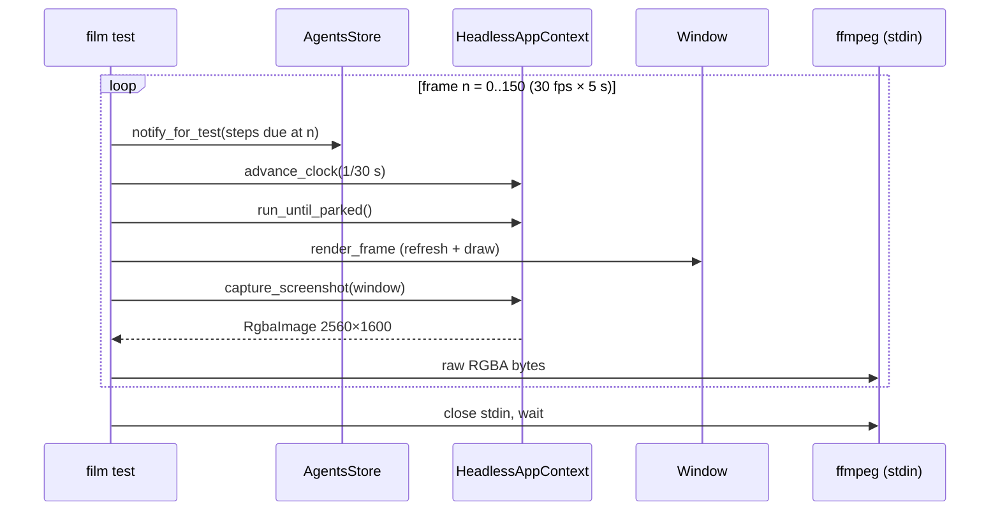

# Design

## Context

See proposal.md (Why) for motivation. What already exists:

- **Offscreen rendering in GPUI** (gpui-pre 0.3.14, behind `test-support`, which the `gpui-kit` dev-dependency enables):
  - `gpui::HeadlessAppContext::with_platform(text_system, assets, renderer_factory)` builds an app on `TestPlatform`, with a deterministic `TestDispatcher` and a pluggable headless renderer.
  - `HeadlessAppContext::advance_clock` moves the fake clock. `run_until_parked` runs queued foreground and background tasks. `capture_screenshot(window)` calls `Window::render_to_image`, which renders the last drawn scene to an `image::RgbaImage`.
  - `gpui_kit::platform::current_headless_renderer()` (`gpui_platform`, `test-support`) returns a Metal renderer on macOS, wgpu on Linux, and `None` elsewhere.
  - `gpui_kit::platform::current_platform(true).text_system()` gives the real platform text system (CoreText on macOS), so glyphs are measured and drawn as in the app.
  - Test windows default to scale factor 2.0 (`platform/test/window.rs`).
- **Clocks:** GPUI animations (`elements/animation.rs`), the app's `SpinnerClock` (`src/ui/kit.rs`) and smooth scrolling (`src/ui/smooth_scroll.rs`) read `cx.background_executor().now()`. That is the dispatcher's clock, so they follow `advance_clock`. The `std::time::Instant::now()` calls in `src/ui/session_view.rs` and `src/ui/smooth_scroll.rs` are inside `#[cfg(test)]` benchmarks.
- **App fixtures** (all `#[cfg(test)]`):
  - `src/store/launch.rs`: `peer_fixture` (a connected `test-agent`), `AgentsStore::install_main_for_test` (a `SessionView` shown in the main pane) and `rpc_for_test`.
  - `src/store/mcp_notice.rs`: `AgentsStore::notify_for_test`, which delivers a notification through `on_incoming`, the same path a live connection uses.
  - `src/ui/find.rs` `tests::rig` opens `QmtApp` this way, using `gpui_kit::open_window` and `gpui_kit::test::TestWindowExt::render_frame`.
- **App bootstrap** (`src/main.rs` `run`): `gpui_kit::init`, then `install_fonts` (embedded IBM Plex), `theme::apply`, `ui::bind_keys`. The asset source is `AppAssets(gpui_kit::assets::AllAssets)`.
- **No library target:** all tests live in the bin target (`cargo t-gpui` = `nextest run -p querymt-gpui --bins`), and the fixtures above are crate-private `#[cfg(test)]` items. The harness therefore lives in the bin target as well.

## Goals / Non-Goals

**Goals:**

- Prove or disprove that the real `QmtApp` can be filmed offscreen, frame by frame, at 30 fps on a stepped clock, with output that looks like the running app.
- Measure wall time per frame and total time for a 5-second clip.
- Write a reviewable MP4, plus two PNG stills.
- Record what broke or differed, so a follow-up change can decide on the scene format and sidecar.

**Non-Goals:**

- A reusable API. The spike may use hard-coded values freely; the follow-up change designs the real harness.
- Determinism across machines. Same-machine reruns should match, but that is noted, not enforced.

## Decisions

### D1. Test-only module in the bin target, run as an ignored test

`src/film.rs` is declared as `#[cfg(test)] mod film;` in `src/main.rs`. It holds one `#[test] #[ignore = "films a demo clip; needs ffmpeg"]` function, `film_prompt_and_streamed_reply`. Run it with:

```bash
cargo nextest run -p querymt-gpui --bins --run-ignored only -E 'test(/film_prompt_and_streamed_reply/)' --no-capture
```

- **Why:** it reuses the existing `#[cfg(test)]` fixtures without making them `pub` or adding a feature. Ignored tests never run in CI (`cargo t-gpui` skips them).
- **Rejected: an example or a second binary.** That needs a library target or duplicated fixtures, and the crate deliberately has no library.
- **Rejected: a `film` cargo feature on the binary.** It would compile test fixtures into a non-test build. That is worth reconsidering only once scenes are data, not code.

### D2. `HeadlessAppContext` with the platform's headless renderer, not `#[gpui_kit::test]`

The test builds its own context:

```rust
let text = gpui_kit::platform::current_platform(true).text_system();
let mut cx = HeadlessAppContext::with_platform(
    text,
    Arc::new(AppAssets(gpui_kit::assets::AllAssets)),
    gpui_kit::platform::current_headless_renderer,
);
```

- **Why not the usual harness:** `#[gpui_kit::test]` gives a `TestAppContext` whose windows have no renderer, so `render_to_image` fails.
- **Why not `VisualTestAppContext`:** it is macOS-only and opens a real (offscreen) window. It is the fallback if D2 fails on macOS (see Risks).
- **Linux:** `current_headless_renderer` returns wgpu, so the same code covers Linux. Linux is tried only if a machine is at hand.

Exact signatures are verified against the gpui-pre 0.3.14 source while implementing; nothing beyond what is listed above is assumed.

### D3. The app is bootstrapped like `main.rs` `run`, minus the platform-only parts

Inside `cx.update`:

1. `gpui_kit::init`;
2. `install_fonts`;
3. `theme::apply(true, "orange", cx)`, the dark theme with a fixed accent, so frames do not depend on the machine's appearance;
4. `ui::bind_keys`.

The store is `peer_fixture()`, with `install_main_for_test` given a `SessionView::new("test-agent", "film", "/workspace", "Film")`.

The window is opened with `gpui_kit::open_window` (which installs the Base `Root`, so overlays render) and explicit `WindowOptions`:

- `window_bounds`: 1280x800 logical;
- `show: false`, `focus: false`.

Skipped: the quick panel host, telemetry, the tray and the single-instance socket. `install_fonts` is private in `main.rs`; it becomes `pub(crate)` so `film.rs` can call it. That is the only change to non-test code.

### D4. The scene is hard-coded Rust: a list of steps keyed by frame number

| Time | Step |
|---|---|
| 0.0 s | Session open, empty transcript, composer focused. |
| 0.3 s | User prompt appears (one `user_message_chunk` notification). The spike does not type into the composer; see D6. |
| 0.8 s | Session state changes to running, if the fixture's view needs that (`phase`), so the spinner shows. |
| 1.0–4.0 s | Agent reply streams as `agent_message_chunk` notifications. The reply is Markdown with a heading, a list, and a short fenced code block, about 3 words per frame, so streaming, highlighting and layout growth are all exercised. |
| 4.0 s | Turn ends; hold to 5.0 s. |

Notifications go through `AgentsStore::notify_for_test` with `session/update`. This is the live path, including the store's flush timer, which the stepped clock drives. Nothing calls `SessionView::apply` directly.

### D5. Frame loop: apply due steps, step the clock, draw, capture, stream to ffmpeg



- **Encoding:**
  - `ffmpeg -f rawvideo -pix_fmt rgba -s 2560x1600 -r 30 -i - -c:v libx264 -pix_fmt yuv420p -crf 18 <out>.mp4`.
  - Raw piping avoids PNG encoding on every frame. Frames 0 and 90 are also written as PNG with the `png` crate already in `[dependencies]`.
  - The size is taken from the first captured image, not assumed.
- **Output:** `$QMT_FILM_OUT` or `target/film/`. If `ffmpeg` is not on `PATH`, the test fails with a message naming it.
- **Timing:** total wall time and per-frame mean are printed to stdout and recorded in tasks.md.

### D6. Spike scope for input

The spike does not simulate typing or clicks. Keystrokes and clicks have known test paths (`TestWindowExt::click`, `VisualTestContext::simulate_keystrokes`). Whether they work on a `HeadlessAppContext` window is recorded as an Open Question for the follow-up, not solved here.

## Risks / Trade-offs

- **[Metal headless rendering fails off the main thread or in a nextest process]** → Retry once with `--test-threads=1`. If it still fails, switch to `VisualTestAppContext` (macOS, offscreen window, same `capture_screenshot`) and record the switch.
- **[Captured frames differ from the real app]** (missing window material or blur, different scale, icons not loaded, transparent background) → Compare the two stills against a screenshot of `cargo r-gpui` at the same size, and list every difference in tasks.md. Expected differences: no OS frame or traffic lights, no macOS material. That is acceptable, because HyperFrames adds the window frame.
- **[Background work does not settle within a frame]** (Mermaid, syntax highlighting or images run on real threads) → `run_until_parked` covers dispatcher tasks only. Record whether code blocks are highlighted in the stills. The scene avoids Mermaid and images on purpose.
- **[Slow capture]** (GPU readback of 2560x1600 per frame) → Measure it. Above about 200 ms per frame, record whether 1x scale is enough for clips.
- **[The fixture's agent needs extra state to show a running turn]** → Use the same `phase`/state updates the existing tests use. If the spinner cannot be shown, note it; it does not block the spike.
- **[Trade-off: code-defined scene]** Changing the clip needs a recompile. That is accepted for a spike; data-defined scenes are the follow-up.

## Open Questions

These are answered by running the spike and recorded in tasks.md; none changes this plan:

- Does `HeadlessAppContext` + `current_headless_renderer` work on macOS in this crate? On Linux?
- Per-frame wall time at 2x scale.
- Do keystrokes and clicks work on a headless window (input for the follow-up)?
- Are code blocks highlighted by the time they are captured?
- Go or no-go for the follow-up change (scene file format, sidecar, `demos/` HyperFrames project).
