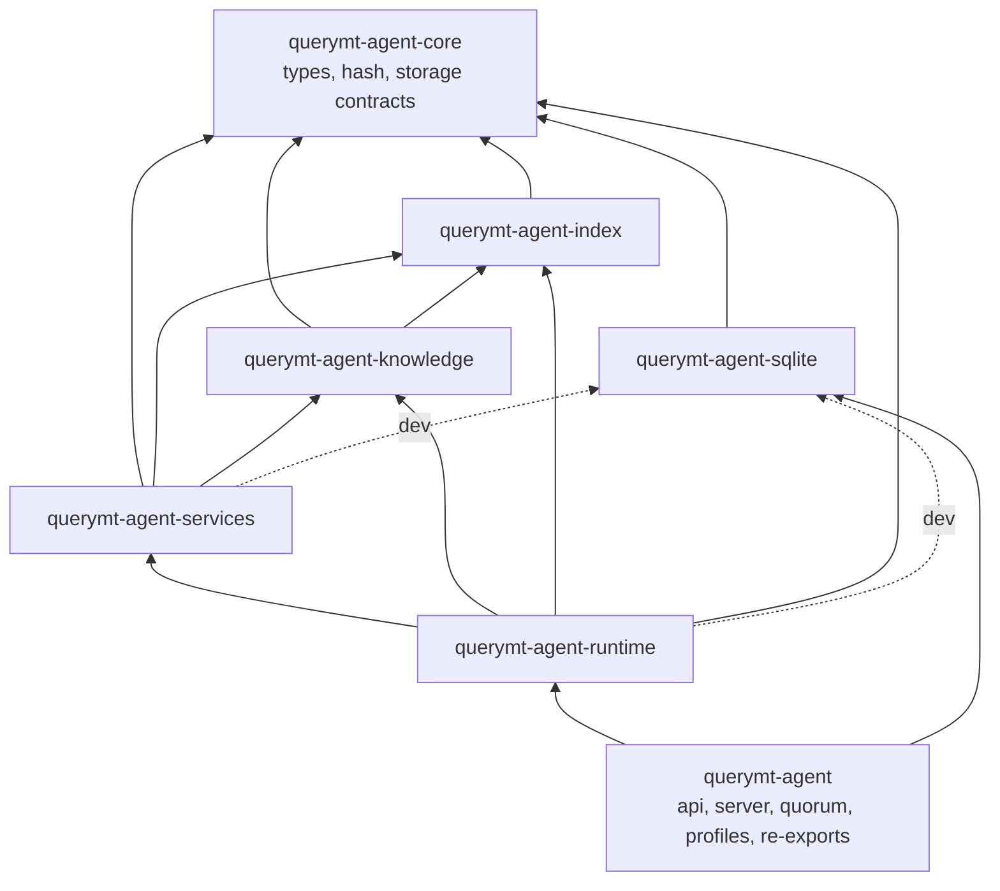
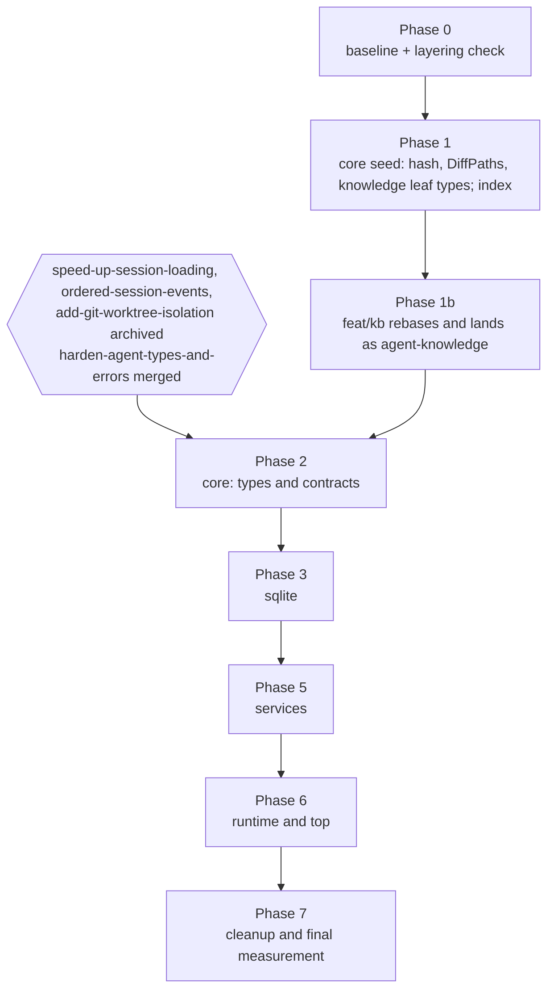

# Design

## Context

See proposal.md (Why). This section records the measured state the plan is built on.

**Code reference.** All counts come from the `feat/kb` tree at `14c3d59b`, because every phase after Phase 1 runs after that branch merges. They are regex counts over `crate::` paths in production code. Production code here excludes `*test*` files and inline `#[cfg(test)] mod` blocks. Glob imports and macro-generated paths are missed, so the counts are lower bounds. The compiler is the final check.

**Size.** `crates/agent/src` is 180.6k production lines and 164.3k test lines.

**Cycle.** 36 of the 46 top-level modules form one strongly connected component. Only these are outside it: `hash`, `index`, `model_info`, `template`, `workspace_query`, `plugin_update`, `snapshot` and `tasks`.

**Existing storage contracts.** The storage layer is already trait-shaped:
- `crates/agent/src/session/backend.rs`: `StorageBackend`
- `crates/agent/src/session/store.rs`: `SessionStore`
- `crates/agent/src/session/projection.rs`: `EventJournal`, `ViewStore`
- `crates/agent/src/session/repository.rs`: seven `*Repository` traits
- `ScheduleRepository`, `KnowledgeStore`, `WorkspaceRepository`, `DotagentsTaskStateRepository`, `DotagentsAutomationRepository`

`store.rs`, `projection.rs`, `repository.rs` and `domain.rs` contain no `rusqlite` and no `Sqlite*` names. Tests already substitute these traits, for example `TestStorageBackend` in `crates/agent/src/agent/handle/tests/mod.rs`. The SQLite implementations are spread over 23 files: `session/sqlite_storage/*`, `session/repo_*.rs`, `session/schema.rs`, `knowledge/sqlite.rs`, `worktree/repo_workspace.rs` and `dotagents/{tasks,automation}.rs`. In five of those files the trait and its SQLite implementation share the file.

**Knowledge is a leaf.** `knowledge/repository/` on `feat/kb` (26.1k lines) has 15 distinct `crate::` references outside itself, and all of them are leaf items:
- `config::{RepositoryKnowledgeSettings, RepositoryKnowledgeDeliverySettings}` (`config/repository_knowledge.rs`, which uses only serde, schemars and `Path`);
- `hooks::HookContextContribution` (`hooks/engine.rs`, a plain 4-field struct);
- `index::{symbol_index::SymbolKind, FileChangeSet, outline_index::common::get_language_for_extension}`, all already `pub`;
- `tools::{resolve_arg_path, effective_root}` (`tools/path.rs`, pure functions over `normalize_tool_path`);
- `dotagents::{parse_frontmatter_markdown, parse_memory_document, field_list, field_string, DotagentsLayer, DotagentsSource}`.

It does not reference `crate::knowledge::*` (the `KnowledgeStore` contract), `crate::session` or `test_utils`. Its tests use only `rusqlite` and `tempfile`. Its users are `agent/{agent_config,agent_config_builder,execution_context,execution/maintenance,repository_delivery}`, `tools/{context,context_impl}`, `tools/builtins/repo_knowledge.rs` and `api/{agent,quorum}`, all of which stay above it.

**Merged gates.** `fix/snapshot` is merged (`9acecd3b`, #1161); `crates/agent` is identical on `main` and that branch. It is no longer a gate.

**Dependents.** `querymt-agent-py` and `querymt-mobile-ffi` depend on `querymt-agent`. `querymt-mobile-ffi` constructs `querymt_agent::session::sqlite_storage::SqliteStorage` directly. The flake builds `-p querymt-agent --example qmtcode`.

## Goals / Non-Goals

**Goals:**
- Each layer is a package with an acyclic dependency graph that Cargo enforces.
- Only the session-database implementation package depends on `rusqlite` for session storage.
- Edits to lower layers compile and test only that layer and the layers above it.
- No behaviour, wire, schema, typeshare or public-path change, apart from the BREAKING items in the proposal.
- Every phase lands on its own, keeps all tests passing, and records timings.

**Non-Goals:**
- Splitting `querymt-agent-runtime` further, including `agent/remote`.
- Introducing a second storage backend.
- Moving or rewriting tests beyond what the crate boundaries force.

## Decisions

### D1. Seven layers, with the allowed edges fixed



Knowledge has no dev edge to sqlite: its tests use its own `rusqlite` index file and `tempfile`, not the session database.

| Package | Directory | Contents (feat/kb paths) | Prod lines / test lines / test attrs (current placement) |
|---|---|---|---|
| `querymt-agent-core` | `crates/agent-core` | `hash.rs`, `events.rs`, `model.rs`, session contracts and domain types (`session/{domain,domain_schedule,error,store,projection,repository,backend,lifecycle,location,ranges}.rs`), `worktree/domain.rs`, `delegation/model_overrides.rs`, `knowledge/{mod,text_processing}.rs` (contract only), plus the type and helper moves in D3 | 7.9k / 4.4k / 223, growing to an estimated 12–14k after D3 |
| `querymt-agent-index` | `crates/agent-index` | `index/` | 10.2k / 5.1k / 133 |
| `querymt-agent-knowledge` | `crates/agent-knowledge` | `knowledge/repository/`, plus `RepositoryKnowledgeSettings`, `RepositoryKnowledgeDeliverySettings` and the `REPOSITORY_KNOWLEDGE_*` constants (from `config/repository_knowledge.rs`). `config` re-exports them | 16.5k / 10.0k / 434 |
| `querymt-agent-sqlite` | `crates/agent-sqlite` | `session/sqlite_storage/`, `session/repo_*.rs`, `session/schema.rs`, `knowledge/sqlite.rs`, the SQLite halves of `worktree/repo_workspace.rs` and `dotagents/{tasks,automation}.rs`, `tests/fixtures/schema_0001_baseline.sql` | 12.5k / 9.0k / 198 |
| `querymt-agent-services` | `crates/agent-services` | `accounting`, `worktree`, `snapshot`, `export`, `tools` (minus the agent-aware built-ins), `verification`, `workspace_query`, `model_heuristics`, `event_fanout`, `event_sink`, `session_event_stream`, `tasks`, `session/{task_service,history_window,turns,pruning,runtime,run_lease,remote_sync}`, the projector half of `control/delegation_notifications.rs` | 32.1k / 30.7k / 975 |
| `querymt-agent-runtime` | `crates/agent-runtime` | everything else: `agent`, `acp` (except `websocket*`), `control`, `delegation`, `middleware`, `hooks`, `config`, `dotagents`, `scheduler`, `skills`, `slash_commands`, `elicitation`, `auth`, `mcp_auth`, `model_*`, `session/{provider,provider_config,compaction,load_snapshot,run_reconcile}`, `tools/builtins/{delegate,route_delegation_to_peer,use_remote_provider}.rs`, `api/sessions.rs`, `api/mesh/{invite,types}.rs`, `plugin_update.rs` | 88.4k / 94.2k / 2,484 |
| `querymt-agent` | `crates/agent` | `api` (rest), `server.rs`, `runner.rs`, `quorum.rs`, `profiles.rs` (manager and embedded catalog), `acp/websocket*.rs`, `build.rs` (dashboard only), examples, benches, `tests/`; facade re-exports | 13.1k / 10.8k / 202 |

**Why seven and not fewer:**
- **Core is a separate package**, not part of services. Tests in services and runtime use real SQLite as a fixture. A crate's unit tests cannot use an implementation crate that depends on that crate itself: Cargo would build two copies of the crate and the trait types would not match. Contracts therefore sit below `querymt-agent-sqlite`, and implementations sit below everything that tests against them.
- **Knowledge gets its own package** because it is 26.5k lines and about 9% of all tests, and it only needs leaf types from core plus index. It does not use the storage contracts, so it can be extracted before them (D8).

**Alternative considered: one large `base` crate.** It was rejected because it would fold `rusqlite` back into the code the storage traits are meant to isolate.

**Why core is the bottom crate.** The index's only upward reference was the `model.rs → index::merkle::DiffPaths` struct, and that struct moves to core (see D3).

### D2. Remove upward edges in the existing crate first, then extract with `git mv`

Each phase follows the same steps:
1. Remove the upward production references for the layer being extracted while the code is still in one crate. Each removal is a small, reviewable diff.
2. Move the files with a pure `git mv`, with no content edits in that commit, so git rename detection stays at 100% for branches that rebase over it.
3. Add the `Cargo.toml` and re-export glue.

**Layering check.** A script, `scripts/check-agent-layering.py`, maps every file to its target layer using the D1 table. It fails when production code references a forbidden layer and reports the remaining count. It is the same analysis used for this plan. CI runs it from Phase 1 until Phase 7, when Cargo enforces the whole graph and the script is deleted.

**Alternative considered: extract first and fix compiler errors in the new crate.** It was rejected because one phase would turn into hundreds of simultaneous errors across many files, with no reviewable intermediate state.

### D3. The cut inventory

There are 81 distinct upward production items (lower bound). Most of them are resolved by moving definitions down. Five need a design change; see D4.

**Data types and pure helpers that move to core** (each upper module re-exports them):

| From | Items | Notes |
|---|---|---|
| `agent/core.rs` | `AgentMode` | 9-line enum. `support-mcp-skills` edits `agent/core.rs`, so move it after that change lands |
| `agent/session_control.rs` | `SessionControlState`, `SessionModelBinding` (whole file, 58 lines) | depends only on `AgentMode` |
| `agent/messages.rs` | `SessionRuntimeStatus`, `SessionRuntimePhase`, `RuntimeObservation` | pulls in `DelegationUpdateNotification` |
| `control/delegation_notifications.rs` | `DelegationStage`, `DelegationActivity`, `DelegationUpdateNotification` | the projector moves to services |
| `agent/utils.rs` | `truncate_to_bytes`, `render_prompt_for_display` | |
| `delegation/model_overrides.rs` | `DelegateModelOverride`, `DelegateReasoningEffort` | the file has a production function over `SessionStore` and `SessionResult` (line 175), so it moves only with the session contracts in Phase 2, not early |
| `middleware/dedup_check.rs` | `DuplicateWarning`, `FunctionLocation`, `SimilarMatch` | |
| `config/mcp.rs`, `config/execution.rs`, `config/workspace.rs`, `config/permissions.rs` | `McpServerConfig`, `CompactionConfig`, `PruningConfig`, `RateLimitConfig`, `ToolOutputConfig`, `OverflowStorage`, `SnapshotBackendConfig`, `WorkspaceSettings`, `ApprovalNeed` | `ApprovalNeed::unmatched`-style methods that take runtime types (`config::permissions::*::unmatched(&McpToolSnapshot)`) stay in runtime as free functions. serde attributes, `deny_unknown_fields` and `JsonSchema` derives move unchanged. |
| `hooks/engine.rs` | `HookContextContribution` | Needed by knowledge. Moves early (tasks 1.6 to 1.8). `harden-agent-types-and-errors` edits `hooks/engine.rs`, so rebase that hunk |
| `config/repository_knowledge.rs` | `RepositoryKnowledgeSettings`, `RepositoryKnowledgeDeliverySettings`, `REPOSITORY_KNOWLEDGE_*` | **Not core.** They move into `querymt-agent-knowledge` and `config` re-exports them (runtime depends on knowledge). The file uses `use super::*` from `config/mod.rs`, so it needs explicit imports (serde, schemars, `Path`, `PathBuf`) when it moves. serde attributes, `deny_unknown_fields` and `JsonSchema` derives stay unchanged |
| `accounting.rs` | `AttemptStart`, `AttemptSettlement`, `RequestAccounting` and their field types (`AttemptRef`, `AttemptOutcome`, `BillingClass`, `DispatchMode`, `PricingApplicability`, `UsageDisposition`, `UsageValuation`, `AccountingReason`) | |
| `session/provider.rs` | `BillingBasis` | |
| `verification/mod.rs` | `VerificationSpec` | |
| `worktree/domain.rs` | whole file (`DelegationIsolation`, `WorkspaceCreationOptions`, `BaselineMode`, `source_cwd_from`, …) | no `crate::` dependencies |
| `index/merkle.rs` | `DiffPaths` | |
| `acp/shared.rs` | `QUERYMT_META_NAMESPACE` | |
| `acp/protocol.rs` | whole file (a re-export of `agent_client_protocol`) | core takes the `agent-client-protocol` dependency |
| `elicitation.rs` | `ElicitationAction`, `ElicitationResponse` | |
| `session/compaction.rs` | `filter_to_effective_history` | pure function over `AgentMessage` |
| `session/load_snapshot.rs` | `StreamCursor`, `observe_cursor` | |
| `session/run_lease.rs` | `run_lease_root_for_db` | pure path function |
| `tools/path.rs` | `normalize_tool_path`, `resolve_arg_path`, `effective_root`, `lexical_clean`, `pop_parent`, `canonicalize_existing_prefix`, `paths_overlap` | std and `serde_json` only. `effective_root` calls `normalize_tool_path`, so the private helpers move with it. The `FileAccess` and `ReadScope` functions in the same file stay in `tools`. Moves early (tasks 1.6 to 1.8) |
| `dotagents/{frontmatter,layer,diagnostics}.rs`, `dotagents/manifest.rs` `DotagentsMemory`, the memory-document part of `dotagents/parsers.rs` (`parse_memory_document`, `partition_fields`, `fingerprint`, `MEMORY_KEYS`) | document parsing used by knowledge | the first three files have no `crate::` dependencies beyond each other. `parsers.rs` as a whole depends on `subagent` and `DotagentsManifest`, so only the memory-document part is split out, not the whole file. None of these files is touched by `feat/kb`, `harden-agent-types-and-errors` or `support-mcp-skills`. Moves early (tasks 1.6 to 1.8) |
| `knowledge/{mod,text_processing}.rs` | `KnowledgeStore`, `KnowledgeEntry`, `KnowledgeError`, request types, text processing | the contract; brings in `rust-stemmers` and `unicode-normalization` |
| `dotagents/{tasks,automation}.rs`, `session/repo_schedule.rs`, `worktree/repo_workspace.rs` | `DotagentsTaskStateRepository`, `DotagentsAutomationRepository`, `ScheduleRepository`, `WorkspaceRepository` traits and their record types | the files are split; the SQLite halves go to the sqlite package |

**Whole-file placement** (not a type move):
- `session/remote_sync.rs` goes to services. Its production code only uses core contracts.
- `api/sessions.rs` (`AgentSessions::list_for_acp_with_runtime`, `AcpSessionListError`), `api/mesh/{invite,types}.rs` (`admit_via_invite_on_runtime`, `MeshJoinOutcome`) and `plugin_update.rs` go to runtime, because `agent/handle` calls them. `querymt-agent` re-exports them under `api::`.
- `SessionProvider::get_pricing` becomes a free function in `accounting`, together with `is_non_billable_oauth_provider`. `SessionProvider::get_pricing` delegates to it.
- `shell_executable` and `shell_exit_code` (tracing helpers in `agent/utils.rs`) move to services next to `tools/builtins/shell.rs`.
- `impl StorageBackend for SqliteStorage` (`session/backend.rs`) moves to the sqlite package.

### D4. The five behaviour edges

1. **`tools` → `acp::client_bridge::ClientBridgeSender`.** Today `ToolContext::workspace_query_bridge` returns the concrete sender. Only `tools/builtins/language_query.rs` uses it. It becomes a `WorkspaceQueryBridge` trait in services, with one async method that takes a `WorkspaceQueryRequest` and returns a `WorkspaceQueryResponse`. `workspace_query.rs` moves to services. `ClientBridgeSender` implements the trait in runtime.

   *Alternative considered:* moving `client_bridge` down. Rejected, because it depends on `elicitation` claim and delivery logic and on `AgentError`.

2. **`tools` → `delegation::AgentRegistry`.** `AgentRegistry` returns `Arc<dyn AgentHandle>`, a runtime type, so it cannot move down. The only reader is the `delegate` tool, which stays in runtime.
   - `ToolContext` drops `agent_registry()` and gains `fn extensions(&self) -> &http::Extensions`. `http` is already a workspace dependency.
   - `tools/context_impl.rs` `AgentToolContext` stores extensions in place of the `agent_registry` field.
   - Runtime inserts the `Arc<dyn AgentRegistry>`, and `delegate.rs` reads it back with `extensions().get::<Arc<dyn AgentRegistry>>()`.
   - Missing-registry behaviour is unchanged: the tool returns the same `ToolError::ProviderError` text.

   *Alternative considered:* making `AgentToolContext` generic over the registry. Rejected, because the generic parameter would spread through every tool signature.

3. **`agent/handle` → `profiles::ProfileRuntimeManager`.** The manager lives in the top crate because it builds `api::Agent` and uses `AgentInfra`. `ProfileRuntime` contains an `Agent`.
   - Runtime defines a `ProfileRuntimeHost` trait (async, object-safe). It covers the manager methods runtime code calls today: `list_profiles`, `active_profile_id`, `set_active_profile`, `active_runtime`, `runtime_for_profile`, `bind_session_to_runtime`, `set_session_binding`, `session_binding`, `adopt_unbound_session`, `materialized_runtimes`, `mcp_servers`, `set_mesh_handle`, `set_mesh`, `forget_session_binding` and `shutdown`.
   - Methods that return `ProfileRuntime` return a runtime-side view instead: `ProfileRuntimeView { metadata, handle: Arc<LocalAgentHandle>, provider_lock }`. Runtime only ever reads `runtime.agent().handle()`.
   - `ProfileMetadata`, `SessionProfileBinding`, `ResolvedProfileProviderLock` and the `ProfileCatalog` trait move to runtime. `LocalProfileCatalog` and the embedded catalog (`RustEmbed` over `examples/`) stay in `querymt-agent`.
   - `api::ProfileRuntimeHandle` becomes `Arc<dyn ProfileRuntimeHost>`. The manager implements the trait.

4. **`ViewStore::get_atif` (BREAKING).** This method makes the storage contract depend on `export`, and the SQLite implementation depend on `ATIFBuilder`. It is removed. ATIF export becomes `export::session_atif(view_store, session_id, options)` in services, built from `ViewStore::get_audit_view`, which is exactly what `crates/agent/src/session/sqlite_storage/view_store.rs` does inside `get_atif` today. The `SplitLifecycleBackend` test wrapper in `crates/agent/src/api/agent_tests.rs` stops forwarding the method.

5. **`SessionError::Database` and `From<rusqlite::Error>` (BREAKING).** `harden-agent-types-and-errors` made `SessionError::Database(#[from] rusqlite::Error)` the carrier of database failures and gave `SessionError` `is_no_rows()`, `is_transient()` and `db_message_contains()`, all of which match on `rusqlite` types. `session/error.rs` is in core (D1), so keeping that shape would put `rusqlite` back into core and break the rule that only the sqlite package depends on it. The orphan rule also stops the sqlite package from implementing `From<rusqlite::Error>` for a core type.

   Core therefore holds a database-neutral error and the sqlite package does the classification:
   - `SessionError::Database(DbError)` keeps the variant name and the `Database error: {0}` display text. `DbError { source: Box<dyn std::error::Error + Send + Sync>, kind: DbErrorKind }` with `DbErrorKind` = `NoRows`, `Busy` (busy or locked), `Other`. `Error::source()` returns the boxed source, so the original `rusqlite::Error` stays reachable by downcast.
   - `is_no_rows()` and `is_transient()` read `kind`. `db_message_contains()` reads `source.to_string()`. Callers such as `claim_delegation` keep their behaviour.
   - `SessionError::TaskFailed(JoinError)` is unchanged. Core already uses tokio (`session/backend.rs`, `session/location.rs`), so it adds no dependency.
   - The sqlite package adds an extension trait, roughly `trait SqliteResultExt<T> { fn db(self) -> SessionResult<T>; }`, that classifies a `rusqlite::Error` into `DbErrorKind` and boxes it as the source. A matching `knowledge_db()` helper maps to `KnowledgeError`, which keeps its string variant because `harden-agent-types-and-errors` did not change it. About 22 files change from `?` to `.db()?`.
   - The unit tests in `session/error.rs` that build `rusqlite` errors move to the sqlite package, next to the classification they test.

   *Alternative considered:* keeping `Database(#[from] rusqlite::Error)` in core. Rejected, because it makes core depend on `rusqlite` and defeats the layering goal. *Alternative considered:* mapping to a string, as this change first planned. Rejected, because it drops the source chain and the busy/locked classification that `claim_delegation` retries rely on.

### D5. Paths: permanent public facade and temporary internal aliases (user-approved)

**External paths.** `querymt-agent` rebuilds the module tree that exists today. Modules split across packages become facade modules that glob-re-export each part:

```rust
// crates/agent/src/lib.rs (illustrative)
pub mod session {
    pub use querymt_agent_core::session::*;
    pub use querymt_agent_sqlite::session::*;   // sqlite_storage, repo_*, schema
    pub use querymt_agent_services::session::*;
    pub use querymt_agent_runtime::session::*;
}
pub use querymt_agent_runtime::{agent, control, delegation, middleware, hooks, /* … */};
```

The same applies to `acp`, `config`, `tools`, `worktree`, `knowledge`, `dotagents` and `api`. Downstream crates, the 13 examples, the 5 benches and `crates/agent/tests` compile unchanged. Proof is `cargo check` of `querymt-agent-py` and `querymt-mobile-ffi`, with no source diff in either.

**Internal aliases.** Each moved package declares crate-root aliases for the layers below it, for example `pub(crate) use querymt_agent_core::{events, hash, model};`, so existing `crate::events::…` paths keep compiling. Phase 7 removes them and rewrites the paths to the real crate paths. These aliases are the only compatibility layer that is removed.

**Visibility.** `pub(crate)` items that are used across a new boundary become `pub` with `#[doc(hidden)]`. There are 694 `pub(crate)` occurrences in total, and only boundary-crossing items change.

### D6. Test helpers: per-package `test-support` features, and tests move up when they need upper layers

- `crates/agent/src/test_utils` is `#[cfg(test)]` and depends on runtime (77 references). It is split by what each helper needs:
  - **core:** mockall mocks of core traits, such as `MockSessionStore`.
  - **sqlite:** `sqlite_conn_with_schema` and `TestStorage`.
  - **runtime:** `TestAgent`, the mock LLM provider, `mcp_harness` and the drivers.
- Each package exposes them as `#[cfg(any(test, feature = "test-support"))] pub mod test_support`. Upper packages enable the feature in `[dev-dependencies]`. With resolver 2, dev-dependency features do not reach normal builds. `mockall` becomes an optional dependency that `test-support` enables.
- A test whose code references a layer above its own package moves up to the lowest package that can see everything it uses. Known cases:
  - runtime tests that reference top-layer items: 11 files and 59 references, mostly `agent/handle/tests/*` and `agent/remote/session_actor_ref_remote_tests.rs`. They move into `querymt-agent`.
  - parts of `session/sqlite_storage/tests.rs` (17 references): most become legal once the D3 moves land, and the rest move to services.
  - the `control/delegation_notifications.rs` tests that use `TestAgent`.
  - `tools/builtins/shell.rs` tests.
- Tests that read files across the old crate root are retargeted:
  - `accounting/dispatch_coverage_tests.rs` uses `include_str!` on `session/compaction.rs`, `session/provider.rs` and `delegation/summarizer.rs`, which become a different package. It moves to runtime, or switches to `CARGO_MANIFEST_DIR` plus the sibling crate path.
  - Config tests embed `crates/agent/examples/confs/*.toml`.
  - `session/sqlite_storage/tests.rs` reads `tests/fixtures/schema_0001_baseline.sql`.
- Doc-sync tests that read `docs/docs/...` with `../../../../` keep the same depth, because `crates/agent-x/src` sits at the same level as `crates/agent/src`.
- **Invariant:** the total number of tests reported by `cargo nextest list` across all agent packages is equal at the end of every phase.

### D7. Features, build script and dependencies

| Package | Features |
|---|---|
| `querymt-agent-runtime` | `remote` (`kameo/remote`, `dep:libp2p`, `querymt-remote/kameo-mesh`, `querymt-remote/qr`), `oauth` (`querymt-utils/oauth`, `rmcp/auth`), `plugin-loaders` (`querymt/dynamic-plugins`), `api` (for the `cfg!(feature = "api")` in `control/capabilities.rs`), `test-support` |
| `querymt-agent` | every current feature, forwarding to runtime where runtime code is gated. `dashboard`, `zbus-secret-service`, `systemd-credentials`, `agent-mcp`, `agent-tracing` and `remote-metrics` keep their current targets. |
| core, index, knowledge, sqlite, services | `test-support` only. No other `cfg(feature)` occurs in their code. |

- **Standalone builds.** Each package declares the `querymt` features its own code needs, so `cargo check -p <pkg> --no-default-features` passes without feature unification from `querymt-agent`. For example, runtime uses `querymt::mcp` unconditionally.
- **Build version.** `env!("QMT_BUILD_VERSION")` in `mcp_auth.rs`, `agent/mcp.rs`, `agent/handle/send_agent_lifecycle.rs` and `export/atif.rs` becomes `querymt_utils::BUILD_VERSION`. `crates/querymt-utils/build.rs` already produces it with the same `QMT_VERSION` / `git describe` logic. `crates/agent/build.rs` keeps only the dashboard preparation. No other package gets a build script.
- **No new external dependencies.**
  - `http` is already a workspace dependency.
  - Versions shared by several agent packages move into `[workspace.dependencies]` so they stay identical: `tokio`, `rusqlite` (bundled), `kameo`, `agent-client-protocol`, `rmcp`, `thiserror`, `anyhow`, `time`, `uuid`, `parking_lot`, `arc-swap`, `tree-sitter*`, `rust-stemmers`, `unicode-normalization`, `mockall`.
  - `querymt-agent-knowledge` keeps a direct `rusqlite` dependency for its own derived cache file, `RepositoryStore::open` in `knowledge/repository/store.rs` (`cache/knowledge/<id>/index.sqlite`). That cache is not session storage, and putting it behind a trait would add indirection with no second implementation.
- **Workspace members** gain `crates/agent-*`.
- **Unaffected builds.** No provider crate depends on any agent package, so `wasm32-wasip1` provider builds are unaffected. The Python and mobile crates are affected only through the facade.

### D8. Sequencing and gates



- **Phases 0 and 1 can start now.** `snapshot` and others reach `hash` through `crate::hash`, which stays valid through an alias. The Phase 0 baselines (test-name list, typeshare output, timings) must be re-taken after `harden-agent-types-and-errors` lands, because it changes the test count and the typeshare output; task 2.1 already reruns them.
- **The index move.** `index/` depends only on `hash`. Its 5 `pub(crate)` items are used only inside `index/` (matches on `helpers` elsewhere are unrelated modules), so no visibility change is needed. No module outside `index/` uses tree-sitter, `similarity-*` or `syn`. `harden-agent-types-and-errors` edits 8 files there (about 110 lines). The move commit is renames only, so that branch rebases over it.
- **Phase 1b: `feat/kb` lands split.** `knowledge/repository/` needs only the leaf types listed in the Context section, which move in Phase 1 into core (`HookContextContribution`, the pure path helpers, the dotagents document parsing; tasks 1.6 to 1.8). The settings types exist only on `feat/kb`, so they move into the knowledge crate during its rebase (task 1.9). After the core moves, `feat/kb` rebases, moves `knowledge/repository/` to `crates/agent-knowledge`, and merges split. Its non-repository users keep working through the internal aliases. Nothing in this step needs the session storage contracts or the sqlite package.
- **Phase 2 waits for two things:**
  - the three nearly finished storage changes archived, because they touch `session/`, `event_sink.rs` and `worktree/`;
  - `harden-agent-types-and-errors` merged, because it rewrites `session/error.rs` (the `SessionError` shape in D4.5), `session/sqlite_storage/*`, `event_sink.rs`, `session_event_stream.rs`, and changes typeshare output (`ScheduleInfo.state`, `PendingInputSummary.delivery`/`state` become enums).
- **Phase 2 no longer waits for `feat/kb`.** The parts of `feat/kb` outside `knowledge/repository/` (`agent/*`, `config/*`, `tools/context*`, `api/*`) stay where they sit today and are moved by the phase that moves those directories. `harden-agent-types-and-errors` and `feat/kb` both edit 11 files in `agent/`, `api/`, `config/` and `tools/`; whichever merges second resolves those conflicts.
- **Phase 3 (sqlite)** has no knowledge dependency. `fix/kb_db_migration` touches the `KnowledgeStore` SQLite half, not `knowledge/repository/`, so Phase 1b does not affect it.
- **`support-mcp-skills`** (20 of 21 tasks done) will land before Phase 6; it edits `agent/core.rs`, so `AgentMode` moves after it. **`support-pi-lens-hooks`** (0 of 16 done) touches `hooks`, which stays in runtime, and should either land before Phase 6 or start after it.
- **Each phase is one PR, or a short series:** in-place removals, then the `git mv` commit, then the glue. CI's path filters, per-package test and lint steps, and the `cargo nextest list` count check are updated in the same PR as the package they cover.

### D9. CI, tooling and docs

- **`.github/workflows/test-agent.yml`:**
  - The lint step runs `cargo clippy --all-targets -D warnings` per package with that package's features.
  - Coverage runs `cargo llvm-cov nextest` over `-p querymt-agent -p querymt-agent-runtime -p …`.
  - The layering check runs until Phase 7.
  - The path filters add `crates/agent-*/**`.
- **`.github/workflows/test-python-packages.yml`:** path filters add `crates/agent-*/**`.
- **`scripts/generate-types.sh`:** add the new crate directories. The packages that contain `#[typeshare]` types are core (events, session domain and projection, model overrides, dedup types), index (`file_index.rs`), services (accounting, `session/history_window.rs`: `PendingInputSummary`, `InputDelivery`, `PendingInputState`), runtime (agent, control, session runtime, auth, `model_registry`, `plugin_update`, `api/sessions.rs`) and the top crate. typeshare output is diffed against the Phase 0 baseline after every phase and must be byte-identical.
- **Docs and repository guidance:** `AGENTS.md` and `openspec/config.yaml` get the package list, the per-layer test commands, and a rule for choosing which package to test. `docs/docs/agent/mesh.md` gets the new log-target path. `CHANGELOG.md` Unreleased lists the BREAKING items.

## Risks / Trade-offs

- **The counts are regex lower bounds.**
  - Risk: glob imports, macros and `super::` chains hide more cuts.
  - Mitigation: the layering check and the compiler run on every step, and each phase starts by refreshing its inventory.
- **Moving a type can pull other types with it.**
  - Risk: for example, `SessionRuntimeStatus` drags in `DelegationUpdateNotification`.
  - Mitigation: core accepts plain data with no `crate::` logic. A type whose dependencies are logic is cut with a trait, and the inventory is updated.
- **Inherent `impl` blocks must live with their type.**
  - Risk: methods that use upper-layer code cannot move with the type.
  - Mitigation: those methods become free functions or extension traits in the upper layer. Call sites change from `x.m()` to `m(&x)` or gain an extension-trait import.
- **Glob re-exports in the facade can create ambiguous names.**
  - Risk: two packages export the same item name under a merged module.
  - Mitigation: a `cargo check` of the facade, examples, benches, `tests/`, `querymt-agent-py` and `querymt-mobile-ffi` catches it, and the fix is an explicit re-export.
- **Log filters on deep module paths change (BREAKING).**
  - Risk: user filters below the crate name stop matching.
  - Mitigation: a test in the runtime package asserts that a known log site's `module_path!()` starts with `querymt_agent`, so the bare `querymt_agent=` prefix filter keeps matching. Docs and CHANGELOG are updated.
- **Merge conflicts with open branches.**
  - Mitigation: pure `git mv` commits, the D8 gates, and merging the phases quickly.
- **Runtime stays large.**
  - Trade-off: about 88k production lines plus 94k test lines remain in one package, and edits there are still slow. This change does not fix that case; the measurements after Phase 7 decide whether to split runtime further.
- **Doctests change crate name.**
  - Risk: 86 Rust doctest blocks may reference `querymt_agent::` paths that a moved package cannot see.
  - Mitigation: `cargo test --doc -p <pkg>` runs in each phase, and broken examples are rewritten to the new package path.
- **Test counts.**
  - Static analysis counts 4,649 test attributes, while nextest ran 2,908 tests on `fix/snapshot`. The gap (likely platform or feature gating) is not explained.
  - Mitigation: the invariant uses `cargo nextest list` with fixed features, not attribute counts.

## Migration Plan

- **Deployment:** there is nothing to deploy. There is no persisted-data, schema or migration change. Existing session databases are opened by the same migration code after it moves.
- **Downstream crates:** `querymt-agent-py` and `querymt-mobile-ffi` need no source changes. Only the internal crate paths behind the facade change.
- **Rollback:** each phase is a single revertible PR. The `git mv` commits revert cleanly. Reverting a later phase does not require reverting an earlier one.

## Open Questions

- **Exact final size of core** after D3, estimated at 12–14k production lines. It is measured at the end of Phase 2 and does not change the plan.
- **Whether `support-pi-lens-hooks` lands before Phase 6 or starts after it.** This is a coordination choice either way; it stays in runtime. `support-mcp-skills` is nearly done and lands first.
- **Whether the settings types stay in `querymt-agent-knowledge` once other crates need them.** If core code ever needs them, they can move down then. Today only `config` (re-export) and knowledge use them.
