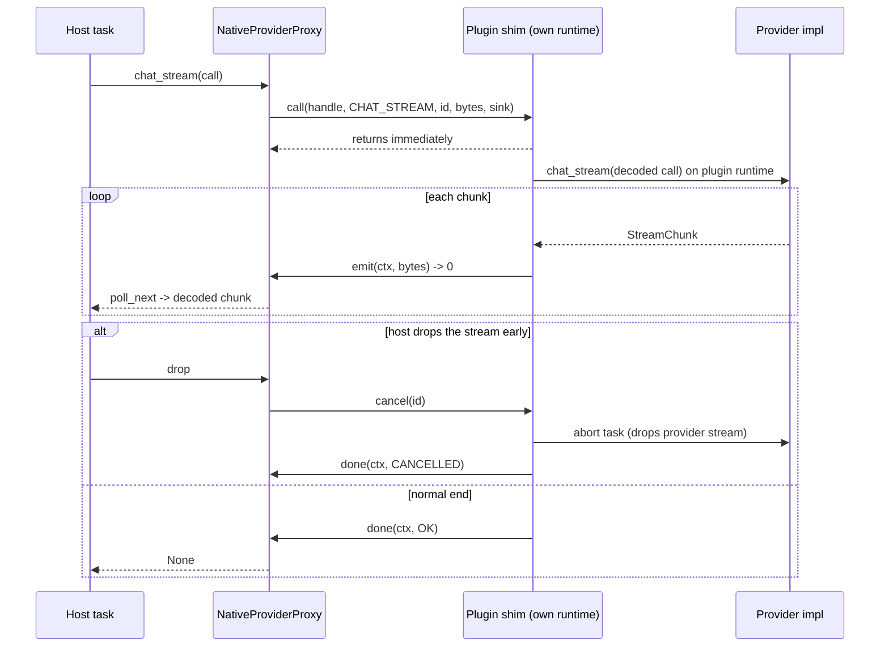
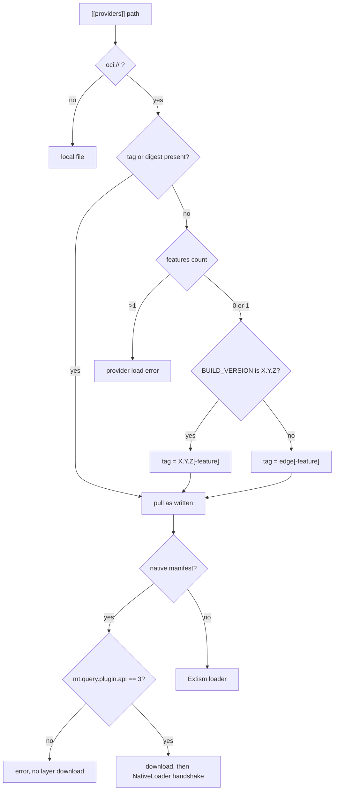

# Design

## Context

See proposal.md (Why) for the motivation. The current state:

- **Loader.** `crates/querymt/src/plugin/host/native.rs` `NativeLoader::load_library`:
  - opens the library with `libloading`;
  - checks `querymt_plugin_api() == NATIVE_PLUGIN_API` (2) in `NativeLoader::validate_descriptor`;
  - takes a `Box<dyn LLMProviderFactory>` from `plugin_factory` (type `FactoryCtor`), or a `Box<dyn HTTPLLMProviderFactory>` from `plugin_http_factory` (`HTTPFactoryCtor`, `crates/querymt/src/plugin/http.rs`);
  - wraps it in `NativeFactoryWrapper`, which holds an `Arc<Library>`.

  From then on every call is a Rust vtable call on plugin-built types. Neither providers created by `from_config` nor their futures and streams keep the library alive.
- **Plugin side.** `crates/providers/{llama-cpp,mrs,izwi}` each hand-write the exports `querymt_plugin_api`, `plugin_factory` and `plugin_init_logging`, using `#[allow(improper_ctypes_definitions)]`. Logging is bridged by `crates/querymt/src/plugin/plugin_log.rs` `init_from_host`.
  - Each plugin works around its separate tokio copy differently: izwi keeps a private runtime (`crates/providers/izwi/src/provider.rs` `IzwiProvider::izwi_rt`), and mrs falls back to building one (`crates/providers/mrs/src/model.rs` `MistralRSFactory::from_config`).
  - llama-cpp's `CompletionProvider::complete` (`crates/providers/llama-cpp/src/provider.rs`) generates inline and blocks the polling thread.
- **HTTP providers.** All 14 export `plugin_http_factory` under their `native` feature, for example `crates/providers/anthropic/src/factory.rs`.
- **Serialization.** Every type that crosses the provider surface already has serde implementations:
  - `ChatMessage` (custom, `crates/querymt/src/chat/mod.rs`);
  - `Tool`, `GenerationOptions`, `ChatCapabilities`, `StreamChunk`;
  - `ChatOutput` (`chat/output.rs`), `StructuredStreamEvent` (`chat/streaming.rs`);
  - `CompletionRequest`/`CompletionResponse`, `SttRequest`/`SttResponse`, `TtsRequest`/`TtsResponse`;
  - `ToolResultPart` (custom deserializer in `chat/migration.rs`).

  Errors convert losslessly through `LLMError::to_payload` / `LLMError::from_payload` (`crates/querymt/src/error.rs`). The mesh already sends these types as MessagePack (`crates/querymt-remote/src/provider_protocol.rs`, `rmp_serde::to_vec_named`).
- **OCI.** `crates/querymt/src/plugin/host/oci.rs` `OciDownloader::pull_and_extract`:
  - selects the platform manifest from an image index;
  - reads its annotations into `ProviderPlugin::annotations`;
  - only then downloads the layer (`extract_file_and_content`).

  `oci_client::Reference::try_from` turns an untagged reference into `:latest`. `PluginRegistry::load_and_process_plugin` (`crates/querymt/src/plugin/host/mod.rs`) checks locked entries using `expected_scalar_feature`.
- **CI.**
  - `.github/actions/native-publish/action.yml` pushes `<version>-<os>-<arch>-<feature>` plus an alias tag, with `mt.query.plugin.api=2` hardcoded.
  - `.github/workflows/native-create-manifests.yml` writes `<version>-<feature>`, `<version>`, `<alias>-<feature>` and `<alias>`, where the alias is `stable` for tag builds and `latest` otherwise.
  - `.github/workflows/publish-providers.yml` does the same for Wasm and writes the provider index (`stable.json`/`latest.json`).
  - Version tags come from `cargo pkgid`, so `main` builds overwrite them.

## Goals / Non-Goals

**Goals:**
- A boundary on which compiler, allocator, std and runtime differences cannot cause undefined behavior. The worst outcome of a mismatch is a clean error.
- Plugin authors keep writing ordinary `LLMProviderFactory` / `LLMProvider` impls; the boundary code is generated.
- The interface overhead stays well below model time, and the benchmark makes it visible.
- A released host gets plugins of its own release by default, and CI cannot overwrite release artifacts.

**Non-Goals (design-level, in addition to proposal.md):**
- Zero-copy payloads. Every crossing copies once into a host-owned buffer.
- A generic out-of-process transport. The byte protocol is shaped so it can be piped later, but no pipe transport is built.
- Hot reload of native libraries.

## Decisions

### 1. Boundary shape: one versioned C table, opaque handles, bytes in, callbacks out

A plugin exports two symbols:

```rust
#[no_mangle] extern "C" fn querymt_native_plugin_abi() -> u32;                    // == NATIVE_PLUGIN_ABI (3)
#[no_mangle] extern "C" fn querymt_native_plugin() -> *const QmtNativePluginV3;   // static table
```

All boundary types live in a new module `crates/querymt/src/plugin/native_abi.rs`, compiled with `native` or `native-plugin`. Each is `#[repr(C)]` and built only from integers, pointers and `extern "C"` function pointers:

```rust
#[repr(C)] pub struct QmtBytes { pub ptr: *const u8, pub len: usize }   // borrowed for the call only
#[repr(C)] pub struct QmtSink {
    pub ctx:  *mut c_void,
    pub emit: unsafe extern "C" fn(ctx: *mut c_void, item: QmtBytes) -> u32,               // 0 = continue, 1 = stop
    pub done: unsafe extern "C" fn(ctx: *mut c_void, status: u32, payload: QmtBytes),       // exactly once
}
#[repr(C)] pub struct QmtHostV3 {
    pub size: u32, pub max_log_level: u32,
    pub log: unsafe extern "C" fn(level: u32, target: QmtBytes, message: QmtBytes),
}
#[repr(C)] pub struct QmtNativePluginV3 {
    pub size: u32,
    pub init:   unsafe extern "C" fn(host: *const QmtHostV3) -> u32,
    pub call:   unsafe extern "C" fn(target: u64, op: u32, call_id: u64, request: QmtBytes, sink: QmtSink),
    pub cancel: unsafe extern "C" fn(call_id: u64),
    pub close:  unsafe extern "C" fn(provider: u64),
}
```

- **Targets.** `target = 0` means the factory. Other targets are provider handles that the plugin assigned in the `OPEN` result. Handles are plain `u64`s from a plugin-side registry, the same model as `crates/querymt-mobile-ffi`.
- **Operations** (`u32` codes): `DESCRIBE`, `LIST_MODELS`, `OPEN` (factory); `CHAT`, `CHAT_STREAM`, `COMPLETE`, `EMBED`, `TRANSCRIBE`, `SPEECH`, `CALL_TOOL` (provider). An unknown code completes with `NotImplemented`.
- **Status codes for `done`.**
  - `OK`: payload is the operation's result.
  - `ERROR`: payload is `LLMErrorPayload`.
  - `PANIC`: payload is the panic message as UTF-8, mapped to `LLMError::PluginError`.
  - `CANCELLED`: empty payload.
- **Memory ownership never crosses.** Every `QmtBytes` is borrowed only for the duration of the call or callback that receives it. Each side copies what it keeps, so no free function exists and allocators never meet.
- **The sink context is owned by the plugin until `done` returns.** `done` is called exactly once on every path, including cancellation and panic, and the plugin never touches `ctx` afterwards. Callbacks may run on any plugin thread, so host callbacks are thread-safe and never block. They copy the bytes and push them into a channel.

**Alternatives considered:**
- *Keep trait objects and add a build fingerprint* (the cordis-rs legacy loader). This turns corruption into an error but still requires the same rustc. Rejected: it fails the "regardless of rustc" goal.
- *`abi_stable` with `async-ffi`.* It needs FFI mirrors of every chat type, and JSON values would cross as strings anyway. Async fits poorly. Rejected as the most work for no gain over bytes.
- *Plugin returns allocated buffers plus a `free` function.* Rejected: callbacks with borrowed buffers make ownership trivial and fit streaming naturally.
- *One exported symbol per operation.* Rejected: a single `call(op)` keeps the table stable when operations are added; a new operation needs only a new code.

### 2. Payload encoding: MessagePack with named fields, the same serde types as other transports

Payloads are `rmp_serde::to_vec_named` encodings of the existing serde types. The decoder is `rmp_serde::from_slice`.

- **Named fields** keep the existing serde attributes working: `skip_serializing_if`, `flatten`, internally tagged enums, and the field-count contract of `ChatMessage`'s custom serializer. The mesh already relies on these with the same codec.
- **Request wrappers.** These live in `native_abi.rs`. Host-side request types borrow, so the host serializes without cloning the history, and the plugin decodes into owned mirrors:
  - `ChatRequestRef<'a> { messages: &'a [ChatMessage], tools: Option<&'a [Tool]>, options: &'a GenerationOptions }`, decoded into `ChatRequestOwned`.
  - `OpenResult { provider: u64, capabilities: ChatCapabilities, tools: Option<Vec<Tool>>, tool_servers: BTreeMap<String, String> }`.
  - `Describe { name, config_schema, supports_custom_models }`.
  - `StreamItem = Result<StreamChunk, LLMErrorPayload>`.
- **Binary fields.** `MediaSource::Inline::data` (`chat/output.rs`), `SttRequest::audio`, `TtsResponse::audio` and `VoiceConfig::Clone::reference_audio` (`stt/mod.rs`, `tts/mod.rs`) get `#[serde(with = "serde_bytes")]`. MessagePack then writes them as `bin` (one copy, no per-byte overhead) instead of an array of integers.
  - **JSON output is unchanged:** `serde_json` writes bytes as a number array, exactly as for `Vec<u8>`.
  - **Mesh peers stay compatible in both directions.** An old peer decoding `bin` into `Vec<u8>` goes through rmp-serde's sequence fallback (`Deserializer::any_inner` visits `bin` as a seq). A new peer decoding an array goes through `serde_bytes::ByteBuf::visit_seq`.

  This is therefore not a wire break for Extism, mesh or persisted JSON.

**Alternatives:**
- *JSON (the Extism codec).* Simpler, but binary audio and images become 3-4x larger number arrays, and text escaping costs on every chunk.
- *bincode/postcard.* Faster, but they don't support `flatten`, internally tagged enums or `skip_serializing_if`, which the chat types depend on.

The benchmark will show whether MessagePack is enough; a codec switch would be an ABI bump.

### 3. Plugin shim: `export_native_plugin!` behind `querymt/native-plugin`

New module `crates/querymt/src/plugin/native_export.rs` (feature `native-plugin` = `dep:tokio`, `dep:rmp-serde`). `export_native_plugin!(expr)` expands to the two `#[no_mangle]` exports and a static `QmtNativePluginV3` whose function pointers go to a generic runtime, `NativeExport`.

- **Runtime.** `init` builds one multi-thread tokio runtime per library, with threads named `qmt-<factory>-N`, and installs a `log::Log` that forwards through `QmtHostV3::log` with `log::set_max_level(max_level)`. This replaces `plugin_log.rs`. Every provider operation runs as a task on that runtime, so `tokio::spawn` and `Handle::current()` work. izwi's and mrs's fallback paths become dead code but are left in place (Non-goal).
- **Call bookkeeping.**
  - `call` decodes the request synchronously.
  - It spawns `AssertUnwindSafe(fut).catch_unwind()` and records the task's `AbortHandle` under `call_id`.
  - A `DoneGuard`, owned by the task, sends `CANCELLED` if the task is aborted or dropped before completing. That is how `done` stays exactly-once.
  - `cancel(call_id)` aborts the task. Aborting drops the provider's stream, and with it the provider's channel receiver, so llama-cpp's producer thread sees `unbounded_send` fail (`generation.rs`) and stops.
  - `emit` returning `1` also aborts.
- **Panics.** Every `extern "C"` entry point wraps its synchronous part in `std::panic::catch_unwind`. Unwinding out of `extern "C"` would abort the host.
  - Panics inside provider futures and stream polls are caught by `catch_unwind` on the task and reported as `PANIC` with the payload text.
  - Panics on threads the provider spawns itself are outside the shim. See Risks.
- **Provider registry.** `OPEN` calls `LLMProviderFactory::from_config` inside `spawn_blocking`, because model loads block. It stores `Arc<dyn LLMProvider>` under a new handle and returns `OpenResult`. `close` removes the entry. In-flight tasks hold their own `Arc`, so closing never invalidates a running call.

The three native crates replace their hand-written exports with `querymt::export_native_plugin!(LlamaCppFactory { … })` (likewise mrs and izwi), and their `native` features enable `querymt/native-plugin`.

### 4. Host side: library registry, factory and provider proxies

`crates/querymt/src/plugin/host/native.rs` is rewritten.

- **`NativeLibraries`.** A process-global `OnceLock<Mutex<HashMap<PathBuf, &'static LoadedLibrary>>>` keyed by the canonical path.
  - The first load runs the handshake: `querymt_native_plugin_abi`, then `querymt_native_plugin`, then a `size` check, then `init`. It then leaks the `Library` with `Box::leak` and caches it.
  - Later loads of the same path reuse the entry without calling `init` again (spec: "Same library configured twice").
  - If `querymt_native_plugin_abi` is missing, the loader probes for `querymt_plugin_api`, `plugin_factory` and `plugin_http_factory` without calling them, only to choose the error message.
- **Configured ABI.** The check against the configured `plugin_api` keeps the existing `NativeLoader::validate_descriptor` semantics, with `NATIVE_PLUGIN_ABI` (3) replacing `NATIVE_PLUGIN_API`.
- **`NativeFactoryProxy: LLMProviderFactory`.**
  - Caches the `DESCRIBE` result for `name`, `config_schema` and `supports_custom_models`.
  - `list_models` is an async call.
  - `from_config` is synchronous in the trait. It runs a call and waits on a `std::sync::mpsc` receiver, the same blocking profile as today's in-library model load.
  - `as_http` returns `None`. The locked factory-name check compares `DESCRIBE.name`.
- **`NativeProviderProxy`** implements `ChatProvider`, `CompletionProvider`, `EmbeddingProvider` and `LLMProvider`.
  - `tools`, `tool_server_name` and `capabilities` answer from `OpenResult`.
  - `set_key_resolver` stays the default no-op.
  - `Drop` calls `close`.
- **Calls.** Each call allocates a `call_id` (`AtomicU64`) and an `Arc<CallState>`, and passes `Arc::into_raw` as the sink context.
  - `emit` copies the bytes into an unbounded `futures::channel::mpsc` and returns `1` once the receiver is gone.
  - `done` pushes the terminal status and drops the `Arc`.
  - The returned future or stream decodes items on the host when polled. On `Drop` before completion it calls `cancel(call_id)`.
  - No host thread ever blocks on an async call, which covers the scenario "Slow plugin call does not block the host executor".



### 5. ABI version policy and drift guard

- `NATIVE_PLUGIN_ABI: u32 = 3` lives in `crates/querymt/src/plugin/mod.rs` and replaces `NATIVE_PLUGIN_API`. Host and plugin must match exactly.
- **When to bump:** whenever the table, an operation or status code, or the meaning of any payload changes so that an existing peer can no longer decode it. A new optional field (`#[serde(default, skip_serializing_if…)]`) does not require a bump.
- **Drift guard:** test `native_wire_encoding_snapshot` in `native_abi.rs` encodes a fixed set of representative requests, results, chunks and errors. It compares them with a checked-in hex snapshot (`crates/querymt/src/plugin/testdata/native_wire_v3.txt`). Any encoding change fails the test, forcing an explicit decision: update the snapshot, and bump the ABI if peers can no longer decode.
- **A missed bump fails cleanly.** If a bump is missed, a decode failure becomes `LLMError::PluginError("native plugin payload decode failed (ABI 3): …")`. It is never undefined behavior.

### 6. Removing the old surface

Removed from `querymt::plugin`:
- `FactoryCtor`, `HTTPFactoryCtor`, `LogCallbackFn`, `PluginInitLoggingFn`;
- the `plugin_log` module and `NATIVE_PLUGIN_API`;
- `NativeFactoryWrapper`.

The 14 HTTP providers drop their `plugin_http_factory` export. Their `native` feature stays, because `test-providers.yml` uses it for static-link tests. Docs rewritten: `docs/docs/plugins/interface_spec.md` and `development.md` (native section: the macro; HTTP providers: Wasm or static).

### 7. OCI: ABI check before download, channel resolution for untagged references

- **ABI check.** A new function `check_native_manifest_abi(annotations: &BTreeMap<String, String>) -> Result<(), String>` in `oci.rs`. `pull_and_extract` calls it for `PluginType::Native` after selecting `image_manifest` and before `extract_file_and_content`. `load_from_cache` calls it too, using the cached `CacheMetadata::annotations`, on all cache-hit paths including offline fallback. Wasm is skipped.
- **Testing without a registry.** `OciDownloader` has no plain-HTTP or mock-registry mode. The step after manifest selection is therefore a small function, `fetch_plugin_layer(plugin_type, annotations, fetch)`, that receives the layer download as a closure. Unit tests prove that an incompatible manifest returns the error without ever calling `fetch`; `pull_and_extract` passes `extract_file_and_content` as the closure.
- **Channel resolution.** A new module `crates/querymt/src/plugin/host/reference.rs` with `resolve_oci_reference(path: &str, features: &[String], build_version: &str) -> Result<String, String>`. It decides "untagged" by looking at the raw text: the last path segment contains neither `:` nor `@`, because `oci_client` would already have defaulted to `latest`.
  - The feature check reuses `expected_scalar_feature` (moved into `reference.rs`).
  - It is applied in `PluginRegistry::load_and_process_plugin` and in the prefetch loop that calls `pull_and_extract`, both in `plugin/host/mod.rs`.
- **Build version.** New `crates/querymt/build.rs` with the same rule as `crates/querymt-utils/build.rs`: `QMT_VERSION`, else `git describe --tags --always --dirty`, else `CARGO_PKG_VERSION`, with `v` stripped. It exports `querymt::BUILD_VERSION`. A version is a release iff it is exactly `X.Y.Z` with digits only, mirroring `querymt-utils::providers::is_stable_release_version`.
  - The logic is duplicated because `querymt` and `querymt-utils` do not depend on each other. That is acceptable for about 20 lines.
  - `build.yml` already sets `QMT_VERSION` for release (`v0.6.0`) and nightly (`0.6.0-nightly.<ts>`) host builds.



### 8. Publishing: one tag script, channels from the git ref

A new script `scripts/release/plugin-tags.sh <channel> <version> <sha> <kind> [<feature> [<os> <arch>]]` prints the tags to write; `channel` is `release` or `edge`. It is used by `native-publish/action.yml` (per-platform push), `native-create-manifests.yml` (index tags, signing, validation) and `publish-providers.yml` (Wasm push and signing).

- **`release`:** `<version>`, `<version>-<feature>` and `<version>-<os>-<arch>-<feature>` for native, plus `latest` and `latest-<feature>`.
- **`edge`:** `<version>-dev.<sha7>…` and `edge`/`edge-<feature>`.
- **Version check:** `plugin-tags.sh --check-release-ref <ref-name> <version>` fails unless `ref-name == v<version>`, and runs before any push on tag builds.
- **Retired tags:** `stable*` and the unversioned per-platform alias are gone.
- **ABI annotation:** a second new script, `scripts/release/native-plugin-abi.sh`, reads `pub const NATIVE_PLUGIN_ABI: u32 = N;` from `crates/querymt/src/plugin/mod.rs`. It fails if the constant is absent. Its output feeds `mt.query.plugin.api`.
- **Revision annotation:** `mt.query.plugin.revision` is `${GITHUB_SHA}`.
- **Signing:** `native-create-manifests.yml` signs every tag `plugin-tags.sh` lists, then runs `cosign verify` on each as a final step.
- **Provider index** (`publish-providers.yml` `publish-providers-json`): release builds write `stable.json` and `<version>.json` with `:<version>` references; `main` builds write `latest.json` with `:edge` references. The inline shell moves into a third script, `scripts/release/provider-index.sh <channel> <version> <owner> <out-dir> <provider>...`, which writes the files.
- **Tests:** all three scripts get cases in `scripts/release/test-release-scripts.sh`, which `release.yml` and `nightly.yml` already run. That script also gains a check that no workflow still writes a `stable` alias.

### 9. Fixture crate, integration tests and benchmark

New workspace member `crates/native-plugin-fixture` (package `querymt-native-plugin-fixture`, `publish = false`, `crate-type = ["cdylib", "rlib"]`).

- **Exports.** It exports a `FixtureFactory` through `export_native_plugin!`, and the same factory statically through `create_factory()` for the in-process path. Its provider is deterministic and driven by the request:
  - echo chat and structured output (reasoning, function-call items, opaque fields);
  - `stream:N`, `panic`, `panic_after:N`, `sleep:MS`, `spawn` (awaits a `tokio::spawn`ed task), `rate_limited:SECS` and `log:LEVEL`;
  - STT and TTS echo the audio bytes;
  - `embed` is not implemented.
- **Compiler evidence.** `build.rs` records `rustc -V` as `FIXTURE_RUSTC`. One build-time value thus serves both the cdylib and the test binary, each built by its own compiler.
- **Locating the library.** Tests and benchmark find the cdylib with `tests/support/mod.rs` `fixture_library()`: it uses `QMT_NATIVE_FIXTURE_PATH` when set, otherwise runs `cargo build -p querymt-native-plugin-fixture --lib --message-format=json` and picks the `cdylib` artifact.
- **Tests.**
  - Integration tests: `tests/native_abi.rs`. nextest runs each test in its own process, so tests that install a capturing `log::Log` do not interfere.
  - Host handshake edge cases (wrong ABI, old interface): unit tests in `plugin/host/native.rs`, compiling one-line `rustc` fixtures as the current tests there do.
- **Benchmark.** `benches/native_abi.rs`: criterion 0.8 with `async_tokio`, `harness = false`. Case definitions and the native/in-process equality check live in `src/bench_support.rs` (compiled only with the `bench-support` feature). Tests can therefore assert the case list and the equality check without running timings. Throughput is reported with `Throughput::Elements` (chunks) and `Throughput::Bytes` (bandwidth).
- **CI job `native-abi`** (in `.github/workflows/test-querymt.yml`, which also triggers on `crates/native-plugin-fixture/**`):
  - fixture tests;
  - `cargo bench … -- --test`;
  - the cross-compiler check: install stable and beta, build the fixture with `cargo +beta build --release`, then run the ignored `plugin_built_with_a_different_compiler_release` test under stable with `QMT_NATIVE_FIXTURE_PATH` set. The test asserts that the plugin's `FIXTURE_RUSTC` differs from the host's, so it fails instead of passing trivially if both ever resolve to the same compiler.

### Affected builds

- **`wasm32-wasip1` provider plugins:** new code is gated behind `native` / `native-plugin`, which Wasm builds never enable. `serde_bytes` (crate-local, `default-features = false` plus `std`) builds for wasm.
- **Python:** `querymt-py` enables `querymt/desktop`, so it gets the new loader with no API change. `querymt-agent-py` is unaffected.
- **Mobile:** `querymt-mobile-ffi` enables `runtime` only, so it is unaffected.
- **New dependencies:** `rmp-serde = "1.3"` (crate-local, optional, enabled by `native` and `native-plugin`); `serde_bytes = "0.11"` (crate-local, always on, already in `Cargo.lock`); `criterion = "0.8"` (dev-dependency of the fixture only).

## Risks / Trade-offs

- **[Each call re-encodes the whole history]** → It is a copy plus encode, linear in history size. The benchmark's `bandwidth/request_text_*` cases quantify it. Model prompt processing dominates by orders of magnitude; if the benchmark says otherwise, a provider-side history cache can be added as an ABI bump.
- **[Panics on threads the provider spawns itself]** (for example llama-cpp's generation thread) are not caught by the shim → The stream ends when the sender is dropped. The stream proxy reports `PluginError("native plugin stream ended without a terminal chunk")` when `done(OK)` arrives without a terminal chunk ever having been emitted. Providers keep their existing behavior; no host abort.
- **[A plugin built with `panic = "abort"`]** gets no panic containment → No workspace profile sets it. Plugin docs state that `panic = "unwind"` (the default) is required.
- **[A ggml `abort()` still kills the host]** → Out of scope (proposal Non-goals). The byte protocol keeps an out-of-process transport possible.
- **[Unbounded stream channel]** → Same as today's `mpsc::unbounded` in the providers. Memory grows only when the host stops polling without dropping the stream.
- **[`from_config` blocks the calling thread]** → Unchanged from today: model loading already blocked inside the library call.
- **[`latest` changes meaning]** (newest `main` build → newest release) → Called out in `CHANGELOG.md` and the tag tables in `docs/docs/core/available-providers.md`. Anyone tracking `main` switches to `edge*`.
- **[Exact ABI matching]** means any ABI bump needs fresh plugins → Accepted (user decision). Release hosts resolve their own release by default, so the normal path always matches.
- **[Leaked libraries]** → A process that loads many distinct plugin files keeps them mapped. Every file is a different provider, so the count is bounded by the config.

## Migration Plan

1. Land the change. The next `main` build publishes `edge*` and `*-dev.<sha7>*` tags with `mt.query.plugin.api=3`. Existing `latest*` and `<version>*` tags stay untouched, still pointing at ABI 2 builds.
2. Hosts built before this change keep pulling `:latest` and get ABI 2 plugins until the next release.
3. The next release tag publishes ABI 3 plugins under `<version>*` and `latest*`. From then on:
   - An old ABI 2 host that pulls `:latest` gets an ABI 3 library and fails cleanly. Its `NativeLoader::validate_descriptor` looks for `querymt_plugin_api`, which no longer exists, and reports it missing. No undefined behavior.
   - New hosts with untagged references resolve their own release.
4. **Rollback:** revert the change and republish. The registry keeps every tag, so pinned `<version>` and digest references stay valid. The retired `stable*` tags are not deleted.

## Open Questions

- **Batch stream chunks per `emit`?** Batching several chunks into one `emit` (for example `ChunkBatch`, as the mesh does) is an ABI-internal optimization. Decide from `stream/*` and `concurrent_stream/*` results after the first implementation. It changes neither specs nor tasks beyond a snapshot update.
- **Record benchmark numbers.** Add the baseline numbers (native vs in-process, per group) to this design after the first run, as `ordered-session-events` did.
