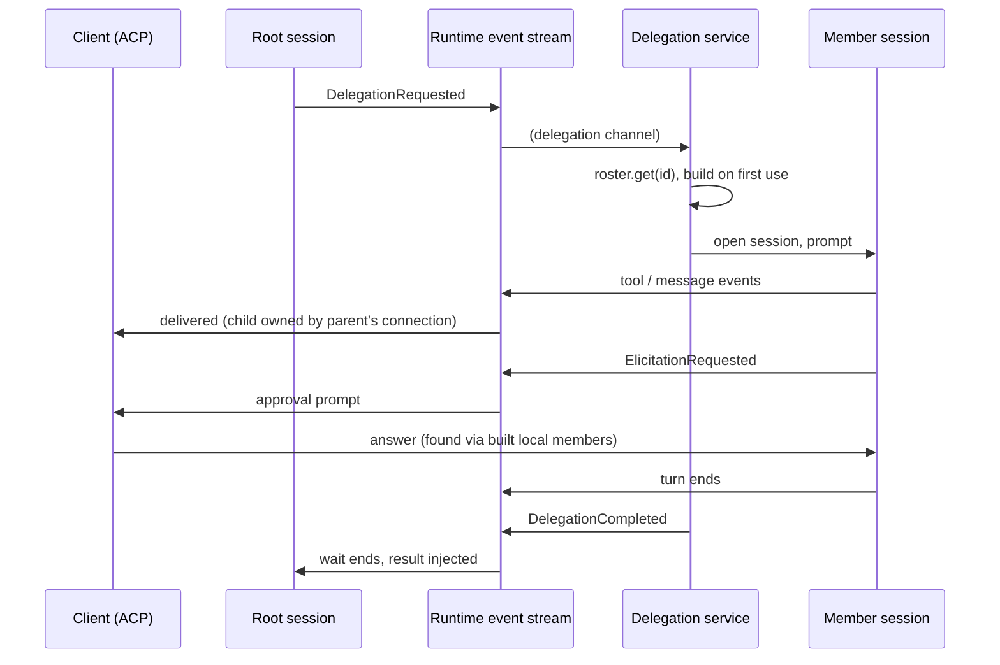

# Design

## Context

See proposal.md for motivation. The facts below were read from the code after `split-agent-crate` (tip `6e558d0a`). Paths are relative to `crates/`. "Runtime" is `querymt-agent-runtime` (`agent-runtime/src`), "services" is `querymt-agent-services` (`agent-services/src`), and "top" is `querymt-agent` (`agent/src`).

**Who runs a delegation.** The `delegate` tool only validates and returns "queued" (runtime `agent/builtin_tools/delegate.rs` `DelegateTool::call`). The agent then emits `DelegationRequested` and waits (runtime `agent/execution/tool_calls.rs`). `DelegationOrchestrator` (runtime `delegation/core.rs:160`) is the only consumer. Its only production construction is `AgentQuorumBuilder::build` in top `quorum.rs:436`.

**Three registries, two handle kinds, one erased interface.**
- `AgentRegistry` (runtime `delegation/core.rs:109`) has three implementations: `DefaultAgentRegistry`, `DotagentsTargetRegistry` (runtime `dotagents/target_registry.rs:101`) and `ChildRegistry` (top `api/dotagents_targets.rs:166`). None can change after build.
- Members are `Arc<dyn AgentHandle>` (runtime `agent/handle/mod.rs:86`). Callers recover the concrete type with `as_any().downcast_ref::<LocalAgentHandle>()`, about 70 times across runtime and top.
- Three code paths build a local member: the delegate closure in top `api/quorum.rs:602-735` (`QuorumBuilder::build`), `DotagentsTargetFactory::create` (top `api/dotagents_targets.rs`), and nothing yet for runtime additions. Only the first uses the runtime's `EventFanout`. That is the `EventFanoutMismatch` bug.

**The package boundary.** Everything that runs or lists a delegation is in runtime. Everything that builds a member is in top. Runtime cannot depend on top, so the lazy protocol registry in runtime reaches the top-package builder through the `ProtocolTargetFactory` trait (runtime `dotagents/target_registry.rs:39`), and an ACP handler in runtime (`agent/handle/ext.rs`) could not build a member at all. After `split-agent-crate`, a one-line runtime edit costs about 70 s per test build, against about 10 s for services and a cheap top package (`split-agent-crate` task 9.3).

**Two builders.** `AgentBuilder::build` (top `api/agent.rs`) and `QuorumBuilder::build` (top `api/quorum.rs`, about 780 lines) each wire storage, mesh, workspace service, skills, tool policy, MCP, `.agents` loading and the scheduler. `QuorumBuilder::build` also creates a second `LocalAgentHandle` from the planner's config, so the planner has two session registries. The planner and delegates are lowered into `api::config::AgentConfig` (top `api/config.rs:35`, `pub(super)`), with `parse_tool_specs` and `infer_required_capabilities` (top `api/utils.rs:51`) next to it.

**The `delegate` tool and the registry.** `all_builtin_tools()` (runtime `agent/builtin_tools/mod.rs:25`) inserts a stateless `DelegateTool` before `delete_file`, and `AgentConfigBuilder::new` registers every built-in (runtime `agent/agent_config_builder.rs:99`), so members get the tool too. The tool finds the registry through `ToolContext::extensions()`, a type map that `split-agent-crate` task 7.2 added to services (`tools/context.rs:131`, `tools/context_impl.rs`) only for this purpose; `ExecutionContext::tool_context` inserts it (runtime `agent/execution_context.rs:321-331`). `AgentConfig::build_delegation_meta` (runtime `agent/agent_config.rs:202`) also lists the registry for ACP `AgentCapabilities._meta`.

**Event delivery.** ACP transports call `collect_event_sources` (runtime `acp/shared.rs:2870`) once at startup: runtime `acp/mod.rs:82` and `acp/stdio.rs:952,1036`, and top `acp/websocket.rs:72`. It walks the registry, which builds every lazy `.agents` target, and it never sees a member added later.

**Remote members.** `RemoteAgentHandle` (runtime `agent/remote/remote_handle.rs`) creates a remote session and keeps it in a private map. It does not install an event relay. The user-facing remote attach path does: `control::remote::create_remote_session` (runtime `control/remote.rs:223`) calls `LocalAgentHandle::create_remote_session_with_profile` and then `connect_remote_session` (runtime `agent/handle/remote_connect.rs`), which installs an `EventRelayActor` on the local `EventSink` and saves a bookmark.

**Agent list.** `DelegationMiddleware` (runtime `middleware/delegation.rs`) puts the agent list into the in-memory context of a session's first turn, and is installed by `AgentConfigBuilder::with_agent_registry` only if the registry is non-empty at build time. `ConversationContext::inject_message` (runtime `middleware/state.rs`) does not write to history (compare `inject_wait_message` in runtime `agent/execution/wait.rs`, which persists explicitly). Its `prevent_duplicates` branch is never enabled, and `DelegationContextMiddleware` has no user.

**Profiles.** `AgentInfra::shared_with_db_path` gives every profile runtime the same `EventFanout`. Orchestrators tell requests apart by `profile_id` (`DelegationOrchestrator::handle_envelope`). Only the quorum path sets it today. Runtime code sees a profile through `ProfileRuntimeView` (runtime `profile_host.rs:187`), whose `delegates: Vec<(String, Arc<dyn AgentHandle>)>` is copied from the quorum once, in top `profiles.rs:76`.

## Goals / Non-Goals

**Goals:**
- One way to build a runtime, one roster type, one way to build a member, one event stream.
- Fewer lines than today. Every new type replaces at least one existing one.
- Types carry the invariants: IDs are not bare strings, members are not type-erased, a member cannot be built on the wrong event stream, a root cannot have the `delegate` tool without the service.
- No trait exists only to cross the runtime/top package boundary.
- Each task group leaves every agent package compiling with its tests green.

**Non-Goals:**
- Converting `Delegation.target_agent_id`, event payloads or the session database to `AgentId`. They are persisted wire formats.
- Changing `DelegationOrchestrator`'s execution logic (claiming, isolation, verification, summaries).
- Renaming `DelegationOrchestrator`. "Delegation service" in the specs means this type.
- Changing the package layout of `split-agent-crate`, or moving code into core, sqlite or services.

## Decisions

### D0. Package placement

| Package | Owns after this change |
|---|---|
| runtime | `delegation/roster.rs` (D2), `delegation/member.rs` (D4: `MemberBuildSpec`, lowering, `build_local_member`, `MemberContext`), `delegation::build_root` (D5), `DelegationOrchestrator`, `DelegateTool`, `MemberAgent::Remote` (D8), the ACP roster methods (D9), `DelegationSettings` and `DelegateConfig` (D10) |
| top | `AgentBuilder` and `Agent` (user API: `.delegate(..)`, `with_profile_id`, `roster()`, `add_member`, `remove_member`), `DelegateConfigBuilder`/`PlannerConfigBuilder`, the profile manager, `runner.rs`, the WebSocket transport, the facade and prelude |
| services | loses `ToolContext::extensions()` and `AgentToolContext::with_extension` (D6) |

The member build code moves from top to runtime **before** any behaviour change, in a renames-only commit followed by a glue commit, as `split-agent-crate` did:
- `api/dotagents_targets.rs` (with `ChildRegistry`) → runtime `dotagents/target_factory.rs`.
- `api::config::AgentConfig` → runtime `delegation::member::MemberBuildSpec`, `pub` with `#[doc(hidden)]`, renamed so it no longer shares a name with runtime's `agent::AgentConfig`. `parse_tool_specs`, `infer_required_capabilities` and `FILESYSTEM_TOOLS` move with it.
- The delegate closure body in `api/quorum.rs:602-735` becomes a runtime function the closure calls.

After this step, `ProtocolTargetFactory` and its implementation are in the same package; the trait is deleted with the registries (D2). Everything after that step is mostly a runtime change with a thin top-package edit, which keeps edits in the cheap top package where they are user-facing and puts the logic next to the orchestrator.

*Alternative: keep building members in top and inject a factory into the roster.* Rejected: it keeps `ProtocolTargetFactory` under a new name, needs a second injected closure for ACP additions, and contradicts D11 `anti-over-abstraction`.

### D1. One runtime shape

`AgentBuilder` (top) is the only builder. A runtime is:

```rust
LocalAgentHandle            // the root agent; owns the delegation service
  └─ config.roster: Option<Arc<AgentRoster>>   // Some for a root, None for a member
```

`QuorumBuilder`, `QuorumSession`, top `quorum.rs` (`AgentQuorum`, `AgentQuorumBuilder`, `AgentQuorumError`, `DelegateAgent`) and the second planner handle are deleted. `Agent::builder_from_quorum_config` keeps its name and returns an `AgentBuilder` (D10). Top `runner.rs`, top `profiles.rs` and `querymt-mobile-ffi` lose their two-armed `match Config` build code.

*Alternative: keep `AgentQuorum` as a thin wrapper.* Rejected: it keeps two public shapes and the `Option<quorum>` branches in `Agent`.

### D2. A typed roster

New file runtime `delegation/roster.rs`:

```rust
#[derive(Clone, Debug, PartialEq, Eq, Hash, PartialOrd, Ord, Serialize, Deserialize)]
#[serde(try_from = "String", into = "String")]
pub struct AgentId(Arc<str>);              // non-empty, trimmed; impl Borrow<str>

#[derive(Clone, Copy, Debug, PartialEq, Eq, PartialOrd, Ord, Serialize)]
#[serde(transparent)]
pub struct RosterGeneration(u64);

#[non_exhaustive] pub enum MemberOrigin   { Config, Protocol, Runtime }
#[non_exhaustive] pub enum MemberLocation { Local, Remote }

pub struct Member {
    info: AgentInfo,                        // info.id: AgentId
    origin: MemberOrigin,
    agent: MemberSlot,                      // D3, D4
}

pub struct RosterSnapshot {
    generation: RosterGeneration,
    members: BTreeMap<AgentId, Arc<Member>>,   // ordered by ID
}

pub struct AgentRoster {
    context: MemberContext,                 // D4
    state: ArcSwap<RosterSnapshot>,
    writer: parking_lot::Mutex<()>,         // serializes add/remove only
}
```

- **Reads borrow.** `roster.snapshot()` returns `Arc<RosterSnapshot>`; callers iterate `&Member`. Today each `list_agents()` call (about 20 call sites) clones a `Vec<AgentInfo>`.
- **Lookups take `&str`.** `snapshot.get(id: &str)` works through `Borrow<str>`, so the strings in `Delegation.target_agent_id` need no allocation or conversion.
- **Writes are copy-on-write.** `add`/`remove` take the writer lock, build a new map, store it, and bump the generation by one. No lock is held across an `.await`. `arc-swap`, `parking_lot` and `once_cell` are already dependencies of runtime.
- **Construction and mutation are `pub(crate)`.** Only `build_root` (D5) creates a roster. Public changes go through `Agent::add_member` / `remove_member` (D9), which call `pub` methods on `LocalAgentHandle`.
- **Errors are typed.** `RosterError` (`thiserror`): `DuplicateId { id, origin }`, `UnknownAgent(AgentId)`, `DelegationDisabled`, `MeshRequired`, `PeerRoutingUnsupported`, `Build { id, #[source] source }`.

Deleted (all runtime unless noted): the `AgentRegistry` trait, `DefaultAgentRegistry`, `DotagentsTargetRegistry`, `LazyTarget`, `ProtocolTargetFactory`, `ChildRegistry` (moved by D0), `AgentConfig.agent_registry` with `AgentConfig::agent_registry()`, `AgentConfigBuilder::{with_agent_registry, with_agent_registry_only}`, and the registry parameter of `ExecutionContext::tool_context` (D6). `merge_protocol_targets` stays and reads a `&RosterSnapshot`.

*Alternative: `RwLock<HashMap>`.* Rejected: listing must not block on a writer, and an ordered map gives the ID order the spec requires for free.

### D3. Members are a closed enum, not a trait object

```rust
pub enum MemberAgent {
    Local(Arc<LocalAgentHandle>),
    #[cfg(feature = "remote")]
    Remote(RemoteMember),                   // D8
}
```

There are exactly two kinds of member, so the `AgentHandle` trait (runtime `agent/handle/mod.rs`, implemented in `agent/handle/agent_handle_impl.rs`) and its `as_any` are deleted. The orchestrator needs three operations from a target (open a session, set its lifecycle, register a client bridge) and matches on the enum for each. Everything else that used `Arc<dyn AgentHandle>` wanted a `LocalAgentHandle` and downcast to get it; those now take `Arc<LocalAgentHandle>`:
- runtime: `LocalAgentHandle::bound_session_handle` (`agent/handle/session_control.rs`), `agent/handle/ext_worktree_ops.rs`, `ProfileRuntimeView::{delegate, session_handle}`.
- top: `Agent::delegate`.

`ProfileRuntimeView` loses its `delegates` field, which is a startup copy and would go stale on add or remove. `delegate(id)` and `session_handle(Some(id))` read the root's roster and build a protocol member on first use, so a session bound to a protocol member still loads after a restart. Top `ProfileRuntime::view()` loses its `quorum()` branch.

Cost: orchestrator unit tests that register `StubAgentHandle` / `CountingStubHandle` targets (runtime `delegation/core.rs` tests) are ported to real local members built with the fixtures that runtime `agent/delegation_loop_tests.rs` uses, moved to runtime `test_utils` first.

*Alternative: keep the trait and slim it.* Rejected: with a closed set, a trait keeps the downcasts and lets a third implementation appear on the wrong event stream again.

### D4. One description, one build path, one event stream

All in runtime `delegation/member.rs`.

**Description.** The public description of a member is the configuration type, used by TOML, Rust and ACP alike:

```rust
#[derive(Deserialize, JsonSchema)]
#[serde(tag = "kind", rename_all = "lowercase")]
pub enum MemberSpec { Local(DelegateConfig), Remote(RemoteAgentConfig) }
```

**Lowering.** Two functions produce `MemberBuildSpec` (D0): one from `DelegateConfig` (moved from top `Agent::builder_from_quorum_config`), one from `DotagentsSubAgentPlan` (moved from `DotagentsTargetFactory::create`). Top `DelegateConfigBuilder` produces a `MemberBuildSpec` directly. What protocol targets do not inherit today (middleware, hooks, snapshot backend, workspace service, schedules, knowledge store) stays a difference in the lowered values, not a second code path.

**Build.** One function builds a local member:

```rust
pub(crate) fn build_local_member(spec: &MemberBuildSpec, ctx: &MemberContext) -> anyhow::Result<Arc<LocalAgentHandle>>
```

`MemberContext` is owned by the roster and holds what every member of a runtime shares: `Arc<EventFanout>`, storage, plugin registry, workspace service, snapshot policy, the root's skills configuration and project root, the runtime's top-level MCP servers, and the mesh handle once there is one. Because this is the only function that builds a member and it takes the event stream from the roster, a member cannot be built on a different stream. `AgentQuorumError::EventFanoutMismatch` and its check (top `quorum.rs:371,395`) are deleted; a test asserts `Arc::ptr_eq` for each member origin instead.

**When a member is built.** `MemberSlot` holds a `once_cell::sync::OnceCell<MemberAgent>` (building is synchronous, so no lock spans an `.await`).
- `Config` and `Runtime` members are built before they enter the roster. A bad middleware entry therefore still fails at startup, as the existing requirement "Middleware errors fail the build" demands, and fails the `add` request.
- `Protocol` members are built on first use, as today for standalone agents. A failed build leaves the cell empty, so the next delegation retries.

Iterating members never builds one: `snapshot.built_local()` yields only `Arc<LocalAgentHandle>` that already exist. The registry walks in runtime `elicitation.rs`, `agent/handle/runtime_observation.rs`, `agent/handle/core.rs` and `agent/handle/remote_mesh.rs` use it.

Members get no roster, so they cannot delegate onward. This replaces `ChildRegistry`.

### D5. The delegation service runs in every runtime that can delegate

**Ownership.** The root `LocalAgentHandle` owns its `Arc<DelegationOrchestrator>` and the listener task, next to the scheduler it already owns. `LocalAgentHandle::shutdown` (runtime `agent/handle/core.rs:1205`) stops both. This removes `AgentQuorum::shutdown`, its `Drop`, and the four `if let Some(quorum) = runtime.agent.quorum()` blocks in top `profiles.rs`.

**Constructor.** `DelegationOrchestrator::new(root: Weak<LocalAgentHandle>, roster: Arc<AgentRoster>, settings: DelegationSettings)`.
- It reads the event sink, hooks, model overrides, workspace service, budget and tool registry from `root.config` when it needs them. The seven `downcast_ref` calls that collect them in `AgentQuorumBuilder::build` go away. So does the empty placeholder `ToolRegistry` passed there today ("for now, we'll use a default/empty one").
- The `delegator: Arc<dyn AgentHandle>` field is removed. It is used only to emit events, which `EventSink` does, and by `inject_results` / `inject_failure`, which no production code enables. Those two functions and the `inject_results` flag are deleted.
- `Weak` avoids a reference cycle between the handle and its service.

**One entry point across the package boundary.** Runtime exposes:

```rust
pub fn build_root(builder: AgentConfigBuilder, delegation: RootDelegation) -> anyhow::Result<Arc<LocalAgentHandle>>
```

`RootDelegation` carries the configured members (`Vec<MemberBuildSpec>` and remote configs), the protocol plans, `DelegationSettings`, the profile ID, the summary configuration and, under `remote`, the peer routes. `build_root` builds the `MemberContext` and roster, decides whether delegation is enabled, registers `DelegateTool::new(roster)` on the root, builds the handle and starts the service. Top `AgentBuilder::build` calls only this function to turn its `AgentConfigBuilder` into the root. `AgentConfigBuilder::with_roster`, `AgentRoster` construction and `DelegateTool::new` are `pub(crate)`, so outside runtime a root cannot have the tool without the service. Peer routing (`RoutingActor`, runtime `agent/remote/routing.rs`) and the delegation summarizer (runtime `delegation/summarizer.rs`) are wired here; their code moves from top `api/quorum.rs:737-1000`.

**When delegation is enabled.** One rule, in one runtime function used by both config shapes:

> enabled = the builder's delegation flag is on (default; off only for `[quorum] delegation = false` or `AgentBuilder::delegation(false)`) **and** the root's tool selection admits `delegate` (an empty `tools` list admits everything).

When enabled, `build_root` registers the tool, adds protocol targets to the roster, and starts the service. When disabled it does none of the three; configured members are still listed.

This changes one case: an agent with an unrestricted `tools` list and `.agents` delegation targets now gets those targets. Today it is offered a `delegate` tool that knows no agents.

**Profiles.** `AgentBuilder::with_profile_id` (top, moved from `QuorumBuilder`) is set by top `profiles.rs` for every profile runtime and passed in `RootDelegation`, so each service handles only its own sessions on the shared event stream.



### D6. The agent list lives in the `delegate` tool

`DelegateTool` holds the `Arc<AgentRoster>`. `definition()` renders the current snapshot: each member's ID, name, description, capabilities and default isolation, in ID order, with `target_agent_id` as an `enum` when the roster is not empty. `call()` validates against the same roster. `AgentConfig::build_delegation_meta` reads the same snapshot.

Tool definitions are already collected on every turn (runtime `AgentConfig::collect_tools`) and a change already emits `ToolsAvailable`, so a roster change reaches every session's next turn with no per-session state. The order is stable, so the definition, and with it the provider's prompt cache, changes only when the roster does.

**Built-in list.** A `DelegateTool` without a roster can no longer exist, so the built-in list is split:
- `all_builtin_tools()` (runtime `agent/builtin_tools/mod.rs`) no longer contains `delegate`, so `AgentConfigBuilder::new` does not register it and members are not offered it.
- A new `builtin_tool_names()` lists every built-in name with `delegate` in its historical place before `delete_file`. Tool-selector validation, capability inference (`FILESYSTEM_TOOLS`) and `builtin_tool_names_unchanged_after_split` use it, so the 33-name baseline from `split-agent-crate` stays valid.

**No type map.** The tool holds its roster, so `ToolContext::extensions()` (services `tools/context.rs`), `AgentToolContext::with_extension` and the `extensions` field (services `tools/context_impl.rs`), and the registry parameter of `ExecutionContext::tool_context` are deleted. Nothing else in services uses `http`, so that dependency is removed from services.

Deleted (runtime): `middleware/delegation.rs` (`DelegationMiddleware`, `DelegationContextMiddleware`, `DelegationConfig`), `DelegationContextConfig`, `DelegationContextTiming`, `AgentConfig.delegation_context_config` and the four `AgentConfigBuilder` methods that set them. `DelegationGuardMiddleware` is unrelated and stays.

*Alternative: keep the middleware and re-inject when the generation changes.* Rejected: it needs a last-seen generation per session, repeats the whole list as a user message on every change, and today's list is not in the model input after the first turn at all.

### D7. One event stream, and interactions for every member

- ACP transports subscribe to the root's `EventFanout` only. `collect_event_sources` is deleted; `event_sources: Vec<Arc<EventFanout>>` becomes one `Arc<EventFanout>` in runtime `acp/mod.rs` and `acp/stdio.rs` and top `acp/websocket.rs`. Child sessions are already attributed to the parent's connection by `SessionForked` (runtime `acp/shared.rs` `is_event_owned`).
- `skills::ApprovalMode` (runtime `skills/catalog.rs:27`) is deleted, with the `NonInteractive` branch in runtime `skills/tool.rs` and the call in `dotagents/target_factory.rs` (D0). It existed only because targets had their own event sink.
- Answers are routed as they are for configured delegates today: `elicitation::take_pending_elicitation_sender` and the session-registry lookups search the root and its built local members.

### D8. Remote members reuse the remote attach path

```rust
#[cfg(feature = "remote")]
pub struct RemoteMember { peer: String, node_id: Option<String> }
```

Opening a delegated session on a remote member is a method on the root handle that makes the same calls as runtime `control::remote::create_remote_session` with `attach = true`: find the node manager, `create_remote_session`, then `connect_remote_session` with the returned handoff and a new `RemoteConnectReason::Delegation`. The session is then an ordinary attached remote session: its events are relayed into the root's `EventSink`, and interactions follow the existing `session-interactions` contract for remote sessions. Lifecycle changes use `patch_remote_session_lifecycle`.

The node is resolved when a delegation needs it, not at startup. Deleted (runtime): `RemoteAgentHandle` (`agent/remote/remote_handle.rs`, 477 lines), `agent/remote/remote_agent_stub_tests.rs`, `RemoteAgentHandleFixture` (`agent/remote/test_helpers.rs`), and `register_remote_agents_from_config` / `register_remote_agent` in `agent/remote/remote_setup.rs`, which wait up to 5 s per peer at startup. `AgentInfo.meta` no longer carries `remote` / `peer` / `node_id`; nothing reads them, and location is `MemberLocation`. The `remote` feature of runtime gates all of it; top forwards the feature as today.

### D9. Changing the roster

- **Rust.** Top `Agent::roster() -> &Arc<AgentRoster>` (read), `Agent::add_member(MemberSpec) -> Result<RosterGeneration, RosterError>` and `Agent::remove_member(&str)`. They call `LocalAgentHandle` methods in runtime, which change the roster and broadcast `querymt/agents/changed` through the existing `broadcast_ext_notification`.
- **ACP.** `querymt/agents/list|add|remove` in runtime `agent/handle/ext.rs` (a new `ext_roster.rs` next to `ext_profiles.rs`), advertised in runtime `control/capabilities.rs`. With `profileId` the handler resolves the profile runtime as `querymt/profile/agents` does (through `ProfileRuntimeHost`), applies the change there, and broadcasts from the handle that serves the connection. Requests accept `profileId` and `profile_id`, as existing extension requests do. Because D0 moved the build path into runtime, the handler builds the member itself.
- **Runtime-added local members** are lowered by the same function as configured delegates. Tool selectors resolve against the runtime's top-level MCP servers and the entry's own `mcp`. `peer` is rejected (`PeerRoutingUnsupported`): the `RoutingActor` is created only when configured delegates use `peer`.
- **Removal** drops the roster's reference. A running delegation holds its own `Arc`, so it finishes.
- **Not persisted.** The roster is rebuilt from configuration on every start.
- **Subsets later.** A group or per-session subset is a set of `AgentId` applied as a filter to one snapshot. It needs no second registry and no change to the types above.

Limitation, unchanged from today: a session bound to a member that no longer exists cannot be loaded (`Session is bound to an unknown delegate`).

### D10. Configuration and deprecation

All in runtime `config/`. `SingleAgentConfig` (`config/single.rs`) gains `delegates: Vec<DelegateConfig>` and `AgentSettings` gains `delegation: DelegationSettings`. `DelegateConfig` moves from `config/quorum.rs` to a new `config/delegates.rs`, with `DelegationSettings`; `config::*` re-exports keep both paths (`config::DelegateConfig`). `Config::{Single, Multi}` stays as the parsed form, because `config_kind` is on the wire in `querymt/profiles`. `QuorumConfig` gets `#[deprecated]`-style documentation and `load_config` (`config/loader.rs`) logs the notice once per load. The `JsonSchema` output of `QuorumConfig` stays identical; that of `SingleAgentConfig` changes only by the two additions.

Lowering happens at the builder, not between config structs, because `[quorum] snapshot_policy` has no `[agent]` key:

| `[quorum]` form | `[agent]` form |
|---|---|
| `[planner]` and `[planner.*]` | `[agent]` and `[agent.*]` |
| `[[planner.middleware]]` | `[[middleware]]` |
| `[quorum] cwd`, `[quorum.workspace]` | `[agent] cwd`, `[agent.workspace]` |
| `delegation_wait_policy`, `delegation_wait_timeout_secs`, `delegation_cancel_grace_secs`, `max_parallel_delegations`, `verification` | `[agent.delegation]` `wait_policy`, `wait_timeout_secs`, `cancel_grace_secs`, `max_parallel`, `verification` |
| `[quorum.delegation_summary]` | `[agent.delegation.summary]` |
| `delegation = false` | leave `delegate` out of `[agent] tools` |
| `snapshot_policy = "diff"` | `[agent.execution.snapshot] backend = "git"`, and the same on each delegate |
| `snapshot_policy = "metadata"` | no equivalent; keep `[quorum]` |
| `[[delegates]]`, `[[mcp]]`, `[mesh]`, `[[remote_agents]]`, `[dotagents]` | unchanged |

Under `[agent]`, delegates inherit the root's snapshot policy, as quorum delegates inherit the quorum's.

**Facade.** Top `lib.rs` and `prelude.rs` drop the re-exports of the removed types (`AgentHandle`, `AgentQuorum*`, `DelegateAgent`, `AgentRegistry`, `DelegationContextConfig`, `DelegationContextTiming`, `DelegationConfig`, `api::QuorumBuilder`, `api::DotagentsTargetFactory`) and add `delegation::{AgentRoster, AgentId, MemberSpec}` to the prelude. Every other `querymt_agent::` path from `split-agent-crate` stays.

### D11. Rust rules applied

| Rule (`rust-skills`) | Where |
|---|---|
| `type-newtype-ids`, `anti-stringly-typed` | `AgentId`, `RosterGeneration`; origin and location are enums, not strings or JSON `meta` |
| `api-parse-dont-validate` | an ID is parsed once at the boundary; a lookup returns `Arc<Member>` |
| `type-enum-states`, `anti-type-erasure`, `pat-exhaustive-enum` | `MemberAgent` replaces `dyn AgentHandle` + `as_any`; the tool holds its roster instead of a type map |
| `own-borrow-over-clone` | snapshot iteration instead of `Vec<AgentInfo>` clones; `&str` lookups |
| `async-no-lock-await` | copy-on-write roster; synchronous `OnceCell` build |
| `err-thiserror-lib` | `RosterError` |
| `api-non-exhaustive` | `MemberOrigin`, `MemberLocation` |
| `anti-over-abstraction` | no factory trait, no registry trait, no builder closures for members, no trait across the package boundary (D0) |
| `api-builder-pattern` + visibility | `build_root` is the one public way to make a root; roster construction and `with_roster` are `pub(crate)` |

## Risks / Trade-offs

- **Large change across two packages.** → Groups are ordered so each compiles and passes: the build path moves into runtime with no behaviour change first, then one builder (on the existing registry types), then the typed roster, then delivery, remote, runtime changes, configuration. The two bugs are fixed after group 3, and task 7.3 of `support-mcp-skills` is testable after group 5.
- **Runtime test builds are slow (about 70 s per edit).** → Each task names the narrowest package to test; runtime unit tests cover roster, member build and orchestrator, and only tests that need `Agent`, TOML profiles or the profile manager live in top.
- **`split-agent-crate` promised stable `querymt_agent::` paths.** → This change removes only the re-exports of types it deletes, and the proposal lists them as BREAKING.
- **`[planner]` lowered into the root must equal today's planner.** The quorum path leaves hooks and slash commands at defaults and applies the quorum snapshot policy. → A characterization test (task 1.2) records the runtime shape of the four `[quorum]` example profiles before any builder code moves and must stay green.
- **Every profile runtime now has a service on a shared event stream.** → `with_profile_id` is mandatory in top `profiles.rs`; scenario "Two profiles delegate at the same time" covers it.
- **The model sees the agent list in a tool definition, not a user message.** → Covered by tests on the tool definition and by the live check in group 5.
- **Unrestricted agents with `.agents` delegation targets start delegating to them** (D5). → Called out in the proposal and documented.
- **Remote delegated sessions become bookmarked attached sessions.** They may appear in remote session lists and be picked up by startup reattachment. → Task 6.3 checks both and filters delegation children if needed.
- **Remote interactions depend on both nodes running a matching interaction contract** (`session-interactions`, "Mesh nodes run a matching interaction contract"). → Verified with the two-node fixture; mixed versions are out of scope.
- **Public Rust API breaks** (`AgentHandle`, `AgentQuorum`, `Agent::multi`, delegation middleware types, `ToolContext::extensions`, `ProfileRuntimeView.delegates`). → Listed in the proposal; `querymt-agent-py` and `querymt-mobile-ffi` are updated in group 9.
- **Stub-based orchestrator tests are rewritten** (D3). → Their assertions are kept; only the fixtures change.

## Migration Plan

1. Start after `split-agent-crate` has merged into `main`; branch from `main`.
2. Land groups in order. No database migration and no wire change to existing methods.
3. Users on `[quorum]` see one deprecation notice per load with the table from D10. The embedded profiles are rewritten, so default installs see none.
4. Rollback is a revert: nothing new is persisted.

## Open Questions

- Should `querymt/profile/agents` later be folded into `querymt/agents/list`? It also returns the `primary` entry and configured model IDs, so it stays for now.
- Does removing the runtime's member code shrink `querymt-agent-runtime` enough to change the `split-agent-crate` decision on splitting it further? Record the line counts and the 9.3-style timing at task 9.4.
