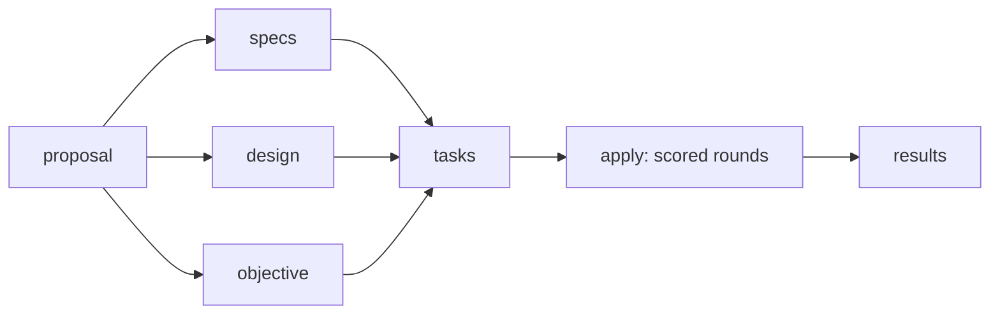

# spec-scored schema

`spec-driven` plus a measurable objective and a scored apply loop.



- `objective.md` defines one numeric metric. The matching `x-score` block goes in
  the change's `.openspec.yaml` (OpenSpec ignores `x-` keys; `validate --strict` passes).
- Apply runs `sh openspec/schemas/spec-scored/bin/score.sh <change> "<note>"` (from the repo root) after each task/change. Rounds are
  logged to `openspec/changes/<change>/rounds.tsv`. Every round (tracked, modified and
  untracked files) is snapshotted as `refs/spec-scored/<change>/round-<n>`, and its id is
  the `commit` column; every new best is also `refs/spec-scored/<change>/best`. Snapshots
  use a throwaway index, so your index, HEAD and working tree are untouched.
- `results.md` is written after apply, citing rounds.

```yaml
x-score:
  command: 'cargo nextest run -p my-crate 2>&1 | tools/pass_rate.sh'
  direction: max        # max | min
  budget_min: 180
  target: 1.0           # optional
  stall_rounds: 4
  protected: ["tools/pass_rate.sh"]
```

## Scripts (`bin/`)

| Script | Role |
|---|---|
| `score.sh <change> [note]` | Run the metric (last stdout line = number), log a round, snapshot best, print budget/target/tasks |
| `stop-hook.sh` | QueryMT `stop` hook: blocks ending the turn until the baseline is scored, tasks are done with one scored round per ticked task, target met (if set) and `results.md` exists, or budget is spent. Reads `stop_reason` and, after a `ModelTokenLimit` cut-off, tells the agent to work in smaller steps |
| `protect-hook.sh` | QueryMT `pre_tool_use` hook: denies writes to the scorer, `rounds.tsv`, `.openspec.yaml` and `x-score.protected` (shell commands checked heuristically; needs `jq`) |

The active change is `$SPEC_SCORED_CHANGE`, else the change with the most recently
written `rounds.tsv`, else a change that has an `x-score` block and `tasks.md` but no
`rounds.tsv` yet (so the hooks guard it before the baseline is scored). Hooks do nothing
outside a scored change. Override a stop:
`touch "$(git rev-parse --git-dir)/spec-scored/<change>.allow_stop"`.

## QueryMT wiring

```toml
[agent.execution]
max_stop_hook_continuations = 50   # default 1; counted separately for EndTurn and
                                   # ModelTokenLimit stops. Hitting the cap publishes an
                                   # error-level hook_notice instead of ending silently.

[agent.hooks]
enabled = true

[[agent.hooks.stop]]
[[agent.hooks.stop.hooks]]
type = "command"
command = 'sh "$(git rev-parse --show-toplevel)/openspec/schemas/spec-scored/bin/stop-hook.sh"'

[[agent.hooks.pre_tool_use]]
matcher = "^(edit|multiedit|write_file|replace_symbol|delete_file|shell)$"
[[agent.hooks.pre_tool_use.hooks]]
type = "command"
command = 'sh "$(git rev-parse --show-toplevel)/openspec/schemas/spec-scored/bin/protect-hook.sh"'
```

Use it per change: `openspec new change <name> --schema spec-scored`.
